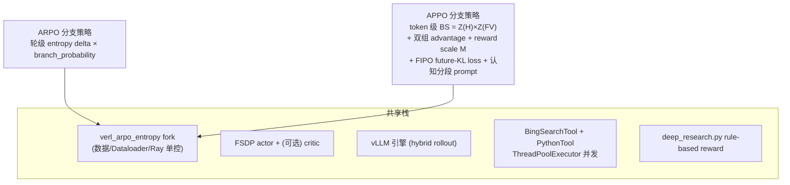
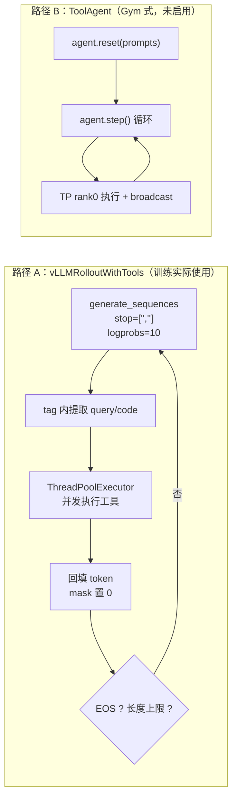
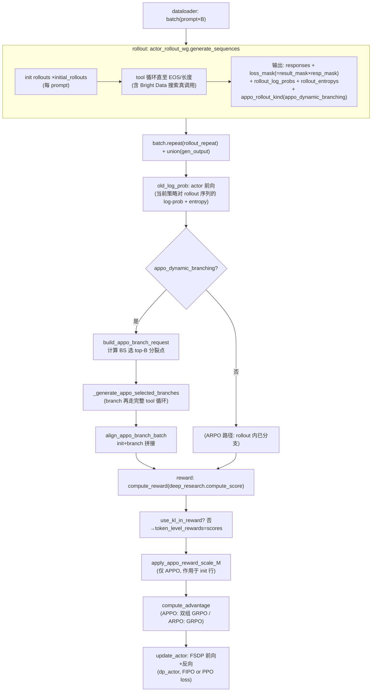
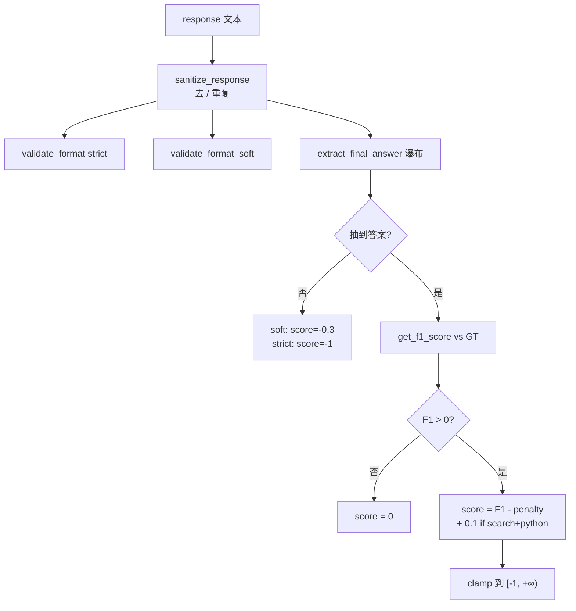

# APPO / ARPO 代码框架技术报告

日期：2026-10-15（初稿 10-13；补协议/解析/本地实测）
分析对象：`ref_Rep/APPO-main/APPO`（主体）、`ref_Rep/ARPO-main/ARPO`（基线对照）
定位：为 MAS Science Infra 的 RL 训练复现与后续算法改造提供代码级参考。所有结论均直接核对源码，引用格式为 `文件:行号` + 代码片段。

---

## 目录

1. [两个项目的关系与共享技术栈](#1-两个项目的关系与共享技术栈)
2. [Agent 架构：两条 rollout 路径与工具协议](#2-agent-架构两条-rollout-路径与工具协议)
3. [RL 训练 Workflow：fit 循环逐步拆解](#3-rl-训练-workflowfit-循环逐步拆解)
4. [ARPO：轮级 entropy 自适应分支](#4-arpo轮级-entropy-自适应分支)
5. [APPO：token 级 procedure 分支（核心增量）](#5-appotoken-级-procedure-分支核心增量)
6. [Reward、格式协议与解析](#6-reward格式协议与解析)
7. [Loss 与策略更新](#7-loss-与策略更新)
8. [APPO vs ARPO 差异总表](#8-appo-vs-arpo-差异总表)
9. [本地实测问题与根因](#9-本地实测问题与根因)
10. [优化方案](#10-优化方案)
11. [附录 A：本地复现改造备忘](#附录-a本地复现改造备忘)
12. [附录 B：关键文件索引](#附录-b关键文件索引)

---


## 1. 两个项目的关系与共享技术栈

ARPO（Agentic Reinforced Policy Optimization，ICLR 2026，[arXiv:2507.19849](https://arxiv.org/abs/2507.19849)）与 APPO（Agentic Procedural Policy Optimization）共享同一套 veRL fork（`verl_arpo_entropy`，基于 verl 0.5.x 时代 API）。我们对两个 fork 做了全量 diff：

- 共有文件 ~90%；**全部算法差异集中在 13 个文件**：`ray_trainer.py`、`core_algos.py`、`dp_actor.py`、`vllm_rollout_with_tools.py`，外加 APPO 新增的 `verl/workers/rollout/vllm_rollout/appo_branching.py` 与仓库根的 `cognitive_pipeline/`。
- ARPO fork 中 grep 不到任何 `appo` / `future_kl` 字符串——APPO 的算法模块是纯增量、零侵入叠加。
- 工具层（search/python tool）、数据格式、SFT 冷启动、评估流程完全复用。




训练全栈：PyTorch FSDP（参数/优化器分片与 offload）+ Ray（single controller，driver 进程编排）+ vLLM（异步 rollout 引擎，权重每步从 FSDP 同步）。一词概括：**trainer 在 driver 进程里编排"rollout 采样 → 工具执行 → reward → advantage → actor 更新"的 on-policy 循环，rollout 端以 stop-tag 协议内嵌工具调用循环**。

两套官方启动形态：


| 维度                               | ARPO 7B Reasoning（`ARPO_7B_Reasoning_1node.sh`）                   | APPO 7B Reasoning（`APPO_7B_Reasoning_1node.sh` + `_appo_common.sh`） |
| -------------------------------- | ----------------------------------------------------------------- | ------------------------------------------------------------------- |
| `algorithm.adv_estimator`        | `grpo`（L105）                                                      | `appo`（`_appo_common.sh` L45）                                       |
| `rollout.n` / `initial_rollouts` | 16 / 8（L55-56）                                                    | 16 / 8（L25-26）                                                      |
| 分支参数                             | `beam_size=2, branch_probability=0.5, entropy_weight=0.2`（L57-59） | `appo_dynamic_branching=True, reward_scale_discount=0.9`            |
| loss                             | 标准 PPO（dual-clip）                                                 | `policy_loss.loss_mode=future_kl`（FIPO，L66-72）                      |
| KL                               | `kl_coef=0.0`（reward 内不扣 KL）                                      | reward 不扣 KL + actor 内 `kl_loss_coef=0.001`                         |


---


## 2. Agent 架构：两条 rollout 路径与工具协议


### 2.1 两条路径




**路径 A**（`rollout.mode=sync_with_tool`，`vllm_rollout_with_tools.py`）：字符串 tag 协议驱动，工具结果直接拼进 token 流，单文件闭环，是两个项目训练脚本实际走的路径。
**路径 B**（`verl/workers/agent/tool_agent.py`，`BaseAgent` Gym 风格 reset/step）：多 rank 环境状态管理 + TP rank0 执行工具后 `dist.broadcast_object_list` 广播（L244-289）。注意其 beam 分支块（L303-388）是**无熵门控的纯概率版**——`if random.random() > self.branch_probability: continue`（L336），熵驱动的判据只在路径 A 里；配置 `rollout.agent.activate_agent=True` 时启用，官方脚本未用，仅作参考。

### 2.2 工具协议与执行

系统 prompt 规定模型输出协议：`<think>...</think>` 推理、`<search>query</search>` 搜索、`<python>code</python>` 计算、`<answer>...\boxed{}</answer>` 作答。这是 **APPO/ARPO 可见协议标签**，与 Qwen3 原生 thinking（chat template 注入的隐式 `<think>`）不是同一套东西——处理方式见 §6.4、§9.4。

rollout 引擎把工具停词设为 `["</search>", "</python>"]`，本地复现另加 `</answer>`，避免答完后继续胡写：

ref_Rep/APPO-main/APPO/verl_arpo_entropy/verl/workers/rollout/vllm_rollout/vllm_rollout_with_tools.py:807

```
                    if is_tool_call:
                        tag = stop_reason.strip("</>")
                        if call_counters[out_idx] < self.tool_call_limit:
                            call_counters[out_idx] += 1
                            full_text = self.tokenizer.decode(curr_inputs[out_idx])
                            content = self._extract_content(full_text, tag)
```

工具停词与作答停词分开（`vllm_rollout_with_tools.py:114-116`）：

```
self.tool_stop_sequences = [f"</{tag}>" for tag in self.tools.keys()]   # </search> / </python>
self.stop_sequences      = self.tool_stop_sequences + ["</answer>"]
```

- **触发工具**：`finish_reason=='stop' and stop_reason in tool_stop_sequences`（**不含** `</answer>`）。`call_limit` 默认 6 次封顶，超限直接补 EOS。停在 `</answer>` 只结束本轮生成，不进工具执行。
- **执行**：`ThreadPoolExecutor(max_workers=64)` 提交 `_execute_tool_with_retry`（超时 120s、重试 3 次），每次 `_extract_content` 用正则/字符串匹配抽取最后一个 `<tag>...</tag>` 内的 query 或代码。
- **回填**：结果格式化为 `" <result>\n{result_text}\n</result>"` 后 tokenize 追加回 token 流，对应 `result_masks.extend([0]*len(result_tokens))`（L889-897）——**工具返回 token 全部 mask=0，不进 actor loss**；模型自生成 token mask=1。
- **循环终止**：所有 rollout 到 EOS 或 `max_len`（response_length 上限）。

工具注册表在 `scripts/config/ppo_trainer*.yaml` 的 `tools.tool_instances`，由 `_load_tool_from_config`（`vllm_rollout_with_tools.py:45`）按 `class_path` 动态加载：

- `BingSearchTool`（`verl/workers/rollout/tools/search_tool.py`）：搜索 query 走 Bright Data SERP API（本地复现版见附录 A）。返回 `Page i: title — snippet` 拼接文本（默认 10 条、每条截 1000 字符）；`langid` 判中英自动切市场参数；带跨进程文件锁的 JSON cache（同一 query 全局只打一次 API）。
- `PythonTool`（`verl/workers/rollout/tools/python_tool.py`）：在指定 Python 解释器子进程执行代码，裸表达式自动包 `print()`；APPO 版还支持 `sample_id` 持久命名空间——**同一 rollout 内前一个** `<python>` **块定义的变量对后续块可见**（`reset_sample` 在每步 rollout 结束清理，`vllm_rollout_with_tools.py:1136-1140`）。


### 2.3 APPO 的认知分段 prompt（增量）

APPO 在 rollout 时可以把一段"认知分段说明"动态注入每条 prompt 的 system 末尾（第一个 `<|im_end|>` 之前）。本地默认 **关闭**（`APPO_INJECT_COGNITIVE=0`）：未做认知 SFT 时 `<|extra_0|>` 会干扰协议标签。论文形态复现再设 `APPO_INJECT_COGNITIVE=1`。原始注入逻辑：

ref_Rep/APPO-main/cognitive_pipeline/config.py:156

```python
COGNITIVE_SYSTEM_PROMPT_ADDON = (
    "\n\nWhen you feel that a paragraph of your reasoning forms a self-contained stage "
    "(for example: a quick judgment, a planning step, a deduction, an induction, "
    "a hypothesis, integrating tool feedback, or a metacognitive correction), "
    "wrap that paragraph with <|extra_0|>...<|extra_1|>. "
    "Do not annotate tool calls or their results — only wrap pure reasoning paragraphs. "
    "Not every paragraph needs a tag; only use <|extra_0|> when a stage boundary is clear.\n"
)
```

注入后在输出侧有一个关键的 **P0 对齐修复**（`vllm_rollout_with_tools.py:1038-1060`）：因为 prompt 被加长了，必须用注入后的 token 序列重建 `input_ids/attention_mask/position_ids`，否则 prompt/response 边界错位会导致 `old_log_prob`、KL 全算错。这提示我们：**任何在 rollout 侧改 prompt 的操作都要同步修 trainer 侧的边界对齐**。

值得澄清的一点：`<|extra_0|>` 标记**并不会被 Branching Score 直接解析**（BS 只由 Z(entropy)×Z(FutureValue) 数学量驱动）。分段标记的作用面是生成行为与 SFT 数据侧打标——认知边界处（隔一段推理的起点）往往是熵波动点，从而间接影响 BS 的分布；`cognitive_pipeline/config.py` L63-150 另有 7 种认知模式定义（`COGNITIVE_MODES`：quick/plan/deduce/induce/hypo/act/meta，附带打标 prompt 生成函数），属于同一条认知流水线的 SFT 侧配套。

---


## 3. RL 训练 Workflow：fit() 循环逐步拆解

训练入口 `verl.trainer.main_ppo` → `RayPPOTrainer.fit()`（`verl/trainer/ppo/ray_trainer.py`）。单个 training step 的数据流（APPO 分支开启时）：




关键调用点（`ray_trainer.py`，APPO 版）：

- **分支判定**：`appo_dynamic_branching = config.algorithm.adv_estimator==APPO and rollout.get("appo_dynamic_branching", True)`（L1367-1370）。开启时 `generate_sequences` 每个样本只回填 `initial_rollouts` 条（`vllm_rollout_with_tools.py:950` `output_repeat_times = initial_rollouts`），剩余 `n - initial_rollouts` 个名额留给 trainer 侧的 token 级分支；关闭时（ARPO 形态）回填满 `n` 条（rollout 内分支已把它们补齐）。
- **old_log_prob**（L1429-1440）：actor 当前权重对整条 rollout 做 teacher-forcing 前向，得到 `old_log_probs` 与 `entropys`。**这是 APPO 分数公式里** `log π_current` **的来源**——注意与 `rollout_log_probs`（vLLM 采样时记录的行为策略 log-probs）是两个量。
- **APPO 分支块**（L1443-1461）：`branch_budget = rollout.n - rollout_repeat`；`build_appo_branch_request` 选点 → `generate_sequences(branch_request)`（meta_info 带 `appo_branch_mode=True`，走 `_generate_appo_selected_branches`）→ `align_appo_branch_batch` 拼接。**分支不足会直接 raise**（L1460，保证 batch 维度 = prompt 数 × rollout.n 不变）。
- **行号修正（Fix 37）**：`_balance_batch` 打乱样本后，用逆映射 `old_to_new` 改写 `appo_branch_meta` 里的 `batch_row_idx`/`orig_batch_row_idx`（L1396-1414），否则 M 缩放与优势回灌会指错行。
- **reward**（L1467-1473）：`compute_reward` 在 **branch 合并之后**才执行——branch rollout 同样被 `deep_research.compute_score` 打分（§6），这是 branch 能提供组内对比信号的前提。注意与 `old_log_prob`（L1429，分支前算）的顺序差：Branching Score 需要当前策略 log π，所以必须先算 log-prob 再分支再打分。
- **reward scale M**（L1540-1544）：见 §5.3。
- **advantage**（L1545-1556）：`compute_advantage` 分发到 `compute_appo_advantage`（APPO，`ray_trainer.py:655`）或标准 `compute_grpo_outcome_advantage`（ARPO 用 grpo）。
- **更新**（L1569-1600）：`actor_rollout_wg.update_actor(batch)`，`dp_actor.py` 里按 micro-batch 前向反向（见 §7.3）。

批内张量（冒烟实测，smoke batch=2/n=4）：`responses [8,4096]`、`loss_mask [8,4096]`、`rollout_log_probs [8,4096]`、`rollout_entropys [8,4096]`、`advantages [8,4096]`；非张量字段 `uid`（prompt 级分组 id）、`appo_branch_meta`、`appo_rollout_kind`、`score/reason/answer/f1_score`。

---


## 4. ARPO：轮级 entropy 自适应分支

ARPO 论文思想：**工具反馈返回后的头几个 token 普遍高熵**（不确定如何整合反馈），此时应对该状态多采样几条续写（branch），相当于在高信息状态点上做类似 beam search 的探索，从而让同组对比更有信息量。

### 4.1 entropy 监控（rollout 内）

ref_Rep/ARPO-main/ARPO/verl_arpo_entropy/verl/workers/rollout/vllm_rollout/vllm_rollout_with_tools.py:283

```
                # ========== Entropy Variation Monitoring ==========
                vocab_size = len(self.tokenizer.get_vocab())
                entropy_norm_factor = math.log(vocab_size)
                current_entropy_dict = {}
                for i, out_idx in enumerate(active_indices):
                    output = outputs[i]
                    logprobs = []
                    tokens = output.outputs[0].token_ids
                    for j in range(min(20, len(tokens))):
                        ...collect top-k logprobs...
                    if logprobs:
                        entropy = self._calc_entropy(logprobs) / entropy_norm_factor
                    else:
                        entropy = 0.0
                    current_entropy_dict[out_idx] = entropy
                    if out_idx not in self.initial_entropy_dict:
                        self.initial_entropy_dict[out_idx] = entropy
```

每轮生成后用 top-10 logprobs 估经验熵（取前 20 个 token），按 `log(vocab_size)` 归一化。新 rollout 的第一次熵记为 baseline（`initial_entropy_dict`）。

### 4.2 entropy-based adaptive beaming（分支判据）

ref_Rep/ARPO-main/ARPO/verl_arpo_entropy/verl/workers/rollout/vllm_rollout/vllm_rollout_with_tools.py:469

```
                        for _ in range(branches_per_idx):
                            # ==== Entropy-based Adaptive Beaming ====
                            entropy_now = current_entropy_dict.get(source_idx, 0.0)
                            entropy_init = self.initial_entropy_dict.get(source_idx, 0.0)
                            entropy_delta = entropy_now - entropy_init
                            prob = random.random() - self.entropy_weight * entropy_delta

                            prob = max(0.0, min(1.0, prob))
                            if prob > self.branch_probability:
                                continue
                            new_inputs.append(curr_inputs[source_idx].copy())
```

解读：`entropy_delta > 0`（本轮熵高于首轮基线，即"工具反馈后不确定度上升"）→ 随机数被减去一个正项 → 落入 `[0, branch_probability]` 的概率升高 → 该活动 rollout 以其**当前完整 token 状态**为前缀复制出新分支（`beam_size-1` 个名额、受 `rollout.n - 已有数` 限制）。分支继续走同一个 tool 循环直到终止。同一 prompt 下的 init+branch 全体凑满 `n` 条进入 GRPO 组。

要点：**分支发生在"轮"粒度（每轮工具结果回填后判一次），判据是熵变化量的线性调制概率，不涉及任何 log-prob 差**。rollout 收尾时统一截长/补齐。

### 4.3 ARPO 的 loss / advantage

ARPO 启动脚本用 `adv_estimator=grpo`、标准 PPO loss、`kl_coef=0.0`：同一 prompt 的 n 条 rollout 组内 std 归一化 advantage（`compute_grpo_outcome_advantage`，`core_algos.py:113`；`norm_adv_by_std_in_grpo=True`），token 级广播。分支带来的唯一变化是**组内成员的相关性结构**（同前缀），损失函数本身与 GRPO 无异。

---


## 5. APPO：token 级 procedure 分支（核心增量）

APPO 把"在哪分支"从轮级细化到 token 级，把"分支怎么用"从单纯凑数升级为**显式的前缀信用回灌 + reward 缩放**，另配一个 FIPO 风格 loss 做细粒度 credit assignment。README 给出的核心公式：

```text
BS_t = Z(Entropy_t) * Z(FutureValue_t)
FutureValue_t = exp( Σ_{k>=t} γ^{k-t} · (log π_current(a_k|s_k) - log π_rollout(a_k|s_k)) )
```


### 5.1 Branching Score 与选点（trainer 侧）

**熵来源（rollout 侧）**：`generate_sequences` 以 `logprobs=10` 采样（`vllm_rollout_with_tools.py:757-767`），对每个 response token 记录 top-10 logprob dict，输出时转成每 token 的 `rollout_entropys`（经验熵，L977-986）与 `rollout_log_probs`（行为策略选中 token 的 log-prob）。

**分数计算（**`build_appo_branch_request`**，**`ray_trainer.py:378-505`**）**：只对 `appo_rollout_kind=="init"` 的行计算（L401-403）。

ref_Rep/APPO-main/APPO/verl_arpo_entropy/verl/trainer/ppo/ray_trainer.py:406

```
        log_ratio = current_log_probs[row] - behavior_log_probs[row]     # log π_current - log π_rollout
        positions = torch.arange(response_length, device=log_ratio.device)
        distance = positions.unsqueeze(0) - positions.unsqueeze(1)
        gamma_t = torch.tensor(gamma, ...)
        decay = torch.where(distance >= 0, torch.pow(gamma_t, distance.clamp(min=0)), 0)
        future_log_ratio = torch.matmul((log_ratio * valid_positions).unsqueeze(0), decay.t()).squeeze(0)
        future_values = torch.exp(torch.clamp(future_log_ratio, min=-20.0, max=20.0))
        if clip_eps > 0:
            future_values = torch.clamp(future_values, min=1.0 - clip_eps, max=1.0 + clip_eps)

        entropy_z[valid_positions] = _tensor_zscore(rollout_entropys[row][valid_positions])
        future_z[valid_positions] = _tensor_zscore(future_values[valid_positions])
        branch_scores = entropy_z * future_z
```

逐项解读：

- `future_log_ratio` = Σ_{k≥t} γ^{k-t}·(logπ_cur − logπ_beh)：**从 t 往后看，当前策略与采样策略在这条轨迹尾部上的折扣对数似然差**。直观含义：如果当前策略（刚被上次更新过）越来越"认同/排斥"分裂点之后的轨迹，说明 t 是一个影响后续所有决策的关键程序点（procedure point）。实现上用一次 `(1,L)×(L,L)` 矩阵乘完成全部后缀和。
- `future_values = exp(·)` 后 clip 到 `[1-ε, 1+ε]`（ε 取 `policy_loss.future_kl_clip_ratio=0.2`，与 FIPO loss 参数同源）。
- 两个 z-score 相乘得 BS。**选点过滤**（L428-436）：跳过空白/纯标点 token；严格候选要求 `entropy_z>0 且 future_z>0 且 BS>0`（高分点必须"熵高+未来价值高"，避免单侧偏置），不足 `max_branches_per_prompt` 时用全量候选按 BS 降序回填，仍不足则复制已有候选凑满（保证 batch 形状恒定，L443-461）。
- 每个选中点产出 branch 请求：非 pad 的 prompt tokens + `response[:t+1]`（含分裂点自身），并记录 `remaining_len`、`orig_batch_row_idx`、`branch_token_response_idx`、`branch_score`（L463-479）。

γ 来自 `algorithm.gamma`（默认 1.0 时退化为无折扣后缀和；`reward_scale_discount=0.9` 是另一个独立折扣，见 §5.3）。

### 5.2 branch 生成（rollout 侧，复用完整 tool 循环）

`generate_sequences` 检到 `meta_info["appo_branch_mode"]` 即转 `_generate_appo_selected_branches`（`vllm_rollout_with_tools.py:633-640`）。其流程与初始 rollout 的 tool 循环**完全同构**——同样的 stop tag、同样调搜索/Python 工具（L429-497），唯一差异：

ref_Rep/APPO-main/APPO/verl_arpo_entropy/verl/workers/rollout/vllm_rollout_with_tools.py:397

```
        result_masks = [
            [0] * min(max_len, max(0, len(prefix_ids) - len(prompt_ids)))
            for prefix_ids, prompt_ids in zip(prefix_ids_list, prompt_ids_list)
        ]
```

以及续写 token 同样 mask=0（L455）——**branch 行的整个 response（含继承前缀）全部 mask=0，不进 actor loss**。branch 的作用是提供 reward/对比信号，不是优化对象（对应 README："branch outcomes are excluded from actor loss"）。

`align_appo_branch_batch`（`ray_trainer.py:509-545`）把 branch batch 与 init batch 拼接：branch 行标 `appo_rollout_kind="branch"`，`old_log_probs/rollout_log_probs/rollout_entropys` 缺省补零张量，非张量字段（uid、reward_model 等）从原始行复制以保持组结构。

### 5.3 双组 advantage 与 reward 缩放

**reward scale M（**`apply_appo_reward_scale_M`**，**`ray_trainer.py:218-281` **+** `compute_reward_scale_M`**，**`appo_branching.py:193-219`**）**：

ref_Rep/APPO-main/APPO/verl_arpo_entropy/verl/workers/rollout/vllm_rollout/appo_branching.py:203

```
    M_base = branch_score / max_branch_score
    对于 response 中第 t 个 token（0-indexed）：
    - 若 t > branch_token_response_idx：M[t] = 1.0（不缩放）
    - 若 t <= branch_token_response_idx：
        distance = branch_token_response_idx - t
        M[t] = 1.0 + M_base * (discount ** distance)
```

即对 init 行在分裂点**之前**的 token reward 乘上 `M_t ∈ (1, 1+M_base]`，几何衰减、`discount=0.9`。直观：**促使分支的"程序性决策"越早出现且分数越高，其前缀 token 的 reward 越被放大**——这些前缀是 branch 与 init 共享的历史，放大它们等于告诉策略"这条通往高质量分裂点的前缀更值得走"。工程细节：同一 init 行有多个 branch 时 M 取平均再去乘（L262-268），branch 行本身 reward 不缩放；max score 只在"真正落进 batch 的 branch"上取（L246-249），避免未落地候选稀释归一化分母。

**双组 advantage（**`compute_appo_advantage`**，**`ray_trainer.py:284-369`**）**：

ref_Rep/APPO-main/APPO/verl_arpo_entropy/verl/trainer/ppo/ray_trainer.py:315

```
    for idx in range(bsz):
        group_key = (str(tree_ids[idx]), str(rollout_kind[idx]))
        group_to_indices[group_key].append(idx)

    for indices in group_to_indices.values():
        group_scores = scores[indices]
        mean_val = group_scores.mean()
        std_val = group_scores.std(correction=0) if len(indices) > 1 else 0.0
        ...base_adv = (score - mean) / (std + 1e-6)   # norm_adv_by_std_in_grpo
```

分组键 = `(prompt uid, init|branch)`——**init 一组、branch 另一组，各自独立做 GRPO 归一化**；token 级 advantage 初始化为"组内 outcome advantage × response_mask"（L331-335），branch 行自身也由此得到 base 值。

随后**前缀信用回灌**（L341-365）：

ref_Rep/APPO-main/APPO/verl_arpo_entropy/verl/trainer/ppo/ray_trainer.py:357

```
        end = min(split_idx + 1, response_length)
        valid_prefix = response_mask[orig_row, :end].to(dtype=scores.dtype)
        aux_sum[orig_row, :end] += base_adv_values[branch_row] * valid_prefix
        aux_count[orig_row, :end] += valid_prefix
    has_aux = aux_count > 0
    advantages = torch.where(has_aux, advantages + aux_sum / torch.clamp(aux_count, min=1.0), advantages)
    advantages = advantages * response_mask
```

把每个 branch 的组内优势**加回其 init 行的分裂点前缀**（多 branch 取平均）。最终 branch 行的 advantage 不会直接进 loss（`loss_mask=0` 挡住），所以分支的全部作用都通过"前缀优势修正 + reward 缩放"两个通道注入 init 行。这就是把 branch 结果映射回原轨迹 credit 的机制。

### 5.4 rollout 侧的备用分支路径（低配版）

`vllm_rollout_with_tools.py:907-917` 还有一条 `appo_dynamic_branching=False` 时才启用的 rollout 内分支路径 `_appo_branch_after_rollout`（L246-388）：只在 rollout 内用 entropy z-score（无 current-policy log-probs 时 FutureValue 退化为 1，即纯熵选点，`appo_branching.py:135-141`）选 top-B 分裂点并当场续写。`APPOBrancher.compute_saliency_scores` 的注释明确了两级策略：**有 FutureValue 用 Z(H)×Z(FV)，没有就退化成纯 entropy z-score**。trainer 侧动态分支（§5.1）是主路径。

---


## 6. Reward、格式协议与解析

两个项目共用同一个规则 reward：`verl/utils/reward_score/deep_research.py` 的 `compute_score`（启动脚本 `custom_reward_function` 指向它）。协议常量与 Qwen 前缀在 `agent_protocol.py`。

原则：**放松的是打分解析，不是工具触发。** rollout 仍然只认 `</search>` / `</python>` 截断并回填 `<result>`；模型发不出这些 tag，搜索根本不会跑。打分则允许「近似合法」轨迹把 F1 信号送进 GRPO/APPO，否则组内全员 -1、advantage 塌掉。

### 6.1 协议骨架（模型应该生成什么）

训练/评测共用的可见协议写在 `verl/utils/reward_score/agent_protocol.py` 的 `SYSTEM_PROMPT`（约 1.2k 字符，配合 `data.max_prompt_length=2048`）。数据集 parquet/json 已由 `scripts/fix_rl_system_prompt.py` 整表替换为此文案。原文：

```text
You are a helpful assistant that solves questions with a Wikipedia search
tool and a Python interpreter.

Follow this protocol exactly:
1. Reason only inside <think>...</think>. Close </think> BEFORE any tool call.
2. Search with <search>short specific query</search>. After <result> appears,
   open a new <think> to interpret it.
3. Calculate with <python>code</python> the same way. Do not invent tool results.
4. When ready, output exactly:
<answer>
\boxed{SHORT_ANSWER}
</answer>
5. Never emit extra </think> after a result. Never emit <tool_call>.
   Never write placeholder queries like "search for the answer".
   One <answer> only. Keep the boxed answer short (entity, date, number, or short phrase).
6. Search at most 3 times. As soon as you can answer, output
   <answer>\boxed{SHORT_ANSWER}</answer> immediately.
   Do not stop after </result> without an answer.
```

骨架示意：

```text
<think> ... </think>
<search>短、具体的关键词</search>
<result>
...环境回填，模型不要编造...
</result>
<think>解读检索结果</think>
<answer>
\boxed{SHORT_ANSWER}
</answer>
```

硬约束：

- 推理只写在 `<think>` 内；**禁止在 think 未闭合时发 `<search>`**。
- 工具结果之后若再推理，开一个**新的** `<think>`，不要在 `</result>` 后再多打一个 `</think>`。
- 最终恰好一段 `<answer>`，内部必须有 `\boxed{短答案}`。
- 禁止 `<tool_call>`、禁止「search for the answer」这类空 query。
- 最多搜 3 次；有把握就立刻作答，不要在 `</result>` 后停住。

这套 `<think>` 是 **APPO/ARPO 协议标签，必须保留**。不要把它和 Qwen3 原生 thinking 当成同一件事（§6.4）。`rl_dataset.py` 用 `apply_chat_template_no_native_think`（内部即 `format_appo_chat_prefix`）把上述 system+user 编成 Qwen 前缀，不再走 tokenizer 自带的 chat template。

### 6.2 论文原始硬门禁（`APPO_FORMAT_MODE=strict`）

官方 `validate_format` 仍保留，用于论文对齐评测：

1. `<think>` / `</think>` 计数必须相等且至少一对。
2. 恰好一对 `<answer>...</answer>`。
3. 每个 `<search>`/`<python>` 后面必须按顺序跟完整 `<result>`。
4. `<answer>` 内必须含字面量 `\boxed{`。
5. 任一失败 → **score = -1**（比答错的 0 更重）。
6. 抽到 boxed 之后按 token F1；search+python 都用过且 F1>0 则 +0.1。

1.7B 冷启动实测：128 条轨迹里 **95.3% 死在这一级**（68 条 think 不配对、50 条没有 answer、3 条缺 boxed），`reward_mean≈-0.93`，GRPO 几乎无对比信号。硬门禁本身没错，但不适合未做工具 SFT 的小模型直接 RL。

### 6.3 本地 soft 解析（默认，`APPO_FORMAT_MODE=soft`）

`compute_score`（`deep_research.py:311`）现在先 `sanitize_response`，再同时跑 strict / soft，按 `APPO_FORMAT_MODE`（或 `extra_info["format_mode"]`）给分。



**清洗**（`sanitize_response`）：

- `</result></think>` → `</result>`（Qwen3 在工具结果后多关 think 的主噪声）
- 连续重复的 `</answer>` 压成一个

**答案瀑布**（`extract_final_answer`）：

1. 最后一个完整 `<answer>...</answer>`（允许多段，取末段；也容忍未闭合的尾部 `<answer>`）
2. 其中的 `\boxed{...}`（`answer_boxed`）
3. 否则清洗 answer 文本 / “the answer is …” 句（`answer_text`）
4. 否则全文最后一个 `\boxed{}`（`global_boxed`）
5. 都没有 → 不可解析

**soft 合法性**（`validate_format_soft`）：能抽出非空答案即过；think 缺失、多余 `</think>`、多段 answer、缺 boxed 记入 `format_issues`，不直接判死。

**给分**（soft 默认）：

| 档位 | 条件 | score |
|---|---|---|
| 不可解析 | 抽不出答案 | **-0.3**（strict 模式仍为 -1） |
| 可解析但答错 | F1=0 | **0**（惩罚不叠加；格式仍优于胡写） |
| 可解析且部分/全对 | F1∈(0,1] | `F1 − penalty`；同时出现 `</search>` 与 `</python>` 再 +0.1 |
| penalty | 未过 strict / `parse_path ≠ answer_boxed` | 各 0.05，仅 F1>0 时扣；最后 `max(-1, score)` |

返回字典额外带 `format_strict` / `format_soft` / `parse_path` / `format_issues`，trainer 会写入 `reward_extra_info`。F1 在 token 重叠之外增加了「归一化后子串包含」回退（短实体被包进 “Almería, Spain” 这类短语时仍能拿到部分分）。yes/no/noanswer 仍走精确匹配，避免被包含回退误伤。

**训练 / 评测分离**：训练默认 soft；论文数字、`test_freq` 验证仍建议 `APPO_FORMAT_MODE=strict`。日志默认不再刷屏，需要时设 `APPO_REWARD_VERBOSE=1`。

**环境变量**（只影响 APPO-main 这份 fork，原 `ARPO-main` 的 `deep_research.py` 仍是硬 -1）：

| 变量 | 默认 | 作用 |
|---|---|---|
| `APPO_FORMAT_MODE` | `soft` | `soft` / `strict`；也可由 `extra_info["format_mode"]` 覆盖 |
| `APPO_INJECT_COGNITIVE` | `0` | `1` 才注入 `<\|extra_0\|>` 认知 addon |
| `APPO_REWARD_VERBOSE` | `0` | `1` 打印每条打分 reason |

reward 仍然只写在 response 末 token（`token_level_scores`），APPO 再按 §5.3 做 M 缩放。

**训练侧 KL**：`use_kl_in_reward=False`；APPO 用 actor 内 `kl_loss_coef=0.001`。

### 6.4 Qwen3 native thinking 与协议 `<think>`

三条通道不要混：

| | 是什么 | 本地策略 |
|---|---|---|
| Qwen3 原生 thinking | chat template 的思考开关，不是协议字段 | **不要** `enable_thinking=False`；True 且不传 tools 只对齐前缀 |
| APPO 协议 `<think>` | 打分要求的可见标签 | **保留，作为生成目标** |
| 产品多轮里的旧 thinking | Qwen 文档说历史里可去掉 | RL 轨迹是要优化的 token，**不要从 loss 里删** |

`enable_thinking=False` 实际会在生成前预置：

```text
<|im_start|>assistant
<think>

</think>
```

think 尚未采样就已经闭合。4B 实测：模型不再按协议开 think，搜完 `<result>` 容易直接停，**strict 通过率 0%**。`enable_thinking=True` **且不传 `tools=`** 时，模板不预置这段空 think，前缀停在 `assistant` 换行处，与 `agent_protocol.format_appo_chat_prefix` 等价。这只是前缀对齐：原生 thinking **不是** APPO 协议 `<think>`，也不保证 search 前先闭 think、`<result>` 后再开 think、不写 `<tool_call>`、最后 `<answer>\boxed{}`。若传入 `tools=`，官方模板会注入 `<tools>` / `<tool_call>`，与 `<search>` / `<python>` 冲突。

本地训练走手写前缀（`agent_protocol.format_appo_chat_prefix` / `rl_dataset.py`），与「True 且不传 tools」在前缀上等价，且不经过 `tools=` 分支：

```text
<|im_start|>system
{SYSTEM_PROMPT}
<|im_end|>
<|im_start|>user
{question}
<|im_end|>
<|im_start|>assistant
```

生成从空 assistant 轮开始，只服从协议 `<think>`。soft 解析可以容忍没有 think 也能抽答案，但目标仍是学会正确开合 think，不是把 think 滤掉。

### 6.5 无训练格式冒烟

`APPO/tests/test_soft_format.py`：合成用例 + 历史 1.7B `rollout/1.jsonl`（128 条：strict 4.7% → soft 可解析 33.6%）。

`APPO/tests/format_agent_bench.py`：vLLM + 真 search/python，打 strict/soft/F1。Qwen3-4B、valid 前 8 题、三轮迭代后 **格式 8/8 严格通过，平均 F1 0.54**。搜完仍不答时，bench 会补一条「只输出 boxed」的收束轮（训练 rollout 无此轮，靠 -0.3 惩罚推动）。

---


## 7. Loss 与策略更新


### 7.1 loss 分发（dp_actor.py）

ref_Rep/APPO-main/APPO/verl_arpo_entropy/verl/workers/actor/dp_actor.py:392

```
                    fipo_cfg = self.config.get("policy_loss", {})
                    use_future_kl = fipo_cfg.get("loss_mode", "vanilla") == "future_kl"
                    if use_future_kl:
                        pg_loss, ... = compute_policy_loss_future_kl(...)
                    else:
                        ...(标准 compute_policy_loss)...
```

ARPO 走 `vanilla`（标准 PPO），APPO 走 `future_kl`（FIPO）。两者共享 dual-clip 的 ratio clip 参数（`clip_ratio_low=0.2 / clip_ratio_high=0.28`，即非对称 clip，向上多容许 −28% 的更新）。

### 7.2 FIPO：`compute_policy_loss_future_kl`（core_algos.py:688-857）

docstring 给出的算法骨架（L705-720）：

```text
Δlogp_k  = log π_θ(o_k) - log π_old(o_k)        (= negative_approx_kl)
M_k      = I(Δlogp_k ≤ log(clip_ratio_c))         (participation mask)
FutureKL_t = Σ_{k≥t} γ^{k-t} · M_k · Δlogp_k · response_mask_k
f_t      = clip(exp(FutureKL_t), 1-ε, 1+ε)
Ã_t      = Â_t · (1 + b · f_t)
```

实现七步（全部逐行核过）：

1. **per-token log-ratio**：`negative_approx_kl = clamp(log_prob - old_log_prob, ±20)`，`ratio = exp(·)`（L751-753）。
2. **参与掩码**：`Δlogp_k > log(clip_ratio_c=3.0)` 的 token 本来就会被 dual-clip 钳到常数、无梯度，将其从 FutureKL 求和中剔除（L757-763）。
3. **分块后缀和**：`FutureKL_t = kl_response @ decayᵀ`，`γ = 2^(-1/decay_rate)`（半衰期=decay_rate 个 token；训练脚本 `decay_rate=64.0`，即每 64 个 token 影响力减半），`chunk_size=128` 分块防 OOM（L766-781）。
4. **influence weight**：`f_t = clamp(exp(FutureKL), 1-ε, 1+ε).detach()`；`future_kl_clip_high_only=True` 时下界抬到 1.0（**只放大、不缩小**）；`future_kl_weight=1.0` 是公式里的 b（L784-791）。
5. **安全帽**：负 advantage 且 IS ratio > `safety_thresh=6.0` 的 token，f 强制 clamp 到 `[0.8, 1.0]`——防止"已经很糟的样本"再被 influence weight 二次放大惩罚（L794-800）。
6. **加权 + dual-clip PPO**：`weighted_adv = advantages * (1 + b*f)`，然后标准三段 clip（`clip_pg_losses1 = max(-Ãr, -÷clip(r))`；负 advantage 时再与常数 `-÷clip_ratio_c` 取 min），`agg_loss` 按 `token-mean` 聚合（L823-830）。
7. **序列级过滤**：dual-clip 命中 token > 1 的整条序列从 loss 归一化中剔除（防止坏样本污染 batch 的梯度尺度，L834-840）。

**与标准 PPO 的本质区别**：标准 PPO 里每个 token 的梯度只乘自己的 `Â_t`；FIPO 让 token t 的梯度额外乘 `(1 + b·f_t)`，而 `f_t` 由**它身后所有 token 的当前/旧策略分歧**决定——若 t 是"程序性关键点"（它之后策略发生了大改），它的学习信号被系统性放大。这与 §5.1 的 FutureValue 完全同构（同一个后缀折扣和），形成"**采样端按 FutureValue 分支，更新端按 FutureKL 加权**"的闭环。KL 侧另有 `use_kl_loss=True, kl_loss_coef=0.001, kl_loss_type=low_var_kl` 把策略拉向 ref。

### 7.3 actor 更新机制（dp_actor.py + FSDP）

- micro-batch：`use_dynamic_bsz=True`，按 `ppo_max_token_len_per_gpu` 打包变长序列（	config 里 = `2×(prompt+response)`），配 `use_remove_padding=True`（序列维拼接+rope index 修复，省 padding 计算量）。
- 每个梯度步：`old_log_prob` 前向（PPO epoch=1，shuffle=False）→ micro-batch 前向反传 → FSDP grad reduce → optimizer step（`optim.lr=1e-6, warmup=constant, weight_decay=0.01, grad_clip=1.0`）。
- 显存三板斧：`enable_gradient_checkpointing=True`；`ref.fsdp_config.param_offload=True`（ref 策略常驻 CPU）；`actor.fsdp_config.param_offload/optimizer_offload` 单卡复现时打开（官方多卡脚本关闭）。
- 每步训练循环后 vLLM 权重同步：FSDP all_gather → `vllm_sharded_state_dict`/`dummy_dtensor` load（`load_format`，`vllm_rollout_spmd.py`），下一 rollout 立刻用上策略更新后的权重。

---


## 8. APPO vs ARPO 差异总表


| 维度                           | ARPO（`ARPO-main/ARPO`）                                                                           | APPO（`APPO-main/APPO` 增量）                                                                         |
| ---------------------------- | ------------------------------------------------------------------------------------------------ | ------------------------------------------------------------------------------------------------- |
| 分支粒度                         | 轮级：每轮工具反馈回填后判一次                                                                                  | token 级：response 内任一有效 token 可为 procedure point                                                   |
| 分支判据                         | `entropy_delta × entropy_weight` 线性调制 `branch_probability`（`vllm_rollout_with_tools.py:469-475`） | `BS = Z(entropy)·Z(FutureValue)`，严格正候选优先（`ray_trainer.py:406-428`）                                |
| 分支发起方                        | rollout 进程内（和采样同 pass）                                                                           | trainer 侧第二轮 generate（`build_appo_branch_request` → `_generate_appo_selected_branches`）           |
| FutureValue / FutureKL       | 无（ARPO fork 无 future_kl 概念）                                                                      | 折扣后缀 log-ratio 和，γ、ε 与 FIPO loss 同参                                                               |
| 分支位置                         | 当前完整状态（工具结果之后）                                                                                   | `prompt + response[:t+1]`（分裂点含在 branch prompt 里）                                                  |
| branch 进 loss 通道             | init+branch 全体等权进 GRPO 组（mask 也进）                                                                | branch 行 `loss_mask=0`；通过 ⓐ前缀优势回灌 + ⓑ前缀 reward ×M 注入 init 行                                       |
| advantage                    | 单组 GRPO（同 prompt n 条）                                                                            | `(uid, kind)` 双组 GRPO + branch→init 前缀回灌（L315-365）                                                |
| reward 修正                    | 无                                                                                                | `M_t = 1 + M_base·0.9^distance` 作用于分裂点前缀（`appo_branching.py:203-217`）                             |
| policy loss                  | 标准 PPO（非对称 clip）                                                                                 | FIPO：`à = ·(1+b·clip(exp(FutureKL)))`（`core_algos.py:688`）                                       |
| adv_estimator                | `grpo`                                                                                           | `appo`                                                                                            |
| prompt 工程                    | 无                                                                                                | 可选注入 `<\|extra_0\|>` 认知分段（本地默认关）；协议 prompt 见 `agent_protocol.py`                                      |
| PythonTool                   | 独立子进程（状态不共享）                                                                                     | `sample_id` 持久命名空间：同 rollout 内变量跨 `<python>` 块共享                                                  |
| 脚本入口                         | `ARPO_7B_Reasoning_1node.sh` / `ARPO_8B_Deepsearch_1node.sh`                                     | `APPO_7B_Reasoning_1node.sh` / `APPO_8B_Deepsearch_1node.sh`                                      |
| yaml 默认值的角色                  | yaml 默认 `adv_estimator=gae`、无任何 appo/policy_loss 键                                               | yaml 默认同样是保守值（`loss_mode=vanilla`、`adv_estimator=gae`）；所有 APPO 开关均由启动脚本 override 打开——**读脚本才是读算法** |
| 数据集（reasoning/deepsearch/评估） | `ARPO-RL-Reasoning-10K` / `hard_search_1k` / GAIA·HLE                                            | 同左（数据集完全复用）                                                                                       |


## 9. 本地实测问题与根因

对象：`ALGO=arpo`、Qwen3-1.7B 双卡正式步（`checkpoints/arpo_local/ARPO_1.7B_2gpu_Qwen3-1.7B`）以及随后的 4B 无训练 agent bench。结论：**高错误率首先是协议/数据/打分门禁，其次才是 1.7B 能力。**

### 9.1 1.7B 训练 step 1

| 指标 | 值 |
|---|---|
| `critic/score/mean` | **-0.928** |
| `score = -1` | 122 / 128（95.3%） |
| 格式严格通过 | 6 / 128（4.7%） |
| 平均 F1 | 0.025 |
| 响应顶满 6144 | 52.3% |
| 模糊 search query | ~37% |

失败原因：think 不配对 68、无 `<answer>` 50、缺 `\boxed{}` 3、search/result 顺序错 1。典型形态：工具结果后再打 `</think>`、开着 think 写到长度上限、重复 `<tool_call>` / `666…`、query 写成 `search for the answer to the question.`。

### 9.2 根因（按优先级）

1. **1.7B 上的硬格式门禁**  
   官方流水线是 SFT（ARPO-SFT-54K）再 RL；7B 脚本的 `ACTOR_MODEL_PATH` 就是 SFT 权重。本地 1.7B 从裸 Instruct 起训，再叠加 strict 的 -1，组内几乎全 -1 时 GRPO/APPO 的 advantage 和 branch improve_rate（step1 仅 0.0625）无信息。  
   这不等于「4B/8B 必须先 SFT」。**格式遵循默认 prompt-only**：协议 prompt + 正确前缀即可。4B `format_agent_bench` v3（无训练）strict **8/8**、平均 F1 **0.54**。SFT 降为完整论文复现与认知 addon 的可选项，见 §10 阶段 B。8B 权重当时不完整，同配置 bench 未做，不能把「8B 也不需要 SFT」写成已证实。

2. **数据里 `\boxed` 被写成退格**  
   parquet/json 的 system 示例是 `\x08oxed`（Python `\b`），reward 却查字面 `\boxed{`。示范与检查不一致。已用 `scripts/fix_rl_system_prompt.py` 整表替换为 `agent_protocol.SYSTEM_PROMPT`。

3. **把 Qwen3 原生 thinking 当成协议 `<think>`**  
   两套通道字符串都叫 think，语义不是一回事，细节见 §6.4。`enable_thinking=True` 且**不传 `tools=`** 时，模板不预置空 think，前缀停在 `assistant` 换行，与 `agent_protocol.format_appo_chat_prefix` 等价。`enable_thinking=False` **禁止**：生成前就写入已闭合的空 `<think>\n\n</think>`，协议 think 学不起来；4B 实测 strict **0%**。True（无 tools）只对齐前缀，并不等于已经学会协议：search 前先闭 think、`<result>` 后新开 think 而不是多打 `</think>`、不写 `<tool_call>`、最后写 `<answer>\boxed{}`，都是生成策略，不是模板开关。传入 `tools=` 会注入 `<tool_call>`，与 `<search>` / `<python>` 直接冲突。

4. **APPO 认知 addon 误加在冷启动上**  
   `<|extra_0|>` 本是认知 SFT 配套。未打标时再叠一套符号，会干扰 `<think>` / `<search>`。`APPO_INJECT_COGNITIVE` 保持 0，做到认知 SFT 之后再开。

5. **搜索限流与超长结果**  
   Bright Data 429/502 单次 tool 可到 50–140s；默认 10 条 × 1000 字，两轮检索后模型更倾向再搜或 EOS，而不是写 `<answer>`。模糊 query 还会打穿 cache、加剧限流。

6. **采样过散**  
   训练 `temperature=1.0, top_p=1`；Qwen3 thinking 官方建议 0.6/0.95。冷启动格式未稳时，高熵采样会把协议噪声放大。

7. **模型规模**  
   1.7B 更易顶长退化、query 更糊。4B 在协议 prompt + 手写前缀（或等价的 `enable_thinking=True` 且不传 tools）下，无训练即可把格式拉到可训（v3 strict 8/8，F1 0.54）；**换大模型是放大器，代替不了协议修复。** 8B 权重下载当时不完整，未作为主测。

### 9.3 仍未关掉的缺口（相对 §10 已落地项）

| 缺口 | 现状 | 影响 |
|---|---|---|
| yaml 搜索条数/截断 | 仍默认 10 条 × 1000 字；bench 已改 5×400 | 训练仍易顶长、搜完不答 |
| `SEARCH_MAX_RPM` | 未降到 40–60 | 429/502 拖慢 rollout |
| 训练无 last-chance 收束轮 | 仅 `format_agent_bench.py` 有 | RL 前期可能停在 `</result>` |
| 原 `ARPO-main` fork | `deep_research.py` 仍硬 -1，无 `</answer>` 停词 | 只应以 `APPO-main/APPO` 栈训练 |
| 8B 权重 | 下载已取消，文件仍不完整 | 规模对照暂缓，不作为当前步骤 |
| F1 | 4B×8 题仅 0.54 | 格式可训 ≠ 答案已会 |

### 9.4 明确不该做的事

- **不要**从轨迹或 loss 里滤掉协议 `<think>`。分支点与工具整合依赖可见协议标签，不依赖 Qwen 内部 thinking。
- **不要**用 `enable_thinking=False`（预闭合空 think；4B strict 0%）。`enable_thinking=True` 且不传 tools 只≈ `format_appo_chat_prefix`；原生 thinking 不是协议 `<think>`。
- **不要**放松 rollout 的 `</search>` / `</python>` 停词（工具执行会失效）。`</answer>` 可以停，因为它不在 `tool_stop_sequences` 里。
- **不要**训练和论文评测用同一套极宽解析：训练 `APPO_FORMAT_MODE=soft`，评测须 strict。
- **不要**在认知 SFT 之前打开 `APPO_INJECT_COGNITIVE`（保持 0）。

---


## 10. 优化方案

按「先恢复可训信号，再对齐论文形态」排。格式修复已经落地。4B/8B 的**格式遵循默认 prompt-only**（协议 prompt + `format_appo_chat_prefix`，或等价的 `enable_thinking=True` 且不传 tools）。SFT 不是开短 RL 的前置，完整论文复现和认知 addon 再作为可选项，见阶段 B。

### 已落地（2026-10-15）

| 项 | 做法 | 证据 |
|---|---|---|
| P0 修 `\boxed` + 协议 prompt | `fix_rl_system_prompt.py` 重写全部 `rl_datasets/*.parquet,json` | 示范与检查一致 |
| P0 soft 解析 | `deep_research.py` 默认 soft；`APPO_FORMAT_MODE=strict` 可回滚 | 1.7B 历史 128 条可解析 4.7%→33.6% |
| P0 Qwen 前缀 | `format_appo_chat_prefix`，不注入空 think | 4B bench strict 0%→62.5% |
| P1 认知注入默认关 | `APPO_INJECT_COGNITIVE` 默认 0 | 冷启动少一套符号 |
| P1 停在 `</answer>` | `vllm_rollout_with_tools.py` 的 `stop_sequences` | 减少答完后胡写 |
| P1 无训练 bench | `tests/format_agent_bench.py` | 4B valid×8：格式 8/8，F1 0.54 |

4B bench 仍有「搜完不答」：测试脚本在无 `<answer>` 时多一轮收束提示。训练没有这一轮，靠 -0.3 驱动；若 RL 前期仍大量停在 result 后，再考虑课程式收紧或短 SFT。

### 建议下一阶段（按 ROI）

**阶段 A — 开短 RL 前（必须）**

1. 用 4B（完整权重）做 `format_agent_bench` 16–32 题，确认 soft≥70%、search 使用率≥70%，再 `TOTAL_STEPS=40` 开 APPO。
2. 训练 `APPO_FORMAT_MODE=soft`，`trainer.test_freq` 上额外打 strict 通过率。
3. `SEARCH_MAX_RPM` 降到 40–60；search `max_results=5`、`result_length=400`（bench 已用，yaml 尚未改）。
4. 1.7B 不建议再作为协议冷启动主实验。8B 规模对照暂缓：权重下载已取消，不作为当前步骤。

**阶段 B — SFT（可选：完整论文复现 / 认知 addon）**

格式遵循不把 SFT 放在 4B/8B 短 RL 之前。官方 README 写 SFT Optional，前提是已有 warm checkpoint；4B `format_agent_bench` v3 的 strict 8/8、F1 0.54 说明协议 prompt + 正确前缀已经是一种弱格式先验。下列情形再补 SFT：

1. 要对齐官方「SFT→RL」复现曲线、发布可比 checkpoint：用 `ARPO-SFT-54K` + LLaMA-Factory full SFT（`arpo_train_sft/`，不要用占位的 `APPO/scripts/sft_train.sh`）。权重接到 `LLM/APPO/Qwen3-4B`（或 8B）再跑 `ALGO=appo`。
2. 要开 APPO `<|extra_0|>` 认知分段：必须先 `cognitive_pipeline` 打标再短训；标注 XML 与 RL 的 `<|extra_0|>` 对齐之后，才把 `APPO_INJECT_COGNITIVE` 从 0 改为 1。未做认知 SFT 之前保持关闭。
3. prompt-only 的短 RL 若前期仍大量停在 `</result>` 后、搜完不答，再考虑课程式收紧或短 SFT，而不是先上满 54K。

进 RL 仍按阶段 A 的格式门禁（soft、search 使用率），训练 `APPO_FORMAT_MODE=soft`，评测与论文数字用 strict。1.7B 历史轨迹上 strict 仅 4.7%，不作为 4B/8B 的格式冷启动主实验。

**阶段 C — 训练动态**

1. 前 20–40 step 可用略低温度（0.7–0.8）稳格式，再回到探索采样。
2. 格式通过率起来后再开认知 addon 与完整 token 分支。
3. 保持「训练 soft、评测 strict」；dashboard 同时看 `format_soft` / `format_strict` / `parse_path`。

**明确不做**

- 把协议 `<think>` 从轨迹或 loss 里滤掉（reward 与分支依赖可见协议标签，不依赖 Qwen 内部 thinking）。
- 用 `enable_thinking=False`（预闭合空 think；4B strict 0%）。`enable_thinking=True` 且不传 tools 才≈ `format_appo_chat_prefix`；原生 thinking 不是协议 `<think>`。
- 放松 rollout 的 `</search>` / `</python>` 停词（发不出闭合标签则工具不会执行）。
- 训练与评测共用极宽解析：训练 soft，评测 strict。
- 未做认知 SFT 时打开 `APPO_INJECT_COGNITIVE`。
- 在 reward 里伪造「没发 `<search>` 也算用过工具」。

---


## 附录 A：本地复现改造备忘

（此章记录为使两个项目跑在 MAS Science Infra `.venv`（torch2.7/vllm0.9.2/ray2.58）上我们所做的环境级改动；算法语义未动。）

1. **Bright Data 直连**（`search_tool.py` `_make_request`/`execute` 重写）：去掉原 Web Unlocker 的 `X-Dst-Host` 转发头，直接 `POST https://api.brightdata.com/request`，`payload = {"zone":"serp_api1","url":bing/google搜索URL,"format":"json","data_format":"parsed_bing"}`，Bearer token 鉴权；解析 `response.json()["body"]` 内嵌 JSON 的 `organic[].title/link/description`。Google URL 偶发 selector timeout（502），切 bing 目标 + parsed_bing 稳定 ~2.5s，首查询即写 cache（`search_cache.json` 单文件 json + 进程文件锁，与原设计兼容）。api_key 写在 `scripts/config/ppo_trainer*.yaml` 的 `tools.tool_instances.search.params`。
2. **PythonTool venv 适配**：`conda_env` 为空时直接用 `conda_path/bin/python`（`.venv` 目录形态），回退 `sys.executable`。
3. **verl fork 兼容 shim**：`verl/__init__.py` 注入 `pkg_resources` 替身（setuptools≥81 移除该模块）；`vllm_rollout_spmd.py` 适配 vLLM 0.9.2 Pydantic 校验（text-only 不传 `limit_mm_per_prompt=None` / `disable_mm_preprocessor_cache`）。
4. **单卡 A800-80GB 冒烟**（`APPO_4B_local_1gpu.sh smoke`，Qwen3-4B、batch 2/n 4、1024+4096 token）：5 步训练 + validation 全链路通过。实测批字段 `appo_branch_meta/appo_rollout_kind` 齐备、分支触发、Bright Data 真实调用累计 cache 1000+ 条、`val-core/DR_grpo_mix/reward/mean@1 = -0.44`、`f1_score mean = 0.226`（基座未学格式协议时正常起点，正是 RL 的改进空间）。已知问题：CPU 参数/优化器双 offload 下系统 RAM 紧张，结束时 DataLoader worker 被系统 Killed（不影响训练循环本身，`SMOKE_EXIT=0`）→ **加卡后关闭 offload 即消除**，最终权重改由 `save_freq` 步点正常落盘。
5. **ARPO 对照形态一键切换**：同一 APPO 栈上 `ARPO_4B_local_1gpu.sh` = `algorithm.adv_estimator=grpo` + `rollout.appo_dynamic_branching=False` + `policy_loss.loss_mode=vanilla` + deepsearch 数据/配置，与 APPO 唯一差异即算法三开关——对照实验设计上等价于原 ARPO-main（分支差异：不走我们改造过的 rollout 内分支路径时，单卡小 n 下 ARPO 的 rollout 内轮级分支仍会触发，即退化为原版行为）。
6. **协议 / 解析（2026-10-15）**：`deep_research.py` 默认 soft 打分；`agent_protocol.py` 提供协议 prompt 与手动 Qwen 前缀；`rl_dataset.py` 不再走会预置空 think 的 chat template；认知 addon 默认关；rollout 增加 `</answer>` 停词。数据集 `\boxed` 损坏已修复。无训练格式测试见 `APPO/tests/{test_soft_format,format_agent_bench}.py`。环境变量：`APPO_FORMAT_MODE`、`APPO_INJECT_COGNITIVE`、`APPO_REWARD_VERBOSE`。


## 附录 B：关键文件索引


| 主题                          | 文件（均相对各自仓库根）                                                                                                                                                                 |
| --------------------------- | ---------------------------------------------------------------------------------------------------------------------------------------------------------------------------- |
| 训练循环 / APPO 分支编排            | `APPO/verl_arpo_entropy/verl/trainer/ppo/ray_trainer.py`（`build_appo_branch_request` L378、`compute_appo_advantage` L284、`apply_appo_reward_scale_M` L218、fit 内调用 L1443-1544） |
| Branch score/缩放工具           | `APPO/verl_arpo_entropy/verl/workers/rollout/vllm_rollout/appo_branching.py`（`compute_reward_scale_M` L193）                                                                  |
| rollout+tool 循环 (APPO 主路径)  | `APPO/verl_arpo_entropy/verl/workers/rollout/vllm_rollout/vllm_rollout_with_tools.py`（`generate_sequences` L622、`_generate_appo_selected_branches` L389、认知注入 L687-713）       |
| rollout+tool 循环 (ARPO 轮级分支) | `ARPO/verl_arpo_entropy/verl/workers/rollout/vllm_rollout/vllm_rollout_with_tools.py`（熵监控 L283、分支判据 L469）                                                                    |
| Gym 式 agent (备用路径)          | `*/verl_arpo_entropy/verl/workers/agent/tool_agent.py`（reset L133、step L181、beam 分支 L303-388）                                                                                |
| FIPO loss / GRPO advantage  | `APPO/verl_arpo_entropy/verl/trainer/ppo/core_algos.py`（`compute_policy_loss_future_kl` L688、`compute_grpo_outcome_advantage` L113）                                          |
| actor 更新                    | `APPO/verl_arpo_entropy/verl/workers/actor/dp_actor.py`（loss 分发 L392）                                                                                                        |
| 工具实现                        | `*/verl_arpo_entropy/verl/workers/rollout/tools/{search_tool,python_tool}.py`                                                                                                |
| Reward / 协议解析               | `APPO/verl_arpo_entropy/verl/utils/reward_score/deep_research.py`（`compute_score` L311、`validate_format` L42、`extract_final_answer` L182）；同目录 `agent_protocol.py`（`SYSTEM_PROMPT`、`format_appo_chat_prefix`） |
| RL 数据集前缀                   | `APPO/verl_arpo_entropy/verl/utils/dataset/rl_dataset.py`（`apply_chat_template_no_native_think`）                                                                              |
| 认知分段 prompt                 | `APPO-main/cognitive_pipeline/config.py`（L156）；注入开关 `APPO_INJECT_COGNITIVE`                                                                                                  |
| 格式单元测试 / agent bench      | `APPO/tests/test_soft_format.py`、`APPO/tests/format_agent_bench.py`                                                                                                            |
| 数据集 prompt 修复               | `APPO/scripts/fix_rl_system_prompt.py`                                                                                                                                        |
| 启动脚本                        | `APPO-main/APPO/scripts/{_appo_common.sh, APPO_7B_Reasoning_1node.sh}`；`ARPO-main/ARPO/scripts/ARPO_7B_Reasoning_1node.sh`                                                   |
| 训练配置                        | `APPO-main/APPO/scripts/config/{ppo_trainer,ppo_trainer_dr}.yaml`                                                                                                            |
| 数据集                         | `APPO-main/APPO/rl_datasets/{train_10k,hard_search_1k,valid,gaia_test,hle_test}.parquet`                                                                                     |


