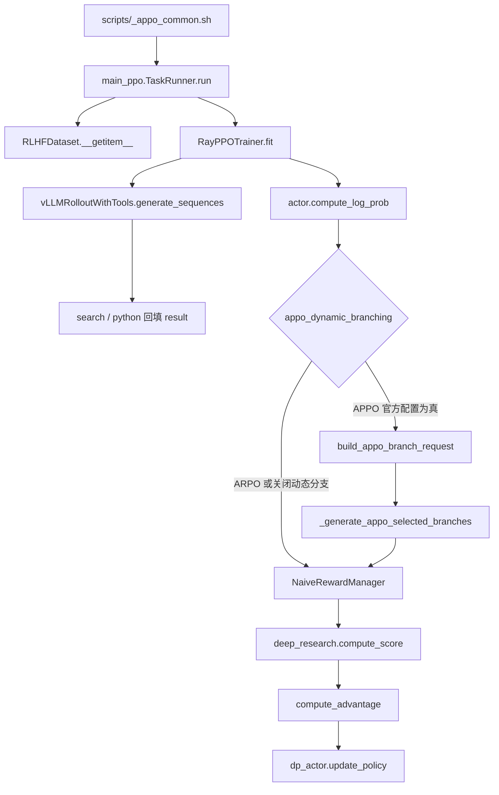
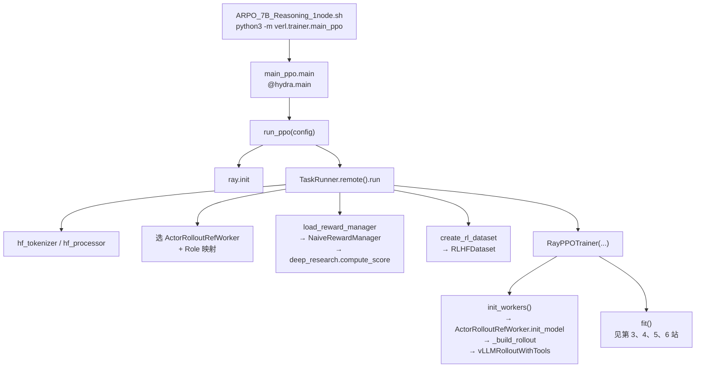

# APPO / ARPO 源码学习指南

日期：2026-10-16

阅读对象：`ref_Rep/APPO-main/APPO`（主线）、`ref_Rep/APPO-main/ARPO`（分叉对照）。

这份文档回答三件事：按什么顺序读、每一站看哪些函数、读完应能独立讲清什么。算法公式、差异总表和本地实测见 [APPO_ARPO_技术报告.md](APPO_ARPO_技术报告.md)。若目标是实习/秋招研究岗、只需掌握边界与面试口述，先看 [Agent_RL_博士掌握清单.md](Agent_RL_博士掌握清单.md)；按清单条目核对源码与行号见 [Agent_RL_掌握清单_源码对照.md](Agent_RL_掌握清单_源码对照.md)；再按需回到本文查完整调用链。两边共享同一套 veRL fork（`verl_arpo_entropy`）。官方训练脚本走 `rollout.mode=sync_with_tool`，下面所有行号都以这条路径为准。

读完之后，你应能不看笔记讲清：一条 JSON 样本怎样变成 prompt，怎样在工具循环里长成一条轨迹，reward 写在哪个 token，ARPO 与 APPO 各自在哪一次生成里分叉，以及哪些 token 会进入 actor loss。

**本节重点补充**：第 1 站按 `ARPO/.../main_ppo.py` 做逐步跳转解读（含代码块与下一跳文件）。`main_ppo.py` 在 APPO / ARPO 两边内容相同；差别在启动脚本写入的配置，以及后续 `fit` / `vllm_rollout_with_tools` 是否含 APPO 第二次生成。

---

## 怎么用

主线只跟 APPO。ARPO 在「分支发生的位置」和「advantage / loss」两处对照，其余文件两边同构，不必各读一遍。若本次目标是吃透 ARPO，按第 1 站的跳转地图从 `main_ppo.py` 往下走，遇到「分支」时跳到第 4.4 节，遇到 advantage 时跳到第 6.1 节。

建议顺序与时间：

| 顺序 | 这一站 | 时间 | 读完能做什么 |
| --- | --- | --- | --- |
| 0 | 下面这张调用链 | 15 分钟 | 知道一次 step 有哪些阶段 |
| 1 | 启动脚本 + `main_ppo.py` 逐步跳转 | 60 分钟 | 从 Hydra 入口讲到 `fit()` 前每一跳落在哪 |
| 2 | 数据集与 chat 前缀 | 30 分钟 | 指出 `ground_truth` 和协议标签从哪来 |
| 3 | `RayPPOTrainer.fit` | 60 分钟 | 按阶段复述 driver 在编排什么 |
| 4 | rollout 工具循环与分支 | 90 分钟 | 画出 mask、logprob、第二次生成 |
| 5 | reward | 40 分钟 | 从解码文本到最后一个 token 上的标量 |
| 6 | advantage 与 `update_policy` | 60 分钟 | 说明谁进 loss、谁只提供信用 |

刻意先不读：

- `verl/workers/megatron_workers.py`、`sglang_rollout/`、`recipe/`：官方脚本用 FSDP + vLLM。
- `verl/workers/agent/tool_agent.py` 与 `vllm_agent_rollout.py`：Gym 式第二条 rollout 路径，配置 `rollout.mode=agent` 才启用，启动脚本未用。
- `verl/utils/reward_score/` 里的 `gsm8k.py`、`math.py`、`prime_*`：veRL 自带打分器。本仓库训练脚本把 `custom_reward_function` 指到 `deep_research.compute_score`，这些文件不会被调用。
- `LLaMA-Factory/`、`dashboard/frontend/`：冷启动 SFT 和监控界面，与 on-policy 循环无关。
- Critic。`adv_estimator` 为 `grpo` 或 `appo` 时 `RayPPOTrainer` 把 `use_critic` 设为 `False`（`ray_trainer.py:1107-1119`），`fit` 里的 `compute_values` / `update_critic` 整段跳过。

---

## 0. 一次 step 的地图

Driver 进程在 CPU 上编排。生成、logprob、参数更新发生在 Ray worker 上。Advantage 和 reward 缩放在 driver 上算。



一条样本在 batch 里会带上这些关键字段。后面每一站都在往这张表里填东西。

| 字段 | 谁写入 | 含义 |
| --- | --- | --- |
| `input_ids` / `prompts` | dataset，rollout 再对齐 | 左填充后的 prompt |
| `responses` | rollout | 模型生成 + 工具回填拼成的 response |
| `loss_mask` | rollout 的 `result_mask` | 1 表示模型自己生成的 token，0 表示工具结果或分支续写 |
| `rollout_log_probs` / `rollout_entropys` | 第一次生成时的 vLLM logprobs | 行为策略上的 token logprob 与熵 |
| `old_log_probs` | `compute_log_prob` | 当前 actor 对同一条 response 的 logprob |
| `uid` | `fit` 里 `uuid4`，再按 rollout 数 repeat | 同一 prompt 的一组轨迹共享 |
| `token_level_scores` | reward manager | 标量分写在最后一个有效 response token |
| `advantages` | `compute_advantage` | 策略梯度用的优势 |

---

## 1. 入口与配置

先看这里（ARPO 主读路径）：

- `ref_Rep/APPO-main/ARPO/scripts/ARPO_7B_Reasoning_1node.sh`
- `ref_Rep/APPO-main/ARPO/verl_arpo_entropy/verl/trainer/main_ppo.py`
- 对照：`ref_Rep/APPO-main/APPO/scripts/_appo_common.sh`

`main_ppo.py` 在 APPO / ARPO 两份 fork 里**字节级相同**（`diff` 无差异）。算法身份不写在这个文件里，而写在启动脚本覆盖进 Hydra 的配置项上。

### 1.0 配置对照（决定走 ARPO 还是 APPO）

`scripts/config/ppo_trainer.yaml` 是默认值，命令行覆盖它。真正要盯的开关：

| 开关 | APPO（`_appo_common.sh`） | ARPO（`ARPO_7B_Reasoning_1node.sh`） |
| --- | --- | --- |
| `algorithm.adv_estimator` | `appo`（L45） | `grpo`（L113） |
| `actor_rollout_ref.rollout.mode` | `sync_with_tool`（L23） | `sync_with_tool`（变量 `ROLLOUT_MODE`，L56→L136） |
| `rollout.n` / `initial_rollouts` | 由具体 `run.sh` 传入，常见 16 / 8 | 脚本默认 16 / 8（L57-58→L138-139） |
| 分支 | `appo_dynamic_branching=True`（L82） | `beam_size`、`branch_probability`、`entropy_weight`（L59-61→L140-142） |
| loss | `policy_loss.loss_mode=future_kl`（L66） | 不传这项，走默认 PPO clip |
| reward | `custom_reward_function` → `deep_research.compute_score` | 同样（L70-71→L150-151） |
| KL | actor `kl_loss_coef=0.001` | `kl_coef=0.0` 且 `kl_loss_coef=0.0`（L114、L129）；但仍 `use_kl_loss=True`（L128），所以会挂 RefPolicy |

ARPO 脚本里与「自适应分叉」直接相关的三行：

```bash
# ARPO_7B_Reasoning_1node.sh L57-61（变量）→ L138-142（Hydra 覆盖）
actor_rollout_ref.rollout.n=${ROLLOUT_N}                 # 16：每个 prompt 最终要凑满的轨迹数
actor_rollout_ref.rollout.initial_rollouts=${INITIAL_ROLLOUTS}  # 8：工具循环一开始就开的条数
actor_rollout_ref.rollout.beam_size=${BEAM_SIZE}         # 2：每条活跃轨迹最多再复制几条
actor_rollout_ref.rollout.branch_probability=${BRANCH_PROBABILITY}  # 0.5
actor_rollout_ref.rollout.entropy_weight=${Entropy_weight}          # 0.2
```

这五个数进 `vLLMRolloutWithTools.__init__`（ARPO 的 `vllm_rollout_with_tools.py:83-86`），在同一次 `generate_sequences` 里消费。Trainer 侧只看到「已经凑满 `n` 条」的 batch，不再第二次生成。

---

### 1.1 从 `main_ppo.py` 出发的跳转地图（ARPO）

下面所有路径相对于 `ref_Rep/APPO-main/ARPO/verl_arpo_entropy/`，除非另写脚本路径。读法：每一跳先看「谁调用谁」，再打开代码块，最后跟「下一跳」进下一个文件。



进程角色：`python -m verl.trainer.main_ppo` 所在进程是 **driver**（CPU 编排）。`TaskRunner` 也是一个 Ray actor（`num_cpus=1`），真正的 GPU 工作在 `init_workers` 之后由 `ActorRolloutRefWorker` 等 worker 承担。

---

### 1.2 跳转 0：Shell → Hydra 入口

启动命令（脚本 L110-112）：

```bash
python3 -m verl.trainer.main_ppo \
    --config-path=$CONFIG_PATH \
    --config-name=$CONFIG_NAME \
    algorithm.adv_estimator=grpo \
    ...
```

`PYTHONPATH` 指向 `ARPO/verl_arpo_entropy`，所以 `verl.trainer.main_ppo` 就是本文件。Hydra 装饰器把 yaml + 命令行合成一个 `config` 对象：

```26:28:ref_Rep/APPO-main/ARPO/verl_arpo_entropy/verl/trainer/main_ppo.py
@hydra.main(config_path="config", config_name="ppo_trainer", version_base=None)
def main(config):
    run_ppo(config)
```

注意：装饰器里的 `config_path="config"` 是相对 `main_ppo.py` 包内默认路径；脚本用 `--config-path=$CONFIG_PATH` 覆盖成 `ARPO/scripts/config`。读配置时以**脚本传入的绝对路径**为准。

**下一跳**：`run_ppo`（同文件 L31）。

---

### 1.3 跳转 1：`run_ppo` —— 起 Ray，把活交给 TaskRunner

```31:40:ref_Rep/APPO-main/ARPO/verl_arpo_entropy/verl/trainer/main_ppo.py
def run_ppo(config) -> None:
    if not ray.is_initialized():
        # this is for local ray cluster
        ray.init(
            runtime_env={"env_vars": {"TOKENIZERS_PARALLELISM": "true", "NCCL_DEBUG": "WARN", "VLLM_LOGGING_LEVEL": "WARN", "VLLM_ALLOW_RUNTIME_LORA_UPDATING": "true"}},
            num_cpus=config.ray_init.num_cpus,
        )

    runner = TaskRunner.remote()
    ray.get(runner.run.remote(config))
```

说明：

- `ray.init` 只在本机尚未初始化时执行；多机集群场景通常已经在外部起好 Ray。
- `TaskRunner.remote()` 创建一个独立 Ray actor；`ray.get(...)` 阻塞直到训练结束。
- 注释写明 `@ray.remote(num_cpus=1)` 是为了避免把 `main_task` 调度到 head 上占满资源（L43）。

**下一跳**：`TaskRunner.run`（同文件 L45）。后面整段装配都在这里完成，直到调用 `fit()`。

---

### 1.4 跳转 2：`TaskRunner.run` —— 按顺序装配

把 `run` 拆成六段读。每一段对应后面某一站的「数据从哪来 / worker 是谁」。

#### 段 A：打印配置 + 拉模型 + tokenizer（L46-64）

```53:64:ref_Rep/APPO-main/ARPO/verl_arpo_entropy/verl/trainer/main_ppo.py
        pprint(OmegaConf.to_container(config, resolve=True))  # resolve=True will eval symbol values
        OmegaConf.resolve(config)

        # download the checkpoint from hdfs
        local_path = copy_to_local(config.actor_rollout_ref.model.path, use_shm=config.actor_rollout_ref.model.get("use_shm", False))

        # instantiate tokenizer
        from verl.utils import hf_processor, hf_tokenizer

        trust_remote_code = config.data.get("trust_remote_code", False)
        tokenizer = hf_tokenizer(local_path, trust_remote_code=trust_remote_code)
        processor = hf_processor(local_path, trust_remote_code=trust_remote_code, use_fast=True)  # used for multimodal LLM, could be none
```

- `copy_to_local`：路径已是本地时基本是直通；HDFS / 远程路径才会真正拷贝。
- `tokenizer` 贯穿 dataset、reward decode、rollout stop tag encode；`processor` 多模态才非空，纯文本 ARPO 脚本里通常是 `None`。

#### 段 B：按 strategy / mode 选 worker 类（L74-92）

```74:81:ref_Rep/APPO-main/ARPO/verl_arpo_entropy/verl/trainer/main_ppo.py
        # define worker classes
        if config.actor_rollout_ref.actor.strategy in ["fsdp", "fsdp2"]:
            assert config.critic.strategy in ["fsdp", "fsdp2"]
            from verl.single_controller.ray import RayWorkerGroup
            from verl.workers.fsdp_workers import ActorRolloutRefWorker, AsyncActorRolloutRefWorker, CriticWorker

            actor_rollout_cls = AsyncActorRolloutRefWorker if config.actor_rollout_ref.rollout.mode == "async" else ActorRolloutRefWorker
            ray_worker_group_cls = RayWorkerGroup
```

ARPO 官方脚本：`strategy=fsdp`（yaml 默认）、`rollout.mode=sync_with_tool`。因此：

| 条件 | 结果 |
| --- | --- |
| `mode != "async"` | `actor_rollout_cls = ActorRolloutRefWorker` |
| `mode == "async"` | 换成 `AsyncActorRolloutRefWorker`（官方未用） |
| `strategy == "megatron"` | 走 `megatron_workers`（刻意不读） |

**关键澄清**：`sync_with_tool` 不会在这里换类。它只影响 worker **内部** `_build_rollout` 选哪个 rollout 实现（见跳转 3）。这里选的是「同步 FSDP hybrid worker」。

#### 段 C：Role → Ray 资源池映射（L94-129）

```96:129:ref_Rep/APPO-main/ARPO/verl_arpo_entropy/verl/trainer/main_ppo.py
        role_worker_mapping = {
            Role.ActorRollout: ray.remote(actor_rollout_cls),
            Role.Critic: ray.remote(CriticWorker),
        }

        global_pool_id = "global_pool"
        resource_pool_spec = {
            global_pool_id: [config.trainer.n_gpus_per_node] * config.trainer.nnodes,
        }
        mapping = {
            Role.ActorRollout: global_pool_id,
            Role.Critic: global_pool_id,
        }
        # ...
        if config.algorithm.use_kl_in_reward or config.actor_rollout_ref.actor.use_kl_loss:
            role_worker_mapping[Role.RefPolicy] = ray.remote(ActorRolloutRefWorker)
            mapping[Role.RefPolicy] = global_pool_id
```

ARPO 脚本实际效果：

| Role | 会不会真正建 worker | 原因 |
| --- | --- | --- |
| `ActorRollout` | 会 | 始终注册 |
| `Critic` | **不会** | 映射表里有类，但 `RayPPOTrainer.__init__` 见 `adv_estimator=grpo` 把 `use_critic=False`（ARPO `ray_trainer.py:413-422`），`init_workers` 跳过 critic |
| `RewardModel` | 不会 | 脚本未开 `reward_model.enable`；用的是规则打分 `reward_fn` |
| `RefPolicy` | **会** | `use_kl_loss=True`（脚本 L128），即使 `kl_loss_coef=0.0` 也会挂参考策略 |

`resource_pool_spec`：`[n_gpus_per_node] * nnodes`，例如 8 卡 1 机就是 `[8]`，表示一个池里 8 个 GPU 进程。

#### 段 D：装 reward（L131-132）→ 跳到 `reward.py`

```131:132:ref_Rep/APPO-main/ARPO/verl_arpo_entropy/verl/trainer/main_ppo.py
        reward_fn = load_reward_manager(config, tokenizer, num_examine=0, **config.reward_model.get("reward_kwargs", {}))
        val_reward_fn = load_reward_manager(config, tokenizer, num_examine=1, **config.reward_model.get("reward_kwargs", {}))
```

**下一跳文件**：`verl/trainer/ppo/reward.py`。

```60:100:ref_Rep/APPO-main/ARPO/verl_arpo_entropy/verl/trainer/ppo/reward.py
def load_reward_manager(config, tokenizer, num_examine, **reward_kwargs):
    reward_manager_name = config.reward_model.get("reward_manager", "naive")
    if reward_manager_name == "naive":
        from verl.workers.reward_manager import NaiveRewardManager
        reward_manager_cls = NaiveRewardManager
    # ...
    compute_score = get_custom_reward_fn(config)
    final_compute_score = compute_score
    if compute_score is None:
        # ... 退回 default_compute_score（gsm8k/MATH 等）
        final_compute_score = default_compute_score

    return reward_manager_cls(
        tokenizer=tokenizer,
        num_examine=num_examine,
        compute_score=final_compute_score,
        reward_fn_key=config.data.reward_fn_key,
        **reward_kwargs,
    )
```

`get_custom_reward_fn`（同文件 L25-57）按 `custom_reward_function.path` / `.name` 动态 import。ARPO 脚本指向：

```text
path = .../verl/utils/reward_score/deep_research.py
name = compute_score
```

因此训练时 **不会** 走到 `default_compute_score` 的 gsm8k/MATH 分支。`num_examine=0` 训练不打样例；验证 `=1` 会打印 prompt/response/分数（见 `NaiveRewardManager.__call__` L94-101）。

打分写 token 的细节在第 5 站；这里只需记住：`reward_fn` 已经是绑好 `compute_score` 的 `NaiveRewardManager` 实例，原样塞进 `RayPPOTrainer`。

#### 段 E：建 dataset（L137-139）→ 跳到 `create_rl_dataset` / `RLHFDataset`

```137:139:ref_Rep/APPO-main/ARPO/verl_arpo_entropy/verl/trainer/main_ppo.py
        train_dataset = create_rl_dataset(config.data.train_files, config.data, tokenizer, processor)
        val_dataset = create_rl_dataset(config.data.val_files, config.data, tokenizer, processor)
        train_sampler = create_rl_sampler(config.data, train_dataset)
```

同文件底部的工厂函数：

```159:191:ref_Rep/APPO-main/ARPO/verl_arpo_entropy/verl/trainer/main_ppo.py
def create_rl_dataset(data_paths, data_config, tokenizer, processor):
    # ...
    if "custom_cls" in data_config and data_config.custom_cls.get("path", None) is not None:
        dataset_cls = load_extern_type(...)
    else:
        dataset_cls = RLHFDataset
    print(f"Using dataset class: {dataset_cls.__name__}")

    dataset = dataset_cls(
        data_files=data_paths,
        tokenizer=tokenizer,
        processor=processor,
        config=data_config,
    )
    return dataset
```

官方脚本不设 `custom_cls` → **`RLHFDataset`**。`create_rl_sampler`（L194-215）：`data.shuffle=True` 时用带 seed 的 `RandomSampler`，否则 `SequentialSampler`。

**下一跳（第 2 站）**：`verl/utils/dataset/rl_dataset.py` 的 `__getitem__`。一条样本在这里变成左填充的 `input_ids`，`reward_model.ground_truth` 留在 non-tensor 字段里。

#### 段 F：构造 Trainer → `init_workers` → `fit`（L140-156）

```140:156:ref_Rep/APPO-main/ARPO/verl_arpo_entropy/verl/trainer/main_ppo.py
        trainer = RayPPOTrainer(
            config=config,
            tokenizer=tokenizer,
            processor=processor,
            role_worker_mapping=role_worker_mapping,
            resource_pool_manager=resource_pool_manager,
            ray_worker_group_cls=ray_worker_group_cls,
            reward_fn=reward_fn,
            val_reward_fn=val_reward_fn,
            train_dataset=train_dataset,
            val_dataset=val_dataset,
            collate_fn=collate_fn,
            train_sampler=train_sampler,
            device_name=config.trainer.device,
        )
        trainer.init_workers()
        trainer.fit()
```

`RayPPOTrainer.__init__`（ARPO `ray_trainer.py:365`）里与 ARPO 直接相关的两件事：

1. `use_reference_policy = Role.RefPolicy in role_worker_mapping`（L397）→ ARPO 为真。
2. `adv_estimator == GRPO` → `use_critic = False`（L413-422）→ 后面 `fit` 整段跳过 critic。

然后 `_validate_config` 检查 batch 能否被 GPU 数整除等；`_create_dataloader` 用上面的 dataset / sampler 建 `train_dataloader`。

**下一跳**：`init_workers`（跳转 3），然后 `fit`（第 3 站）。

---

### 1.5 跳转 3：`init_workers` —— 真正把 GPU worker 和 vLLM 工具 rollout 拉起来

文件：`verl/trainer/ppo/ray_trainer.py` 的 `init_workers`（ARPO L769-850）。

核心顺序：

1. `create_resource_pool()`：按 `resource_pool_spec` 向 Ray 要 GPU。
2. 为 `ActorRollout`（以及 ARPO 的 `RefPolicy`）包一层 `RayClassWithInitArgs`。
3. `create_colocated_worker_cls` + `spawn`：同一资源池上共置多个 role。
4. 依次 `init_model()`：**最后**才 init `actor_rollout`，好让 vLLM 更准确地估计 KV cache（注释 L839）。

`ActorRolloutRefWorker.init_model`（`fsdp_workers.py:514`）在 `_is_rollout` 时调用 `_build_rollout`（L577）。选类的关键分支：

```426:434:ref_Rep/APPO-main/ARPO/verl_arpo_entropy/verl/workers/fsdp_workers.py
                if self.config.rollout.mode == "sync":
                    from verl.workers.rollout.vllm_rollout.vllm_rollout_spmd import vLLMRollout
                    vllm_rollout_cls = vLLMRollout
                elif self.config.rollout.mode == "async":
                    from verl.workers.rollout.vllm_rollout.vllm_rollout_spmd import vLLMAsyncRollout
                    vllm_rollout_cls = vLLMAsyncRollout
                elif self.config.rollout.mode == "sync_with_tool":
                    from verl.workers.rollout.vllm_rollout.vllm_rollout_with_tools import vLLMRolloutWithTools
                    vllm_rollout_cls = vLLMRolloutWithTools
```

ARPO 走到第三个分支。`vLLMRolloutWithTools.__init__` 立刻读入脚本里的分叉超参（L83-86）和工具实例（L101-113）。停词只有工具闭合标签 `</search>` / `</python>`（L113），**没有** APPO 多加的 `</answer>`。

之后 driver 上的 RPC 入口是：

| Driver 调用 | Worker 方法 | 最终落到 |
| --- | --- | --- |
| `actor_rollout_wg.generate_sequences` | `fsdp_workers.py:652` | `self.rollout.generate_sequences` → 工具循环 + ARPO 熵分支（第 4.4 节） |
| `actor_rollout_wg.compute_log_prob` | `fsdp_workers.py:681` | `DataParallelPPOActor` 重算 `old_log_probs` |
| `actor_rollout_wg.update_actor` | `fsdp_workers.py:609` | `dp_actor.update_policy`（第 6.3 节） |
| `ref_policy_wg.compute_ref_log_prob` | 同 worker 族 | 参考策略 logprob（ARPO 因 `kl_loss_coef=0` 对 loss 贡献为 0，但仍会算） |

`generate_sequences` 转发本身很薄：

```652:677:ref_Rep/APPO-main/ARPO/verl_arpo_entropy/verl/workers/fsdp_workers.py
    def generate_sequences(self, prompts: DataProto):
        prompts = prompts.to(get_torch_device().current_device())
        assert self._is_rollout
        # ... 写入 eos/pad meta_info ...
        with self.rollout_sharding_manager:
            prompts = self.rollout_sharding_manager.preprocess_data(prompts)
            output = self.rollout.generate_sequences(prompts=prompts)
            output = self.rollout_sharding_manager.postprocess_data(output)
        output = output.to("cpu")
        get_torch_device().empty_cache()
        return output
```

权重同步、KV cache 清理在这里；工具协议与 ARPO 分叉不在这里。

---

### 1.6 跳转 4：`fit()` 接管 —— ARPO 一步里会发生什么

`trainer.fit()`（ARPO `ray_trainer.py:948`）是训练主循环。与 APPO 对照时只需记住三点：

1. **只有一次** `generate_sequences`（L1014）。ARPO 的分叉在 `vLLMRolloutWithTools.generate_sequences` 内部完成（第 4.4 节 L458-511）。
2. `batch.repeat(repeat_times=rollout.n)`（L1041）按配置的 `n` 对齐；因为 rollout 已经返回 `n` 条，这里与生成结果行数一致。APPO 动态分支打开时第一次往往只返回 `initial_rollouts` 条，要用实际返回行数算 `rollout_repeat`。
3. `compute_advantage(..., adv_estimator=grpo, multi_turn=...)`（L1143-1154）走 GRPO（第 6.1 节），没有 APPO 的 M 缩放与 `compute_appo_advantage`。

一个 step 的调用顺序（ARPO 行号）：

```text
DataProto.from_single_dict(batch_dict)          # L992
  └─ batch.pop(input_ids, ...) → gen_batch      # L1003
       └─ actor_rollout_wg.generate_sequences   # L1014  ← 工具循环 + 熵分支
  uid = uuid4 × prompt 数                       # L1039
  batch.repeat(n) ; batch.union(gen_output)     # L1041-1042
  compute_response_mask                         # L1044
  compute_reward(batch, reward_fn)              # L1065  ← NaiveRewardManager → deep_research
  actor_rollout_wg.compute_log_prob             # L1069
  ref_policy_wg.compute_ref_log_prob            # L1110（若挂了 Ref）
  token_level_rewards = token_level_scores      # L1137（use_kl_in_reward=False）
  compute_advantage(GRPO)                       # L1143
  actor_rollout_wg.update_actor                 # L1166 一带
```

细读控制流回第 3 站；工具与分支回第 4 站；打分回第 5 站；GRPO / `update_policy` 回第 6 站。

---

### 1.7 读完第 1 站应能回答

- 改 advantage 算法要改启动脚本里的 `algorithm.adv_estimator`，改 yaml 默认值不够，因为脚本会覆盖它。ARPO 必须是 `grpo`；写成 `appo` 会走到另一份 fork 才有的分支逻辑（ARPO 这份 `ray_trainer.py` 甚至没有 APPO 估计器）。
- `sync_with_tool` 这个字符串在 `fsdp_workers.py:432` 决定 import `vLLMRolloutWithTools`；它不改变 `main_ppo` 里选的 worker 类名。
- Reward 类名来自 `reward_model.reward_manager=naive`，打分函数来自 `custom_reward_function`，两处都在脚本里；`main_ppo` 只负责调用 `load_reward_manager`。
- ARPO 挂 `RefPolicy` 是因为 `use_kl_loss=True`，不是因为 `kl_loss_coef` 非零。
- 从 `main` 到第一次 GPU 生成的最短调用链是：`main → run_ppo → TaskRunner.run → RayPPOTrainer.fit → actor_rollout_wg.generate_sequences → ActorRolloutRefWorker.generate_sequences → vLLMRolloutWithTools.generate_sequences`。

---

## 2. 数据如何变成 prompt

先看这里：

- 随便打开 `ref_Rep/APPO-main/APPO/rl_datasets/train_10k.json` 的第一条
- `ref_Rep/APPO-main/APPO/verl_arpo_entropy/verl/utils/dataset/rl_dataset.py` 的 `_build_messages`（L164）和 `__getitem__`（L183）
- `ref_Rep/APPO-main/APPO/verl_arpo_entropy/verl/utils/reward_score/agent_protocol.py`

看什么。一条训练样本是一个 JSON 对象，后面 reward 和 prompt 都从这里取：

- `prompt`：`system` + `user` 两条消息。system 就是协议说明，要求 `<think>`、`<search>`、`<python>`、`<answer>\boxed{}</answer>`。
- `reward_model.ground_truth`：标准答案字符串，例如 `"3\\sqrt{3} - 6"`。
- `data_source`：传给打分函数的数据集名，例如 `DR_grpo_mix`。`ppo_trainer.yaml` 里 `data.reward_fn_key` 默认就是 `data_source`。
- `extra_info`：索引进度之类，reward 里也会读 `format_mode`。

`RLHFDataset.__getitem__` 做三件事：

1. `_build_messages` 取出 `prompt` 列表。
2. `apply_chat_template_no_native_think` 把它拼成 Qwen 对话前缀（`rl_dataset.py:223`）。
3. tokenize、左填充到 `max_prompt_length`，把 `input_ids`、`attention_mask`、`position_ids`、`raw_prompt_ids` 放进 `row_dict`。`reward_model` 和 `data_source` 留在非张量字段里，原样进 batch。

`agent_protocol.py:37-68` 解释了为什么不用 tokenizer 自带的 chat template。`format_appo_chat_prefix` 手工拼：

```text
<|im_start|>system
{system}<|im_end|>
<|im_start|>user
{user}<|im_end|>
<|im_start|>assistant
```

注释写得很明确：`enable_thinking=False` 会在生成前塞进一对空的 `<think></think>`，模型就不再按协议自己写 `<think>`；`enable_thinking=True` 又会多开一条原生 thinking 通道。手工前缀避开这两种注入。协议标签和 Qwen3 原生 thinking 是两套东西，读 rollout 和 reward 时都按协议标签理解。

读完应能回答：

- 模型看到的第一段文本来自样本里的 system，来自 `agent_protocol.SYSTEM_PROMPT` 的同文案。
- `ground_truth` 此刻还没用，它要等到 reward 阶段才从 `non_tensor_batch["reward_model"]` 里取出来。
- prompt 是左填充的。后面算 response 区间时，用的是 `attention_mask` 的后 `response_length` 列，而不是「从第一个非 pad 开始」。

---

## 3. fit 循环骨架

有两份 `ray_trainer.py`，行号不同：

| 阅读目标 | 文件 | `fit` 起点 |
| --- | --- | --- |
| **ARPO（建议先读）** | `ref_Rep/APPO-main/ARPO/verl_arpo_entropy/verl/trainer/ppo/ray_trainer.py` | L948–约 L1250 |
| APPO（对照第二次生成） | `ref_Rep/APPO-main/APPO/verl_arpo_entropy/verl/trainer/ppo/ray_trainer.py` | L1792–约 L2117 |

第一遍只看控制流。ARPO 没有 APPO 专用函数；读 APPO 时遇到 `build_appo_branch_request` 等先记名字，第 4.5、6.2 站再进去。

`fit` 开头注释（ARPO L949-953 / APPO L1793-1797）就是阅读钥匙：driver 通过 RPC 调 worker，advantage 这种轻计算留在 driver。

### 3.1 ARPO 的 step（主路径）

一个 batch 在 `with _timer("step")` 里按这个顺序走。行号是 **ARPO** 这份 `ray_trainer.py`。

1. **拆出生成输入**（L994-1006）。从 batch 里 pop 出 `input_ids`、`attention_mask`、`position_ids`、`raw_prompt_ids`（以及可选的 multimodal / tools_kwargs）。剩下的 `reward_model`、`data_source` 留在原 batch，等 reward 用。
2. **一次生成**（L1012-1018）。`actor_rollout_wg.generate_sequences(gen_batch)`。同步模式下这是对所有 GPU worker 的一次 RPC。**ARPO 的熵自适应分叉发生在这一次内部**（见 4.4），返回时已经是每条 prompt `rollout.n` 条轨迹。
3. **对齐 prompt 与 response 的条数**（L1039-1042）。每条 prompt 先分配一个 `uid`，再 `batch.repeat(repeat_times=rollout.n, interleave=True)`，然后 `batch.union(gen_batch_output)`。因为生成侧已经返回 `n` 条，这里的 `n` 与返回行数一致。
4. **response mask**（L1044）。`compute_response_mask` 取 `attention_mask` 的 response 段。它标记「哪些位置是有效 token」，工具结果也算有效 token。它和 `loss_mask` 不同，后者才决定进不进 loss。
5. **可选的 token 均衡**（L1050-1051）。`balance_batch` 会打乱行顺序；advantage 按 `uid` 分组，不受行序影响。
6. **reward**（L1056-1065）。ARPO 没有「等第二次生成」的推迟逻辑；同步路径直接 `compute_reward(batch, self.reward_fn)`。
7. **当前策略 logprob**（L1068-1080）。`compute_log_prob` 得到 `old_log_probs`；熵只做监控指标后 pop 掉。
8. **参考策略 logprob**（L1106-1113）。ARPO 挂了 RefPolicy 就会算；`kl_loss_coef=0` 时对 loss 无贡献。
9. **分数变成 reward**（L1126-1137）。`token_level_scores = reward_tensor`。`use_kl_in_reward` 为假时，`token_level_rewards` 直接等于这份分数。
10. **advantage**（L1143-1154）。`adv_estimator=grpo`，且 `multi_turn=True` 时用 `loss_mask` 的 response 段做 GRPO mask。
11. **更新 actor**（L1164 起）。`critic_warmup` 默认 0，且 `use_critic=False`，直接 `update_actor`。

### 3.2 APPO 多出来的步骤（对照）

APPO 行号在括号里。相对 ARPO，多了：

- 对齐时可能按**实际返回行数**算 `rollout_repeat`（第一次常只返回 `initial_rollouts`）（L1883-1893）。
- **第二次生成**（L1960-1983）：`build_appo_branch_request` → 再一次 `generate_sequences` → `align_appo_branch_batch`。
- reward 在动态分支打开时推迟到第二次生成之后（L1985）。
- `apply_appo_reward_scale_M` + `compute_appo_advantage`（L2057-2074）。

ARPO 的 `fit` 没有这些步骤。分支在第 2 步那一次 `generate_sequences` 内部完成。

### 3.3 读完应能回答

- Driver 自己不做前向。你在 `fit` 里看到的 `generate_sequences`、`compute_log_prob`、`update_actor` 都是 Ray worker 方法。
- 同一条 prompt 的多条轨迹靠 `uid` 分组，靠 `repeat(interleave=True)` 和生成结果对齐。
- 官方 APPO 每个 step 有两次 `generate_sequences`：第一次采初始轨迹，第二次从选中的 token 续写。ARPO 只有第一次，分支嵌在那一次里面。
- 从 `main_ppo.TaskRunner.run` 走进 `fit` 之后，ARPO 再也不会回到 `main_ppo.py`；配置已经冻在 `self.config` 里。

---

## 4. Rollout 采集

这是整份代码里最值得慢慢读的一站。建议先读 APPO 的工具循环，再跳到 ARPO 的分支块，最后回来看 APPO 的第二次生成。

### 4.1 Worker 只是转发

先看 `ref_Rep/APPO-main/APPO/verl_arpo_entropy/verl/workers/fsdp_workers.py`。

- L432-434：`rollout.mode == "sync_with_tool"` 时，rollout 类是 `vLLMRolloutWithTools`。
- L652-677：`ActorRolloutRefWorker.generate_sequences` 把 batch 放到 GPU，交给 `self.rollout.generate_sequences`，再拷回 CPU。权重同步、KV cache 清理在这里，工具协议不在这里。

真正的循环在 `ref_Rep/APPO-main/APPO/verl_arpo_entropy/verl/workers/rollout/vllm_rollout/vllm_rollout_with_tools.py`。

### 4.2 停词与工具

`vLLMRolloutWithTools.__init__`（L83）：

- `initial_rollouts` 默认等于 `rollout.n`，脚本里通常更小（L87）。
- 按 `tools.tool_instances` 加载工具，键是 `trigger_tag`，也就是 `search`、`python`（L102-108）。
- `tool_stop_sequences` 是 `</search>`、`</python>`。`stop_sequences` 再加一个 `</answer>`（L114-116）。
- `tool_call_limit` 默认 5，配置里可改（L93）。

触发工具的条件在生成循环里（L795）：`finish_reason == "stop"` 并且 `stop_reason` 属于 `tool_stop_sequences`。停在 `</answer>` 只是结束这一段生成，不进工具执行。调用次数达到上限时，直接补 EOS，mask 记 1（L819-822）。

### 4.3 一次工具循环在做什么

`generate_sequences` 从 L624 开始。若 `prompts.meta_info["appo_branch_mode"]` 为真，立刻转到 `_generate_appo_selected_branches`（L634），那是第二次生成，先放着。

第一次生成的状态在 L735-748 建好：每个 prompt 复制 `initial_rollouts` 份，放进 `curr_inputs`。`result_masks[i]` 是这条 response 每个 token 的 0/1 标记，一开始为空。`active_indices` 是还没写完的轨迹。

`while active_indices`（L752）每一轮：

1. 用当前 token 前缀调用 vLLM，`stop=self.stop_sequences`，`logprobs=10`（L759-770）。
2. 把新 token 接到 `curr_inputs`，`result_masks` 对应位置写 1（L782-783）。这些是模型自己生成的，要进 loss。
3. 把 vLLM 返回的逐步 logprob 追加到 `rollout_logprobs`（L785-788）。后面的熵和 APPO 分裂分都从这里来。
4. 若是工具调用，用 `_extract_content` 取最后一个 `<tag>...</tag>` 里的 query 或代码（L139、L811-814），丢进 `tool_requests`。
5. `ThreadPoolExecutor` 并发执行（L842）。每个结果包成 ` <result>\n...\n</result>`，encode 后接到序列末尾，**这些 token 的 mask 写 0**（L893-899）。
6. 长度还没到 `response_length` 的轨迹留在 `active_indices`，回到第 1 步。模型在 `<result>` 之后继续 `<think>`，直到写出 `</answer>`、EOS，或顶满长度。

循环结束后组 batch（约 L1008-1134）：`result_mask` pad 成 `loss_mask`，logprob 与熵 pad 成 `rollout_log_probs`、`rollout_entropys`。返回的 `TensorDict` 里有 `prompts`、`responses`、`input_ids`（prompt 与 response 拼起来）、`attention_mask`、`loss_mask`。

`loss_mask` 和 `response_mask` 的差别就在这一步：工具回填的 `<result>` 占了 response 的位置，attention 看得到它们，loss 把它们乘成 0。模型不该为「搜索引擎写出来的字」吃梯度。

动态分支打开、且不是验证时，返回的条数是 `initial_rollouts` 而不是 `rollout.n`（L954）。这就是 `fit` 里 `rollout_repeat` 要按实际返回行数算的原因。

### 4.4 ARPO：分支嵌在同一次循环里

从 `main_ppo` 跳到这里的完整链：

```text
fit L1014
  → ActorRolloutRefWorker.generate_sequences          (fsdp_workers.py:652)
    → vLLMRolloutWithTools.generate_sequences         (vllm_rollout_with_tools.py:203)
      → while active_indices: 生成 → 工具 → 【熵分支】
```

文件：`ref_Rep/APPO-main/ARPO/verl_arpo_entropy/verl/workers/rollout/vllm_rollout/vllm_rollout_with_tools.py`。

#### 构造时读入的分叉超参（来自第 1 站脚本）

```83:86:ref_Rep/APPO-main/ARPO/verl_arpo_entropy/verl/workers/rollout/vllm_rollout/vllm_rollout_with_tools.py
        self.initial_rollouts = self.config.get("initial_rollouts", self.config['n'])
        self.beam_size = self.config.get("beam_size", 1)
        self.branch_probability = self.config.get("branch_probability", 0.5)
        self.entropy_weight = self.config.get("entropy_weight", 0.5)
```

停词只有工具闭合标签（L113），没有 APPO 多加的 `</answer>`：

```113:115:ref_Rep/APPO-main/ARPO/verl_arpo_entropy/verl/workers/rollout/vllm_rollout/vllm_rollout_with_tools.py
        self.stop_sequences = [f"</{tag}>" for tag in self.tools.keys()]
        self.logprobs = 10 # entropy
        self.initial_entropy_dict = {}  # record initial entropy of active indice
```

#### 工具循环与初始条数

工具循环的形状与 APPO 同构：stop tag、抽内容、线程池、`<result>` mask 为 0（结果回填在 L446-450）。开始时每个 prompt 先开 `initial_rollouts` 条（L260-282），不是一次性开满 `n`。

每一轮生成时，用 top-k logprob 算归一化熵，记到 `current_entropy_dict`；第一条熵写入 `initial_entropy_dict`（L305-327）。

#### 熵自适应复制（核心）

工具结果写回之后（约 L458），对还活着的轨迹做自适应复制：

```492:509:ref_Rep/APPO-main/ARPO/verl_arpo_entropy/verl/workers/rollout/vllm_rollout/vllm_rollout_with_tools.py
                            # ==== Entropy-based Adaptive Beaming ====
                            
                            entropy_now = current_entropy_dict.get(source_idx, 0.0)
                            entropy_init = self.initial_entropy_dict.get(source_idx, 0.0)
                            entropy_delta = entropy_now - entropy_init
                            prob = random.random() - self.entropy_weight * entropy_delta
                    
                            prob = max(0.0, min(1.0, prob))
                            if prob > self.branch_probability: 
                                continue
                            # ==== END ====
                            new_inputs.append(curr_inputs[source_idx].copy())
                            new_init_inputs.append(init_inputs[source_idx].copy())
                            new_result_masks.append(result_masks[source_idx].copy())
                            new_call_counters.append(call_counters[source_idx])
                            new_sample_origins.append(orig_sample)
                            rollouts_per_sample[orig_sample] += 1
                            branches_created += 1
```

用文字重述判定：

```text
entropy_delta = entropy_now - entropy_init
prob = clip(random() - entropy_weight * entropy_delta, 0, 1)
若 prob > branch_probability：跳过（本轮不分叉）
否则：把当前 curr_inputs 整段复制成一条新轨迹，rollouts_per_sample += 1
```

要点：

- 复制的是**已经包含若干轮工具结果的 `curr_inputs`**，不是裸 prompt。新轨迹从同一前缀继续 `while`。
- `beam_size - 1` 限制每条活跃源轨迹本轮最多再复制几条（L488）；总条数还受 `n - rollouts_per_sample` 约束。
- 熵比起始轮更高时，`entropy_delta > 0`，`prob` 变小，更容易满足 `prob <= branch_probability`，即更倾向在「这一轮变不确定」的工具轮上分叉。
- 已经结束的样本若条数还不够 `n`，会从 prompt 再开一条（L514-531）。

所以 ARPO 回到 trainer 时，一个 prompt 已经凑满 `n` 条完整轨迹，`fit` 不再第二次生成。读两边循环时，用「有没有 `</answer>` 停词」和「有没有这段 Entropy-based Adaptive Beaming」定位你在哪份文件里。

### 4.5 APPO：官方路径是 trainer 里的第二次生成

`_appo_common.sh` 把 `appo_dynamic_branching=True`。此时 `generate_sequences` 末尾这段被跳过（`vllm_rollout_with_tools.py:911`）：

```python
if do_sample and not is_validate and not self.appo_dynamic_branching:
    branch_inputs, ... = self._appo_branch_after_rollout(...)
```

`_appo_branch_after_rollout`（L248）和 `APPOBrancher`（`appo_branching.py:83`）是关闭动态分支时的引擎内备用路径：第一次生成全部结束后，用熵（有 future value 就乘上它）选 token，当场再生成。官方训练不走它。读的时候知道它存在即可，避免把它当成主路径。

官方主路径在 driver，`ray_trainer.py:1960-1973`：

1. `build_appo_branch_request`（L379）只看 `appo_rollout_kind == "init"` 的行。
2. 对每个有效 token 算 `log_ratio = old_log_probs - rollout_log_probs`，再做成折扣 future value（L408-420）。`old_log_probs` 来自刚刚的 `compute_log_prob`，所以这次分裂用得上「当前策略相对行为策略」的信息。引擎内那条备用路径在第一次生成结束时还没有 `old_log_probs`。
3. 有效位置上分别做熵和 future value 的 z-score，相乘得到 branch score（L422-426）。优先保留两项 z-score 都为正的 token；不够 `max_branches_per_prompt` 时用其余 token 补，再不够就重复已选点（L446-464）。
4. 分裂前缀 = 该行 prompt + `responses[:token_idx+1]`（L466-474）。请求的 `meta_info` 带 `appo_branch_mode=True`（L506）。

第二次 `generate_sequences` 看到这个标志，进入 `_generate_appo_selected_branches`（L391）。它复用同一套工具循环，但 mask 策略不同：

- 前缀里已经存在的 response token，mask 先写成 0（L401-404）。
- 续写出来的 token 也写成 0（L457）。
- 返回的 `appo_rollout_kind` 全是 `"branch"`（L602）。

因此分支行整段 `loss_mask` 为 0。它们仍然跑工具、仍然会被打分，信用在 advantage 阶段映射回初始轨迹，梯度不直接打在分支行上。

`align_appo_branch_batch`（L510）把分支行接到初始 batch 后面，并把 `appo_branch_meta` 里的 `batch_row_idx` 改成拼接后的行号。每条 meta 记下 `orig_batch_row_idx` 和 `branch_token_response_idx`，后面的 M 和 advantage 靠这两个下标配对。

读完应能回答：

- `responses` 来自 `curr_inputs` 去掉 prompt 前缀之后的 token。
- `loss_mask` 来自 `result_mask`：初始轨迹上模型 token 为 1，`<result>` 为 0；分支轨迹上整段为 0。
- `rollout_log_probs` / `rollout_entropys` 只在第一次生成时按 vLLM 的逐步 logprob 填。分支续写那次 `logprobs=0`（L441），这两项在分支行上是对齐时补的零（`align_appo_branch_batch` L518-525）。
- ARPO 的分叉点是「某一轮工具调用之后的整段前缀」。APPO 官方配置的分叉点是「初始轨迹上某一个 token」。

---

## 5. Reward

先看这里，按调用顺序：

1. `verl/trainer/ppo/reward.py` 的 `load_reward_manager`（L60）和 `compute_reward`（L103）
2. `verl/workers/reward_manager/naive.py` 的 `NaiveRewardManager.__call__`（L32）
3. `verl/utils/reward_score/deep_research.py` 的 `compute_score`（L311）
4. 回到 `fit` 的 L2035-2061，看分数怎么进 `token_level_rewards`

### 5.1 谁被装上 trainer

`load_reward_manager` 读 `reward_model.reward_manager`。脚本传的是 `naive`，所以类是 `NaiveRewardManager`。接着 `get_custom_reward_fn`（L25）按路径加载 `deep_research.py` 的 `compute_score`。这个函数存在时，就不会用 `verl/utils/reward_score/__init__.py` 里按 `data_source` 分发的 gsm8k / MATH 打分。

`compute_reward`（L103）调用 `reward_fn(data, return_dict=True)`，取出 `reward_tensor` 和 `reward_extra_info`。`fit` 里若 `launch_reward_fn_async` 为真，这一步放到 Ray 远程函数里和 logprob 重叠；默认同步路径就是直接调用。

### 5.2 标量分写在最后一个 token

`NaiveRewardManager.__call__` 对 batch 的每一行：

1. 用 `attention_mask` 切出有效 prompt 和有效 response，decode 成字符串（L54-63）。
2. `ground_truth = non_tensor_batch["reward_model"]["ground_truth"]`（L65）。
3. `data_source = non_tensor_batch[reward_fn_key]`，也就是样本里的 `data_source`（L67）。
4. 调用 `compute_score`。返回 dict 时取 `score` 字段，其余键（`f1_score`、`reason`、`parse_path` 等）收进 `reward_extra_info`（L81-85）。
5. **`reward_tensor[i, valid_response_length - 1] = reward`**（L89）。其余位置保持 0。

这是 outcome reward：一条轨迹一个标量，记在 response 最后一个有效 token 上。后面 GRPO / APPO 都先 `sum(dim=-1)` 得到这个标量，再在组内做归一化，最后乘回 mask。

`num_examine` 控制打印几条解码结果。训练用的 `reward_fn` 在 `main_ppo.py:131` 是 `num_examine=0`，验证用的是 1，所以验证时终端会打出 prompt、response 和分数。

### 5.3 deep_research.compute_score 在判什么

`compute_score`（L311）对解码后的 response：

1. 去掉尾部 EOS（L328-333）。
2. `get_format_mode`（L36）：`extra_info.format_mode` 优先，否则环境变量 `APPO_FORMAT_MODE`，默认 `"soft"`。
3. 同时跑严格校验 `validate_format`（L42）和宽松校验 `validate_format_soft`（L104）。
4. `extract_final_answer` 抽答案。解析顺序在函数上方，常见路径是 `<answer>` 里的 `\boxed{}`。

分数规则（L346-381）：

- `strict` 模式：格式不合法或抽不出答案，分数为 `-1`。
- `soft` 模式（默认）：抽不出答案给 `SOFT_UNPARSEABLE_SCORE`；抽得出就继续算 F1。
- F1 来自 `get_f1_score`（L259），把预测和 `ground_truth` 归一化后做 token F1。`ground_truth` 可以是字符串或列表。
- F1 大于 0，且回复里同时出现过 `</search>` 和 `</python>`，再加 0.1。
- 严格格式不通过，扣 `STRICT_MISMATCH_PENALTY`；解析路径不是 `answer_boxed`，再扣 `MISSING_BOXED_PENALTY`。
- 最终分数截断到不小于 `-1`。

返回的 dict 至少有 `score`、`reason`、`answer`、`f1_score`、`format_strict`、`format_soft`、`parse_path`。这些键会进 `reward_extra_info`，`fit` 写 rollout dump 时能一起存下来。想对一下某条样本为什么是这个分，先看 dump 里的 `reason` 和 `parse_path`，再回到 `validate_format` / `extract_final_answer`。

### 5.4 回到 fit：分数、KL、M

`fit` L2040 把 tensor 放进 `token_level_scores`。官方配置 `use_kl_in_reward` 为假，L2051 让 `token_level_rewards = token_level_scores`。KL 若要惩罚，走的是 actor loss 里的 `kl_loss`，不是这条 reward。

APPO 在 `compute_advantage` 之前调用 `apply_appo_reward_scale_M`（L2058-2061，函数本体 L219）。它只改初始轨迹：对每个配对的分支，用 `compute_reward_scale_M`（`appo_branching.py:193`）做一条长度等于 response 的乘数

```text
M_base = branch_score / max_branch_score
t <= 分裂点：M[t] = 1 + M_base * discount^(分裂点 - t)
t >  分裂点：M[t] = 1
```

同一条初始轨迹有多个分支时，对 M 取平均再乘到 `token_level_rewards` 上（L275-278）。分支行的 reward 保持原值。

因为规则分只坐在最后一个有效 token 上，M 会不会改变这个标量，取决于该 token 的下标是否小于等于分裂点。分裂点在答案之前时，最后一个 token 的 M 是 1，标量分不变；M 乘上去的那些更早位置本来就是 0。读 advantage 时把 M 理解成「对初始轨迹 reward 向量的逐 token 乘数」，再去看求和之后还剩什么，不要默认每个 token 原本都有非零 reward。

读完应能回答：

- 训练脚本的打分入口是 `deep_research.compute_score`，`default_compute_score` 的 gsm8k/MATH 分支不会被走到。
- reward tensor 的形状和 `responses` 一样，非零值在 `valid_response_length - 1`。
- 工具调用本身不加分。多工具只在答案 F1 已经大于 0 时额外加 0.1，而且看的是文本里有没有同时出现过两个闭合标签。

---

## 6. Advantage 与策略更新

先看这里：

- `ray_trainer.py` 的 `compute_advantage`（L550）、`compute_appo_advantage`（L286）
- `verl/trainer/ppo/core_algos.py` 的 `compute_grpo_outcome_advantage`（L113）和 `compute_policy_loss_future_kl`（L688）
- `verl/workers/actor/dp_actor.py` 的 `update_policy`（L318）

### 6.1 ARPO：一组 rollout 做 GRPO

`compute_advantage` 在 `adv_estimator == GRPO` 时调用 `compute_grpo_outcome_advantage`（`ray_trainer.py:589`）。

`core_algos.py:140-166` 的步骤：

1. `scores = token_level_rewards.sum(-1)`，每条轨迹一个标量。
2. 按 `uid` 分组。同一条 prompt 的 `n` 条轨迹为一组。
3. 组内减均值，可选再除标准差（`norm_adv_by_std_in_grpo`，默认开）。
4. 把这个标量乘回 `response_mask`，得到形状 `(bs, response_length)` 的 advantage。`returns` 与 advantage 相同，因为没有 critic。

多轮且存在 `loss_mask` 时，GRPO 用 `loss_mask` 的 response 段代替 `response_mask`（`ray_trainer.py:592-595`）。工具 token 因此不携带 advantage。

### 6.2 APPO：初始组与分支组分开，再把信用映回去

`AdvantageEstimator.APPO` 调用 `compute_appo_advantage`（L655、函数 L286）。

1. 同样先把 reward 加总成每行一个标量。
2. 分组键是 `(uid, appo_rollout_kind)`（L319）。同一个 prompt 的初始轨迹自己做一组 GRPO，分支轨迹自己做另一组。两组都是减均值、可选除标准差。
3. 初始行：标量 advantage 乘 `response_mask`，写到整段有效 token（L335-338）。
4. 分支行自己的最终 advantage 保持 0。它们的标量被加到对应初始轨迹、分裂点及其之前的位置上（L344-365）。多个分支打到同一前缀时取平均。
5. 最后再乘一次 `response_mask`（L366）。

结合第 4 站的 mask：actor 更新时若 batch 里有 `loss_mask`，用的是 `loss_mask` 而不是这份 `response_mask`（见下）。分支行 `loss_mask` 全 0，所以即使 advantage 张量里有数，分支行也不产生策略梯度。初始行上，分裂点之前的 token 同时带着「初始组 advantage」和「分支组映回来的 advantage」；工具 `<result>` 在 `loss_mask` 里是 0，梯度在那里断开。

### 6.3 update_policy：future KL 或普通 PPO

`dp_actor.py:318` 的 `update_policy`：

1. 取出 `responses`、`old_log_probs`、`advantages`。只要 batch 里有 `loss_mask`，response 侧的 mask 就用它（L370-373）。这就是工具 token 和分支续写不进 loss 的落点。
2. 按 mini-batch / micro-batch 做前向，得到当前策略的 `log_prob`（L389）。
3. 读 `actor.policy_loss.loss_mode`（L392-393）。APPO 脚本设为 `future_kl`，调用 `compute_policy_loss_future_kl`（L396）。否则调用 `compute_policy_loss`（L415），ARPO 走这里。
4. `use_kl_loss` 为真时，再加 `kl_penalty(log_prob, ref_log_prob)` 的掩码均值，乘 `kl_loss_coef`（L435-441）。APPO 这个系数是 0.001，ARPO 是 0。

`compute_policy_loss_future_kl` 的 docstring（`core_algos.py:705-719`）把公式写在函数上面，读代码时先读这段再看实现。它用当前 logprob 与 `old_log_prob` 的差，沿未来 token 做折扣累加，得到每个 token 的影响权重，再乘到 advantage 上，然后仍做 PPO clip。`decay_rate`、`future_kl_clip_ratio`、`future_kl_weight` 都来自 `_appo_common.sh` L67-71。

权重更新本身仍是 veRL 的 FSDP actor：`loss.backward()` 之后 `_optimizer_step`（L450-459）。不需要为了看懂 APPO 去读 FSDP 分片细节。

读完应能回答：

- ARPO 的 advantage 在一个 prompt 的全部轨迹之间比较。APPO 把 `init` 和 `branch` 拆成两个比较组，再把分支组的优势加回初始轨迹的前缀。
- 分支轨迹提供这个对比信号，它们的 `loss_mask` 为 0，actor 不更新它们的 token。
- 工具结果不产生梯度，因为 `loss_mask` 在那些位置是 0，advantage 和 KL 聚合都乘这张 mask。
- APPO 的 future-KL 改的是 loss 里的 advantage 权重。它和 rollout 阶段那个 future value（用来选分裂点）用的都是「未来 log ratio 的折扣和」，但是两次计算，一次在 `build_appo_branch_request`，一次在 `compute_policy_loss_future_kl`。

---

## 7. 自测

每一站读完用对应的问题检查。答得出函数名和字段名即可，不必背公式。

**入口（沿 `main_ppo.py`）**

- `algorithm.adv_estimator`、`rollout.mode`、`custom_reward_function` 分别在哪个脚本、哪几行被设上？
- `TaskRunner.run` 在调用 `fit` 之前，dataset 和 reward manager 谁先建好？
- 从 `main` 到 `vLLMRolloutWithTools.generate_sequences`，中间经过哪几个函数？（见 1.7）
- 为什么 ARPO `kl_loss_coef=0` 却仍然会创建 `RefPolicy` worker？
- `sync_with_tool` 是在 `main_ppo` 选 worker 类时生效，还是在 `fsdp_workers._build_rollout` 里生效？

**数据**

- `ground_truth` 存在样本的哪个字段，进 batch 之后又从哪个键读出？
- 为什么 prompt 字符串不走 tokenizer 默认的 `apply_chat_template`？

**fit**

- 第一次 `generate_sequences` 的输入为什么要把 `input_ids` 从原 batch pop 出去？
- 官方 APPO 一个 step 里 `generate_sequences` 被调用几次？ARPO 呢？
- `uid` 在 repeat 之前赋值。repeat 之后，同一个 prompt 的多条轨迹为什么还共享同一个 `uid`？

**Rollout**

- 模型写出 `</search>` 之后、`<result>` 出现之前，这段 token 的 mask 是 0 还是 1？`<result>` 本身呢？
- ARPO 复制轨迹时，复制的是 prompt，还是已经包含若干轮工具结果的 `curr_inputs`？
- APPO 官方配置下，`_appo_branch_after_rollout` 会不会被调用？第二次生成的入口函数叫什么？
- 分支行的 `rollout_log_probs` 是 vLLM 算出来的，还是对齐时填的零？

**Reward**

- `reward_tensor` 的非零下标是什么？
- 格式完全不合协议、但 `format_mode=soft` 且能抽出答案时，分数会直接变成 -1 吗？看 `compute_score` 的哪个分支。
- 搜索了三次但答案 F1 为 0，多工具的 +0.1 会加上吗？

**Advantage 与 loss**

- GRPO 的分组键是什么？APPO 的分组键多了哪一项？
- 分支轨迹的标量优势被写回初始轨迹的哪一段下标？
- `update_policy` 在什么条件下用 `loss_mask`？future KL 和选分裂点用的 future value，各在哪个函数里算？

---

## 阅读清单

按建议顺序。路径均相对于仓库根目录。学 ARPO 时优先走「ARPO 路径」列；对照 APPO 时再开右侧文件。

### ARPO 路径（从 `main_ppo.py` 往下）

| 顺序 | 文件 | 函数或区段 |
| --- | --- | --- |
| 1 | `ref_Rep/APPO-main/ARPO/scripts/ARPO_7B_Reasoning_1node.sh` | 变量 L53-71；Hydra 覆盖 L110-151 |
| 1 | `ref_Rep/APPO-main/ARPO/verl_arpo_entropy/verl/trainer/main_ppo.py` | 全文；重点 `main` L26，`run_ppo` L31，`TaskRunner.run` L45，`create_rl_dataset` L159 |
| 1 | `ref_Rep/APPO-main/ARPO/verl_arpo_entropy/verl/trainer/ppo/reward.py` | `get_custom_reward_fn` L25，`load_reward_manager` L60 |
| 1 | `ref_Rep/APPO-main/ARPO/verl_arpo_entropy/verl/trainer/ppo/ray_trainer.py` | `__init__` 里 `use_critic` L411-422；`init_workers` L769；`fit` L948 |
| 1 | `ref_Rep/APPO-main/ARPO/verl_arpo_entropy/verl/workers/fsdp_workers.py` | `_build_rollout` 选类 L426-434；`init_model` L514；`generate_sequences` L652 |
| 2 | `ref_Rep/APPO-main/ARPO/verl_arpo_entropy/verl/utils/dataset/rl_dataset.py` | `__getitem__` L183（两边同构，APPO 路径也可） |
| 2 | `ref_Rep/APPO-main/ARPO/verl_arpo_entropy/verl/utils/reward_score/agent_protocol.py` | `SYSTEM_PROMPT`，`format_appo_chat_prefix` |
| 3 | `ref_Rep/APPO-main/ARPO/verl_arpo_entropy/verl/workers/rollout/vllm_rollout/vllm_rollout_with_tools.py` | `__init__` L83；`generate_sequences` L203；熵分支 L305-327、L458-531 |
| 4 | `ref_Rep/APPO-main/ARPO/verl_arpo_entropy/verl/workers/reward_manager/naive.py` | `__call__` L32，写分 L89 |
| 4 | `ref_Rep/APPO-main/ARPO/verl_arpo_entropy/verl/utils/reward_score/deep_research.py` | `compute_score`（与 APPO 侧同逻辑） |
| 5 | `ref_Rep/APPO-main/ARPO/verl_arpo_entropy/verl/trainer/ppo/core_algos.py` | `compute_grpo_outcome_advantage` |
| 5 | `ref_Rep/APPO-main/ARPO/verl_arpo_entropy/verl/workers/actor/dp_actor.py` | `update_policy`（默认 PPO clip，无 future_kl） |

### APPO 对照路径

| 顺序 | 文件 | 函数或区段 |
| --- | --- | --- |
| 1 | `ref_Rep/APPO-main/APPO/scripts/_appo_common.sh` | `appo_run_training`，约 L41-110 |
| 2 | `ref_Rep/APPO-main/APPO/verl_arpo_entropy/verl/trainer/main_ppo.py` | 与 ARPO 相同，可只读一份 |
| 3 | `ref_Rep/APPO-main/APPO/verl_arpo_entropy/verl/trainer/ppo/ray_trainer.py` | `fit` L1792；`build_appo_branch_request` L379；`align_appo_branch_batch` L510；`compute_appo_advantage` L286 |
| 4 | `ref_Rep/APPO-main/APPO/verl_arpo_entropy/verl/workers/rollout/vllm_rollout/vllm_rollout_with_tools.py` | `_generate_appo_selected_branches` L391 |
| 5 | `ref_Rep/APPO-main/APPO/verl_arpo_entropy/verl/workers/rollout/vllm_rollout/appo_branching.py` | `compute_reward_scale_M` L193 |
| 5 | `ref_Rep/APPO-main/APPO/verl_arpo_entropy/verl/trainer/ppo/core_algos.py` | `compute_policy_loss_future_kl` L688 |

技术报告对照：

| 本指南 | 技术报告章节 |
| --- | --- |
| 第 0、1 站 | 第 1 节 两个项目的关系与共享技术栈 |
| 第 4 站工具循环 | 第 2 节 Agent 架构 |
| 第 3 站 fit | 第 3 节 RL 训练 Workflow |
| 第 4.4 节 ARPO 分支 | 第 4 节 ARPO：轮级 entropy 自适应分支 |
| 第 4.5、6.2 节 | 第 5 节 APPO：token 级 procedure 分支 |
| 第 5 站 | 第 6 节 Reward、格式协议与解析 |
| 第 6.3 节 | 第 7 节 Loss 与策略更新 |
| 自测里的差异题 | 第 8 节 APPO vs ARPO 差异总表 |
