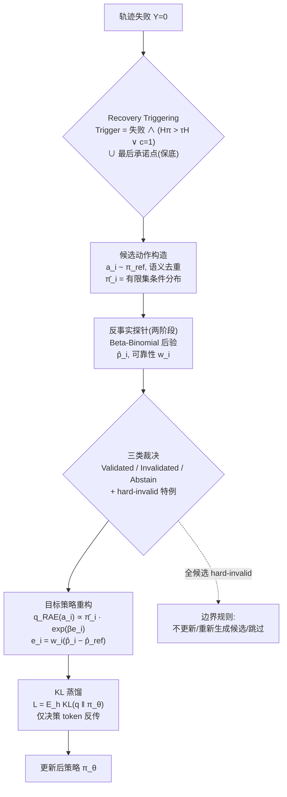

# RAE: Recovery-Aware Exploration with Counterfactual Policy Elimination for Agentic Reinforcement Learning

**RAE：面向 Agent 强化学习的恢复感知探索与反事实策略消除**

> 论文修订稿 v0.2（method-only draft）。本版依据 GPT 重构意见（`GPT_analysis_idea.md` v0.2）对初稿 v0.1 进行结构性修订：将核心机制从"失败动作硬删除"重构为"证据加权的目标策略软重构"（硬消除为证据充分时的特例）；触发机制限定为失败优先（recovery-first）；修正 v0.1 中的数学错误（删除"与 GRPO 一阶等价"命题、澄清长度归一化概率与有限候选集条件分布）；补齐 2026 P0 近邻（RAIL/APPO/IGRPO/Fission-GRPO 等）相关工作；实验设计改为分阶段验证路线。
> 引用均已核实存在（RAIL 等新文献截至 2026-09，见文末参考文献；ARPO 已被 ICLR 2026 接收，RAPO 已被 KDD 2026 接收）。

---

## 摘要（Abstract）

基于可验证奖励的强化学习（RLVR）正在从单轮推理扩展到多轮工具交互的 Agent 场景（agentic RL）。近期工作分别修补了训练管线的三个层面：DAPO 等修复了组相对优化的**损失稳定性**；ARPO / AEPO / BPO 用 token 熵决定**在哪里分支采样**；APPO / IGRPO 为"在哪里探索"引入策略内部第二因子，RAIL 更把 rollout 干预整体学成 contextual-bandit 控制器；IGPO / GiGPO 通过信息增益或状态锚点改进**过程级信用分配**。然而，这些方法共享同一个未被质询的假设：**失败只是一个标量惩罚**（$R=0$ 或负 advantage）。我们指出，长时程 Agent 的核心能力不是复现一条静态的成功路径，而是**从错误中恢复**——在一次失败之后，哪些决策应当被保留、哪些值得进一步验证、哪些已有足够证据支持降低其选择概率，这无法由一个标量回答。

据此我们提出 RAE（Recovery-Aware Exploration with counterfactual policy Elimination），一条把动作级反事实证据显式转化为目标策略分布的链路：**Failure → Counterfactual Evidence → Action-level Assessment → Target Policy Reconstruction → KL-based Policy Update**。它做出三个结构性改变：（1）**Rollout 层（恢复优先触发）**：只在失败轨迹上触发反事实探索，Trigger $=\ R(h)=0\ \wedge\ (H^\pi(h)>\tau_H\ \vee\ C(h)=1)$（策略熵超阈值，或工具报错、代码异常等外部矛盾信号），配合"最后承诺点"保底覆盖低熵的灾难性自信状态；（2）**Evidence 层（三类裁决）**：对每个候选动作在**相同执行协议**（相同上下文、相同后续策略、相同预算）下做有限次反事实 rollout，以 Beta-Binomial 后验将其归入 Validated / Invalidated / Abstain 三类而非二值裁决，证据不足时保留不确定性；（3）**Target/Loss 层（证据加权重构）**：目标策略 $q_{\mathrm{RAE}}(a_i\mid h)\propto\bar\pi_i\exp(\beta e_i)$ 继承参考策略的相对结构、由证据分数 $e_i$ 调整，我们证明其为 $\min_q D_{\mathrm{KL}}(q\Vert\bar\pi_{\mathrm{ref}})-\beta\mathbb{E}_q[e]$ 的唯一解；硬删除 $\mathrm{Renorm}(\bar\pi_{\mathrm{ref}}\setminus a^{hard})$ 被重述为明确环境硬约束下的特例，参数更新以 KL 蒸馏而非伪优势函数完成——目标分布与策略优化严格分离，不把对数概率比冒充 PPO/GRPO 优势。我们给出面向开放动作空间的可执行近似（有限候选集条件分布）、动作级证据的统计可靠性框架、采样预算记账，以及覆盖可重置/可验证环境、含机制性指标与分阶段消融的实验设计。

**关键词**：Agentic RL；错误恢复；反事实推理；目标策略重构；探索-利用

---

## 1 引言（Introduction）

### 1.1 背景与动机

以 GRPO 为代表的组相对策略优化使 RLVR 成为训练推理 LLM 的主流范式 [GRPO]。当模型进一步作为 Agent 与环境交互——调用工具、浏览网页、执行代码——RL 的对象从“一段静态文本”变成“一条动态轨迹”，催生了 agentic RL 这一快速增长的方向 [Survey]。

LLM RL 与 agentic RL 的本质差异并非动作空间大小，而在于**动作会主动改变环境状态，并使未来信息变得可观测**。这带来两个后果：

1. **正确路径不可复用。** 数学题的正确推理链可以被反复强化；Agent 的正确路径依赖具体的环境反馈，observation 换一次就可能失效。
2. **动作具有双重价值。** 除执行价值外，动作还有信息获取价值——一次工具调用可能不改变任务进度，却改变了 Agent 的信念状态。

考虑一条终局失败的轨迹 $s_0\xrightarrow{a_0}s_1\xrightarrow{a_1}\cdots\xrightarrow{a_{T-1}}\text{Failure}$：终局失败只能说明整条轨迹没有完成任务，不能直接说明其中每个动作都是错误的——$a_0$ 可能是正确的导航，$a_1$ 可能是合理的工具调用，而错误可能只发生在 $a_3$，甚至可能只是上游状态不佳。如果直接把整条失败轨迹作为负样本，就可能同时降低合理决策与错误决策的概率。

因此，长时程 Agent 真正需要学习的不是“哪条完整路径最终成功”，而是：

> **在经历失败之后，哪个动作能最快、最可靠地把 Agent 带回正确决策区域？**

### 1.2 现有工作的共同盲区

近期 agentic RL 的进展可以在一个统一的三层坐标系中定位（§3）：**Rollout（采什么）→ Advantage（什么算好）→ Loss（好坏如何变成参数更新）**。DAPO [DAPO] 修 Loss 层稳定性；ARPO [ARPO]、AEPO [AEPO]、BPO [BPO] 修 Rollout 层的探索位置；2026 年的 APPO [APPO] 与 IGRPO [IGRPO] 为选点引入策略内部第二因子，RAIL [RAIL] 则把 rollout 干预整体学成一个 contextual-bandit 控制器（仍在 Rollout 层内优化采样分布而非策略分布，见 §2.2.1）；IGPO [IGPO]、GiGPO [GiGPO]、VinePPO [VinePPO] 修 Advantage 层的信用分配。这条“修漏洞”谱系卓有成效，但四个系统性缺口从未被同时回答：

- **G1（不确定 ≠ 值得探索）**：ARPO/AEPO 在高熵处分支，但高熵可能是 productive uncertainty（结局尚未定），也可能是 unproductive uncertainty（怎么走都失败/都成功）。熵只回答“哪里不确定”，不回答“这里的不确定是否可以被环境分辨”。
- **G2（信念增益 ≠ 正确）**：IGPO 用 $\Delta P_\theta(y^*)$ 做稠密奖励，RAPO 奖励检索后的熵降。二者度量的都是**内部信念的边际变化**——模型对错误答案越来越自信时，同样表现为熵降。内部置信度的上升必须经外部结局校验后才可信。
- **G3（失败 ≠ 标量惩罚）**：所有上述方法把失败折算为 $R=0$ 或负 advantage，即“整体压低这段行为的概率”。但环境给出的信息是**结构化的**：哪个动作被证伪、哪些动作的相对可信度不应被牵连。标量惩罚丢失了这一结构。
- **G4（学习单元错位）**：基本 rollout 单元仍是完整轨迹，而长时程 Agent 最有学习价值的片段是“错误执行 → 检测 → 修正 → 正确执行”这一**局部恢复过程**。

值得强调的是，2026 年社区已从不同方向逼近 G1 的前半句（APPO 的策略内部似然增益 $\Omega$、RAIL 的可学习组对比度增益、IGRPO 的 $P(y^*)$ 信念增益），也把“从失败恢复”做成了显学（Agent-R、Fission-GRPO、ReGRPO 等，见 §2.4/§2.7）。**尚未被同时满足的是**：以外部环境结局为第二因子、把失败定义为对目标策略支持集的结构化约束、且无成功样本时失败侧目标仍良定义——这三条的合取才是 RAE 的贡献位置（§2.7 定位表）。与名字最接近的 RAIL 的完整对照见 §2.2.1 本质区分（四个层面：优化对象 / 核心标量 / 非平稳性处理 / 结构化用法）。

### 1.3 我们的方案：可检验假设而非承诺

我们提出 RAE，把 agentic RL 中对失败轨迹的处理从“负标量回传”改写为“**反事实证据驱动的目标策略重构**”（counterfactual evidence-driven policy reconstruction）：失败触发反事实探针，动作级证据把结局的裁决细化到候选动作，证据加权的软目标分布通过 KL 蒸馏更新参数。与初稿 v0.1 直接宣称四条贡献不同，本版将其收缩为三个可检验假设，其成立与否由分阶段实验（§7）裁决：

- **H1（恢复假设）**：在相同环境交互预算下，基于动作级反事实证据的目标策略重构能够提高 Agent 的失败恢复率。
- **H2（区分假设）**：相比仅使用终局负优势，RAE 能够更准确地区分值得保留的动作与应当降低概率的动作。
- **H3（预算假设）**：在存在多个竞争性候选动作的状态下，自适应反事实预算分配比均匀分配更有效。

方法链路一句话概括：**熵与矛盾信号决定在失败之后的哪些状态值得付反事实预算；相同执行协议下的反事实结局裁决候选动作（Validated / Invalidated / Abstain）；证据加权的软目标分布以 KL 蒸馏落地为参数更新。** 其中，反事实证据到目标分布的连接（Evidence $\to q_{\mathrm{RAE}}$）是方法核心，触发机制与探索预算服务于这一核心；硬消除是证据充分时的极限特例而非默认操作。

---

## 2 相关工作（Related Work）

我们按三层坐标系与“失败如何被使用”两条线组织相关工作。并按近邻威胁程度单列 P0 组（§2.2）。所有文献均已核实（arXiv 编号见参考文献；检索截至 2026-09）。

### 2.1 组相对策略优化：Loss 层的稳定性

**PPO** [PPO] 以 clip 代理目标与 GAE 成为 RLHF 标准，但需要额外的 value model；长时程 Agent 的状态是完整对话加工具返回，critic 既贵又难准。**GRPO** [GRPO] 用同一 prompt 的一组完成做组内标准化，免去 critic，但整条轨迹共享同一个 outcome advantage，且组内全对/全错时优势坍缩为零梯度。**DAPO** [DAPO] 用非对称 clip（clip-higher）、动态采样过滤零方差组、token 级损失归一修复 GRPO 的训练动力学；**NGRPO** [NGRPO] 给全错组注入虚拟 $r_{\max}$ 得到非零负优势。

*与本文关系*：这些方法回答“如何稳定地更新”，不回答“失败告诉了我们什么”。DAPO 丢掉全错组、NGRPO 给全错组一个负标量——二者都承认“失败有信息”，但信息被压成一个数，且概率质量流向不受控。RAE 的底层优化器可以复用该家族的稳定化机制（§6.6 讨论），但失败语义在证据层被重构。

### 2.2 Rollout 层：从纯熵分支到“第二因子”（P0 近邻组）

**纯熵谱系。** **ARPO** [ARPO] 观察到工具返回后 LLM 的 token 熵显著升高，据此在高熵处做 partial rollout 分支，同预算下减少约一半工具调用。**AEPO** [AEPO] 修复 ARPO 的两个失败模式——连续高熵步骤耗尽分支预算与高熵 token 梯度被 clip 剪除——引入熵预监控的预算分配与 stop-gradient 保护。**BPO** [BPO] 在可快照沙箱中主干 + 高熵处分叉，用兄弟回报替代 critic。三者共享“熵 = 探索信号”假设，不区分 productive / unproductive uncertainty（G1 前半）。

**第二因子谱系（P0，related work 必须正面区分）。** 2026 年三项独立工作承认 G1 的前半句（高熵 ≠ 值得探索），但第二因子均为**策略内部量**：

- **APPO** [APPO] 用 $\mathrm{BS}=z(H)\cdot z(\Omega)$ 选择 token 级 procedure 分支点，其中 $\Omega$ 是后续 token 相对 $\pi_{old}$ 的衰减重要性比——**内部续写似然增益**。其实证（高熵 token 的分支准确率并不更高）直接支持 G1；但错误自信同样抬高 $\Omega$。APPO 的乘积门控形式与我们的双熵乘积同构，差别在第二因子的**生成机制**（内部似然 vs 外部探针结局）与后续用法（组相对标量 + 缩放超参 vs 目标分布重构）。
- **RAIL** [RAIL]（Recoverability-Aware Intervention Learning，arXiv:2608.05080）是名字与问题陈述上最接近的近邻，处理层与本文**正交而非重叠**（详见 §2.2.1 本质区分）。它的完整机制是：(i) 把 rollout 干预定义为结构化决策 $b\in\mathcal{B}=\mathcal{M}\times\mathcal{T}$（分支预算 $m\in\{4,8,12\}$ × 解码机制 $\tau\in$ {EXPLOIT, MILD, AGGRESSIVE}，共 9 个可执行动作）；(ii) 定义 recoverability 为干预诱导的**组奖励对比度增益** $\Delta_\theta(z,b)=\mathbb{E}[I(Y_b)-I(Y_\emptyset)\mid z,b,\pi_\theta]$，$I(Y)$ 为组内奖励方差；(iii) 用一个约 2000 参数的 contextual-bandit side-controller（26 维预干预状态特征 + recency 加权 Huber 回归、shadow-to-live 部署、utility gate $\eta$）在线学习该增益并决定在哪分支、怎么采样；(iv) **策略更新保持标准 GRPO**（其附录 D.1 明确 deliberately uncorrected：干预重塑采样分布但不做重要性修正）。理论贡献是 sublinear recoverability regret（其定理 C.8）与“固定启发式干预→线性 regret”（其命题 C.9）。其 Figure 7 给出 G1 的又一独立实证：anchor 熵与实际干预增益几乎不相关（Pearson $r=+0.01$），而学习控制器的预测相关（$r=+0.31$）。
- **IGRPO** [IGRPO] 用节点 informativeness $=\Delta\pi_\theta(a^*\mid h)$（**需要 ground truth**）分配树扩展预算，诱导 teacher 分布 $\mu\propto\pi\exp(\gamma V)$ 后对 teacher 采样做 GRPO——选点标准是“不像正确答案”，不是“环境证伪了哪个动作”，正中 G2。

*与本文关系*：G1 已被 2026 年的工作从两个方向推进。APPO 与 IGRPO 用**策略内部量**（续写似然增益 $\Omega$、对 ground-truth 的信念增量 $P(y^*)$）做第二因子；RAIL 更进一步用**真实结局**（干预诱导的组奖励对比度增益）做第二因子，但其标量停留在**干预层面**——回答“在此状态分支值不值”，而非“此动作是否可行”；且该信号只服务于 rollout 预算分配，从不进入策略更新（附录 D.1 deliberately uncorrected）。本文的第二因子是**动作层面的协议条件化结局** $p_i=P(Y{=}1\mid h,a_i,\mu)$，其熵 $\bar H^B$ 不仅用于预算分配，更进一步驱动动作级裁决与目标重构。三者与 RAE 的差异谱系见 §2.2.1。$\bar H^B$ 与互信息形式均不进入 reward channel（§6.1，回应 Dark Room [DarkRoom] 对密信号进 GRPO 奖励通道的警告）。

#### 2.2.1 RAIL vs RAE：本质区分（原文精读结论）

基于对 RAIL 全文（含附录 B.3 实现、C 章理论、D 章讨论）的逐节精读，两者的差异不是程度差异而是**四个层面上的本质差异**。审稿人视角下，RAIL 是"Recoverability"一词的先占者，因此这一区分必须在 related work 中以最高优先级完成：

**区分一：优化对象不同——"rollout 分布的形状" vs "策略本身应然分布"。**
RAIL 学的是一个 side-controller $\hat\Delta_\phi(z,b)$，其输出决定"在状态 $z$ 用哪个干预动作（几个分支、什么温度）"——它**不改变策略更新公式**，只重塑 GRPO 更新所依据的经验分布；其附录 D.1 明确声明这是刻意的："isolates RAIL's contribution to the rollout-generation layer"（干预塑形采样 + 近似 on-policy 无修正更新）。RAE 输出的是一个**目标策略分布** $q_{\mathrm{RAE}}(a_i\mid h)\propto\bar\pi_i\exp(\beta e_i)$——证据直接改写"策略应该成为什么"，参数更新以 KL 蒸馏逼近这个分布。一言以蔽之：**RAIL 优化采样的分布，RAE 重构被优化的分布**；前者是数据采购器（data curator），后者是监督信号生成器（supervisor）。

**区分二：核心标量的语义不同——"组内奖励对比度增益" vs "动作级协议条件化成功率"。**
表面上，RAIL 的 recoverability 增益 $\Delta_\theta(z,b)$（干预后组方差 $I(Y_b)$ 提升）与 RAE 的探针结局熵 $\bar H^B$（Bernoulli 熵，$p(1-p)$ 的单调函数）同为 $p=0.5$ 取最大，容易被视为“同一数学量”。精读后必须指出二者的**对象与方向相反**：

| | RAIL：$\Delta_\theta(z,b)$ | RAE：$p_i=P(Y{=}1\mid h,a_i,\mu)$ |
|---|---|---|
| 估计对象 | 干预对**rollout 组**造成的奖励分布变化（"多采几条会不会让组内出现对比"） | 单个**候选动作**在同一执行协议下的任务成功率 |
| 最大价值点 | $p\approx 0.5$（组对比最大，midpoint 定理 Prop C.2）；**$p\approx 0$ 判为 unrecoverable，stop 干预**；$p\approx 1$ 判为 solved，skip | $p_i$ 高→Validated；$p_i$ 显著低于参照且可复现→Invalidated；**全候选皆低概率成功不终止学习**——失败侧目标仍良定义 |
| 信号流向 | 组→GRPO 标量 advantage（对比度只是换来了更好的组内归一化） | 动作→目标分布（$e_i$ 改写每个候选的目标概率） |
| 失败的作用 | 全败组是**预算黑洞**，RAIL 用控制器学会避开它 | 全败组是**第一学习信号**，recovery-first 触发的核心场景（§6.4.5 边界规则保证其不退化为 Renorm 空转） |

**关键悖论（最重要的卖点）**：RAIL 的 midpoint 目标意味着它最大化学习信号的位置恰是"半数成功"的可分辨状态；而 RAE 的 recovery-first 触发恰好覆盖 RAIL 判为 unrecoverable 而放弃的 $p\approx 0$ 深水区——**同一状态，相反处方**。RAIL 在全败组停止干预是"预算纪律"，RAE 在全败组启动反事实探针是"证据采集"。这直接引出 RAE 失败侧目标在无成功样本时仍良定义的核心主张：RAE 从这些状态提取结构化约束（哪个动作被证伪），而 RAIL 从这些状态提取不到任何组对比度信号。

**区分三：变化中的不变量不同——"学一个跟随策略漂移的控制器" vs "每步在旧策略上做最小修改"。**
RAIL 的 non-stationary gap 论述（其 Observation 1 / $D_T$ drift budget / recency 加权 / shadow-to-live 晋升协议）是说：recoverability 随 $\pi_{\theta_t}$ 演化，必须在线跟踪。RAE 的立场不同：**证据永远只与上一版策略相关**——$q_{\mathrm{RAE}}$ 是 $\bar\pi_{\mathrm{ref}}$ 的函数，每轮从当前参考策略重新构造，不存在"控制器学习漂移"问题，但有意识地声明非平稳性边界（§6.4.6：消除仅在当前迭代内生效，能力增长后动作可重入支持集）。RAIL 需要一个额外的学习机器去追赶策略；RAE 的目标构造本身是随 rollout 天然 on-policy 的，无控制器、无 shadow phase、无 regret 界需求——但也因此不提供 RAIL 那种"跨任务干预知识迁移"，这是诚实的取舍。

**区分四：结构化决策空间的用法不同——"枚举 9 个干预动作" vs "把裁决写成分布约束"。**
RAIL 的 non-scalar 贡献是干预空间 $\mathcal{B}=\mathcal{M}\times\mathcal{T}$ 的笛卡尔积枚举（分支数 × 解码温度），控制器在 9 个格子中做 bandit 选择；其消融显示标量空间不够（Table 2）。RAE 的"结构化"不在动作枚举而在**证据→分布的映射**：三类裁决 + hard-invalid 特例 + soft 目标公式 + 边界规则（§6.3.3、§6.4）。RAIL 的结构是**采样行为的参数化**（多少、多热），RAE 的结构是**监督语义的参数化**（保留谁、削弱谁、削多少）——前者属于 rollout 超参空间的自适应化，后者属于"失败如何进入梯度"的语义重构。

**收束句（可直接用于论文/rebuttal）**：RAIL 回答"**有限的额外 rollout 花在哪里最划算**"（where-to-spend），它把干预学成 bandit、把对比度当作可学习的信号质量指标，策略更新原封不动；RAE 回答"**一条失败轨迹告诉我们策略应该变成什么**"（what-failure-means），它把结局做成动作级证据、把证据写成对旧策略的最小修改目标，rollout 只是为这个证据采集服务的。二者甚至天然互补：RAIL 的控制器可决定 RAE 探针的总预算（§7.1 P2 阶段与 B6 消融保留 RAIL 式组方差作为第二因子对照之一），而 RAE 可以为 RAIL 判定 unrecoverable 的全败组提供仍能学习的更新目标——共存而非取代。

### 2.3 Advantage 层：过程级信用分配

**IGPO** [IGPO] 把每一 turn 的奖励定义为模型对 ground-truth 答案概率的边际增量 $\Delta P_\theta(y^*)$；**InfoReasoner** [InfoReasoner] 的语义聚类信念熵降与之同源（G2 点名对象）。**GiGPO** [GiGPO] 在已生成的轨迹组内寻找可哈希的重复“锚点状态”做第二级组内相对优势，无需额外 rollout，但开放工具环境中观测文本几乎不会重复；**VinePPO** [VinePPO] 用蒙特卡洛 rollout 替代 value network 估计中间状态价值；**BranPO** [BranPO] 截断前缀、重采样续写构造同前缀不同结局的对比分支，并提出 non-monotonic correctness（早错可被后步救）——这在归因问题上与本文 C2 同源，但学到的是对比优势/偏好，不是支持集重构。

*与本文关系*：RAE 的反事实探针与 VinePPO 的 MC 估计同源，但估计目标不同——VinePPO/BPO 估**价值的期望**并直接作 advantage；RAE 估**结局的可分辨性**并仅用于预算分配（E2，§6.1），价值裁决由后续 validate/invalidate 承接。对 IGPO 一族，RAE 不接受任何未经外部结局校验的内部信念变化作为训练信号。

### 2.4 从失败中学习

**Reflexion** [Reflexion] 用语言化自我反思改进后续尝试，不更新参数；**DPR** [DPR] 做回合内 TextGrad+Reflexion 恢复，同样无参数更新——二者供“上下文恢复 vs 参数化恢复”对照。**Agent Q** [AgentQ] 用 MCTS 成败分支构成偏好对做 DPO。**Agent-R** [AgentR] 在首个错误点拼接失败前缀与成功后缀构造“修正轨迹”做自训练 SFT。**Fission-GRPO** [Fission] 与本文共享 G3 的原话级诊断（“standard RL collapses rich failure into sparse negative rewards”）并同样优化 error recovery rate，但处方相反：失败轨迹 + Error Simulator 诊断反馈裂变成多条 on-policy 恢复 rollout，**仍要采到恢复成功才构成正样本**。**CLEANER** [CLEANER] 把同轨迹内的自纠正段替换成净化轨迹；**ReGRPO** [ReGRPO] 把反思 token 做成可训动作（其奖励是显式加权和 $R=\lambda_{\mathrm{exec}}\mathbf{1}_{\mathrm{succ}}-\eta C+\lambda_{\mathrm{val}}V$，正中本文拒绝的 $\lambda$ 结构）；**CausalFlow** [CausalFlow]、**ERL** [ERL] 分别以反事实干预算修复与擦除再生修补轨迹。**WebRL** [WebRL] 从失败任务自举新任务构成课程。

*与本文关系*：这条线确认“错误恢复”是社区正在收敛的问题，但现有方法的失败利用方式是**repair the trajectory**（拼接/偏好对/净化/再采）——本质仍是模仿或偏好学习，且多数需要成功侧存在。RAE 的差异在于：失败**本身**即训练信号——被证伪的动作直接变成对目标策略支持集的证据约束，无需找到正确后缀，无成功分支时失败侧目标仍然良定义（§6.4）。当环境中难以采到成功分支时（Agent-R 与 Fission-GRPO 均依赖成功侧），RAE 的失败侧目标不退化。Fission-GRPO 是失败利用的第一对照（同诊断、反处方）。

### 2.5 拒绝采样微调与偏好/负梯度方法

**STaR** [STaR]、**RFT** [RFT]、**RAFT** [RAFT] 采样-过滤-模仿成功轨迹，与 RAE 成功侧的 $\delta$ 型极限目标同构——我们明确承认：**成功侧不是新贡献**，新颖性集中在失败侧证据到目标分布的连接。**Unlikelihood training** [UL] 直接压低负 token 概率；**DPO/KTO** [DPO][KTO] 通过偏好对或效用函数隐式产生负梯度。这些方法压低坏行为时**不约束剩余概率质量的去向**；RAE 的软目标显式保持其余动作的相对结构（KL 最小意义下对旧策略的最小修改，定理 1'）。

### 2.6 动作消除的经典理论

Bandit 与 RL 理论中的 **action elimination** [EvenDar] 在置信区间意义下永久移除次优臂并保证样本复杂度。RAE 可视为其在 LLM 策略空间的软化、非平稳版本：消除仅相对 $\bar\pi_{\mathrm{ref}}$ 在当前迭代内生效（§6.4），极限特例（硬消除）需满足与 Even-Dar 同构的“置信下界显著劣于参考”条件（§6.3 裁决规则）。

### 2.7 小结：定位表

| 方法 | Rollout / 选点 | Advantage / 证据 | Loss / 更新 | 失败的用法 |
|---|---|---|---|---|
| PPO / GRPO / DAPO / NGRPO | 独立轨迹 / 组采样 | outcome 标量 | clip | 负 advantage（DAPO 丢全错组，NGRPO 虚拟 $r_{\max}$） |
| ARPO / AEPO / BPO | 高熵分支（BPO 兄弟回报） | outcome + MC value | clip | 负 advantage（BPO 低 value） |
| **APPO** | $z(H)\cdot z(\Omega)$ token 级分支（内部 $\Omega$） | 双组 GRPO + 前缀回灌 | FIPO 影响加权 | 负 advantage |
| **RAIL** | 结构化干预 $\mathcal{M}\times\mathcal{T}$（bandit side-controller 学习组对比度增益） | 仍组内标量（deliberately uncorrected GRPO） | clip | 全败组=unrecoverable，停干预（预算纪律）；失败无结构化用途 |
| **IGRPO** | $P(y^*)$ informativeness 树预算 | teacher-GRPO | clip | “不像正确答案”即抑制 |
| IGPO / InfoReasoner | 标准多轮 | $\Delta P(y^*)$ 答案信念 | clip + KL | 负信念增益 |
| GiGPO / VinePPO / BranPO | 锚点 / MC 续采 / 对比分支 | 锚点相对 / MC value / 对比优势 | clip | 相对标量 |
| Agent-R / Fission-GRPO / CLEANER / ERL | MCTS / 诊断裂变 / 净化 / 擦除 | 修正轨迹 / 恢复 rollout | SFT / GRPO | **造正样本（需成功侧）** |
| **RAE（本文）** | **失败触发探针（recovery-first）** | **Validated / Invalidated / Abstain 三分裁决** | **KL 蒸馏到 $q_{\mathrm{RAE}}$** | **失败 = 目标分布的证据约束（无成功侧仍良定义）** |

**Novelty 的诚实表述**：2026 年已有工作分别触及（i）熵不够所以加第二因子（APPO 的 $\Omega$、IGRPO 的 $P(y^*)$ 为策略内部量；RAIL 的可学习组对比度增益虽源自真实结局，但停留在干预层面、只服务预算分配）；（ii）从失败恢复（Fission-GRPO、ReGRPO、Agent-R——需成功侧或 $\lambda$ 加权）；（iii）对比分支（BranPO）。**尚未被同时满足的是**：（i'）第二因子是**动作层面的外部结局**（协议条件化成功率）且触发限定在失败轨迹（覆盖低熵灾难性自信）；（ii'）失败转化为对目标策略的概率约束 $q\propto\bar\pi\exp(\beta e)$（硬消除为特例），该目标在无成功样本时仍良定义；（iii'）证据评估与策略优化分离，不向 reward channel 引入线性加权超参。这三条合取，是 RAE 的贡献位置。据我们所知，在 agentic RL 语境下，尚无已发表方法把失败定义为“基于动作级反事实证据对旧策略做证据加权重构的目标分布”。

---

## 3 预备知识与问题定义（Preliminaries & Problem Formulation）

### 3.1 Agent 交互环境：部分可观测与决策上下文

将 Agent 交互建模为部分可观测的序贯决策过程 $\mathcal{M}=(\mathcal{S},\mathcal{A},\mathcal{O},P,R,\gamma)$，其中 $\mathcal{S}$ 为环境状态空间，$\mathcal{A}$ 为动作空间，$\mathcal{O}$ 为观测空间，$P$ 为状态转移机制，$R$ 为任务奖励，$\gamma$ 为折扣因子。Agent 不直接观测 $s_t$，而是维护**决策上下文**（完整交互历史）：

$$h_t=(o_0,a_0,o_1,a_1,\ldots,a_{t-1},o_t),$$

策略模型为 $\pi_\theta(a_t\mid h_t)$。对于具有明确任务成功条件的 Agent，使用终局二值奖励 $Y\in\{0,1\}$（连续奖励的阈值化见 §6.3）。

**语义化动作（semantic action）。** LLM Agent 的动作可以是：一次完整工具调用（tool name + 规范化参数）、一个规范化浏览器操作、一段局部代码编辑、一个语义化决策块，或一段连续 token 序列。RAE 的理论设计**优先采用工具调用级 / 语义化动作** $a$，其对应的文本生成过程视为策略的实现方式。原因是：若把每个 token 当独立动作，反事实归因与动作去重都被语言表达差异污染——两个不同 token 序列可能对应完全相同的工具调用（如 `browser.click("submit")` 与 `browser.click(element_id="submit")`），语义上应视为同一动作。token 级实现（§6.5）是语义动作的载体近似而非理论原语。

### 3.2 失败上下文与候选动作

当 Agent 在上下文 $h$ 下完成一次失败交互（终局 $Y=0$）后，算法决定是否触发反事实探索。若触发，构造候选动作集合 $\mathcal{A}_h=\{a_1,\ldots,a_n\}$，每个候选 $a_i\sim\pi_{\mathrm{ref}}(\cdot\mid h)$，其中 $\pi_{\mathrm{ref}}$ 是采集当前训练数据时的参考（旧）策略。此后 RAE 通过环境交互评估各候选的后续结局。

### 3.3 条件化成功率与执行协议（因果归因边界）

这是 RAE 必须显式声明的一个理论边界。定义动作 $a_i$ 的**协议条件化成功率**：

$$p_i=P(Y=1\mid h,a_i,\mu),$$

其中执行协议 $\mu$ 绑定五项实验约定：(1) 动作 $a_i$ 的执行方式；(2) 后续执行策略版本 $\mu_{\mathrm{pol}}$；(3) 后续 rollout 预算；(4) 任务终止条件；(5) 环境重置与随机性控制方式。不同协议下的 $p_i$ 不具可比性。

**必须承认的限制（回应 C2）**：$p_i$ 不是动作脱离执行条件的独立因果效应。多步 Agent 中候选动作会改变后续状态，后续状态又影响后续动作与最终结局。因此 RAE 的估计对象始终是“指定上下文、指定后续策略、指定预算下的条件化成功率”，所有归因结论都以此为限定语：实验须保证不同候选从相同上下文出发、使用相同后续策略与预算、控制可控环境随机性；环境不可控时，结论限定为**条件化的结果差异**而非绝对因果结论。支持确定性重放的环境可提高动作间比较的可解释性。

### 3.4 优化目标与三层分解

RAE 研究的问题是：**在固定或可比较的环境交互预算下**，能否通过反事实证据构造更合适的目标策略分布，提高训练后 Agent 的任务成功率与失败恢复能力。记 $B$ 为总交互预算，$\pi_{\mathrm{ref}}$ 为参考策略，$q_{\mathrm{RAE}}$ 为反事实证据构造的目标策略，$\pi_\theta$ 为被训练策略。RAE 将问题分解为三个层次：

| 层次 | 核心问题 | RAE 的处理方式 |
|---|---|---|
| **Rollout** | 失败之后，哪些状态值得反事实预算？ | 失败触发机制 + 矛盾信号 + 候选评估分配预算（§6.1） |
| **Evidence** | 如何判断候选动作值得强化、削弱或保留？ | 相同协议下的动作级结局证据 + Beta-Binomial 可靠性（§6.3） |
| **Optimization** | 如何把证据转化为策略更新？ | 证据加权目标分布 $q_{\mathrm{RAE}}$ + KL 蒸馏（§6.4–6.5） |

三层不相互独立：候选选择影响可观测证据；证据可靠性影响目标构造；目标分布决定更新方向。**RAE 的方法贡献集中在后两层的连接上**：Counterfactual Evidence $\to q_{\mathrm{RAE}}$。三层坐标系（Rollout/Advantage/Loss）与 G1–G4 的对应关系保持初稿定位：Rollout 层在失败后决定在哪采样；Evidence+Target 层替代组相对标量；Loss 层为 KL 蒸馏。

### 3.5 恢复片段与熵生命周期（研究对象，非训练目标）

长时程 Agent 真正决定策略质量的是**错误恢复能力**：在动作被环境证伪或信念冲突的状态下，能否 (i) 撤回失效承诺，(ii) 在剩余备选中高效重探，(iii) 收敛到被环境验证的新承诺。对应的学习单元是**恢复片段**（recovery segment）：

$$\sigma=(s_e,a_f,\underbrace{\text{explore}}_{\text{熵}\uparrow},a^+,\underbrace{\text{commit}}_{\text{熵}\downarrow}),$$

理想策略在 $\sigma$ 上呈现熵生命周期 $H$: low→high→low。**与 v0.1 的关键区别**：本版不把熵生命周期作为训练目标或必然涌现的结构宣称，而是作为**实验预言**——若 RAE 的证据-重构机制真正学到了恢复，则在以证伪事件对齐的熵曲线（§7.4）中可观察到该形态；观察不到即构成对该机制的证伪（§8 理论边界“不可直接宣称清单”）。

---

## 4 挑战（Challenges）

把“反事实证据驱动的目标重构”变成可训练目标，需同时解决四个技术挑战：

- **C1（失败后的选点）**：一条失败轨迹中哪些决策状态值得付反事实采样的代价？纯熵准则在全成/全败处浪费预算，在灾难性自信处漏检；但二元冲突信号也非处处可得。
- **C2（裁决与归因）**：一条从 $(h,a_i)$ 出发的续采失败，错误可能出在 $a_{i+5}$ 而非 $a_i$——证伪信号应打在哪个动作上？小样本下点估计如何避免过度自信？
- **C3（目标构造）**：如何把三类证据写成一个**不加权超参堆积**、对旧策略修改最小、且失败侧在无成功样本时仍良定义的训练目标？被证伪动作占满概率质量时如何数值稳定？所有候选皆被证伪时如何处理？
- **C4（开放动作空间）**：LLM 动作是开放 token 序列，熵计算、概率定义、目标重构、KL 计算全部需要有限支持集上的可执行近似——且有限候选集上的分布不能被冒充为完整动作空间上的分布。

§6 逐一给出解法：C1→§6.1，C2→§6.3，C3→§6.4，C4→§6.2/§6.5。

---

## 5 方法概览（Method Overview）

RAE 包含五个模块，整体链路为 **Failure → Counterfactual Evidence → Action-level Assessment → Target Policy Reconstruction → KL-based Policy Update**：

1. **Recovery Triggering**（§6.1）：判断失败轨迹上哪些决策状态值得额外探索；
2. **Candidate Action Construction**（§6.2）：构造具有语义区分度、概率定义明确的候选集合；
3. **Counterfactual Evaluation**（§6.3）：在可比较执行条件下估计候选动作结局并做三类裁决；
4. **Evidence-aware Target Reconstruction**（§6.4）：把动作级证据转化为目标策略分布；
5. **Target Policy Distillation**（§6.5）：以 KL 蒸馏将目标分布转化为参数更新。

两个贯穿性设计原则：(1) **证据评估与策略优化分离**——反事实探针负责“发生了什么”，目标分布负责“该成为什么”，KL 蒸馏负责“如何变成”，三者不混在同一公式里；(2) **证据不足时保留不确定性**——Abstain 不代表动作无用，而是当前预算下无法可靠判断；有限次失败不直接等价于动作不可行。

---

## 6 方法：RAE 五模块（Method）

### 6.1 模块一：Recovery-aware Triggering（解 C1）

#### 6.1.1 为什么不能只依赖策略熵

策略熵 $H^\pi(h)=-\sum_a\pi_{\mathrm{ref}}(a\mid h)\log\pi_{\mathrm{ref}}(a\mid h)$ 衡量策略在候选动作间的分散程度，但它不能回答：不同动作是否产生不同结果、哪个动作更可能成功、额外 rollout 是否能改变当前决策。策略可能对五个语义相近动作均分概率（高熵但探索无价值），也可能高度偏好一个错误动作而低概率替代动作中存在可行解（低熵但探索有价值——灾难性自信）。

**注意两种结果不确定性的区分。** 给定上下文 $h$，候选动作 $a$ 的结局随机性为 $H(Y\mid h,a)>0$（同一动作在不同环境种子下结果不同）；而**动作之间的结果差异** $P(Y\mid h,a_i)\neq P(Y\mid h,a_j)$ 才直接关系候选间是否存在可利用信息。若所有动作成功率都≈0.5，总体结局熵很高但动作间无差异——高结局熵 ≠ 高动作可区分性。动作与结局之间的条件互信息

$$I(A;Y\mid h)=\sum_i\bar\pi_i\sum_{y\in\{0,1\}}P(y\mid h,a_i)\log\frac{P(y\mid h,a_i)}{P(y\mid h)},\qquad P(y\mid h)=\sum_i\bar\pi_iP(y\mid h,a_i),$$

才是"知道选了哪个动作能减少多少结局不确定性"的正确度量；所有动作结局分布相同时 $I(A;Y\mid h)=0$。但互信息只反映可区分性，不能独立衡量探索成本与决策价值，且实测依赖有限样本——**因此第一版 RAE 不把互信息用于选点，只用于第二阶段的预算分配消融**（§7.5 B6），避免一开始引入过多阈值。

#### 6.1.2 失败优先触发（recovery-first）

**v0.2 的关键收缩**（相对 v0.1 的三路通用触发）：主算法只在失败轨迹上触发反事实探索。

$$\boxed{\ \mathrm{Trigger}(h)=\mathbb{1}\Big[R(h)=0\ \wedge\ \big(H^\pi(h)>\tau_H\ \vee\ C(h)=1\big)\Big]\ }$$

其中：

- $R(h)=0$：当前轨迹终局失败（必要条件）；
- $H^\pi(h)$：参考策略在该决策点的候选动作熵，$\tau_H$ 为熵触发阈值；
- $C(h)$：**外部可验证的矛盾信号**，操作化为可插拔检测器的析取：工具调用被环境明确拒绝、代码执行返回确定性异常、浏览器操作触发明确状态错误、环境反馈违反任务约束。**不应把任意终局失败当作强冲突信号**——失败若只因后续推理不完整或环境随机性，当前动作未必错误。

**保底候选。** 对 $Y=0$ 的轨迹，其**最后一个承诺点**（最后一次不可逆动作前的决策态）无论是否满足熵/矛盾条件，强制进入候选集。这专门覆盖低熵的**灾难性自信**象限：错误承诺越坚定熵越低，越不会被熵准则选中，但它是 reward hacking 与死循环的高发区。路 2（矛盾）与保底路共同构成对纯熵方法（ARPO/AEPO）结构性盲区的补丁。

**候选状态集合**：$\mathcal{C}_\tau=\{h_t\ \text{于失败轨迹}\ :\ \mathrm{Trigger}(h_t)=1\}\cup\{\text{最后承诺点}\}$。

**与 v0.1 的关系**：v0.1 的"高熵 top 分位（不问成败）"通用触发被移出主算法，作为可选扩展进入消融 B4a（§7.5）。

#### 6.1.3 结局可分辨性：从选点信号降级为预算分配准则

v0.1 的双熵乘积 $U=\bar H^\pi\cdot\bar H^B$ 被作为通用探索价值宣称。v0.2 做两个修正：

1. **地位修正**：在 recovery-first 设定下，触发已由失败 ∧（熵阈值 ∨ 矛盾信号）完成，$\bar H^B$（少量探针结局的 Bernoulli 熵）与 $I(A;Y\mid h)$ 不再是主选点判据，而是**阶段二预算分配准则**——当多个触发状态竞争有限反事实预算时，优先分配给"策略 undecided 且结局可分辨"（$\bar H^\pi$ 高、$\bar H^B$ 高）的状态；全成/全败（$\bar H^B\approx 0$）的状态少分配或不分配。
2. **解释修正**：乘积是满足"任一因子为零则价值为零"的最简单组合（替代形式 min / 加权和进入消融 B5），**不宣称其为信息增益的上界或最优组合**；v0.1 的 BALD 型 MI 上界说法撤回，正确互信息定义见 §6.1.1。

**冷启动回退。** 训练初期难题上探针成功率处处 $\hat p\approx 0$ 使 $\bar H^B\equiv 0$。此时预算分配退化为按 $H^\pi$ 排序（ARPO 式），并将该题移入课程队列，待策略在邻近难度获得非零 $\hat p$ 后再启用可分辨性准则。

### 6.2 模块二：Candidate Action Construction 与概率定义（解 C4 前半）

#### 6.2.1 采样支持集与语义去重

对每个触发状态 $h$，从参考策略采样并构造有限候选集：

$$\mathcal{A}_h=\mathrm{dedup}\big\{a^{(j)}\sim\pi_{\mathrm{ref}}(\cdot\mid h)\big\}_{j=1}^{n},$$

去重键为**语义规范化动作**：工具调用取 $(\text{tool name},\ \text{normalized arguments})$；浏览器任务取规范化操作；代码编辑取局部编辑操作；`browser.click("submit")` 与 `browser.click(element_id="submit")` 若在环境中执行语义相同，则归并为同一候选。文本生成类动作的粒度定义需谨慎（两个表达不同的回复可能任务效果相同），第一版优先工具调用级动作。

#### 6.2.2 概率定义：条件分布、四种量不可混用（E3 修正）

开放动作空间不可枚举，候选集 $\mathcal{A}_h$ 是完整空间 $\mathcal{A}$ 的有限子集。**必须区分四种概率量**：完整空间上的 $\pi_{\mathrm{ref}}(a\mid h)$；有限集上的条件化分布；语义去重后的经验分布；候选评分分布。RAE 的全部概率运算（熵、证据加权、KL）都在条件分布上进行：

$$\bar\pi_i=\bar\pi_{\mathrm{ref}}(a_i\mid h,\mathcal{A}_h)=\frac{\pi_{\mathrm{ref}}(a_i\mid h)}{\sum_{a_j\in\mathcal{A}_h}\pi_{\mathrm{ref}}(a_j\mid h)}.$$

**长度归一化警告**：若动作为 token 序列，$\pi_{\mathrm{ref}}(a\mid h)$ 必须用**真实序列对数似然**参与上式重归一。长度归一化分数 $\frac{1}{|a|}\log\pi_{\mathrm{ref}}(a\mid h)$ 可用于候选**排序**，但一般不能作为对数概率参与严格的概率重归一化——v0.1 中该混用被修正。相应地，所有在 $\mathcal{A}_h$ 上的结论都带有"有限候选截断"的近似声明：$n$ 越大截断偏差越小，$n\in\{4,8,16\}$ 进入消融。

**从参考策略单一来源到多来源采样（future work）**：候选全来自 $\pi_{\mathrm{ref}}$ 会遗漏低概率但有效的动作（§8 局限）。第一版刻意只用单一来源以控制变量，多样化候选生成器留给后续版本。

### 6.3 模块三：Counterfactual Evaluation 与三类证据（解 C2）

#### 6.3.1 相同执行协议下的反事实探针

对每个候选 $a_i$，从上下文 $h$ 出发执行：

$$\tau_{i,k}\sim P(\tau\mid h,a_i,\mu),\qquad Y_{i,k}=\mathbb{1}[\tau_{i,k}\text{ succeeds}],\quad k=1,\ldots,K_i,$$

其中执行协议 $\mu$ 固定（§3.3）：相同后续策略版本、相同后续预算、相同终止条件、相同随机性控制。经验成功率 $\hat p_i=\frac{1}{K_i}\sum_kY_{i,k}$。

**示例**：$a_1$ 8/8 失败、$a_2$ 2/8 成功、$a_3$ 6/8 成功——但 $\hat p$ 只是点估计：某动作 2 次全失败并不足证其真实成功率为零。

#### 6.3.2 Beta-Binomial 后验：估计与可靠性并重（E4 修正）

设 $p_i\sim\mathrm{Beta}(\alpha_0,\beta_0)$，观测 $S_i=\sum_kY_{i,k}$ 次成功、$F_i=K_i-S_i$ 次失败后：

$$p_i\mid\mathcal{D}_i\sim\mathrm{Beta}(\alpha_0+S_i,\ \beta_0+F_i),\qquad \mathbb{E}[p_i\mid\mathcal{D}_i]=\frac{\alpha_0+S_i}{\alpha_0+\beta_0+K_i},$$

后验方差刻画估计不确定性。该模型假设 rollout 条件独立；若不同 rollout 共享强环境随机因素或候选间存在复杂依赖，需调整统计模型。**RAE 的关键不在于必须用 Beta 分布**：动作级证据须同时含**表现估计**与**可靠性**，不能只据成功/失败次数做绝对判断——Beta-Binomial、置信区间或其它经校准的估计均可，第一版采用 Beta-Binomial，校准式消融进入 §7.5。

#### 6.3.3 三类裁决：Validated / Invalidated / Abstain（统一规则）

v0.1 的不对称规则（invalidate 要求 $\hat p=0$ 且 $K\ge K_{\min}$，validate 要求 $\hat p\ge p_+$）被统一的后验陈述替代。设 $p_{\mathrm{ref}}$ 为参考成功率（来自预定义基准动作、当前策略基线表现或同上下文对照组——**没有可靠参照时不得宣称"显著更好/更坏"**）：

| 裁决 | 条件（后验形式） | 语义 |
|---|---|---|
| **Validated** | $P(p_i>p_{\mathrm{ref}}\mid\mathcal{D}_i)>1-\delta$ | 证据支持该动作在协议下表现较好 |
| **Invalidated** | $P(p_i<p_{\mathrm{ref}}-\Delta\mid\mathcal{D}_i)>1-\delta$ | 证据支持表现较差或存在明确不可行性（$\Delta$ 为有实际意义的最小差异） |
| **Abstain** | 两者之间 | **当前预算下无法可靠判断**；不进目标重构，只作为保留质量 |

$\delta$ 是允许的错误概率水平（多臂检验的校准进入敏感性分析）。**Hard-invalid 特例**：仅当动作**明确违反环境硬约束**——工具调用确定性返回参数非法且相同条件下必现相同错误——才允许直接硬消除（$e_i\to-\infty$，§6.4），且要求相同参数在相同条件下的错误可复现。**普通终局失败不自动意味着动作无效**；有限样本失败更不等价于动作不可行。

#### 6.3.4 有对照的 Dead-end 处理（E6 修正）

v0.1 规则"状态处所有动作全被证伪 $\Rightarrow$ 上游动作 invalid"**不成立**：全下游失败可能是上游动作错误，但也可能是后续策略弱、环境困难、探针不足、采样未覆盖可行动作。v0.2 改为**有对照的上游回传**：

设上游动作 $a_p$ 导致上下文 $h$，$h$ 处多分支皆败。仅当可构造可比替代 $a_p'$ 且从相同起始条件执行比较：

- 若后验支持 $\hat p(a_p)$ 与 $\hat p(a_p')$ **存在稳定差异**（同 §6.3.3 的 Invalidated 条件），才对 $a_p$ 施加 upstream 调整；
- 若无法构造可比替代，记录为"**当前分支未找到成功路径**"，不标"上游已证伪"。

该模块作为**独立可选模块**实现，其净收益进入消融 B7。

#### 6.3.5 反事实预算记账（E8 修正）

必须区分三类操作的不同成本：候选生成、反事实探针、完整扩展。设 $N_c$ 为生成候选数、$N_p$ 为进入评估的候选数、$K_i$ 为候选 $i$ 的探针数、$C_{\mathrm{full}}/C_{\mathrm{probe}}$ 为完整/探针 rollout 平均成本（生成 token 计）：

$$C_{\mathrm{total}}=C_{\mathrm{candidate}}+\sum_{i=1}^{N_p}K_iC_{\mathrm{probe}}+N_{\mathrm{full}}C_{\mathrm{full}}.$$

**两阶段评估**：阶段一以 $K_{\mathrm{init}}$ 条轻量探针（截断长度 $\ell_{\mathrm{probe}}\ll\ell$）对每个候选做低成本筛查；阶段二将追加预算分配给"证据不足但可能影响决策"的候选（如后验区间高度重叠的两个动作），目标是**减少目标重构中的决策错误**而非单纯降方差。是否值得，由 B6 消融裁决。不允许同时声称"每候选充分统计"又"探针成本常数"——所有对比实验中探针成本全部计入总预算 $M$（§7.6）。

### 6.4 模块四：Evidence-aware Target Policy Reconstruction（解 C3）

本模块把动作级证据转化为目标分布——**RAE 不是不用奖励**：它仍使用成功/失败结局，只是把轨迹级结果监督细化到动作级证据，再由证据构造目标策略。

#### 6.4.1 软目标主公式

在候选集 $\mathcal{A}_h$ 上，为每个动作定义证据分数 $e_i=e(a_i,h,\mathcal{D}_i)$：$e_i>0$ 支持提高相对概率，$e_i=0$ 保留参考权重，$e_i<0$ 支持降低。目标策略：

$$\boxed{\ q_{\mathrm{RAE}}(a_i\mid h)=\frac{\bar\pi_i\exp(\beta e_i)}{\sum_{j=1}^{n}\bar\pi_j\exp(\beta e_j)}\ }$$

五条性质：(1) 继承参考策略的相对结构；(2) 证据决定相对调整；(3) Abstain 动作（$e_i=0$）保留相对权重；(4) 有限集上自动归一；(5) 证据分数与参考概率显式区分。

#### 6.4.2 证据分数设计

第一版从简、可复现：

$$e_i=\begin{cases}+w_i(\hat p_i-\hat p_{\mathrm{ref}}), & \text{Validated}\\ -w_i(\hat p_{\mathrm{ref}}-\hat p_i), & \text{Invalidated}\\ 0, & \text{Abstain}\end{cases}$$

其中可靠性权重 $w_i\in[0,1]$ 由后验方差、置信区间宽度或有效样本量构造。**建议第一版先验证"目标重构本身的价值"**（$w_i\equiv1$、平滑差值），复杂置信度函数经消融证明有效后再引入，避免同时引入多种证据权重（§7.5 B2）。

#### 6.4.3 定理 1'（推广）：证据加权目标的优化解释

**定理 1'。** 设候选集上 $\bar\pi_{\mathrm{ref}}$ 正支持。约束问题

$$\min_q\ D_{\mathrm{KL}}(q\Vert\bar\pi_{\mathrm{ref}})-\beta\sum_iq_ie_i\quad\text{s.t.}\ \sum_iq_i=1,\ q_i\ge0$$

的唯一解为 $q^*(a_i)=\bar\pi_i\exp(\beta e_i)/\sum_j\bar\pi_j\exp(\beta e_j)$。*证明*：拉格朗日函数 $\mathcal{L}(q,\lambda)=\sum_iq_i\log\frac{q_i}{\bar\pi_i}-\beta\sum_iq_ie_i+\lambda(\sum_iq_i-1)$，驻点 $\frac{\partial\mathcal{L}}{\partial q_i}=\log\frac{q_i}{\bar\pi_i}+1-\beta e_i+\lambda=0$ 给出 $\log\frac{q_i}{\bar\pi_i}=\beta e_i-1-\lambda$，即 $q_i\propto\bar\pi_i\exp(\beta e_i)$；KL 对 $q$ 严格凸且目标线性，解唯一。∎

**对数偏移关系**：$\log\frac{q^*(a_i)}{\bar\pi_i}=\beta e_i-\log Z$，$Z=\sum_j\bar\pi_j\exp(\beta e_j)$——目标对参考的概率比由证据分数先经 $\beta$ 缩放再平移。**$\beta$ 的角色**：它不是需要网格搜索的加权超参，而是 KL 正则的温度——给定证据分数后的目标分布在 argmin 意义下唯一确定，$\beta\in\{0.5,1,2\}$ 仅做稳健性检查。该论断同样适用于 Invalidated 的 $\Delta$ 与 $\delta$：它们不是 $\lambda$ 型加权系数，而是裁决规则的统计参数，各有独立于 reward channel 的语义（§6.6）。

**必须声明**：定理 1' 证明的是"给定证据分数后目标分布的最优性"，**不保证证据分数本身正确**；若 $e_i$ 估计有偏或与真实成功率不一致，目标仍会产生错误更新。"无任何超参"的 v0.1 口号撤回——RAE 的正确主张是**不向 reward channel 引入 $R_1+\lambda R_2$ 型线性加权**（E5，回应 Dark Room [DarkRoom] 与 InfoReasoner 的显式 $\lambda$）。

#### 6.4.4 v0.1 定理 1 / 命题 1 的重述：硬消除是极限特例

- **硬消除**（$a_f$ 被 hard-invalid 证实违反环境硬约束）：$q(a_f)=0$、其余按 $\bar\pi$ 重归一，即 $q(a)=\bar\pi_{\mathrm{ref}}(a\mid a\neq a_f)$——对应主公式中 $e_{a_f}\to-\infty$ 的极限。在该极限下，v0.1 定理 1（$q=\mathrm{Renorm}(\bar\pi\setminus a_f)$ 是 $\min_{\pi:\pi(a_f)=0}D_{\mathrm{KL}}(\pi\Vert\bar\pi)$ 的唯一解）与命题 1（贝叶斯条件化）继续成立，作为 $\mathcal{A}_{\mathrm{hard\text{-}invalid}}\subseteq$ 支持集约束的特例保留。
- **成功侧条件化**（$\mathcal{V}=\{a:\text{Validated}\}$）：$\beta e_i\to+\infty$（对 $a_i\in\mathcal{V}$）、其余 $e\to-\infty$ 的极限退化到 $\mathrm{Renorm}(\bar\pi\restriction_\mathcal{V})$；$|\mathcal{V}|=1$ 时为 $\delta_{a^+}$（与 RFT/STaR 成功侧同构，**不称新颖**）。有限 $\beta$ 下无需单独温度 $T_{tgt}$ 软化即天然缓解 $\delta$ 目标的熵坍缩。
- **Floor 软化**：为极端自信错误保留 $\epsilon_f$ 下限等价于把 $e_{a_f}$ 截断到 $\log(\epsilon_f/\bar\pi_{a_f})$，即"硬消除"软化回有界负证据——v0.1 的 sequential elimination 论述（叠轮次逐步剥离而非单步剧烈重构）继续适用。
- **Uniform soft-elimination 不存在单独 math**：对所有动作施加软权重与不施加的差别只是 $e\equiv 0\Rightarrow q=\bar\pi$（无更新），不存在额外机制。

#### 6.4.5 边界条件（E9）

- 若所有候选皆 hard-invalid：**不做归一化更新**——保留原目标（$q=\bar\pi$）、重新生成候选或终止该状态的反事实更新；算法不得在空支持集上 Renorm。
- 若 $\mathcal{A}_h$ 只剩单动作：目标退化为 $\delta$ 分布，按成功侧处理。
- 有限候选分布 $\neq$ 完整动作空间最优策略：所有结论带截断近似声明（§6.2.2）。

#### 6.4.6 熵是结果而非目标（预言地位的说明）

例：$\bar\pi=[0.8,0.1,0.05,0.05]$，$a_1$ 被 Invalidated 取 $\beta e_1=-2$、其余 Abstain（$e=0$）$\Rightarrow q\approx[0.35,0.32,0.16,0.16]$，分布熵从 $0.71$ nats 升至 $1.32$ nats；随后 $a_2$ Validated（$\beta e_2=+2$）$\Rightarrow q\approx[0.11,0.78,0.05,0.05]$，质量向 $a_2$ 收缩。**但本版不宣称该生命周期必然涌现**（§8 清单）；它是 §7.4 被检验的实验预言。

**非平稳性声明**：$q_{\mathrm{RAE}}$ 是 $\bar\pi_{\mathrm{ref}}$ 的函数，证据调整仅在当前迭代内生效；能力增长后动作可重入支持集——区别于经典 action elimination 的永久删除。

### 6.5 模块五：KL 蒸馏与梯度（解 C4 后半）

#### 6.5.1 目标分布与参数化策略的分离

明确区分两个对象：$q_{\mathrm{RAE}}$（证据决定的目标分布，本轮固定）与 $\pi_\theta$（需优化的参数化策略）。前者表达"基于证据希望策略成为什么"，后者通过更新逼近它。这种分离使证据估计、奖励设计、策略梯度不混在同一公式。

#### 6.5.2 KL 目标与正确梯度

$$\mathcal{L}_{\mathrm{RAE}}(\theta)=\mathbb{E}_{h\sim\mathcal{D}}\Big[D_{\mathrm{KL}}\big(q_{\mathrm{RAE}}(\cdot\mid h)\Vert\pi_\theta(\cdot\mid h)\big)\Big]=\mathbb{E}_h\Big[\sum_{a\in\mathcal{A}_h}q(a\mid h)\big(\log q(a\mid h)-\log\pi_\theta(a\mid h)\big)\Big].$$

$q$ 固定时，$D_{\mathrm{KL}}(q\Vert\pi_\theta)=\text{const}+\mathbb{E}_{a\sim q}[-\log\pi_\theta(a\mid h)]$——最小化 KL 等价于**向目标分布蒸馏**。梯度：

$$\nabla_\theta\mathcal{L}=-\mathbb{E}_{a\sim q}\big[\nabla_\theta\log\pi_\theta(a\mid h)\big].$$

若动作用参考策略采到的样本近似（$q$ 在 $\pi_{\mathrm{ref}}$ 支持集上绝对连续），可写重要性采样形式：

$$\nabla_\theta\mathcal{L}=-\mathbb{E}_{a\sim\pi_{\mathrm{ref}}}\Big[\underbrace{\frac{q(a\mid h)}{\pi_{\mathrm{ref}}(a\mid h)}}_{\text{IS 权重：概率比}}\nabla_\theta\log\pi_\theta(a\mid h)\Big].$$

**关键修正（E1）**：IS 权重是**概率比** $q/\pi_{\mathrm{ref}}$，不是对数概率比。v0.1 的命题 2（"$A^{\mathrm{RAE}}=\log q-\log\bar\pi$ 与 KL 蒸馏梯度一阶等价，可回传进 PPO/GRPO clip 管线"）**不成立，撤回**：log-ratio 与概率比非同一数学对象（前者可为 $-\infty$ 而后者为 0，数值性质不同），二者不是等价的梯度权重。GRPO 管线集成的可行路径改为 §6.6 的开放问题。

#### 6.5.3 token 层实现

1. **支持集概率**：$\pi_\theta(a_i\mid h)$ 为动作 token 的真实序列对数似然和（不长度归一化，§6.2.2）；
2. **蒸馏样本**：候选动作由探针阶段复用生成（探针即支持集采样来源，选点与证据共享同批样本，无额外生成开销）；
3. **损失域**：$\mathcal{L}(h)=-\sum_iq_i\log\pi_\theta(a_i\mid h)$，**只对决策/动作 token 反传**；观测与工具返回 token 一律 mask（损失掩码沿用工具返回 token mask=0 的管线惯例，见 §6.8）；
4. **首分歧退化版（低成本变体）**：仅在 $a_f$ 与其余候选首个分歧 token 处施加加权蒸馏，退化为带比例保持的 token 级 unlikelihood，作为效率-精度权衡进入消融 B3。

#### 6.5.4 RAE 第一版不依赖"新 loss"

主目标即 KL 蒸馏：$\mathcal{L}_{\mathrm{RAE}}=\mathbb{E}_hD_{\mathrm{KL}}(q_{\mathrm{RAE}}\Vert\pi_\theta)$。成功侧展开为加权 NLL 型模仿项，失败侧展开为比例保持的重分布项——**同一损失承载 exploit 与 explore，不需要熵系数、IG 权重或 $R_1+\lambda R_2$ 结构**。与 GRPO/PPO 似然比管线的关系见 §6.6。

### 6.6 与 GRPO/PPO 管线的关系（讨论，降级为开放问题）

v0.1 宣称 $A^{\mathrm{RAE}}$ 可直接替换组相对优势回传 clip 管线并与之"一阶等价"。E1 修正后，本节降级为**开放问题**：能否在同一组 rollout 上构造 $q_{\mathrm{RAE}}$ 并替换组内优势加权？

作为正面命题，其成立需先解决五项（GPT §8.4）：(1) 目标如何从 rollout 数据估计——组内候选即支持集、组成功率即 $p_{\mathrm{ref}}$ 的可能对应；(2) 目标分布与采样分布差异的重要性修正——IS 概率比 $q/\pi_{\mathrm{ref}}$ 而非 log-ratio；(3) 目标零概率而采样正概率动作的处理；(4) clip 截断/近似对蒸馏目标的偏置；(5) 修正后更新与标准 GRPO 更新的理论关系。**这些问题解决前，RAE 主方法不宣称与 GRPO 等价，也不把 RAE 定义为"新 PPO 变体"**——目标重构独立成模块，KL 蒸馏有明确目标，把优化器机制混入第一版会让性能变化难以归因。

**工程混合变体的披露要求**：若实现时为稳定训练将 KL 蒸馏损失与既有 outcome loss 组合（如 verl 管线里的 FIPO/PPO loss 旁挂一个蒸馏项），论文必须显式披露组合结构与各自权重及其消融；不得在叙述中隐去组合而宣称"单一损失"。

### 6.7 训练流程（九步 → 五模块循环）

1. 常规 rollout：$\tau_1..\tau_N\sim\pi_{\mathrm{ref}}$（verl 型管线的标准组采样）；
2. 失败识别与触发：$Y=0$ 轨迹上按 Trigger 公式（§6.1.2）提取候选状态 $\mathcal{C}_\tau$，含最后承诺点保底；
3. 候选构造：每状态采样 $n$ 候选、语义去重、计算 $\bar\pi_i$（§6.2）；
4. 反事实探针（两阶段）：$K_{\mathrm{init}}$ 轻量探针 → Beta-Binomial 后验 → 阶段二按可分辨性追加（§6.3.5），全部计入预算 $M$；
5. 三类裁决：Validated / Invalidated / Abstain（+ hard-invalid 特例、有对照 upstream 回传，§6.3.3–6.3.4）；
6. 目标重构：证据分数 $e_i$ → $q_{\mathrm{RAE}}\propto\bar\pi\exp(\beta e)$；全候选无效触发边界规则（§6.4.5）；
7. KL 蒸馏：$\mathcal{L}_{\mathrm{RAE}}=\mathbb{E}_hD_{\mathrm{KL}}(q_{\mathrm{RAE}}\Vert\pi_\theta)$，仅决策 token 反传（§6.5）；
8. 优化更新：标准 FSDP/AdamW 微批次循环，证据增强态蒸馏梯度与常规 outcome 梯度按各自损失域分别计算（见 §6.6 披露要求）；
9. 日志：每个裁决的事件记录（动作、裁决类、$\hat p$、$w$、$e$）供机制分析（§7.4）。

### 6.8 工程落地：verl 兼容性（Implementation Notes）

基于本仓对 APPO/ARPO 代码栈的全量核对（`docs/APPO_ARPO_技术报告.md`），RAE 五模块在 verl 型管线上的落点：

| RAE 模块 | verl 栈落点 | 说明 |
|---|---|---|
| 反事实探针（trainer 侧第二程 generate） | APPO `build_appo_branch_request` → `_generate_appo_selected_branches` 同构机制（`ray_trainer.py` L378–505 / `vllm_rollout_with_tools.py` L389-497） | APPO 的 token 级分支请求也是"旧 rollout 选点 → 第二程续采 → 合并对齐"三步；RAE 把"选点判据"从 $z(H)z(\Omega)$ 换成失败触发 + 语义候选，"合并用法"从前缀优势回灌（`compute_appo_advantage` L341-365）换成目标分布蒸馏 |
| 工具循环与 stop-tag 协议 | `vllm_rollout_with_tools.py` 的 `</search>/</python>` stop +ThreadPoolExecutor 工具执行 + `<result>` 回填 | 候选动作天然切分于工具调用边界（语义动作粒度与 stop tag 对齐） |
| 损失掩码惯例 | 工具返回 token `result_masks=0`（L889-897）、APPO branch 行整行 mask=0 | "仅决策 token 反传"（§6.5.3）与该惯例一致 |
| 参考成功率 $p_{\mathrm{ref}}$ 的组基线 | `(uid, kind)` 双组归一化的组内均值结构（L315）＋ rollout.n=16 / initial=8 的 init 组 | init 组成功率即为"同上下文策略基线"的天然估计来源；组内方差用于 Abstain 区间标定 |
| 结局 $Y$ 的可验证性 | `deep_research.py` 的 F1 + 格式校验 reward | 连续 F1 可阈值化为 $Y$；格式 -1 罚区分协议错误与任务失败 |
| prompt 改动的边界对齐 | 认知分段注入的 P0 对齐修复（L1038-1060）先例 | RAE 若在上下文注入额外反思段落，必须同步修 prompt/response 边界，防 old_log_prob 与 KL 错位 |
| 预算分配 | initial_rollouts=8 + branch_budget=8 比例先例 | 探针预算占比沿用此比例带做敏感性扫描（§7.6） |

管道总括：**RAE 是对 APPO 分支机制在触发判据与后续用法上的替换，而非 rollout 基础设施的重写**——"恢复感知触发 + 证据加权蒸馏"是对同一"generate → 合并"管线的两次定点替换，基础设施复用面约 90%。

---

## 7 实验设计（Experimental Design）

> 设计原则：实验的首要目标不是证明 RAE 在所有 Agent 场景优于现有方法，而是验证核心机制是否成立。每个实验回应一个可证伪主张；所有对比在**同一环境交互预算**下进行，探针、分支、树搜索全部计入 $M$（"不允许免费探针"）。基线与近邻的完整分层清单见同目录 `Agent_related_work_baselines.md` §4（Tier A/B/C），正文不重复展开。

### 7.1 分阶段路线（P0–P3）

| 阶段 | 目标 | 环境 | 暂缓实现 |
|---|---|---|---|
| **P0 最小可验证** | 完整五模块链路跑通：失败识别 → 语义候选 → 有限反事实 rollout → 成功率估计 → 证据加权目标 → KL 蒸馏；算法正确、可复现、成本可计算 | 单环境（WebShop 或 ALFWorld：可重置、动作语义结构明确、成功可自动验证、反事实成本可控） | 复杂 IG 奖励、熵生命周期控制、多级 dead-end 回传、多种 GRPO 目标混合、跨环境自适应预算 |
| **P1 核心三问** | ① RAE 能否识别出表现差异明显的候选动作？② 目标重构是否比普通失败负优势更有效？③ 同预算下能否转化为更高成功率/恢复率？ | P0 环境 + 2~3 难度分层 | — |
| **P2 预算机制** | 在 P1 证明目标重构有效**之后**，分离"如何构造好目标"与"如何更有效收集证据"：熵触发 vs 矛盾触发 vs 互信息/可分辨性预算分配（含 $U=\bar H^\pi\bar H^B$ vs RAIL 组方差 vs APPO $\Omega$ 对照） | P0 环境 | — |
| **P3 跨环境迁移** | 验证适用范围而非堆砌 benchmark：选择动作空间或失败模式不同的第二环境（如 P0 用 WebShop，则 P3 加一个工具交互结构强的环境，或 SWE/LiveCodeBench 类天然 $c_t$ 环境） | 第二环境 | — |

**不建议第一版同时铺 ALFWorld + WebShop + 开放问答 + 软工任务**：环境机制、动作空间、失败归因难度差异过大，会显著增加实现与分析成本。

### 7.2 环境选择

| 类别 | 环境 | 选择理由 | 主要对比 |
|---|---|---|---|
| 具身/可重置 | ALFWorld、WebShop（P0 主环境二选一） | 状态可哈希、可重放、动作语义明确；天然满足反事实协议五项绑定 | GiGPO、GRPO |
| 开放工具/搜索 | HotpotQA、2Wiki、Bamboogle、GAIA 文本子集（P3 或按资源扩展） | 观测不可复现、工具后熵尖峰显著；ARPO/AEPO/IGPO/APPO 主场 | ARPO、AEPO、APPO、IGPO |
| 代码/可验证执行 | SWE-bench-lite 或 LiveCodeBench-agent 子集（P3 备选） | 单元测试提供天然 $c_t$ 与二值 $Y$；失败恢复行为最丰富 | GRPO、Fission-GRPO、Agent-R |

模型：Qwen2.5-7B-Instruct（主）+ Qwen3-4B/8B 至少一组（2026 年对比工作多用 Qwen3 系，需对齐）；Llama-3.1-8B 验证泛化。注意适用性边界：不可重置的真实网页/带副作用 API 上探针不可行（§8），需沙箱/世界模型替代。

### 7.3 基线（四层 + 强制对照）

| 层 | 基线 | 对照目的（证伪什么） |
|---|---|---|
| 标准策略优化 | GRPO、DAPO | 相对标准结局导向优化的收益 |
| 自适应探索 | ARPO、AEPO（开放工具）或 BPO（可快照具身） | 收益是否只是"更多/更有效的 rollout" |
| 第二因子选点（2026 P0） | APPO 或 RAIL 至少其一（资源够则两个） | 收益是否只是另一种"第二因子" |
| 失败利用/目标学习 | Agent-R（主）或 Fission-GRPO（代码环境）、RFT/STaR 型拒绝采样 SFT、行为克隆/目标分布蒸馏 | 收益是否只是失败恢复数据；隔离"成功侧模仿"贡献 |
| 无训练对照 | Reflexion（或 DPR） | 上下文恢复 vs 参数化恢复 |
| **强制新增**（GPT §13.2） | **普通失败负优势惩罚**（同预算多 rollout 全按 $R=0$ 负梯度） | **RAE 的主要主张是"动作级证据重构 > 简单压低失败动作概率"，缺此对照无法证明目标重构本身有价值** |

预算对齐：所有含分支/探针/树搜索的方法按生成 token 总数与环境调用次数双口径对齐 $M$；APPO/RAIL/IGRPO 类外部搜索成本计入；RAE 探针计入（§6.3.5）。若某种方法在特定环境不可实现（如 IGPO 需 $y^*$ 的具身改写），标 N/A 并说明。

### 7.4 核心指标（五项，双口径与独立验证）

1. **任务成功率 SR**：$SR=N_{\mathrm{success}}/N_{\mathrm{episodes}}$，同任务集、同预算、可比配置下报告；附 pass@1/pass@4 与每成功一次的 token/环境调用成本。

2. **恢复成功率 RSR（双口径）**：$RSR=N_{\mathrm{recovered}}/N_{\mathrm{eligible}}$。**资格必须预先定义**：全失败任务口径 + 独立验证的可行替代子集口径（由环境设计或额外验证 rollout 确定"存在可行替代路径"，不得用算法自身标签筛选）。不可逆/超时/无可行后续的失败任务纳入分母会致结果不可解释，故双口径并报。

3. **Invalidation Precision IP**：$IP=N_{\mathrm{correctly\ invalidated}}/N_{\mathrm{invalidated}}$。被标无效的动作用**独立评估协议**复核：追加更大 $K$ 的高置信探针或检查硬约束复现，判断其是否确实显著劣于参照或违反约束。**不得用生成该标签的同一批样本评估标签准确率**。

4. **重复错误率 RER**：$RER=N_{\mathrm{repeated\ invalid\ selections}}/N_{\mathrm{eligible\ decisions}}$。预先定义：状态相同/近似的匹配方式（语义规范化键）、动作语义规范化、什么构成"重复"（已可靠识别为无效后的再次选择，且"可靠"来自独立验证标签）。

5. **交互效率 Eff**：$N_{\mathrm{success}}/C_{\mathrm{interaction}}$，多口径并报（环境调用数、总生成 token）；同时报告：成功率对预算曲线（环境调用口径 + token 口径）、达到指定 SR 所需环境调用数——直接检验"反事实预算换来选点质量"是否真比等量盲目 rollout 更值（vs ARPO/BPO 效率叙事）。

**机制性子指标**（沿用 v0.1 的可证伪预言框架，但全部降为实验预言）：熵生命周期曲线（以证伪事件为原点对齐 $\bar H^\pi$ 均值带；预言 low→high→low 若机制成立则涌现，GRPO/ARPO 呈单调或无结构）；**无成功分支分层**（成功后缀稀缺的难题分桶上 Agent-R/Fission-GRPO 退化、RAE 失败侧目标仍良定义——G3 的直接载体）。

### 7.5 消融（B 系列；每个回应一条核心主张）

| # | 消融 | 检验的主张 | 阶段 |
|---|---|---|---|
| **B1** | 标准 GRPO → +普通失败惩罚 → +动作级反事实证据 → 完整 RAE（四级阶梯） | 动作级证据是否比普通终局结局提供增量价值（h2 最直接） | P1 |
| **B2** | 反事实成功率**直接加权优势** vs **转化为目标分布再 KL 蒸馏** | **最重要消融**：区分收益来自"更多探索数据"还是"目标重构方式"（H1） | P1 |
| **B3** | 软证据加权 vs 仅硬约束硬删除 vs 全部经验失败硬删除 vs v0.1 Renorm+floor vs 首分歧退化版 | 软调整是否在保持 RSR 同时降低误删除率（E4 动机）；token 级近似精度-成本 | P1 |
| **B4** | 触发机制：失败后固定增 rollout vs 仅熵阈值 vs 仅矛盾信号 vs 组合（主）；B4a：v0.1 三路通用触发（成功轨迹高熵也扩展） | recovery-first 收缩是否得当；自适应触发是否必要 | P1/P2 |
| **B5** | 动作粒度：token 级 vs 完整序列级 vs 语义/工具调用级 | 粒度对去重、证据可靠性、目标学习的影响（§6.2.1）；$U$ 组合形式（乘积 vs min vs 加权和）顺带消融 | P1 |
| **B6** | 预算分配：均匀 vs 不确定性驱动 vs 可分辨性/互信息驱动（含 $U=\bar H^\pi\bar H^B$、RAIL 式组对比度增益、APPO 式 $\Omega$ 三种第二因子对照） | H3；动作级结局熵 vs 干预级组统计量 vs 内部第二因子（呼应 §2.2/§2.2.1） | P2 |
| **B7** | 有对照的 upstream 回传 on/off | 模块净收益（E6 条件性） | P2 |
| **B8** | 失败侧用法横向对照：Renorm 软消除 vs Fission 式"再采恢复" vs BranPO 式对比分支 | 支持集证据约束 vs 造正样本 vs 对比优势三者的差异（同诊断、三处方） | P2 |

### 7.6 敏感性与统计协议

- **预算记账**：所有方法同 $M$；反事实 rollout 成本不得视为免费（§6.3.5 的 $C_{\mathrm{total}}$ 口径）；探针截断长度 $\ell_{\mathrm{probe}}$ 做敏感性扫描，截断未终止分支按保守规则计 $Y=0$ 并报两口径。
- **多随机种子**：3–5 个训练随机种子，报告均值、标准差与置信区间；任务数少时用配对比较。
- **超参敏感性**：$n\in\{4,8,16\}$（候选集大小）、$K\in\{2,4,8,16\}$（探针数）、$\beta\in\{0.5,1,2\}$、$\delta\in\{0.05,0.1\}$、$\Delta$（有意义差异）、$w_i$（可靠性权重形式）。
- **独立验证集**：动作无效性标签与成功率估计不得完全依赖构造目标策略的同一批 rollout——为部分候选保留额外验证预算复核。
- **公平比较 checklist**：基础模型 / 训练数据 / 环境版本 / 最大交互步数 / 环境调用预算 / 生成 token 预算 / 评估任务集 / 终止条件 八项逐一对齐；额外搜索/模型调用/反事实轨迹在成本分析中显式体现。
- **Reward hacking 压力测试**（沿用 v0.1）：构造"侥幸成功"陷阱（错误路径小概率蒙对），对比各方法强化错误中间步骤的程度；SIGNBALANCE [SIGNB] 观察的 spurious advantage 现象即为该陷阱的实证同构。

### 7.7 分析实验

- **探针占比-收益曲线**：固定 $M$ 扫探针占比，验证"少量探针换选点质量 > 等量盲目分支"（vs ARPO 效率叙事）；
- **无成功分层分析**：按首错位置/成功后缀可得性分桶，验证 G3 主张（失败侧良定义）；
- **目标拟合误差**：报告更新后 $\pi_\theta$ 对 $q_{\mathrm{RAE}}$ 的实际 KL（参数化策略未必能精确拟合目标，尤其上下文间参数共享时的干扰——§8）；
- **非平稳性检查**：追踪早期被 Invalidated 动作后期重入支持集的频率与正确性；
- **案例研究**：可视化恢复片段的 $\bar\pi\to q_{\mathrm{RAE}}\to\pi_\theta$ 演化与熵轨迹。

---

## 8 理论边界（Theoretical Boundaries）

本节将"可严格成立的性质"与"不可直接宣称的性质"显式分离——后者全部转化为可检验假设。

### 8.1 可成立的三个性质（均限于有限候选集）

1. **目标分布最优性（定理 1'，§6.4.3）**：给定 $\bar\pi_{\mathrm{ref}}$ 与证据分数 $e_i$，$q^*=\arg\min_q[D_{\mathrm{KL}}(q\Vert\bar\pi_{\mathrm{ref}})-\beta\mathbb{E}_q[e]]$ 在支持集正条件下有唯一闭式解。**边界**：证明的是"给定证据后的目标最优"，不保证证据分数正确。
2. **对数偏移关系**：$\log(q^*/\bar\pi_i)=\beta e_i-\log Z$——目标偏移由证据先经 $\beta$ 缩放再平移，目标不丢弃失败轨迹信息而是按证据重分配相对概率。**边界**：不保证参数化策略能精确达到该分布（受模型表达力、优化步数、数据覆盖、参数共享影响）。
3. **硬删除特例的受限归一化**：对 hard-invalid 集 $\mathcal{A}_{\mathrm{invalid}}$，剩余非空且正支持时 $q(a)=\bar\pi(a)/\sum_{a'\notin\mathcal{A}_{\mathrm{invalid}}}\bar\pi(a')$ 良定义——对应把参考策略限制到允许集合后重归一。**边界**：仅适用硬约束版；实践保留 floor 或软权重时不得继续描述为"硬删除的精确投影"。

### 8.2 不可直接宣称清单（逐条转 H1–H3 或撤回）

以下论断 v0.1 曾直接或隐含宣称，v0.2 全部撤回直接宣称、降级为可检验假设或标注为推导目标：

1. "RAE 一定减少策略熵 / 一定先升后降（熵生命周期必然涌现）"——**转实验预言**（§7.4），不成立即证伪；
2. "RAE 一定提高所有失败任务的恢复率"——**转 H1**，限定同预算；
3. "RAE 不需要任何关键超参"——**撤回**，改为"无 $R_1+\lambda R_2$ 型 reward-channel 加权；$\beta,\delta,\Delta$ 为统计/温度参数"（E5）；
4. "目标策略与 GRPO 优势函数天然一阶等价"——**撤回并删除命题 2**（E1：log-ratio ≠ 概率比 IS 权重）；
5. "有限候选集上的目标策略 = 完整动作空间最优策略"——**撤回**，全部标注截断近似（E3/E7）；
6. "一次失败足以确定动作不可行"——**撤回**，三类裁决 + hard-invalid 唯一例外（E4，需错误可复现）；
7. "全下游分支失败 ⇒ 上游动作无效"——**撤回**，仅有对照回传（E6）；
8. "$U=\bar H^\pi\bar H^B$ 是互信息上界/最优组合"——**撤回**，降级为预算分配启发式 + min/加权和对比消融（E2）；
9. "死循环中熵单调不变" 等具体熵动力学断言——转为分析观察而非机制保证。

### 8.3 假设

$$\textbf{H1：}\ \text{同预算下，动作级反事实证据 }\to\text{ 目标重构}\Rightarrow\text{失败恢复率提升}\quad(\text{主实验}+B2/B3)$$
$$\textbf{H2：}\ \text{相比终局负优势，RAE 更准确区分保留/削弱动作}\quad(IP\uparrow,\ RER\downarrow;\ B1)$$
$$\textbf{H3：}\ \text{多竞争候选状态下，自适应反事实预算 }> \text{均匀分配}\quad(B6)$$

每条假设都有明确实验路径与证伪条件——这是本文相对 v0.1 在研究方法论上的核心改进：**将机制主张从叙述承诺降为协议化检验**。

---

## 9 局限与未来工作（Limitations）

(i) **候选覆盖偏差**：候选全采自 $\pi_{\mathrm{ref}}$，遗漏参考策略低概率但有效的动作；多样化候选生成器（互补来源、低概率探索性采样、覆盖率评估）是明确的 future work，第一版刻意单来源控制变量。(ii) **归因条件性**：$p_i$ 是协议条件化成功率而非独立因果效应（§3.3），更强因果主张需专门识别假设与对照实验。(iii) **目标-参数偏差**：$q_{\mathrm{RAE}}$ 构造合理不等于 $\pi_\theta$ 学得到——参数共享使某上下文的更新波及他上下文；须报告目标拟合误差与实际行为变化（§7.7）。(iv) **反事实成本**：每失败状态多候选×多探针的完整 rollout 成本快速增长；第一版必须限制每状态候选数、初始探针数、阶段二进入数与总预算（§6.3.5），并验证增益是否值回成本。(v) **$c_t$ 检测器召回率**直接决定矛盾触发覆盖，其错误率对训练的影响需量化。(vi) **不可重置环境**（真实网页、副作用 API）探针不可行，需世界模型/沙箱替代。(vii) **dead-end 回传深度**在本版中仅限"有对照的单层"（§6.3.4），多层信用回传的代价-收益未刻画。(viii) **无 verifier 的开放任务**需外部评审模型替代二值 $Y$，可能重新引入 G2 风险。(ix) **名称撞车预案**：RAIL（arXiv:2608.05080）标题含 Recoverability，审稿人可能误判本文为增量工作；§2.2.1 已基于其原文全文精读建立四层本质区分（优化对象：rollout 分布 vs 目标策略分布；核心标量：组对比度增益 vs 动作级条件化成功率；非平稳性：学控制器跟踪 vs 每轮最小修改；结构化：干预动作枚举 vs 证据→分布映射），其中最锋利的一条是 midpoint 目标使 RAIL 放弃 $p\approx 0$ 全败组而 RAE 恰以全败组为第一学习信号（§2.2.1 区分二）；rebuttal 需备该差异表并强调二者互补位置（RAIL 可为 RAE 探针分配预算、RAE 为 RAIL 的 unrecoverable 组提供更新目标）。

---

## 10 结论（Conclusion）

RAE 把 agentic RL 的失败信号从标量惩罚升级为结构化的证据约束链：失败触发反事实探针，相同协议下的结局把候选动作裁决为 Validated / Invalidated / Abstain，证据加权的软目标 $q_{\mathrm{RAE}}\propto\bar\pi\exp(\beta e)$ 以单一 KL 蒸馏落地——硬消除仅在明确环境硬约束下作为特例发生，证据不足时保留不确定性。相对初稿，本版撤回了未经证明的等价性与必然性主张，把全部机制论断协议化为可检验假设（H1–H3 与分阶段路线）。我们期望"反事实证据驱动的目标策略重构"视角把社区注意力从"找到成功路径"推进到"以有限预算学会从失败恢复"。

---

## 参考文献（References，均核实；★=ICLR/ICML 2026，检索截至 2026-09）

- [PPO] Schulman et al. Proximal Policy Optimization. arXiv:1707.06347.
- [GRPO] Shao et al. DeepSeekMath. arXiv:2402.03300.
- [DAPO] Yu et al. DAPO: An Open-Source LLM RL System at Scale. arXiv:2503.14476.
- [NGRPO] Beyond the 0-1 Divide: NGRPO. arXiv:2509.18851.
- [ARPO] Dong et al. Agentic Reinforced Policy Optimization. arXiv:2507.19849. ICLR 2026.
- [AEPO] Agentic Entropy-Balanced Policy Optimization. arXiv:2510.14545.
- [BPO] Branching Policy Optimization. arXiv:2607.14171.
- [APPO] Agentic Procedural Policy Optimization. arXiv:2606.12384.
- [RAIL] Zhang et al. Recoverability-Aware Intervention Learning. arXiv:2608.05080.
- [IGRPO] Information-Gain Guided Rollout Policy Optimization. arXiv:2607.06223.
- [IGPO] Wang et al. Information Gain-based Policy Optimization. arXiv:2510.14967. ICLR 2026.
- [InfoReasoner] arXiv:2602.00845. ICML 2026.
- [GiGPO] Feng et al. Group-in-Group Policy Optimization. arXiv:2505.10978. NeurIPS 2025.
- [VinePPO] Kazemnejad et al. VinePPO. arXiv:2410.01679.
- [BranPO] arXiv:2602.03719.
- [RAPO] RAPO: Retrieval-Augmented Policy Optimization. arXiv:2603.03078. KDD 2026.
- [DarkRoom] Dark Room in the Reward Channel. arXiv:2607.21273.
- [SIGNB] SIGNBALANCE. arXiv:2609.04063.
- [Reflexion] Shinn et al. Reflexion. NeurIPS 2023.
- [AgentQ] Putta et al. Agent Q. arXiv:2408.07199.
- [AgentR] Yuan et al. Agent-R. arXiv:2501.11425.
- [Fission] Zhang et al. Fission-GRPO. arXiv:2601.15625. ACL 2026.
- [CLEANER] arXiv:2601.15141.
- [ReGRPO] arXiv:2606.31392.
- [CausalFlow] arXiv:2605.25338.
- [ERL] ERL/ESearch. ICLR 2026.
- [DPR] Within-episode Recovery (DPR). ICML 2026.
- [WebRL] Qi et al. WebRL. arXiv:2411.02337. ICLR 2025.
- [StructRefl] Failure Makes the Agent Stronger. arXiv:2509.18847.
- [STaR] Zelikman et al. STaR. NeurIPS 2022.
- [RFT] Yuan et al. RFT. arXiv:2308.01825.
- [RAFT] Dong et al. RAFT. TMLR 2023.
- [UL] Welleck et al. Unlikelihood Training. ICLR 2020.
- [DPO] Rafailov et al. DPO. NeurIPS 2023.
- [KTO] Ethayarajh et al. KTO. arXiv:2402.01306.
- [EvenDar] Even-Dar et al. Action Elimination and Stopping Conditions. JMLR 2006.
- [Survey] The Landscape of Agentic RL for LLMs: A Survey. arXiv:2509.02547.

---

### 附：与源文档的映射（写作备忘，投稿前删除）

| 论文章节 | 来源 |
|---|---|
| 摘要三结构性改变 / §1.3 H1–H3 / §19 定位句 | GPT_analysis_idea.md §0、§11.4、§19（最终定位） |
| §2.2 第二因子谱系（APPO/RAIL/IGRPO）+ §2.2.1 RAIL 本质区分 | Agent_related_work_baselines.md §2.2B、§3 P0、§7 + RAIL 原文全文精读（ref/OPTIMIZING...pdf，32 页：B.3 实现细节/C 章理论/D.1 uncorrected 声明/Fig.7 熵无关实证） |
| §2.4 Fission-GRPO/CLEANER/ERL/ReGRPO 失败谱系 | Agent_related_work_baselines.md §2.4 |
| §3.3 条件化成功率与执行协议 | GPT_analysis_idea.md §2.2、§6.4 |
| §3.5 恢复片段（降为预言） | v0.1 §4 + GPT §11.4 |
| §6.1 失败触发公式 / 熵-互信息辨析 | GPT_analysis_idea.md §4.3–4.4 |
| §6.2 条件分布 / 长度归一化警告 | GPT_analysis_idea.md §5.2 |
| §6.3 Beta-Binomial / 三类裁决 / 有对照回传 / 两阶段预算 | GPT_analysis_idea.md §6.2–6.3、§9、§10 |
| §6.4 软目标 / 定理 1' / 硬消除特例化 / 边界规则 | GPT_analysis_idea.md §7、§11.1–11.3 |
| §6.5 KL 梯度 / IS 权重修正（E1）/ token 实现 | GPT_analysis_idea.md §8.2–8.3 |
| §6.6 GRPO 集成降级为开放问题 | GPT_analysis_idea.md §8.4 |
| §6.8 verl 落地映射 | APPO_ARPO_技术报告.md §3/§5/附录 B |
| §7 分阶段 P0–P3 / 强制负优势对照 / B1–B8 | GPT_analysis_idea.md §13–15 + Agent_related_work_baselines.md §4 |
| §8 理论边界三性质 + 不可宣称清单 | GPT_analysis_idea.md §11 |
| §9 局限新增 v–ix | GPT_analysis_idea.md §17 + Agent_related_work_baselines.md §3 命名警告 |

### 附：v0.1 → v0.2 修订摘要（Change Log）

| 类别 | 修订 |
|---|---|
| 数学修正 | E1 删除命题 2（log-ratio≠概率比 IS 权重）；E3 长度归一化仅限排序、概率运算用条件分布；E4 裁决改 Beta-Binomial 后验统一规则；E8 预算三类记账 + 两阶段 |
| 机制重构 | 核心从"失败硬删除"→"证据加权软目标 $q\propto\bar\pi\exp(\beta e)$"，硬消除降为 hard-invalid 特例；E6 dead-end 改有对照回传；E9 全候选无效边界规则 |
| 定位收缩 | 触发改 recovery-first（用户决策）；E2 双熵乘积降为预算分配启发式（撤 MI 上界说法）；E5 "无超参"改"无 reward-channel 线性加权"；熵生命周期降为实验预言；GRPO 集成降为开放问题 |
| 文献补齐 | RAIL/APPO/IGRPO/BPO/BranPO/Fission-GRPO/CLEANER/ReGRPO/ERL/DPR/NGRPO/InfoReasoner/DarkRoom/SIGNB 等 2026 P0 近邻 |
| 实验重排 | 分阶段 P0–P3；强制"普通失败负优势"对照；RSR 双口径；IP 独立验证；B1–B8 消融对齐 H1–H3 |
| 保留资产 | G1–G4 诊断、三层坐标系、恢复片段概念、失败侧无成功样本良定义、冷启动回退、verl 兼容落地 |
