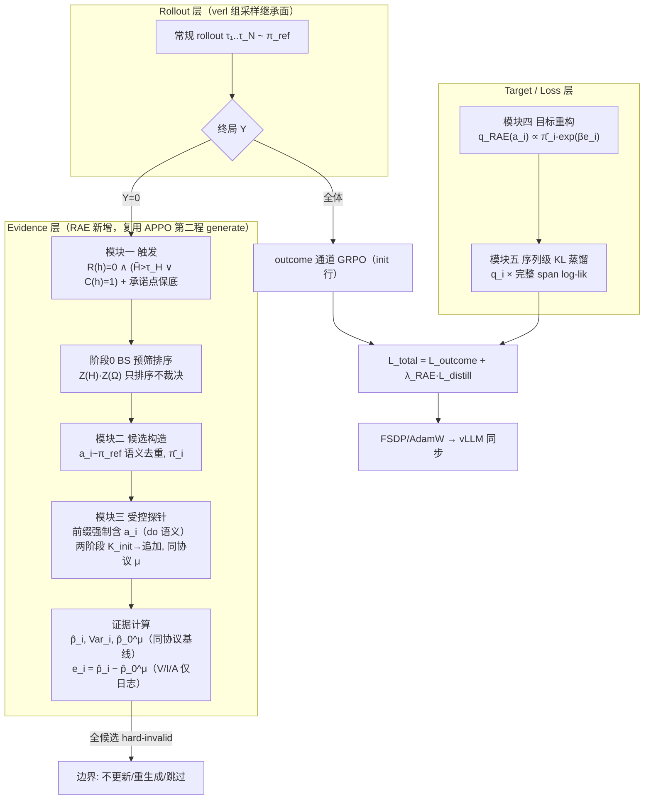
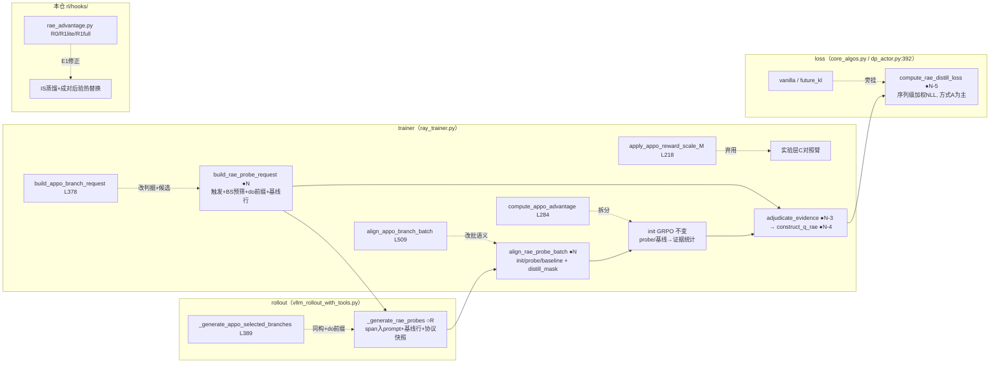

# RAE: Recovery-Aware Exploration with Counterfactual Policy Elimination —— 算法设计与实现方案

**RAE：恢复感知探索与反事实策略消除 —— 结合 ARPO × APPO 代码血脉的 ICML 2027 设计稿（v2.0，GPT 审稿意见整合版）**

> v2.0（2026-10-14）。依 [GPT_analysis_idea.md](GPT_analysis_idea.md)（§一–§十九审稿意见）对 v1.0 的全面修订：修复三处 P0 正确性问题（探针 do-语义、$p_{\mathrm{ref}}$ 协议可比性、序列级蒸馏损失），定理 1' 降为 Proposition 1 并新增两个研究目标定理方向，实验重组为 A/B/C 三层级，定位压缩为两项创新；全文由 941 行精简至 496 行（约 47%）。
> 三件套定位不变：v0.2 方法稿（[Agent_RL体系说明-润色版.md](Agent_RL体系说明-润色版.md)）= 理论与近邻划界；[APPO_ARPO_技术报告.md](../../APPO_ARPO_技术报告.md) = 代码事实与行号；本文 = 实现设计。文中 `文件:行号` 相对 `ref_Rep/APPO-main/APPO`（APPO 栈）或 `ref_Rep/ARPO-main/ARPO`（ARPO 栈）。

---

## 0 GPT 意见整合对照表

| GPT 意见 | 内容一句话 | 处置 | 本文落点 |
|---|---|---|---|
| §3 探针语义（P0） | `response[:t_s]` 不含候选动作 → 估计的是 `Y\|h,π_ref` 而非 `Y\|h,do(a_i)` | **修复**：探针前缀强制包含候选 span | §7.1、§10、§11.2 |
| §4 $p_{\mathrm{ref}}$ 可比（P0） | init 组（完整预算）与探针（截断协议）不可直接相减 | **修复**：$p_0$ 同探针协议估计；裁决改成对后验 | §7.3、§7.4 |
| §9 蒸馏加权（P0） | "q 只乘 span 起点"被 3-token 梯度反例证伪 | **修复**：序列级加权 NLL 主公式 | §9.1 |
| §5 理论层级 | 定理 1' 不支撑 ICML 主张 | 定理 1' → Proposition 1；新增 T1/T2 研究目标 | §8.2 |
| §6/§7 预算理论 | 双熵乘积是启发式，VOI 才是正路 | VOI 列为 T2 方向；双熵乘积降为 P0 缺省 | §5、§8.2 |
| §8 证据分数 | 裁决与幅度重复用同一信息；权重过繁 | 第一版 $e_i=\hat p_i-\hat p_0$；三态裁决降为日志/停机规则 | §7.4 |
| §10 候选覆盖 | 有限候选集 = 覆盖误差 + 目标误差 | 分解写入边界；覆盖率列机制指标 | §13、§12.4 |
| §11 实验 | H1–H3 归因不足，缺 oracle 与双预算曲线 | 重组 A/B/C 三层级实验 | §12 |
| §12/§19 定位 | "组件集成"观感危险 | 压缩为两项创新 | 摘要、§1 |
| §15 工程优先级 | 第一版关掉 FIPO/dead-end/复杂权重 | 采纳为最小闭环清单 | §13 |
| §16/§17 归因五问 | Q1–Q5 预案 | 对应位标注（§12 三层各答一问） | §12 |

**v2.0 采纳但降级**：BS 预筛保留（成本为零，不与 VOI 冲突）；hard-invalid 特例保留（环境硬约束可复现时唯一硬消除通道）。**未采纳**：GPT §10 的候选生成理论（第一版只报告覆盖率）。

---

## 1 引言

**背景（一段话）**：以 GRPO 为基线的 agentic RL 谱系——ARPO/AEPO/BPO 用熵定分支位置，APPO/IGRPO 引入策略内部第二因子，RAIL 学干预控制器，IGPO/GiGPO 修过程信用——共享四个缺口（v0.2 §1.2）：G1 高熵≠值得探索、G2 内部信念增益≠正确、**G3 失败被压成标量负优势**、G4 学习单元错位于完整轨迹。RAE 的靶心是 G3+G4：把失败从"负优势回传"改写为"动作级反事实证据 → 目标策略分布约束"。

**核心研究问题**（GPT §2.2）：在有限交互预算下，如何利用失败轨迹选择值得评估的决策状态，通过可比较的反事实执行获取动作级证据，并将这些证据转化为能够提高后续任务成功率的策略更新？三个子问题环环相扣——选错状态则预算浪费；探针未真正执行指定动作则证据失效；证据无法正确映射为更新则前两步无效。

**两项创新**（GPT §12/§19 定位收缩）：

1. **创新一：Recovery-Oriented Counterfactual Evidence**——在失败轨迹上选择有纠错价值的决策状态，构造**指定动作的反事实执行**（受控探针），依外部结局估计动作的协议条件化价值。重点：反事实执行不为增加训练样本，而为降低下一次策略决策的错误风险（同预算实验验证，实验层 A/C）。
2. **创新二：Decision-Aware Budgeted Evidence Acquisition**——探针预算依"能否改变最终决策"分配（决策风险/VOI 方向），而非寻找高熵位置。重点：这是最值得发展成理论的路线（§8.2 T2）。

目标分布重构与 KL 蒸馏**降为算法构件**（实现证据落地，不作主创新）。完整近邻划界（RAIL 四层区分、APPO/IGRPO/BranPO/Fission-GRPO 谱系）见 v0.2 §2.7，不重复。

**三假设**（检验框架，对应实验层 A/B/C）：

$$\textbf{H1（恢复）}: \text{同预算下，动作级反事实证据→目标重构} \Rightarrow \text{失败恢复率提升}$$
$$\textbf{H2（区分）}: \text{相比终局负优势，RAE 更准确区分保留与削弱动作（FER}\downarrow,\ \text{Decision Regret}\downarrow)$$
$$\textbf{H3（预算）}: \text{自适应证据获取优于均匀分配（可分辨性条件下）}$$

---

## 2 代码血脉：ARPO × APPO 给 RAE 留下了什么

实现视角盘点（行号均经 [APPO_ARPO_技术报告.md](../../APPO_ARPO_技术报告.md) 逐行核对）。两父系机制的要点：

- **ARPO（轮级，rollout 内自包含）**：(a) 熵监控（`vllm_rollout_with_tools.py:283`）——每轮取前 20 token 的 top-10 logprobs 经验熵，$\log|V|$ 归一，首轮记基线；(b) 分支判据（`:469-475`）——$\Delta H$ 线性调制分支概率，凑满 GRPO 组；(c) 更新不变——`adv_estimator=grpo` + 标准 PPO。
- **APPO（token 级，trainer 侧第二程）**：$M1$ 选点 $BS_t=Z(H_t)Z(\Omega_t)$（$\Omega_t$=折扣后缀 log-ratio 的指数，clip $[1{-}\varepsilon,1{+}\varepsilon]$；`ray_trainer.py:378-505`）；$M2$ 第二程生成（`_generate_appo_selected_branches`，`vllm_rollout_with_tools.py:389-497`，前缀 `prompt+response[:t+1]` **含分裂点**，工具循环同构）；$M3$ 批合并（`align_appo_branch_batch`，`ray_trainer.py:509-545`）；$M4$ 双组 $(uid,\mathrm{kind})$ 归一化（L315）+ 前缀信用回灌（L341-365）+ 几何 reward 缩放 $M_t$（`appo_branching.py:193-219`）；$M5$ FIPO 影响加权（`core_algos.py:688-857`，分发于 `dp_actor.py:392`）。branch 行整行 `loss_mask=0`（`:397,455`），只经 advantage/reward 通道注入 init 行。

### 2.1 八维机制对照

| 维度 | ARPO | APPO | RAE（本文） |
|---|---|---|---|
| 分支粒度 | 轮级 | token 级 | **语义动作级**（工具 stop tag 边界），token 熵为前端代理 |
| 分支判据 | $\Delta H$ 调制概率 | $Z(H)\cdot Z(\Omega)$ | **失败触发 +（熵分位 ∨ 矛盾）+ 承诺点保底**；BS 降为零成本预筛（§5） |
| 分支发起方 | rollout 进程内 | trainer 第二程 generate | trainer 第二程（继承 M2/M3） |
| **分支用途** | 凑 GRPO 组 | 组对比 + 前缀回灌 | **反事实证据采集**（探针结局 → 裁决/证据） |
| advantage | 单组 GRPO | 双组 + 回灌 | init 照常 GRPO；probe 只产证据不进 outcome loss（§9.3） |
| reward 修正 | 无 | 前缀 $\times M_t$ | 无缩放；证据走目标分布通道（$M$ 降为对照） |
| policy loss | 标准 PPO | FIPO | outcome 不动（v2 起缺省 vanilla）+ **序列级蒸馏项**（§9） |
| **失败语义** | 负 advantage | 负 advantage | **失败 = 目标分布的证据约束**（无成功侧仍良定义） |

### 2.2 继承 / 替换 / 弃用清单

| # | 机制（位置） | 处置 | 落点 |
|---|---|---|---|
| 1 | 组采样骨架 + 工具循环（stop tag/回填/线程池） | **继承** | §9.3、§11.1 |
| 2 | 轮级熵监控 + 逐 token 熵张量 `rollout_entropys`（ARPO :283；APPO :977-986） | **继承**（触发代理 + 冷启动回退） | §3.2、§5 |
| 3 | BS=Z(H)Z(Ω) 数学（`ray_trainer.py:406-428`） | **继承改用途**：零成本预筛排序，只排序不裁决 | §5 |
| 4 | 第二程生成（`vllm_rollout_with_tools.py:389-497`） | **继承**：`_generate_rae_probes` 同构，**前缀强制含候选 span** | §7.1（P0 修复一） |
| 5 | 批合并（`ray_trainer.py:509-545`） | **继承**：kind 改 `{init, probe}` | §11.1 |
| 6 | branch 行 loss_mask=0（`:397,455`） | **继承+细化**：outcome 全 0 + span 级 distill_mask | §9.3 |
| 7 | 前缀回灌（L341-365）/ reward 缩放 $M_t$（`appo_branching.py:203`） | **弃用 → 实验层 C 对照臂**（同数据异通道归因） | §12.3 |
| 8 | 双组归一化（L315） | **继承语义**：probe 组统计只用于证据与基线 | §7.4 |
| 9 | FIPO（`core_algos.py:688`） | **P0/P1 关闭**（GPT §15），P2 再消融 | §13 |
| 10 | `deep_research.py` reward（`:282-304`） | **继承**：F1 阈值化为 $Y$，协议错误隔离 | §7.4 |
| 11 | 搜索三层限流 + cache（本仓 `search_tool.py`） | **继承**：探针成本口径 | §11.3 |
| 12 | 本仓 verdict 链（`rl/hooks/rae_advantage.py` R0 :33 / R1-lite :85 / R1-full :161 / 表决 :243） | **升级**：后验裁决热替换；R1-full 按 E1 修正 | §7.4、§9.4 |

**换通道的一句话理由**（v0.2 E1）：APPO 的分支效用最终经 advantage/reward 通道注入（"更好的 GRPO 数据"）；RAE 证据经目标分布通道注入（"策略应成为什么的证据"）。log-ratio 不是合法 IS 权重，把动作级证据压成标量塞进 clip 管线无法控制概率质量流向；回灌/缩放保留为实验层 C 的对照臂而非否定。

---

## 3 预备知识与符号

### 3.1 决策上下文、语义动作与协议条件化成功率

POMDP 与决策上下文 $h_t=(o_0,a_0,\ldots,a_{t-1},o_t)$ 沿 v0.2 §3。理论原语是**语义动作** $a=(\text{tool},\text{normalized args})$；token 序列是载体，天然切分于工具 stop tag 边界（`</search>`/`</python>` 后的 `<result>` 回填段是观测非动作）。状态的工程载体 = token 前缀 `prompt + response[:t]`。

**协议条件化成功率**（v0.2 §3.3，归因边界不变）：

$$p_i^{\mu}(h)=P_{\mu}\big(Y{=}1\ \big|\ h,\ \mathrm{do}(a_i)\big)$$

执行协议 $\mu$ 绑定：动作执行方式 / 后续策略版本 / 后续预算 / 终止条件 / 随机性控制。**$\mathrm{do}(a_i)$ 记号是 v2.0 新增强调**（GPT §3）：探针必须**实际执行**候选动作，而非以它为提示再让策略自由采样——这是本文探针协议的构造性要求（§7.1），不是事后声明。$p_i^\mu$ 是协议条件量而非普适因果效应；随机环境下估计对象为 $\mathbb E_\xi[Y\mid h,\mathrm{do}(a_i),\xi,\mu]$，common random numbers 只是可选降方差手段（GPT §3.4）。

### 3.2 熵的两口径

- **口径 A（token 熵，工程免费）**：top-$k$ logprobs 重归一经验熵除以 $\log|V|$，APPO 逐 token 存为 `rollout_entropys`——零采集成本；
- **口径 B（动作熵，理论量）**：候选集条件分布 $H^\pi(h)=-\sum_i\bar\pi_i\log\bar\pi_i$（$\bar\pi$ 见 §4）。

衔接：触发时候选未构造，用口径 A 的**决策边界窗聚合** $\tilde H^\pi(h)=\frac{1}{k_{\mathrm{win}}}\sum_{t\in\mathrm{win}}\hat H_t$（继承 ARPO 首轮基线差分思想）作初筛代理；触发后以口径 B 复核。代理声明：$\tilde H^\pi$ 偏且便宜，进实验层 A 归因，不作理论量。

### 3.3 符号表（新增/变更加粗）

| 符号 | 含义 | 符号 | 含义 |
|---|---|---|---|
| $h,\ \mathcal A_h$ | 决策上下文 / 候选集 | **$\mathrm{do}(a_i)$** | **强制执行候选动作**（v2.0） |
| $\pi_{\mathrm{ref}},\pi_\theta$ | 参考/被训练策略 | **$p_0^{\mu}$** | **同探针协议的策略基线成功率**（v2.0） |
| $\bar\pi_i$ | 有限集条件分布 | $\hat H_t,\tilde H^\pi,H^\pi$ | token 熵 / 窗聚合 / 动作熵 |
| $a_i.\mathrm{span}$ | 动作 token 区间 $[t_s,t_e]$ | $R(h),C(h)$ | 失败 / 矛盾信号 |
| $\tau_H$ | 熵分位阈值（batch 标定） | $K_i,S_i,F_i$ | 探针数 / 成功 / 失败数 |
| $\hat p_i,\mathrm{Var}_i$ | Beta-Binomial 后验均值 / 方差 | **$\Delta_{ij}$** | **成对后验比较 $P(p_i>p_j\mid\mathcal D)$**（v2.0） |
| $e_i,\beta,q_{\mathrm{RAE}}$ | 证据分数 / 温度 / 目标分布 | $\varepsilon_f$ | floor（复用 `algorithm.tir.rae_epsilon_f`） |
| $K_{\mathrm{init}},\ell_{\mathrm{probe}}$ | 保底探针数 / 截断长 | $B,M,C_{\mathrm{total}}$ | 探针 / 总预算 / 成本记账 |
| $\mathcal L_{\mathrm{distill}},\lambda_{\mathrm{RAE}}$ | 序列级蒸馏 / 组合权重 | V/I/A | Validated/Invalidated/Abstain（日志态） |

---

## 4 方法总览



两原则不变：**证据评估与策略优化分离**；**证据不足保留不确定性**。链路：Failure → Candidates → Controlled Probes（do 语义）→ Posterior Evidence → Target Distribution → Sequence-level Distillation（GPT §15 最小闭环）。

---

## 5 模块一：恢复优先触发与选点

**触发**（v0.2 §6.1.2 不变）：

$$\mathrm{Trig}(h)=\mathbb 1\big[R(h)=0\ \wedge\ (\tilde H^\pi(h)>\tau_H\ \vee\ C(h)=1)\big],\qquad \mathcal C_\tau=\{h_t:\mathrm{Trig}=1\}\cup\{\text{最后承诺点}\}$$

- **熵通道标定**：$\tau_H$ 取本 batch 失败轨迹决策点 $\tilde H^\pi$ 的 $q_H$ 分位（缺省 0.7）——batch 内自标定，继承 ARPO 差分稳健性，免手工 schedule；
- **矛盾通道**：$C(h)$ = 可插拔检测器析取——工具显式拒绝 / 代码确定性异常（`python_tool.py` 非零退出）/ 协议破坏（`validate_format` 失败）/ 环境约束违反。任意终局失败**不**当作矛盾；
- **承诺点保底**：最后一个不可逆动作前的决策态无条件入选，覆盖低熵灾难性自信（reward hacking 高发区）。

**BS 预筛（阶段 0，零生成成本）**：对已触发状态的候选 span 聚合 $\mathrm{BS}(a_i)=\frac{1}{|span_i|}\sum_{t\in span_i}Z(H_t)Z(\Omega_t)$ 排序取 top-$n$。**位分声明**：$\Omega$ 是策略内部量（G2 约束：错误自信同样抬高它），**只排序、不裁决**；且 BS 需要 trainer 侧一次当前策略前向，仍属免费层。v0.1 三路通用触发（成功轨迹也触发）保留为实验层 B 的对照臂。

**轮级 × token 级统一**：轮边界（ARPO 血统）是触发判断的主战场；token 前缀 `prompt+response[:t]`（APPO 血统）是状态载体；语义动作 span 对齐于 stop tag 边界。粒度进实验层 A。

---

## 6 模块二：候选动作构造

$$\mathcal A_h=\mathrm{dedup}\big\{a^{(j)}\sim\pi_{\mathrm{ref}}(\cdot\mid h)\big\}_{j=1}^{n},\quad n\in\{4,8\}\ (\text{P0 先小})$$

- **去重键**：`(tool_name, normalized_args)` 哈希；代码编辑取 diff 语义；执行语义相同的 token 序列归并；
- **条件分布**（长度归一化禁则，v0.2 E3）：$\bar\pi_i=\pi_{\mathrm{ref}}(a_i\mid h)/\sum_j\pi_{\mathrm{ref}}(a_j\mid h)$，其中 $\log\pi_{\mathrm{ref}}(a_i\mid h)=\sum_{t\in span_i}\log\pi_{\mathrm{ref}}(y_t\mid y_{<t})$ 取**真实序列对数似然和**（`rollout_log_probs` span 求和，APPO 张量已有）；长度归一化分数只可用于排序；
- **复用协议**：候选生成与探针执行共享同批样本——候选动作即阶段 B 探针的本体（§7.1），蒸馏支持集同源，无额外生成；
- **候选覆盖率**（GPT §10）：$\mathrm{Cov}_h=P(\mathcal A_h\cap\mathcal A_h^{\mathrm{good}}\neq\emptyset)$ 列为机制指标（近似 oracle 评估集上测，§12.4），候选生成理论留 future work。

---

## 7 模块三：受控反事实评估（P0 修复一、二）

### 7.1 探针协议：阶段 A → B → C（do 语义）

> **GPT §3 的裁定**：v1.0 的 `probe prompt = prompt + response[:t_s]`（span 起点）**不含候选动作**，第二程会重采样动作，估计的是 $Y\mid h,\pi_{\mathrm{ref}},\mu$ 而非 $Y\mid h,\mathrm{do}(a_i),\mu$——两组探针结果无法区分候选，证据环节失效。这是 P0 第一优先级修复。

**阶段 A（候选生成）**：$a_i\sim\pi_{\mathrm{ref}}(\cdot\mid h)$，去重得 $\mathcal A_h$（§6）。

**阶段 B（强制执行）**：探针请求前缀 = `prompt + response[:t_s^{(i)}] + a_i.tokens`——**候选动作 token 完整包含在 prompt 内**（与 APPO 分裂点含于前缀的先例 `response[:t+1]` 对齐）。动作若为工具调用则真实执行、环境返回回填；随后续策略 $\pi_{\mathrm{ref}}$ 继续至终止或预算上限：

$$\tau_{i,k}\sim P_\mu\big(\tau\ \big|\ h,\ \mathrm{do}(a_i)\big),\qquad Y_{i,k}=\mathbb 1[\tau_{i,k}\ \text{成功}]$$

语义动作由 stop tag 边界界定，"强制执行"在 verl 栈上有自然实现：动作 span 拼入 prompt 后，工具循环解析到 `</search>`/`</python>` 即执行该调用——**动作不被重采样，只被兑现**。

**阶段 C（同协议估计）**：固定 $\mu$（五项绑定快照进 `rae_probe_meta`），两阶段预算：

- 阶段一保底 $K_{\mathrm{init}}\in\{2,4\}$ 条，截断 $\ell_{\mathrm{probe}}\ll\ell_{\mathrm{full}}$（截断未终止保守计 $Y=0$，双口径报告）；
- **阶段二追加 $K_i^{\mathrm{add}}$，分配准则见 §8.2（VOI 为研究目标，双熵乘积为 P0 缺省）。**

### 7.2 Beta-Binomial 后验

$$p_i\mid\mathcal D_i\sim\mathrm{Beta}(\alpha_0{+}S_i,\ \beta_0{+}F_i),\quad \hat p_i=\frac{\alpha_0{+}S_i}{\alpha_0{+}\beta_0{+}K_i},\quad \mathrm{Var}_i=\frac{\hat p_i(1-\hat p_i)}{\alpha_0{+}\beta_0{+}K_i{+}1}$$

先验均匀 $\alpha_0=\beta_0=1$。**后验而非点估计**：2 次全失败的 Beta(1,3) 均值是 0.25 不是 0——有限失败不等价动作不可行。

### 7.3 $p_{\mathrm{ref}}$ 修正：同协议基线 $p_0^{\mu}$（P0 修复二）

> **GPT §4 的裁定**：init 组均值是 $p_0=P(Y\mid h,\pi_{\mathrm{ref}},\mu_0)$（完整预算协议），探针是 $p_i=P_\mu(Y\mid h,\mathrm{do}(a_i),\mu_i)$（截断协议）；预算/后续策略/终止规则不一致时 $p_i-p_0$ 不是干净比较量——探针偏低可能只因预算更短。

**修正**：

1. **基线随协议走**：$p_0^{\mu}$ 在**与候选探针完全相同的协议**下估计——每触发状态抽 $K_0$ 条"无强制动作"的基线 rollout（同 $\ell_{\mathrm{probe}}$、同 $\pi_{\mathrm{ref}}$ 续采、同终止规则），探针批与基线批同程生成，只多 $K_0$ 行。init 组均值（$p_0$ 完整协议）仅作参考读数，不进证据公式；
2. **主目标采方案 B**（GPT §4.2）：$\Delta_i=p_i^\mu-p_0^\mu$ 回答"是否值得把概率质量转移给 $a_i$"——与目标重构的语义一致；候选间排序 $\Delta_{ij}=p_i^\mu-p_j^\mu$ 作为分析层（方案 A）并行报告；
3. **成对后验裁决**：不再以单动作方差定可靠度，改用 $P(p_i>p_j\mid\mathcal D)$ / $P(p_i>p_0^\mu\mid\mathcal D)$——单个动作方差大但后验差值稳定时排序照样可信（GPT §8 问题三）。

### 7.4 证据分数与三态裁决的分工

**第一版证据（最简连续映射，GPT §8.2）**：

$$e_i=\hat p_i-\hat p_0^{\mu}$$

连续、无可靠性权重（$w_i$ 机制全部后置到实验层 A 消融）。**三态裁决降级为分析日志与预算停机规则**，与连续证据分工（GPT §8 问题一）：

| 裁决 | 后验条件（成对形式） | 用途 |
|---|---|---|
| Validated | $P(p_i>p_0^\mu\mid\mathcal D)>1-\delta$ | 日志/机制分析 |
| Invalidated | $P(p_i<p_0^\mu-\Delta\mid\mathcal D)>1-\delta$ | 日志；**hard-invalid 通道入口**（见下） |
| Abstain | 其余 | **预算停机规则**：整组 Abstain → 停止追加 |

**Hard-invalid 特例保留**（唯一硬消除通道）：动作明确违反环境硬约束且同条件可复现（工具确定性报错）→ $e_{a_f}$ 截断到 $\log(\epsilon_f/\bar\pi_{a_f})$（floor 软化，$\epsilon_f$ 复用 `algorithm.tir.rae_epsilon_f`）。普通终局失败不触发。

**结局 $Y$ 阈值化**（不变）：探针轨迹过 `deep_research.py compute_score`（`:282-304`），$Y=\mathbb 1[s\ge\theta_Y]$（$\theta_Y{=}0.5$ 起步）；**score=$-1$ 的协议失败不计入探针统计**（没按协议做实验≠动作差），单独计数进日志；多工具 $+0.1$ bonus 不改二值化。RAE 不向 reward 通道引入任何 $\lambda$ 加权（v0.2 E5）。

**预算记账（不变）**：$C_{\mathrm{total}}=C_{\mathrm{cand}}+\sum_i K_iC_{\mathrm{probe}}+K_0\cdot C_{\mathrm{probe}}+N_{\mathrm{full}}C_{\mathrm{full}}$——**基线探针行也计入**（v2.0 新增项）；双口径（token/API），"不允许免费探针"。

---

## 8 模块四：证据加权目标重构与理论层级

### 8.1 软目标与 Proposition 1

$$q_{\mathrm{RAE}}(a_i\mid h)=\frac{\bar\pi_i\exp(\beta e_i)}{\sum_j\bar\pi_j\exp(\beta e_j)},\qquad \log\frac{q^*}{\bar\pi_i}=\beta e_i-\log Z$$

**Proposition 1（Evidence-Regularized Target Construction，原定理 1' 降级，GPT §5）**：设 $\bar\pi$ 正支持，则 $q^*=\arg\min_q[D_{\mathrm{KL}}(q\Vert\bar\pi)-\beta\sum_iq_ie_i]$ 唯一，闭式如上（拉格朗日证明见 v0.2 §6.4.3）。

**定位声明**：Proposition 1 只提供目标构造的**优化基础**，不回答证据是否准确（$e$ 有偏则目标错）、不证明预算分配有效、不证明成功率提升——主理论贡献移至下方两个研究目标。$\beta$ 是 KL 温度（$\{0.5,1,2\}$ 稳健性检查），$\delta,\Delta$ 是统计参数，均非 reward-channel 加权。

**边界规则**（不变，v0.2 E9）：全候选 hard-invalid → 不做归一化更新（保留 $q=\bar\pi$/重生成/跳过）；单候选 → $\delta$ 分布按成功侧；全 Abstain → $q=\bar\pi$（设计特性：保留不确定性）。

### 8.2 两个研究目标定理（未证明，不作贡献宣称）

**T1 方向：有限预算下的动作决策错误界**。Bernoulli 条件独立模型、协议固定下，研究

$$P(\text{裁决错误})\ \le\ g\big(B,\ \{\Delta_{ij}\},\ \beta,\ \alpha_0,\beta_0\big)$$

基础是最佳臂识别/后验收敛工具；注意目标是分布重构而非唯一最佳臂，需用目标分布误差或决策风险表述（GPT §6/§14）。

**T2 方向：决策风险驱动的自适应预算（最优先，GPT §7）**。定义后验决策风险 $\mathfrak R(\mathcal D_t)=\mathbb E[\mathcal R(q_t,p)\mid\mathcal D_t]$，价值增量

$$\mathrm{VOI}_i=\mathfrak R(\mathcal D_t)-\mathbb E_{Y_i\mid\mathcal D_t}\big[\mathfrak R(\mathcal D_t\cup\{Y_i\})\big],\qquad \text{分配} \propto \mathrm{VOI}_i/c_i$$

与双熵乘积的本质差别：**只有可能改变最终决策的候选才追加探针**（$p_1{=}0.95,p_2{=}0.20$ 已可分辨时不浪费；$0.52$ vs $0.48$ 且概率质量大时优先）。研究问题：风险函数结构、VOI 可估计性、贪心近似保证、何时严格优于均匀。**P0 缺省仍用双熵乘积** $w^{\mathrm{alloc}}\propto\tilde H^\pi\cdot H_b(\hat p_i)$（实现简单、VOI 估计未落地），VOI 作为实验层 B 的对照臂与理论主线——GPT 明确警示：不能先假定自适应优于均匀再找证明；"高不确定性≠高决策价值"正是 T2 要形式化的现象。

**T3（可选，第三优先级）**：目标误差传播 $D(q^*,\hat q)$ 与 $D(\hat q,\pi_\theta)$ 的分解——区分证据误差 / 构造误差 / 拟合误差，与 §12.4 目标拟合误差指标对接。

---

## 9 模块五：损失设计与策略更新（P0 修复三）

### 9.1 序列级蒸馏主公式

> **GPT §9 的裁定**：v1.0 "行权重 $q_r$ 只乘 span 起点"**不成立**——3-token 反例：只在首 token 乘 $q$ 得到的梯度是 $-q\nabla\log\pi(y_1)-\sum_{t\ge2}\nabla\log\pi(y_t)$，与目标梯度 $-q\sum_t\nabla\log\pi(y_t)$ 在 $q\neq1$ 时不相等。它不是序列级损失的等价实现。

**修正（序列级加权 NLL，与 KL 蒸馏严格对应）**：

$$\boxed{\ \mathcal L_{\mathrm{distill}}=-\frac{1}{|\mathcal H|}\sum_{h\in\mathcal H}\ \sum_{i\in\mathcal A_h}\ q_i\ \sum_{t\in\mathrm{span}(a_i)}\ \log\pi_\theta(y_t\mid y_{<t})\ },\qquad \nabla_\theta\mathcal L_{\mathrm{distill}}=-\frac{1}{|\mathcal H|}\sum_{h,i}q_i\sum_{t\in span_i}\nabla_\theta\log\pi_\theta(y_t\mid y_{<t})$$

$\mathcal H$ = 参与蒸馏的决策上下文集合；$q_i$ 是**动作级权重乘满全 span**；$\log\pi_\theta(a_i\mid h)$ 取真实序列对数似然和（不长度归一化）。IS 形式（若以 $\pi_{\mathrm{ref}}$ 样本近似 $q$ 支撑集）用**概率比** $q/\pi_{\mathrm{ref}}$，非 log-ratio（E1 红线不变）。

**归一化两方式（GPT §9.2）**：方式 A（按上下文均化，上式）= 主实验，最贴理论；方式 B（按有效 token 数归一，贴 verl `token-mean`）= 工程变体，动作长度不齐时与方式 A 不等价，须作为实现变量显式比较。**消融含 A/B 对照。**

### 9.2 组合损失与批分流（披露式）

$$\mathcal L_{\mathrm{total}}=\mathcal L_{\mathrm{outcome}}(\text{GRPO，仅 init 行})\ +\ \lambda_{\mathrm{RAE}}\cdot\mathcal L_{\mathrm{distill}}(\text{仅 probe/基线行动作 span})$$

- **outcome 通道缺省 vanilla**（GPT §15：FIPO P0/P1 关闭，P2 再做 2×2 消融）；
- **probe 行**：outcome loss 整行 mask=0（继承 APPO branch 惯例）；动作 span 开 `distill_mask`；**基线 rollout 行**（§7.3 的 $K_0$ 条）同样 span 开 distill_mask（它是 $q\propto\bar\pi$、$e{=}0$ 的天然成员）；
- **首分歧退化版**（低成本变体，实验层 A）：只在候选间首分歧 token 蒸馏——注意它是**近似**而非等价，与方式 A/B 一并消融；
- 披露纪律（v0.2 §6.6）：组合结构与 $\lambda_{\mathrm{RAE}}$ 显式披露并消融，不得叙述为"单一损失"。

### 9.3 双组语义

| 组 | 归一化用途 | 进哪个 loss |
|---|---|---|
| init 组（GRPO 组） | 组相对优势（不变） | $\mathcal L_{\mathrm{outcome}}$ |
| probe + 基线组 | 只产 $\hat p_i,\hat p_0^\mu$、成对后验与证据统计（§7.3–7.4） | 不进 outcome；span 进 $\mathcal L_{\mathrm{distill}}$ |

与 GRPO 优势管线整合（同批构造 $q$ 替换组内优势）仍为开放问题（v0.2 §6.6 五项前置未解），不投机实现。

### 9.4 本仓 R1-full 的 E1 修正路径（保留）

`rl/hooks/rae_advantage.py:161` 的 $A^{\mathrm{RAE}}=\log\pi_{\mathrm{tgt}}-\log\pi_{\mathrm{old}}$ 正是 E1 撤回的 log-ratio bias。四层升级：**R0** 前缀清零（`:33`，保留）；**R1-lite** verdict 缩放（`:85`，留作消融）；**R1-full 修正版**——废弃 log-ratio bias，改 IS 概率比 + 序列级蒸馏（新键 `algorithm.tir.rae_distill`，与 `rae_full_tgt` 互斥）；**完整 RAE**（§11 全组件）。裁决热替换：`adjudicate_action_group`（`:243`，频率派表决，daemon `:806-871` 消费）→ Beta-Binomial 成对后验，verdict 字面量与 `verdict_list` 链兼容。

---

## 10 训练流程与伪代码

```
━━━━━━━━━━━━━━━━━━━━━━━━━━━━━━━━━━━━━━━━━━━━━━━━━━━━━━━━━━━━━━━━━━━━━━━━━━
Algorithm 1  RAE 训练循环（一步 fit；○R=复用 ●N=新建）
输入: π_θ, π_ref 快照, 组大小 n, 预算 M_step, (q_H, K_init, K_0, ℓ_probe, n, β, ε_f, λ_RAE)
━━━━━━━━━━━━━━━━━━━━━━━━━━━━━━━━━━━━━━━━━━━━━━━━━━━━━━━━━━━━━━━━━━━━━━━━━━
 1: 组采样 τ_1..τ_N ~ π_ref（工具循环+stop tag）；记录 rollout_entropys / log_probs / score   ○R
 2: 失败识别 Y=𝟙[score≥θ_Y]；触发: C_τ={R=0 ∧ (H̃>Q_{q_H} ∨ C=1)} ∪ {承诺点}              ●N-1
 3: 候选: a_1..a_n ~ π_ref(·|h) 语义去重；BS 预筛排序取 top                                 ○R(M1改用途)
 4: 受控探针（同协议 μ）: 前缀=prompt+response[:t_s]+a_i.tokens（do 语义，动作不重采样）    ○R(M2, P0修复一)
    + 每状态 K_0 条无强制动作基线行（同 ℓ_probe/同续采/同终止）                            ●N-2(基线行)
 5: Beta-Binomial 后验 p̂_i, Var_i；协议错误(score=-1)行剔除并计数                          ●N-3
 6: 证据: e_i = p̂_i − p̂_0^μ；V/I/A 后验裁决（成对）→ 日志；hard-invalid 需可复现           ●N-3
 7: 阶段2追加: 预算按 VOI（研究目标）/双熵乘积（缺省）分配 K_i^add；冷启动回退纯熵排序      ●N-3
 8: 目标重构: q_i ∝ π̄_i exp(βe_i)；floor 截断；全 hard-invalid → 跳过                      ●N-4
 9: 批合并: init 行 + probe 行 + 基线行（probe/基线 outcome mask=0, span 开 distill_mask）  ○R(M3)+●N
10: L_total = GRPO(init) + λ_RAE·序列级蒸馏(span, q_i 乘满全 span, 方式A)                  ●N-5(P0修复三)
11: FSDP/AdamW 更新 → vLLM 权重同步                                                        ○R
12: 日志: (action, verdict, p̂_i, p̂_0^μ, e, q, K_i, 成本, cache命中率, 候选覆盖率)          ●N
━━━━━━━━━━━━━━━━━━━━━━━━━━━━━━━━━━━━━━━━━━━━━━━━━━━━━━━━━━━━━━━━━━━━━━━━━━
对账: 步2/3/7→H3；步4–8→H1；步8–10→H2；成本全记（含基线行）
```

与 APPO `fit()` 插桩点的对应不变（`build_appo_branch_request` L378 → 第二程 generate → `align_appo_branch_batch` L509 → advantage L284；reward 缩放 L218 弃用为对照）——训练骨架不动。

---

## 11 verl 工程落地映射

### 11.1 改造拓扑与复用清单



| 组件 | 位置 | 处置 |
|---|---|---|
| 第二程生成 / 工具循环 | `vllm_rollout_with_tools.py:389-497` | 同构改名 `_generate_rae_probes`；**请求体改前缀含候选 span**；新增 `probe_candidate_id / probe_protocol / baseline_flag` |
| 批合并 | `ray_trainer.py:509-545` | kind 改 `{init, probe, baseline}`；零张量补齐/uid 复制不动 |
| loss 分发 | `dp_actor.py:392-420` | 旁挂 `rae_distill`（新 loss mode，L2 议案走 `RL_design.md` §8 ADR） |
| outcome / FIPO | `core_algos.py:113 / :688` | vanilla 缺省；FIPO 关闭待 P2 |
| reward | `deep_research.py:282-304` | 零改动（$Y$ 阈值化输入） |
| 限流/缓存 | `search_tool.py`（三层防御） | 零改动；成本口径见 §11.3 |
| verdict 链 | `rl/hooks/rae_advantage.py` + `daemon.py:806-871` | 表决键 `(uid, action_key)` 不变，裁决算法热替换 |

### 11.2 新增组件接口（压缩签名）

```python
# ●N-1 rae_trigger.py
build_rae_triggered_states(batch, *, q_h=0.7, detectors) -> List[TriggeredState]
# 读 token_level_scores / rollout_entropys / 工具事件; 纯张量, 零生成成本

# ●N-2 build_rae_probe_request（P0 修复一落点）
build_rae_probe_request(batch, triggered, *, n_cand=4, bs_prefilter=True,
                        k_init=2, k_baseline=2, len_probe=...) -> RAEProbeReq
# 每状态: 候选排序 → 探针请求(前缀=prompt+response[:t_s]+a_i.tokens, do语义)
#        + K_0 条基线请求(无强制动作) + probe_protocol 五项快照

# ●N-3 rae_evidence.py（P0 修复二落点）
adjudicate_beta_binomial(S_i, F_i, S_0, F_0, *, delta=0.1, delta_prob=0.05) -> (e, verdict)
# 成对后验 P(p_i>p_0^μ|D); 返回连续证据 + 日志裁决; 表决键/三态字面量兼容 daemon

# ●N-4 rae_target.py
construct_q_rae(cands, *, beta=1.0, eps_floor=1e-3) -> TargetDist | SkippedState
# q ∝ π̄·exp(βe); floor 截断; 全 hard-invalid 边界规则

# ●N-5 compute_rae_distill_loss（P0 修复三落点）
compute_rae_distill_loss(logprob_output, distill_mask, q_rows, span_index, *, norm="ctx_mean")
# 序列级加权 NLL; norm ∈ {"ctx_mean"(主), "token_mean"(工程变体)}; 消融含 A/B
```

新增 non_tensor 列：`rae_rollout_kind{init,probe,baseline}`、`rae_cand_id`、`rae_protocol`、`rae_distill_mask`（张量列）、`rae_q_row`、`rae_baseline_flag`；`verdict` 列复用现有链。

**两条工程红线（保留自 v1.0）**：(1) 探针前缀追加 span 后 `prompt_length` 重算，`old_log_prob` 边界同步——防 KL 参照错位（APPO 认知注入 L1038-1060 先例）；(2) probe 行继承的 `result_masks=0` 区间原样带过批合并——观测 token 不得进蒸馏。

### 11.3 成本与限流（要点）

三层限流（3 s/key 节流、429/502 退避、$N_k$ key 轮换）下 API 口径上界 $\approx 20N_k\Delta t(1-c)$ 次/步（$c$=cache 命中率，`search_cache.json` 对探针的重合 query 免费返回——**机制日志必须分层记录命中率**，基线也受益 cache 才公平）。最坏 $8$ 状态 $\times(4{+}2)$ 探/基行 $=48$ 次调用/步——多 key 池与阶段 2 追加是必要的；探针折算系数 $\kappa=C_{\mathrm{probe}}/C_{\mathrm{full}}$ 实测填入。

---

## 12 实验设计：A/B/C 三层级（GPT §16 重组织）

> 组织原则：每个实验层对应一个可独立证伪的主张，并预答 GPT §17 的 AC 五问（Q1 同预算必要性→层C；Q2 目标重构必要性→层C；Q3 预算分配→层B；Q4 协议敏感性→层A 协议扰动；Q5 理论贡献→T1/T2）。

### 12.1 层 A：证据是否有效（答 H2 前半 + Q5 理论输入）

固定候选集与探针数据，比较排序/裁决能力：普通失败负优势 / 经验成功率排序 / Beta-Binomial 后验 / 完整证据分数 / **oracle 动作价值（分析性上界，非现实基线）**。

**指标**：最佳候选识别率、**False Elimination Rate（FER，把高价值动作错判为无效的比例——核心指标）**、动作价值排序相关性、目标分布误差、候选覆盖率 $\mathrm{Cov}_h$、**协议扰动稳健性**（改 $\ell_{\mathrm{probe}}$/终止规则重估 $p_i$，答 Q4）。证据质量无改善即重审核心机制。

### 12.2 层 B：预算分配是否有效（答 H3 + Q3）

对照臂：均匀 / 熵驱动 / 双熵乘积 / **Decision-Risk（VOI）分配** / 充分预算 oracle。**完整预算-效果曲线** $B\in\{B_1..B_m\}$（成功率、决策错误率、目标分布误差、单位预算增益、成本分解），区分探针预算与总交互预算两种口径。若 RAE 只在大预算下有效，则贡献是额外采样而非更聪明的失败恢复——这一证伪条件显式写入。

### 12.3 层 C：证据→策略更新通道归因（答 H1/H2 + Q1/Q2）

**完全相同的候选、探针轨迹与结局**，五种消化通道：①不使用证据 ②直接失败惩罚 ③APPO 式前缀回灌 + $M$ 缩放 ④RAE 目标分布蒸馏 ⑤**oracle 目标分布蒸馏（上界）**。指标：SR、RSR（双口径资格定义）、独立验证成功率、FER、目标拟合误差 $\mathrm{KL}(\pi_\theta\Vert q)$。

**同预算纪律**（GPT §11.1 控制二）：同时匹配生成 token、环境调用、训练 token、更新次数、候选数量——只对齐 rollout 数不合格。无成功后缀分桶分析（G3 载体）保留。

### 12.4 机制指标与统计协议

熵生命周期曲线（证伪事件对齐，观察不到即证伪）、候选覆盖率、目标拟合误差、cache 命中分层、hard-invalid 复现通过率。3–5 种子报均值/置信区间；敏感性：$n\in\{4,8\}$、$K_{\mathrm{init}}\in\{2,4\}$、$\beta\in\{0.5,1,2\}$、$\delta\in\{0.05,0.1\}$、$\ell_{\mathrm{probe}}$、归一化方式 A/B。环境路线（P0 WebShop/ALFWorld 二选一或 `hard_search_1k`、P3 跨环境）与四层外部基线清单沿 v0.2 §7.1–7.3。

---

## 13 P0 修复清单、最小闭环与理论边界

### 13.1 P0 修复与最小闭环（GPT §15/§18 采纳）

| 优先级 | 事项 | 状态 |
|---|---|---|
| P0 | 探针执行指定动作（do 语义） | 本稿 §7.1 已修复 |
| P0 | $p_{\mathrm{ref}}$ 同协议可比 | 本稿 §7.3 已修复 |
| P0 | 序列级蒸馏实现 + 归一化方式明确 | 本稿 §9.1 已修复 |
| P0 | 候选/探针/蒸馏样本同源关系明确 | §6 复用协议 |
| P1 | 成本三口径（token/API/墙钟）、候选覆盖率报告、触发率漂移与蒸馏梯度范数监控、probe-init 梯度相关性 | §11.3、§12.4、§14 |
| P2 才开启 | FIPO 叠加、upstream dead-end 回传、复杂可靠性权重、多粒度 | §12 层 B/C 后置 |

**最小闭环**（先证明证据本身有价值，再叠机制）：Failure → Candidates → Controlled Probes → Posterior Evidence → Target Distribution → Sequence-level Distillation。

### 13.2 理论边界（不可宣称清单，v0.2 §8 压缩 + GPT 补充）

- Proposition 1 ≠ 证据正确性（$e$ 有偏则目标错）；≠ 预算有效性；≠ 成功率保证；
- 不得宣称"探针免费"（全记账）；"BS 预筛替代探针"（内部量只排序）；"token 熵=动作熵"（偏且便宜的代理）；"floor=精确硬删除投影"（软化后有界负证据）；"蒸馏与 clip 管线等价"（E1：写回 advantage 即 bug）；
- **学习误差分解**（GPT §10）：最终效果 = **候选覆盖误差 + 候选内目标误差**——$q_{\mathrm{RAE}}$ 只在 $\mathcal A_h$ 内重分配质量，好动作不在候选集内则无解；第一版以覆盖率指标暴露此风险，不宣称候选生成理论；
- T1/T2 是研究目标非结论：不得先假定"自适应优于均匀"再找证明；VOI 的可计算性与贪心保证开放。

---

## 14 局限（压缩）

继承 v0.2 九条（候选覆盖偏差/归因条件性/目标-参数偏差/反事实成本/检测器召回/不可重置环境/回传深度/无 verifier/RAIL 撞名预案），实现侧四条：**(x)** top-$k$ 熵代理与 $k_{\mathrm{win}}$ 窗口的系统偏差；**(xi)** probe 与 init 共享前缀的梯度相关性（$N_{\mathrm{eff}}$ 估计进分析）；**(xii)** 单卡双 offload 下第二程 generate 的显存压力（P0 先小 $n$、小 $K$）；**(xiii)** 基线行与 probe 行同批使批规模随触发率漂移（$\lambda_{\mathrm{RAE}}$ 有效权重监控）。

---

## 15 结论

RAE 的实现不发明新 rollout 基础设施：ARPO 贡献熵尖峰实证与轮级切分先验，APPO 贡献 token 级选点数学、第二程生成、批合并、mask 惯例与双组结构（复用面约 90%）。RAE 只做两处定点替换——**触发判据**（失败优先 + 熵/矛盾 + 承诺点保底 + BS 零成本预筛）与**结果用法**（受控探针 do-证据 → 成对后验 → 证据加权目标 $q\propto\bar\pi\exp(\beta e)$ → 序列级 KL 蒸馏）。v2.0 依审稿意见把三处正确性问题（探针 do 语义、协议可比基线、序列级损失）修复为构造性协议，把理论主张收缩为 Proposition 1 + 两个研究目标定理（T1 决策错误界、T2 决策风险预算），把实验重组为可独立证伪的 A/B/C 三层并配 oracle 上界对照。目标是让"失败是结构化证据、且证据值得花预算"这两个假设**第一次能被干净地检验**。

---

## 参考文献

沿 v0.2 已核清单（PPO/GRPO/DAPO/NGRPO/ARPO/AEPO/BPO/APPO/RAIL/IGRPO/IGPO/GiGPO/VinePPO/BranPO/Fission-GRPO/Agent-R/STaR/DPO/Even-Dar 等，检索截至 2026-09），见 [Agent_RL体系说明-润色版.md](Agent_RL体系说明-润色版.md) 文末。实现侧：verl 0.3.1.dev fork、vLLM 0.9.2、PyTorch 2.7.0、Qwen3-4B/1.7B。

## 附录 A：关键代码索引（RAE 直接消费面）

| 主题 | 索引（相对 `ref_Rep/APPO-main/APPO` 除注明外） | RAE 用途 |
|---|---|---|
| 训练循环插桩点 | `ray_trainer.py`（L378 / L284 / L218 / L509 / fit 内 L1443-1544） | 编排骨架（§10） |
| BS / $M$ 工具 | `appo_branching.py`（L193；`:135-141` 退化） | BS span 聚合；$M$ 对照臂 |
| 第二程生成 / 熵张量 / mask | `vllm_rollout_with_tools.py`（L389-497 / L977-986 / L397,455） | probe 生成（do 前缀）；熵代理；双 mask |
| ARPO 轮级分支 | `ref_Rep/ARPO-main/ARPO`（`:283` / `:469-475`） | 触发先验；冷启动回退 |
| FIPO / GRPO / 分发 | `core_algos.py:688/:113`；`dp_actor.py:392` | outcome 通道；distill 旁挂 |
| reward | `deep_research.py:282-304` | $Y$ 阈值化 |
| 限流/缓存 | `tools/search_tool.py`（本仓改造） | 成本口径 |
| 本仓 verdict 链 | `rl/hooks/rae_advantage.py`（:33/:85/:127/:161/:243/:261）；`rl/hooks/daemon.py:806-871` | 热替换与 E1 修正路径 |

## 附录 B：与 v1.0 / v0.2 的映射（备忘）

| v2.0 | v1.0 | 说明 |
|---|---|---|
| §0 | —（新增） | GPT 意见对照 |
| §7.1/7.3 | v1.0 §7.1/7.5 | P0 修复一/二重写 |
| §9.1 | v1.0 §9.2–9.3 | P0 修复三重写（删"span 起点"实现备案） |
| §8.2 | —（新增） | T1/T2 研究目标（双熵乘积降为 P0 缺省） |
| §12 | v1.0 §12 | P0-P3+B1-B8 → A/B/C 三层（oracle 臂、FER/DR 指标、预算曲线） |
| 其余章节 | 同名节压缩 | 详见 §0 对照表 |

>v2.0 备注：与 v0.2 方法稿、技术报告构成三件套；若 T1/T2 有证明进展，先更新 §8.2 再同步 v0.2 §8。
