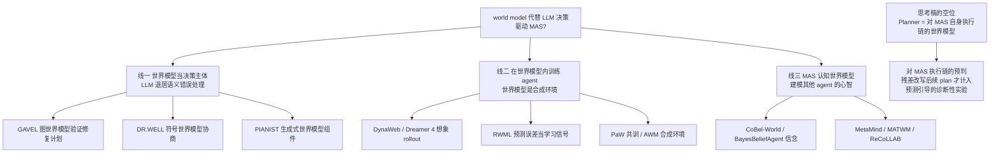

# 世界模型决策驱动 MAS：文献调研

> 检索日期：2026-10-10。回答的问题：**有没有用 world model 代替 LLM 来做决策、驱动 MAS 的工作？** 这些工作与 [MAS_RL_思考-润色版.md](MAS_RL_思考-润色版.md) 的主张（把 Planner 训练成对 MAS 的内部世界模型）是支持、压缩还是正交。
> 共整理 18 篇：线一 4 篇（世界模型当决策主体）、线二 5 篇（在世界模型内训练 agent）、线三 5 篇（MAS 认知世界模型）、线四 4 篇（综述与近邻）。**v1.1 补查（2026-10-10 第二轮）**：新增 §4.5 共 7 篇——专门回答「有没有工作认知 MAS 内部 agent 能力及其与环境的交互」，结论：单项都有人做，合取仍是空的。

---

## 0. 结论先行

**有，且正在快速变多，但走的是三条不同的路，没有一条与思考稿正面重合。**

- **线一（决策主体）**：符号 / 图世界模型接管「可行性与后果判断」，LLM 只处理世界模型修不了的语义错误。世界模型建模的是**环境物理或博弈规则**。
- **线二（训练场所）**：世界模型作为合成环境，agent 在想象 rollout 里做 RL。其中 **RWML 把「预测-真实的差异」当学习信号**，是对思考稿 novelty 冲击最大的一篇，必须正面区分。
- **线三（认知世界模型）**：世界模型建模**队友的目标、技能、信念**，用于协调与重规划。建模对象是其他 agent 的心智，不是本系统的 Executor–Tool 链。
- **共同盲区**：三 条线里，没有任何一篇把 Planner 训练成对 **MAS 自身执行链**（Executor 如何落地参数、Tool 如何搜集返回证据、能力边界在哪）的世界模型，也没有把「预判误差只有改写了后续 plan 才计入」当学习信号，更没有让 Planner 主动设计诊断性实验。思考稿的空位仍然成立，但表述必须收窄（见 §5）。

---

## 1. 线一：世界模型当决策主体（LLM 退居语义错误处理）

这类工作把决策权部分移交给可验证的世界模型：计划先在世界模型里滚一遍，违反前置条件 / 约束的失败直接在模型内修复，只有语义层面的错误才交还 LLM。**与思考稿的差异**：世界模型建模的是环境或任务物理，不是 MAS 的执行链；学习信号仍然是任务成功，没有信念更新。

### 1.1 GAVEL — Graph World Models for Verified and Efficient Long-Horizon LLM Task Planning

- arXiv:2609.19315（2026-09-16），cs.RO。
- 显式图世界模型表示对象关系、动作前置条件与效果、以及对未观测物体位置的概率信念。LLM 生成计划后，在图上前滚预测每步后果，检测违规；凡世界模型能推导出修法的失败直接在模型内修复，**LLM 重规划只保留给需要语义推理的错误**。部分可观测下用物体位置分布重排子任务、最小化期望搜索代价。
- 结果：BEHAVIOR-1K 上，Qwen3-8B 单任务成功率 41.2%→91.8%，多任务 19.9%→92.6%；分布式信念推理比静态变体少走约 5.4% 路程。
- **与思考稿**：正交中带支持。它证明「把预判做成显式、可验证的结构，让 LLM 只兜语义底」是可行且收益巨大的架构方向；但它预判的是机器人环境的物体状态，不是 MAS 的执行过程，也没有从预判误差里学任何东西。

### 1.2 DR. WELL — Symbolic World Model for Embodied LLM-Based Multi-Agent Collaboration

- arXiv，2025-11-06。
- 去中心化神经符号协作：两阶段协商协议（先提角色与理由，再在共识与环境约束下提交联合分配），各自独立生成符号计划、不共享轨迹；**共享世界模型**记录当前状态并随动作更新，把执行结果落地回抽象层。
- 结果：协作推块任务上跨 episode 适应，动态世界模型提升完成率与效率（以时间开销换取可演化的协作策略）。
- **与思考稿**：正交。共享世界模型驱动去中心化 MAS 这一点最接近「world model 驱动 MAS」的字面含义；但它是符号状态机，不是被训练的预测器，没有认知校准。

### 1.3 PIANIST — Learning Partially Observable World Models with LLMs for Multi-Agent Decision Making

- arXiv（exa 收录，2025）。
- 把世界模型拆成七个组件（前向转移函数、动作函数、信息划分函数等），全部由 LLM 零样本生成成**可执行代码**，供 MCTS 在部分可观测的博弈（卡牌、讨论类）中模拟。
- 论点：直接把 LLM 当策略在多智能体部分可观测设定下不可行（动作空间大、他方对抗、随机性），所以把 LLM 用在「生成世界模型」而不是「直接决策」上。
- **与思考稿**：正交中带支持。「LLM 别直接决策，先建一个可执行的世界模型再用它决策」与思考稿的动机同向；但组件是环境规则，不涉及能力信念与失败诊断。

### 1.4 World Action Planner — Generalizable Decision-Making with Action-Conditioned World Models

- arXiv:2607.27599。
- VLM 提出动作序列，动作条件世界模型做想象 rollout，迭代修正；多视角姿态-图像条件的世界模型模拟物理交互。并给出「模型规划比模仿学习更泛化」的理论论证。
- **与思考稿**：正交。imagination-based planning 的机器人版，世界模型是像素级环境动力学。

---

## 2. 线二：在世界模型内训练 agent（对思考稿冲击最大）

世界模型不再只做推理期规划，而成为 RL 的训练场所：agent 在想象 rollout 里学习，真实环境交互降到最低。**这一条线证明「用预测误差训练预测器」已经是活跃方向**，思考稿的 novelty 表述必须与它对齐。

### 2.1 DynaWeb — Model-Based Reinforcement Learning of Web Agents

- arXiv:2601.22149。
- LLM 网页世界模型充当「学出来的 web 服务器」：给定当前页面表示与动作，预测下一页面表示并给出任务级反馈信号。agent 策略在世界模型生成的想象 rollout 与真实专家轨迹的混合中做在线 RL（GSPO）。Dyna / Dreamer 架构在 web agent 上的复活：世界模型从「规划或数据生成工具」升级为「在线 RL 的核心组件」。
- **与思考稿**：正交但方法可借。它解决的是「真实 web 交互贵且不可逆」，与思考稿把在线 Google 移出训练环的论证同构；但世界模型建模的是页面状态，不是 MAS 执行链，预测误差只用于训模型，不用于改 plan。

### 2.2 RWML — Reinforcement World Model Learning for LLM-based Agents（重点区分对象）

- arXiv:2602.05842。
- 用 RL（GRPO）自监督地训练动作条件世界模型：不用 SFT 的 token 级保真，而是在预训练 embedding 空间中最小化**模拟下一状态 \(\hat{s}_{t+1}\) 与真实下一状态 \(s_{t+1}\) 的差**（余弦相似度做奖励）。rollout 转成 \(\langle s_{\le t}, a_t, s_{t+1}\rangle\) 三元组，过滤「太容易」的样本。
- 结果：ALFWorld +19.6、\(\tau^2\)Bench +6.9（不用专家数据、强 LLM、任务奖励）；叠加任务成功奖励后超过直接 outcome RL 6.9 / 5.7 分。
- **与思考稿**：**压缩 novelty 的那篇，必须在 related work 正面拆开**。相同点：预测误差是学习信号、比结局奖励更有效、都承认「奖励只监督结果不够」。三点不同：
  1. RWML 预测的对象是**环境状态** \(s_{t+1}\)；思考稿预判的是 **MAS 执行轨迹**——Executor 的参数绑定、Tool 的返回形态与失败位点、子目标裁决，逐层对应能力 / 工具 / 环境信念。
  2. RWML 的信号是 embedding 距离，一个标量；思考稿的残差是**三层的、结构化的**，且每层写入不同的信念分量。
  3. RWML 训练完把预测头用在决策，但**没有「误差必须改写后续 plan 才计入信息」的定义**，也没有预测引导的诊断性实验选择。RWML 学「预测得更像环境」，思考稿学「预测误差如何变成可迁移的系统认知并改变决策」。

### 2.3 PaW — Policy and World Modeling Co-Training for Language Agents

- arXiv:2606.02388。
- 在 on-policy RL 后训练中共训策略与世界模型：复用 RL rollout，把下一观测 token 追加在后面，加一个辅助 next-token-prediction 损失（因果注意力保证不干扰动作 logits）。推理时零开销。三个设计：按动作熵选 WM 数据、截断 MAE 处理噪声观测、按奖励自适应平衡两个损失。ALFWorld、WebShop、搜索问答上一致提升。
- **与思考稿**：正交。它说的是「世界模型能力可以顺手学」，为「Planner 带预测头」的实现提供先例；但学的是观测预测，不涉及信念体系。

### 2.4 Agent World Model（AWM）— Infinity Synthetic Environments for Agentic RL

- arXiv:2602.10090（Snowflake Labs，开源）。
- 全合成环境生成管线：1000 个环境、平均 35 个工具；**代码驱动 + 数据库后端**，状态转移比 LLM 模拟更可靠一致，可写可靠的奖励函数。仅在合成环境上训练，即可获得强 OOD 泛化。
- **与思考稿**：正交中带支持。直接支撑思考稿实验设计的关键选择——「可复现、可重置、不过 LLM 摘要的工具动力学」是世界模型训练的前提；AWM 用 1000 个环境的规模化实验说明了为什么在线网页当训练动力学是坏主意。

### 2.5 Dreamer 4 — Training Agents Inside of Scalable World Models

- arXiv:2509.24527（DeepMind）。
- 像素级通用世界模型：shortcut forcing + 高效 transformer 做到单 GPU 实时交互推理；从离线数据学行为，随后完全在世界模型内的想象 rollout 上做 RL。Minecraft「仅离线数据拿钻石」：超过 2 万步键鼠动作序列。
- **与思考稿**：极限参照。它划定了「在想象里训练」的工程上限，也反衬思考稿的对象选择：Dreamer 4 建模的是画面，思考稿建模的是 MAS 执行链——后者不需要像素级生成，但需要结构化、可审计的残差。

---

## 3. 线三：MAS 认知世界模型（建模队友与信念）

把「其他 agent 的目标、技能、信念」作为世界模型的建模对象，用于协调、通信与重规划。**与思考稿的差异**：建模方向朝外（他者心智），思考稿朝内（本系统的执行能力与可靠性）；但「显式信念表示 + 系统性更新」的框架高度可类比。

### 3.1 CoBel-World — Collaborative Belief Reasoning with LLMs

- arXiv:2509.21981。
- 给每个 LLM agent 一个 **Collaborative Belief World**：环境 + 协作者心理状态的内部表示。符号信念表示模块（PDDL 风格）把开放世界描述转成结构化信念并推导信念规则；贝叶斯信念协作协议（类贝叶斯滤波）用 LLM 推理零样本预测他方信念、检测潜在失配并自适应通信。
- 结果：TDW-MAT、C-WAH 上通信成本降 64–79%，任务完成效率升 4–28%。
- **与思考稿**：正交中带支持。「显式信念 + 贝叶斯式更新 + 失配驱动通信」与思考稿的「信念 + 残差驱动重规划」是同一设计语法的两个应用域；它是协作通信，不是工具执行链。

### 3.2 BayesBeliefAgent — Bayesian Partner Modelling for Adaptive Replanning

- arXiv:2608.18490。
- 队友技能的递归贝叶斯后验 + 层级 LLM 规划器。关键机制是**矛盾条件化的中断**：只有当新证据与当前技能估计直接矛盾时才打断正在执行的技能并重规划，重规划次数比启发式少一个数量级。提出 belief–action gap 指标：持有正确伙伴估计时却执行了非互补技能的决策比例。
- **与思考稿**：正交。「证据矛盾才触发重规划」与思考稿「信息必须改写 plan 才算数」共享同一原则；建模范围限于队友技能。

### 3.3 MetaMind — General and Cognitive World Models in MAS via Meta-Theory of Mind

- arXiv:2603.00808。
- Meta-ToM 框架：agent 从自己的行为轨迹反推自己的目标与信念（双向自洽推理），再经类比推理把这种元认知能力泛化到第三人称——从有限的可观测轨迹零样本推断其他 agent 的目标与信念，不依赖显式通信即可适应涌现的集体意图。
- **与思考稿**：正交中带警示。「从行为轨迹反推信念」与思考稿的「从执行残差反推能力信念」在认识论上同构。审稿人可能问：为什么需要对 MAS 的世界模型，而不是对所有 agent 的 ToM？回答应在论文里预置：ToM 建模的是意图，思考稿建模的是**能力与可靠性**——决定「这条计划该不该发出去、发给谁、用哪个工具」的是后者。

### 3.4 MATWM — Multi-Agent Transformer World Model

- arXiv:2506.18537。
- MARL 的 transformer 世界模型：中心化聚合改为显式**队友预测器**（近似常数开销于 agent 数量），配合优先级回放（适应非平稳性）与动作空间缩放，在部分可观测下支持多智能体想象与协调。
- **与思考稿**：正交。经典 MARL 世界模型的多智能体扩展，非 LLM。

### 3.5 ReCoLLAB — Retrieval-Augmented LLMs for Cooperative Ad-hoc Teammate Modeling

- arXiv:2512.22129。
- LLM 充当**队友行为的世界模型**：把短轨迹映射到行为类型假设，路由到预训练最优响应策略；RAG 版本用检索到的相似队友轨迹摘要稳定推理。Overcooked 上达到分类精度与回报的 Pareto 前沿。
- **与思考稿**：正交。又一次「LLM 当某类世界模型」的实例——这次是行为分类器。

---

## 4. 线四：综述与近邻

### 4.1 Understanding World or Predicting Future? A Comprehensive Survey of World Models

- ACM Computing Surveys（2025）。整理库：tsinghua-fib-lab/World-Model。
- 把世界模型分成两大功能：**(1) 构建内部表征以理解世界机制；(2) 预测未来状态以模拟并引导决策**。
- **与思考稿**：直接背书。思考稿对「环境世界模型（Dreamer / WebDreamer）」与「内部系统认知世界模型（本稿）」的区分，恰好落在该综述的两分类上；思考稿的定位可以引用这个二分：现有 agentic 工作几乎都在 (2)，本稿把重心移回 (1)——理解 MAS 的机制。

### 4.2 Large Language Models for Planning: A Comprehensive and Systematic Survey

- arXiv:2505.19683。
- 其中「World Model-based Exploration」一节是思考稿近邻的现成地图：**RAP**（LLM 当世界模型预测状态变化做搜索）、**WebDreamer**（LLM 预测网页动作后果，避免真实交互的不可逆风险）、WorldCoder（世界模型写成代码当代转移函数）、ReasonPlanner（世界模型 = 时序知识图谱）。另有扩散模型世界模型预测机械臂操作后的物体状态（Feng et al. 2025）。
- **与思考稿**：作为 related work 的组织骨架；这些工作的世界模型都是环境模拟器。

### 4.3 WorldEvolver — Self-Evolving World Models for LLM Agent Planning（近邻，单列）

- arXiv:2606.30639。
- 部署期自进化、**agent 与全部模型参数冻结**的世界模型：情景记忆（用检索做基于真实转移的模拟）、语义记忆（**从预测-观测不匹配中提炼持久启发式规则**）、选择性预见（低置信预测先过滤再进 agent 上下文）。ALFWorld / ScienceWorld：预测精度最高，下游 agent 成功率领先基线。
- **与思考稿**：**机制上最近的邻居，第二篇必须正面拆开的论文**。相同点：预测-观测不匹配驱动记忆修订；都相信「预测误差是认知更新的来源」。三点不同：
  1. WorldEvolver 修订的是**检索记忆与启发式规则**（测试时上下文），Planner 不被训练；思考稿把残差当学习信号**训练 Planner 双头**。
  2. WorldEvolver 是被动进化——遇到什么修什么；思考稿有**预测引导的诊断性实验选择**——主动决定探哪里、设计哪种失败（argmax IG）。
  3. WorldEvolver 的「选择」只过滤低置信预测；思考稿要求残差**改写后续 plan** 才计入信息，并有失败类型学（Type I/II/III）作为判别准则。
- 同时它支持思考稿的一个设计：不更新世界模型参数也能获得下游收益，说明「残差 → 信念」这条路径本身就有效。

### 4.4 WebDreamer 与 RAP（思考稿已引近邻，归档）

- WebDreamer：Gu et al., arXiv:2411.06559（TMLR 2025）。LLM 想象候选动作后的页面状态（change / a11y / html），打分后执行最优；Dreamer-7B 用 310 万合成交互实例专训。想象的是**网页状态**，目标是任务成功率，预判误差不是学习信号。
- RAP：Hao et al., arXiv:2305.14992。LLM 同时当策略与世界模型，在小环境做树搜索。动力学太窄。
- **与思考稿**：已在 §5.4 划界；归入线四作完备引用。

### 4.5 v1.1 补查：认知 MAS 内部 agent 能力 + 预判执行后果的工作（2026-10-10 第二轮）

针对用户追问「有没有认知 MAS 内部各个 agent 能力、以及如何与环境做交互的」做了三路定向检索：工具行为世界模型、agent 自我能力建模、planner 预判 executor。**结论：三个单项都有人做且相当近，但没有一篇同时覆盖「MAS 执行链预判 + 三层结构化残差 + 残差计入信息」三件事。这七篇全部进 P0 划界清单。**

#### 4.5.1 DyMo — World Modelling Improves Language Model Agents（**形最近，P0 第一位**）

- arXiv:2506.02918。
- 微调一个 LLM 同时输出 tool call 与**调用后工具引擎的后续状态预测**；测试时用该内部环境模型做 Self-Verification Sampling：N 个候选在想象中前滚打分选优，**不查询真实环境**，避免反复试错带来的副作用。
- **与思考稿**：**形上最接近**——同一模型双输出（动作 + 执行后状态）、预测用于门控执行，正是思考稿 dual-output 的单 agent 版本。四点不同：
  1. DyMo 是**单 agent 自己调工具**，不存在 Planner–Executor 分工；思考稿预判的是**另一个组件**（Executor）如何落地参数、另一个组件（Tool）如何搜集返回——是对 MAS 内部执行链的认知，不是自我工具调用；
  2. DyMo 预测的是**环境侧状态**（工具引擎返回的状态），思考稿预判分三层：Executor 参数层、Tool 动力学层、Subgoal 结果层，且残差按层结构化写入不同的信念分量（Cap / ToolRel / Env / Rec）；
  3. DyMo 无持久信念体系——预测误差只用于当下打分，不形成可复用的能力认知；思考稿残差是** belief revision 的来源**，训练两阶段（先学预测后学门控）；
  4. DyMo 的预测评估没有信息量判据——所有残差一视同仁；思考稿只有改写后续 plan 的残差才计入 \(I\)。

#### 4.5.2 ReasonPlanner — 预测轨迹 + 预测-观测差异触发重规划（**机制第二近，P0 第二位**）

- arXiv:2410.09252。ScienceWorld 环境。
- 用动态时序知识图谱（TKG）当世界模型，在假设空间生成状态-动作轨迹；actor 执行后，critic **显式对比真实下一状态与预测下一状态，反思差异，触发重规划或修正子任务**。
- **与思考稿**：**「预测 → 执行 → 对比 → 重规划」闭环的字面近邻**。三点不同：
  1. ReasonPlanner 的世界模型是**环境状态的 TKG**，不是对 Executor 能力或 Tool 动力学建模；它不预判 executor 会用什么参数；
  2. critic 的对比反思是 **prompt 级的，不训练**——差异不会持久地改写任何能力信念，下次遇到同类工具还是同样的错；
  3. 无信息量判据与诊断性实验选择。
- 引用价值：它证明「预测-观测残差驱动重规划」这个直觉已被社区接受，思考稿可以引用它作为动机，然后指出它的残差**既不结构化也不持久化**。

#### 4.5.3 MUSE — Competence-Aware Agents with Metacognition（**能力自评最近，P0 第三位**）

- arXiv:2411.13537。Meta-World / ALFWorld。
- 元认知自评：可学习的内部模型预测「所提计划的成功概率」，据此做能力感知的策略选择与自我调节；有 RSSM 世界模型与 LLM 两种实现。
- **与思考稿**：占了「agent 对自身能力建模」这半边。三点不同：
  1. MUSE 是**标量自评**（成功概率一个数），思考稿是**结构化能力模型**——Cap 按工具/子目标类型维护，能回答「为什么失败、失败在哪层」；
  2. MUSE 是**单 agent**，无 MAS 分工；思考稿的能力模型针对的是 Planner–Executor–Tool 链条中其他组件的行为；
  3. MUSE 的自评不与具体执行预判（参数、工具动力学）对账，无三层残差。

#### 4.5.4 MAGELLAN — 元认知学习进度预测

- arXiv:2502.07709。autotelic agent 在大目标空间中预测自身胜任度（competence）与学习进度（LP），用于课程选择；跨语义相关目标泛化。
- **与思考稿**：同属「自我能力元认知」线，但服务于**目标课程选择**，不服务执行预判；能力是目标空间上的泛化标量，不拆解到工具与参数层。

#### 4.5.5 Capability Self-Assessment (CSA) — RL 教 LLM 知道自己不会什么

- arXiv:2606.00251（2026-05）。
- 把「知道自己做不到、该委托/上报」建模为策略学习问题，RL 训练显著优于 SFT（SFT 反而损害原能力）；OOD 泛化好；可改进本地-云端推理分流。
- **与思考稿**：占了「能力边界 → 委托决策」这半边。两点不同：
  1. CSA 是**二值/分流级**的知道自己行不行，思考稿的能力认知粒度是「这个 Executor 在这类子目标上如何落地参数、这个 Tool 在这种输入下如何失败」——预判内容本身，不只是成功率；
  2. CSA 无执行链世界模型，无预测-观测残差回路。但 CSA 的 RL > SFT 结论**直接支持**思考稿两阶段训练中「预测能力需 RL 而非 SFT」的设计，可在方法部分引用。

#### 4.5.6 FOREAGENT — 执行前用隐式世界模型剪枝

- ACL 2026（aclanthology.org/2026.acl-long.182）。
- 数据科学 agent：先用「隐式世界模型」预测两个候选方案的相对性能（无物理执行），剪枝后再真实运行，把小时级执行压缩到秒级推理。
- **与思考稿**：验证「预测代替执行」的巨大收益叙事（9 小时 → 1 秒），可作为动机引用。但它是**方案级相对性能比较**，不对执行链分层建模，无信念修订。

#### 4.5.7 SiRA — 分层世界模型 + simulative reasoning

- arXiv:2507.23773。
- Planner 在内部世界模型上提出动作、预测下一信念状态、用 critic 评估目标进度，选出最优动作序列后交 actor 落地——显式的「想象中搜索、现实中执行」双层架构。
- **与思考稿**：imagination-gated execution 的近邻，但世界模型对象是**环境信念状态** \(\hat{s}_{t+1}\)，不对 Executor 参数与 Tool 动力学建模；单 agent GUI 任务。

#### 4.5.8 补查总结：合取空位的精确表述

| 能力维度 | DyMo | ReasonPlanner | MUSE | CSA | FOREAGENT | SiRA | **思考稿** |
|---|---|---|---|---|---|---|---|
| 预判执行后果（动作+状态双输出） | ✅ | ✅ | ❌ | ❌ | ✅（方案级） | ✅ | ✅ |
| 对象是 **Executor 能力 / Tool 动力学**（MAS 执行链） | ❌（自身环境状态） | ❌（环境 TKG） | ❌（标量自评） | ❌ | ❌ | ❌（环境信念态） | ✅ |
| **MAS 分工**（Planner 预判其他组件） | ❌ | ❌ | ❌ | ❌ | ❌ | ❌（actor 是自己） | ✅ |
| 三层结构化残差 → 持久信念修订 | ❌（无信念） | ❌（prompt 级反思） | ❌ | ❌ | ❌ | ❌ | ✅ |
| 残差改写 plan 才计入信息 \(I\) | ❌ | ❌ | ❌ | ❌ | ❌ | ❌ | ✅ |
| 残差作为训练信号（而非仅打分/反思） | ✅（辅助信号） | ❌ | ✅（自评模型） | ✅ | ❌ | ✅ | ✅ |

七篇没有任何一列全勾。**与 BayesBeliefAgent（认知他人）、WorldEvolver（修订记忆不训练）合起来看，空位被框得更死**：他者心智线不做执行链预判，执行预判线不做 MAS 分工与信念修订，能力自评线不做预判内容本身。思考稿的三项合取（§5a）在补查后依然成立且更加必要——v1.0 的六条划界扩为**至少十二条**。

---

## 5. 对思考稿的修订建议（只列建议，不改稿）

基于以上 18 篇，思考稿有三处需要修订，都在定位与表述层，不在机制层。

**（a）§3.4 的 novelty 声明必须收窄。**「把 prediction error 当学习信号」已不再是空位：RWML 用它训世界模型（线二），WorldEvolver 用它修记忆（线四），PaW 用它做辅助损失。继续用这句话当核心 novelty 会被这三篇直接打回。空位的精确表述是三项**合取**：

1. 预判的对象是 **MAS 自身执行链**（Executor 参数落地、Tool 搜集与返回动力学、能力边界），不是环境状态 \(s_{t+1}\) 或网页快照；
2. 残差是**三层的、结构化的**，且只有改写了后续 plan 的部分才计入信息 \(I\)；
3. 预测用于**主动设计诊断性实验**（argmax IG、失败类型学），而不是过滤预测或挑选成功率最高的动作。

RWML 占住的是「训练」半边但没有结构化残差与实验设计；WorldEvolver 占住「信念修订」半边但不训练 Planner、不主动设计实验。两者合起来恰好把思考稿的位置框得很清楚。

**（b）Related work 需新增划界。** v1.0 六条：RWML（预测环境状态、标量残差）、WorldEvolver（被动记忆修订、参数冻结）、GAVEL（世界模型验证环境计划，非 MAS）、DR. WELL（符号共享状态，非预测器）、CoBel-World / MetaMind（他者心智，非本系统能力）。**v1.1 补查后扩为十二条**，新增：DyMo（单 agent 双输出、无信念体系、非 MAS）、ReasonPlanner（环境 TKG、反思不训练）、MUSE / MAGELLAN / CSA（能力自评但不预判执行链内容）、FOREAGENT（方案级剪枝）、SiRA（环境信念态想象，actor 是自己）。建议按思考稿 §5.4 表格的格式各给一行「做了什么 / 缺什么」。

**（c）实验论证可借两篇的说法。** AWM 与 DynaWeb 给了「为什么要可复现、非在线、不过摘要的工具动力学」的社区共识级论据，可在 §7 的实验设计里直接引用（AWM：LLM 模拟的转移不如代码 + 数据库可靠；DynaWeb：真实 web 交互低效且不可逆）。另可借 BayesBeliefAgent 的 belief–action gap 思路设计指标：**「信念更新了但 plan 没变」的比例**应当随训练下降——这正是 \(I\) 的定义在评测上的投影。

---

## 6. 参考文献表

| # | 工作 | 出处 | 一句话机制 | 与思考稿关系 |
|---|---|---|---|---|
| 1 | GAVEL | arXiv:2609.19315 | 图世界模型前滚验证并修复 LLM 计划，LLM 只处理语义错误；BEHAVIOR-1K 41.2%→91.8% | 正交 / 支持：显式可验证预判的架构方向 |
| 2 | DR. WELL | arXiv 2025-11 | 符号共享世界模型 + 两阶段角色协商的去中心化协作 | 正交：世界模型驱动 MAS 的字面近邻 |
| 3 | PIANIST | arXiv 2025 | LLM 生成世界模型七组件（可执行代码）供部分可观测博弈 MCTS | 正交 / 支持：先建世界模型再决策 |
| 4 | World Action Planner | arXiv:2607.27599 | 动作条件世界模型想象 rollout 迭代修正机器人计划 | 正交 |
| 5 | DynaWeb | arXiv:2601.22149 | LLM 网页世界模型当合成环境，真实+想象轨迹混合 RL | 正交 / 支持实验论证 |
| 6 | RWML | arXiv:2602.05842 | GRPO 最小化模拟与真实下一状态的 embedding 差；ALFWorld +19.6 | **压缩：须正面拆开（§2.2）** |
| 7 | PaW | arXiv:2606.02388 | RL rollout 复用，辅助下一观测预测共训同一模型 | 正交：预测头可顺带学的先例 |
| 8 | Agent World Model | arXiv:2602.10090 | 代码 + 数据库驱动 1000 合成环境，可靠转移 | 支持实验设计 |
| 9 | Dreamer 4 | arXiv:2509.24527 | 像素世界模型内做 RL 的工程极限（Minecraft 离线拿钻） | 参照 |
| 10 | CoBel-World | arXiv:2509.21981 | 协作信念世界：符号信念 + 零样本贝叶斯更新，通信成本 −64–79% | 正交 / 支持：信念 + 更新框架 |
| 11 | BayesBeliefAgent | arXiv:2608.18490 | 队友技能贝叶斯后验 + 矛盾触发中断重规划；belief–action gap | 正交 / 可借指标 |
| 12 | MetaMind | arXiv:2603.00808 | Meta-ToM 认知世界模型，从轨迹反推他者目标信念 | 正交 / 需预置答辩 |
| 13 | MATWM | arXiv:2506.18537 | MARL transformer 世界模型 + 队友预测器 + 优先级回放 | 正交 |
| 14 | ReCoLLAB | arXiv:2512.22129 | LLM + RAG 当队友行为世界模型做 ad-hot 协作 | 正交 |
| 15 | WM 综述 | ACM CSUR 2025 | 世界模型二分：内部表征理解 vs 未来预测 | 背书分类定位 |
| 16 | LLM for Planning 综述 | arXiv:2505.19683 | RAP / WebDreamer / WorldCoder / ReasonPlanner 的世界模型地图 | related work 骨架 |
| 17 | WorldEvolver | arXiv:2606.30639 | 预测-观测不匹配 → 情景/语义记忆修订，agent 参数冻结 | **压缩：须正面拆开（§4.3）** |
| 18 | WebDreamer / RAP | arXiv:2411.06559 / 2305.14992 | LLM 想象网页或环境下一状态以选动作 | 已划界（§5.4） |
| 19 | DyMo | arXiv:2506.02918 | 单 LLM 双输出 tool call + 工具后状态，SVS 想象采样免查环境 | **压缩：P0 第一位（§4.5.1）** |
| 20 | ReasonPlanner | arXiv:2410.09252 | TKG 世界模型预想轨迹；critic 对比预测-真实状态触发重规划 | **压缩：P0 第二位（§4.5.2）** |
| 21 | MUSE | arXiv:2411.13537 | 元认知自评：可学习模型预测计划成功概率，能力感知选策略 | **压缩：P0 第三位（§4.5.3）** |
| 22 | MAGELLAN | arXiv:2502.07709 | 元认知预测自身胜任度与学习进度，指导课程选择 | 正交：自评服务课程（§4.5.4） |
| 23 | CSA | arXiv:2606.00251 | RL 教 LLM 知道自己不会什么、该不该委托；RL>SFT | 正交 / 支持训练设计（§4.5.5） |
| 24 | FOREAGENT | ACL 2026 | 隐式世界模型执行前剪枝，9 小时物理执行 → 1 秒推理 | 动机引用（§4.5.6） |
| 25 | SiRA | arXiv:2507.23773 | 分层 WM 上 simulative reasoning，想象搜索现实执行 | 正交 / 近邻（§4.5.7） |
