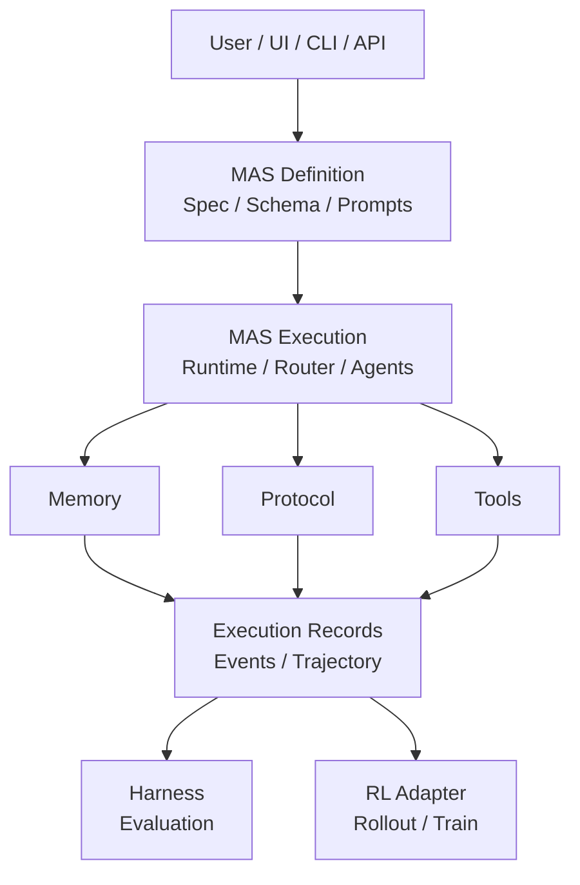
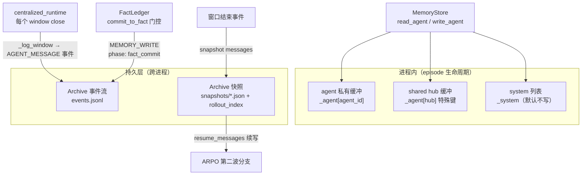

# MAS 层设计文档 v2（重构后目标架构）

日期：2026-10-13
版本：v2（设计稿，尚未实施）。本 v2 吸收 [GPT_analysis_for_MAS_design.md](./GPT_analysis_for_MAS_design.md) 评审意见修订：A 类 20 项直接采纳（文档层补强）、B 类 4 项压缩范围（只写合同不扩信封）、C 类 6 项推迟（入 §16 ADR）。涉及代码现状的表述已逐一对照仓库源码校准。
状态：Phase 0–6 已落地；2026-10-15 修订新增 §8.5 Mode B-window（user_space 窗口图进入训练的合同），§8.3 相应更新。2026-10-16 修订：默认工具五件套改为与 AgentFlow / EPC-AW 对齐；Mode B-window 的 AgentFlow 窗口可以按 planner / executor 回合做 ARPO 续写。差距清单见 [AUDIT_GAP_MATRIX.md](./AUDIT_GAP_MATRIX.md)。
配套阅读：[RL_design.md](./RL_design.md) · [Harness_design.md](./Harness_design.md) · [TECHNICAL_FRAMEWORK.md](./TECHNICAL_FRAMEWORK.md) · [AUDIT_GAP_MATRIX.md](./AUDIT_GAP_MATRIX.md)（原 MAS_AGENT_LANDING.md 已删除，历史版本见 git）

---

## 0. 三层定位与模块职责约束

### 0.1 为什么要重构 MAS 层

当前 `mas/` 并存三套体系：产品主栈（`workflow/` + `tools/` + TirAgent 训练热路径）、vendored StructAgent 栈（`MAS_structagent/`）、单 Agent 遗留栈。用户视角的直观痛点：

1. **结构不透明**：`mas/` 里有 `tools/` 目录，却没有 `memory/` 目录——记忆被刻意做薄（90 行 `MemoryStore`，默认不写入），真正的"共享记忆"是 Archive 黑板日志，散落在 `workflow/runtime.py`、`memory.py`、`archive.py`、`centralized_runtime.py` 四处。
2. **同名概念多处落地**：两套 tools 暴露面（`langchain_tools.py` vs `tool_agents.py`）、两套 memory（`workflow/memory.py` vs `MAS_structagent/epc_aw/models/memory.py`）、两套 prompts（内联拼接 vs `epc_aw/prompts/*.txt`）。
3. **跨包 shim 泛滥**：`mas/algos/`（6 文件 40 行）、`workflow/rewards.py`、`workflow/train_signal.py` 全部是指向 `rl/` 的 re-export——"一套东西两个入口"。
4. **运行时产物混在源码树**：`mas/{data,checkpoints,artifacts,tensorboard_log,.tir_archives,.local_expansion}` 与代码同级，source 与 artifact 无分离。
5. **prompt 存储分散六处**，没有单一入口可查"某个窗口的 system prompt 从哪来"。

重构原则（小成本、渐进、零训练回归）：

- 顶层 import 名全部不破（`workflow` / `tools` / `tir_agent` / `MAS` 注册名 / `legacy.*`）——`mas/tests` 412 处 `from workflow.*` 必须继续通过。
- 训练热路径三件套零移动、零行为变化：`tir_agent.py`、`lit_tir_agent.py`、`train_tir_agent.py`（控制层以文件路径拉起）。
- 每阶段独立回归：`./run.sh feature-test functional workflow user-space` + `./run.sh smoke` 全绿才进下一阶段。
- 不改 `agent-lightning/` 源码（黑盒边界）。

### 0.2 MAS 层的三层定位

评审二节的核心提醒：MAS 层不能只被理解成 Workflow Engine。它承担三个不同层面的职责：

| 层次 | 核心问题 | 典型组件 |
|---|---|---|
| MAS Definition（定义层） | 用户如何定义一个多智能体系统 | AgentNodeSpec、RouterSpec、MASSpec、Prompt、Schema |
| MAS Execution（执行层） | 系统如何实际运行 | AgentRegistry、Runtime、Router、Protocol、Memory |
| MAS Observability & Learning（观测与学习层） | 如何记录、评估和改进执行过程 | Trajectory、Archive、BranchSite、Harness、RL Adapter |

逻辑依赖方向（只表示依赖，不要求立刻按层次建目录）：



### 0.3 五条模块职责约束

目录结构可以保持平铺，架构边界不能因此变得模糊：

1. **spec.py 只描述定义，不执行 Agent**：AgentNodeSpec/RouterSpec 是配置 schema，不承担执行。
2. **centralized_runtime.py 只做执行协调**：不同时成为消息协议、事实提交、记忆管理和 Archive 写入的主要实现位置——协议在 protocol.py、门控委托 FactLedger（Phase 2 后）、Archive 经注入的 `arch` 引用由 runtime 显式调用。
3. **contracts.py 只存跨模块数据合同**，不存执行逻辑、存储逻辑或策略实现（§10）。
4. **active_set.py 只做分支展开策略**，不重新实现 Runtime 的执行逻辑（episode 执行统一经 `run_episode` 回调注入）。
5. **agents.py 只负责 Agent 实例的注册与解析**，不承担执行流程。

---

## 1. 目录总览与 legacy 分级（重构后）

### 1.1 目录总览

```text
MAS_Science_Infra/
├── mas/                            # 产品主栈（唯一受控仓库面）
│   ├── workflow/                   # 引擎：spec→compile→runtime
│   │   ├── spec.py                 # MASSpec YAML schema（AgentNodeSpec/RouterSpec/MemorySpec）
│   │   ├── contracts.py            # 数据合同（Trajectory/ExecutionEvent/MemoryItem/BranchSite/RolloutTree）
│   │   ├── compiler.py             # MASSpec → 可执行 handoff 图
│   │   ├── protocol.py             # AgentMessage 信封 + 各 kind payload schema
│   │   ├── runtime.py              # ExecutionService 门面 + TirAgent 适配
│   │   ├── centralized_runtime.py  # planner→router→tool-agent→verifier 中心化行走
│   │   ├── router.py               # from_plan / score / round_robin 路由策略
│   │   ├── agents.py               # AgentRegistry 运行时注册表
│   │   ├── prompts.py              # [新] prompt 解析单入口（planner/verifier/候选菜单）
│   │   ├── memory/                 # [新] 记忆子包——三组件显式化（§4）：__init__ 重导出，
│   │   │                           #   store.py（三作用域）/ facts.py[FactLedger 新] / archive.py（原 workflow/archive.py）
│   │   ├── sampling/               # 分支采样 adapter（GRPO/ARPO/AEPO/RAE）
│   │   ├── active_set.py           # ActiveSetSession 两波展开（active_set_scheduler.py 为其 ready_batch 调度器）
│   │   └── user_gateway/           # user_space 桥（HIVE/EPC-AW 包装窗口）
│   ├── tools/                      # 五个 ToolAgent（LLM-in-tool）+ 纯函数内核
│   ├── {tir_agent,lit_tir_agent,train_tir_agent}.py   # 训练热路径三件套（零移动红线）
│   ├── specs/                      # hub_react.yaml 默认 spec + templates/*.yaml 画布模板
│   ├── tests/                      # 单测（412 处 workflow.*，import 名全程兼容）
│   └── docs/                       # CONCEPT_MAP.md（Phase 4 产出）
├── legacy/structagent/              # 第三层隔离区：epc_aw/ 引擎原样 + mas_agent.py 冒烟
│                                   #   + train_mas_agent.py 平行 GRPO 入口（UI 不走）+ scripts/
├── rl/                             # RL 钩子层（rewards/loss/train_signal/hooks）——Reward/TrainSignal 唯一入口
├── science_infra/                  # Control / CLI（serve, collect, train 拉起）
├── webui/                          # Science Studio UI
├── experiments/                    # <id>/{experiment,llm,workflow,rl,harness}.yaml
├── artifacts/mas/{tir_archives,local_expansion}/   # [新] 运行时产物（原 mas/.tir_archives、.local_expansion）
├── user_space/                     # 用户项目（Assistant 唯一可写树）
└── agent-lightning/                # AGL 黑盒（不动）
```

与现状的目录差异（全部是物理移动，不改运行逻辑）：

| 现状 | 重构后 | 说明 |
|---|---|---|
| `mas/MAS_structagent/` | `legacy/structagent/epc_aw/` | 隔离 vendored 栈 |
| `mas/mas_agent.py` `mas/train_mas_agent.py` | `legacy/structagent/` | 平行训练栈随行 |
| `mas/workflow/memory.py`（单文件） | `mas/workflow/memory/store.py` | 变子包，import 兼容 |
| `mas/workflow/archive.py` | `mas/workflow/memory/archive.py` + 原位 6 行 shim | 持久层归入 memory 子包 |
| `mas/algos/`（6 文件 shim） | 删除 | 引用全部转正为 `rl.*` 直引 |
| `mas/workflow/rewards.py` `train_signal.py`（shim） | 删除 | 同上 |
| `mas/.tir_archives/` | `artifacts/mas/tir_archives/` | 我们自己的写入点，可安全迁 |
| `mas/.local_expansion/` | `artifacts/mas/local_expansion/` | 同上 |
| `mas/{checkpoints,tensorboard_log,data,artifacts}/` | 探查后定 | AGL/monitor 依赖未明前原地保留 |

三层物理隔离：

- **mas/**：产品主栈。UI 手册描述的所有流程（Collect、单题调试、批量测试、训练、采样树、Monitor）经手的全部代码。
- **legacy/structagent/**：可独立运行但产品 UI 不走的研究栈。命令行 `python legacy/structagent/train_mas_agent.py` 仍可用；vendored 包注册名 `sys.modules["MAS"]` 在 bootstrap 内部维持不变，包内 `from MAS.epc_aw...` 零改动。
- **agent-lightning/**：黑盒 submodule，一个字符不动。

### 1.2 legacy 依赖的三级分类（诚实边界）

物理目录隔离不等于运行时隔离。`mas/tools/tool_agents.py` 有 5 处对 `MAS_structagent.epc_aw.tools.*` 的懒加载（python_coder/wikipedia_search/google_search/web_search/think），因此 vendored 栈不是"完全隔离的死代码"——诚实分类如下：

| 依赖级别 | 内容 | 处理方式 |
|---|---|---|
| 产品必需的运行时依赖 | 5 个 ToolAgent 的 pro 后端（页面分析、代码执行 LLM）经 tool_agents.py 懒加载 `epc_aw/tools/` | 明确声明为**产品运行时可选后端**（`tier: pro`），lite 内核不依赖 |
| 可选的高级能力 | `tier: pro` 才启用的 LLM-in-tool | 可选适配器 + 缺失依赖时明确报错降级（不崩溃进程） |
| 独立研究栈 | `train_mas_agent.py`、完整 EPC-AW 引擎、`mas_agent.py` | 不被产品主栈默认加载，仅命令行拉起 |

- 关键事实：`_epc_aw_llm_backend` 是 try/except 懒加载，import 失败返回 None，工具回退 lite 内核——产品主栈在缺失 vendored 依赖时仍可运行。

### 1.3 `sys.modules["MAS"]` 注册的三项验证

`mas/mas_agent.py` 的 `bootstrap_mas_package()` 用 `sys.modules["MAS"] = ModuleType(...)` 注册 vendored 包。这种全局命名空间注册有 module 加载顺序冲突风险，隔离完成的验收不能只看 import 更新数量，Phase 1 必测三项：

1. **干净独立导入**：全新 Python 进程分别执行产品主栈导入、StructAgent 导入，各自通过。
2. **同进程双栈导入**：同一进程先加载产品主栈再加载 vendored 栈（及反序），确认行为不因加载顺序改变。
3. **模块身份**：确认 `import MAS` 指向预期的 vendored 包（`__path__` 指向 `legacy/structagent/epc_aw/` 物理路径），不是其他同名模块。

配套要求：缺失可选依赖时，lite 工具正常工作、pro 工具返回明确的依赖缺失错误，import 阶段不崩溃（现状的 try/except 懒加载已满足，测试锁定之）。注册行为必须限定在 bootstrap 内部，禁止产品主栈代码直接依赖 `MAS.*` 名称。

### 1.4 workflow 平铺准入三规则

不创建 `mas/engine/`（412 处测试 import + 训练拉起命令成本，见 §16 ADR-1）。但平铺获准延续的前提是：

1. **唯一权威实现**：每个稳定概念在 workflow/ 内只有一个权威实现文件（§15 速查表是验收稿）。
2. **shim 必须声明删除条件**：所有兼容 shim（如 archive 原位 6 行）必须有书面删除条件与期限，不做永久 shim。
3. **新模块必须声明职责与依赖方向**：新增 `.py` 到 workflow/ 时，docstring 声明职责、依赖方向与公共接口；禁止把 workflow/ 当默认公共代码存放区。落点文件为 `mas/docs/CONCEPT_MAP.md`（Phase 4 与 prompts.py 同期产出）。

---

## 2. Agent 模型与 Router 四契约

### 2.1 三类节点（保留 v1 骨架）

统一节点由 `AgentNodeSpec` 定义（见 [mas/workflow/spec.py](../mas/workflow/spec.py)：id / kind / role / skills / `tools`（可路由 tool-agent id）/ memory_scope（默认 none）/ system_prompt / model（inherit）/ trainable / profile）。三类节点：

| kind | 数量 | LLM 窗口 | 可训练 | 说明 |
|---|---|---|---|---|
| `planner` | 每图恰好 1 个 | 多轮 | 是 | 唯一 plan agent；输出 `plan_step`/`final_answer`；`HubSpec` 是其默认配置来源 |
| `tool` | 5 个内置 + 可注册 | 单次 | 否 | 默认五件套与 AgentFlow / EPC-AW 对齐：`base_generator` / `python_coder` / `bing_search` / `wikipedia_search` / `web_fetch`（`web_search` 仍是 `web_fetch` 的别名）。`think` 不再出现在默认 palette，旧图里的节点仍能解析 |
| `verifier` | 0-1 个 | 单次 | 可 | 无声明时运行时兜底（格式检查）；有 `system_prompt` 时按 `verify` schema 校验输出 |
| `blank` | 任意 | 单次 | 可 | 用户自定义：`system_prompt` + `input_schema`/`output_schema`（JSON Schema 自描述）+ `profile.memory` 策略 |

`tool` 的内核与 LLM 分离（[mas/tools/tool_agents.py](../mas/tools/tool_agents.py)）：内核是 `mas/tools/{search,wikipedia}.py`、`python_tool.py` 纯函数；LLM 后端来自 legacy 栈懒加载（§1.2），按 `tier: lite|pro` 决定仅内核还是加页面分析。

### 2.2 四个字段语义澄清（评审四节采纳）

1. **`trainable` = 可优化策略候选范围，不等于必产生梯度**。`kind: tool` 在 spec 归一化中被强制 `trainable: false`（tool_agents 注册也是 `trainable=False`），但"trainable: true"只表示节点属于策略优化的候选成员，实际是否参与梯度更新由训练配置、策略绑定（远期 §8）与 RL Adapter 共同决定。禁止把它当训练调度器的唯一依据。
2. **`tools` 字段实为 `routable_agent_ids`**：它存的是 planner 可路由的 Agent 节点 id 列表，不是原子工具注册表（原子工具在 `mas/tools/`）。短期不改字段名（YAML/UI 兼容），文档与内部变量统一用"可路由 Agent 集合"表述；长期经 schema 版本迁移把"可路由 Agent"与"Agent 可调用的原子工具"分开。
3. **四类 kind 是混合维度**：planner/verifier 描述逻辑职责（Role），tool 描述执行方式（Execution Type），blank 是未指定语义的通用节点。短期保留四类不加抽象；文档明确三个维度（Role / Execution Type / Backend）供长期演进——只有某维度能导致不同运行时行为时才升级为独立配置项。
4. **实例生成位置**：spec → AgentRegistry（agents.py）解析为 BlankAgent / UserBoundAgent 等运行时对象，此为成品分工，不因 kind 混合维度而重构。

### 2.3 运行时三层包装（AgentRegistry）

[mas/workflow/agents.py](../mas/workflow/agents.py) 把 spec 解析成：

- **ToolAgent 实例**：`kind: tool` 节点绑定具体 `ToolAgent`（tools/tool_agents.py）。
- **BlankAgent**：`kind: blank` 节点携带 profile（prompts/schemas/内存策略）。
- **UserBoundAgent**：`profile.backend: user_space` 的节点，经 `user_gateway` 隔离加载用户项目里的窗口函数，不污染 `mas/workflow` 的 AGL 边界。

### 2.4 Router 四契约（评审六节采纳）

`RouterSpec` 字段见 [mas/workflow/spec.py](../mas/workflow/spec.py)：`id / candidates / strategy（from_plan|llm_choice|score|round_robin）/ scorer / output_contract`。四条契约：

**契约一：`llm_choice` 是 `from_plan` 的历史别名**。代码现状（router.py）：`strategy == "llm_choice"` 直接归一到 `from_plan`，router 自身不调 LLM。文档锁定：新实验一律用 `from_plan`；枚举保留仅为配置兼容，未来仅当出现真正独立的 LLM Router 时才赋予 `llm_choice` 独立语义。

**契约二（设计合同）：score 策略必须显式 scorer，禁止候选自报分可比**。代码现状：centralized_runtime 的 `score_runner` 存在 `scorer_id = _rs.scorer or cid` 回退——scorer 未声明时退化为候选给自己打分，不同候选的 prompt/模型/评分尺度不可比。v2 把评审结论写为设计合同："score 结果可比的前提是所有候选使用同一评分合同（同一 scorer agent、同方向、同区间、同缺失值处理）"。实施：文档级先行，代码级仅补显式告警 + 配置校验（不改回退行为）。

**契约三：round_robin 计数器 scope = episode**。代码现状：router.py 的 `_ROBIN_COUNTERS` 是模块级 dict（key=router_id）——计数器是进程生命期而非 episode 生命期。v2 声明设计语义为 episode scope；现状差距（跨 episode 延续、分支恢复后不重置）作为已知缺口写入文档，训练场景（固定形状组）使用前必须显式 reset（`reset_round_robin`）。**这是文档合同，不改代码**——把未定义行为变成已声明的限制。

**契约四：并行 fan-out 部分失败不丢失成功结果**。现状已满足（centralized_runtime `_run_hop`：每个 hop 返回完整消息链，失败 hop 产出 `ok=false` 的 tool_result 消息而非异常；主线程统一收集 chains 后串行追加 `all_messages` 与 `_log_window`——见 §3.5 对此并发形态的精确说明）。v2 将其升格为契约：每个被选中节点都有对应终态记录、失败 hop 不中断其余 hop、verifier 见到完整结果集合并区分部分成功与整体成功、部分失败时事件流依然完整可审计。

多 router fan-out：planner 可同时喂多个 router，选中多个 tool-agent 时 `ThreadPoolExecutor` 并行执行各 hop。

---

## 3. 通信协议：信封、身份映射与四视图

### 3.1 AgentMessage 信封

边上只传 `AgentMessage`（[mas/workflow/protocol.py](../mas/workflow/protocol.py)），不传 LangChain `tool_calls`/`ToolMessage`。

```python
class AgentMessage(BaseModel):
    msg_id: str                        # uuid
    task_id: str
    turn: int                          # runtime 维护，agent 不写
    src: str                           # 发送 agent id
    dst: str                           # 接收 agent id
    kind: Literal["plan_step", "route_decision", "tool_invoke",
                  "tool_result", "verify", "feedback",
                  "final_answer", "error"]
    payload: Dict[str, Any]            # 按 kind schema 校验
    trace_ref: Optional[str]           # 指向上一条 msg_id → 单一直接因果链
```

**并行因果的边界声明**：`trace_ref` 是单一直接因果引用。fan-out 时 invoke A 与 invoke B 都指回 plan_step；verifier 的完整多父关系由执行事件记录（window_close 事件携带 input/output_msg_id 与消息链），不由单条消息承担。这是评审 7.1 的低成本方案：消息层单一因果引用 + 事件层记录完整多父关系。

一次循环的四条消息与终止规则（v1 通信循环骨架，保留）：


- **planner 窗口**：输入 = 题目 + 候选菜单（或上轮 verifier feedback 文本）；输出解析为 `plan_step{next, args, sub_goal, done}`，`done=true` 直接产出 `final_answer`。
- **router 窗口**：按策略从候选选 1..N 个、逐个发 `tool_invoke`；`next` 不在候选内 → `ok=false` 回 planner。路由决策字段（selected/candidates/strategy）写进窗口 metrics，不单独成消息。
- **executor 窗口**：args schema 先校验，产出 `tool_result{output, ok, evidence_type}`；blank agent 按 `output_schema` 校验输出；post-tool blank pipeline 沿 message 边链式追执行。
- **verifier 窗口**：输入 = 本轮全部 tool_result + sub_goal，输出 `verify{ok, reason, step_conclusion, slot_updates}`。

终止由 runtime 判定（planner `done + verifier ok`、`ready_to_stop`、`answer` 三条路径任一满足），**LLM 不输出 STOP**——从 HIVE 保留的设计原则。

### 3.2 身份映射表（本轮零字段变更）

| 概念字段 | 现状承载 | 说明 |
|---|---|---|
| task_id | 任务逻辑标识（spec 声明或题目级） | 逻辑任务，同一题可能多 episode |
| episode / rollout | `_rollout_id`（task 字段，TirAgent/AGL 链路） | 一次任务执行实例；session 内唯一，分支任务经父 id 关联 |
| archive_id | `Archive.archive_id` | 一组事件流+快照的持久单元 |
| run / experiment | 实验目录 `experiments/<id>/` 与 AGL run_id / active_set 的 rollout_id | 外层运行标识，由控制层与 daemon 维护 |
| msg_id | 每条 `AgentMessage` 唯一 | 因果链节点 |
| causation_id | **扩展点，暂不实现** | 未来如需区分"直接因果"与"关联"，再考虑 |
| correlation_id | **扩展点，暂不实现** | 同轮并行调用关联；现状经 trace_ref + 执行事件已覆盖 |
| parent_episode_id | `BranchPoint.parent_rollout_id`（持久物） | 分支任务经 BranchPoint 携带父执行实例 |

结论：**本轮信封零字段变更**。身份语义经本表锁定：权威来源——msg/task 归 runtime、rollout 归采集/训练层、archive 归 Archive、run 归控制层。新字段（causation_id/correlation_id）待单靠 trace_ref+事件流无法满足审计需求时按 ADR-8 决策流程引入。

### 3.3 turn 语义锁定（对评审的校准之二：现状已正确，缺的只是文档）

评审 7.2 建议将 turn 统一为 `turn_id` 表示逻辑轮次。**经代码核对，现状已满足目标语义，无需代码修正，本节将其锁死**：

- **centralized_runtime 的 `turn`**：由 runtime 维护，每完成一轮 planner→router→tools→verifier 循环 +1，**已是"逻辑决策轮次"**。
- **TirAgent 的 `num_turns`**：独立的 ReAct 循环 LLM 调用计数器，只进 ReAct 内部状态、不进 AgentMessage。
- **映射关系（写死，永不互串）**：AgentMessage.turn **只能**是决策轮次；LLM 调用次数/工具调用次数/事件序号由执行记录独立统计（window events、metrics），不得复用 turn 字段承载其他计数。

### 3.4 两层校验（信封结构 vs kind 业务规则）

现状 `validate_payload` 已做两层：信封字段与类型 + 按 kind 的业务规则（如 `evidence_type` 枚举、`step_conclusion` 枚举校验）。v2 把跨字段约束声明为显式合同（现状尚未实现、列为合同）：

- **plan_step 语义链**：`done=true` 且 `next` 非空 → runtime 现状语义：读取 `done && !next` 分支直接产出 final_answer 终止（忽略 next），即"done 即终回合"。
- **跨字段约束声明**（实施时由 validate_payload 增加）：`done=true` 时 `next` 不应非空；若两边同时声明，以 done+answer 为准（现状行为恰好如此，合同化锁死）。
- 未来画布自定义 Agent 扩展协议时，各 blank agent 的 input/output schema 即版本明确的自定义合同（此次已实现），AgentMessage 信封本身不随之扩张。

### 3.5 四数据视图（派生关系声明）

四个视图**现状已物理存在**，v2 命名并声明派生关系：

| 视图 | 载体 | 用途 |
|---|---|---|
| Raw Protocol | `EpisodeRaw.messages`（AgentMessage dump 全量） | 协议审计、原始因果链 |
| Execution Events | `Archive.events` + window_events | 执行追踪：tool call、window close、memory write、error |
| Chat Trajectory | `Trajectory.messages`（经 `_normalise_chat_messages` 标注 OpenAI 四角色） | 模型训练（VERL chat template 只认 system/user/assistant/tool） |
| Branch Snapshot | `Snapshot.messages` + meta | 分支恢复前缀 |

**关键禁令**：`Trajectory.messages` 不得再当万能容器——它是四角色训练对话，不是审计日志，也不是分支恢复介质。route_decision/MEMORY_WRITE/SNAPSHOT 属于 Execution Events 视图，不进对话序列；分支恢复只走 Snapshot（§9）。

**关于并行 append 的并发形态（评审校准点之一，精确化）**：centralized fan-out 用 ThreadPoolExecutor 并行执行 `_run_hop`，但每个 hop 只构建自身的消息链（AgentMessage 对象，内存对象）；**所有 `archive.append` 都发生在主线程收集 chains 之后**的串行遍历里。因此 centralized fan-out 的 Archive 写入现状是线程安全的——评审 GPT_analysis §8.5 对 fan-out 的并发担忧**不成立于此路径**。真正的无锁并发点在 lit_tir_agent 的本地展开路径，见 §4.6。

---

## 4. 记忆体系：三种作用域与三组件（v2 重写核心）

"看见了 tool 却没有 memory"的回应：memory 不是没有，是被做成了**三种不同作用域 + 三个生命周期各自独立的组件**。v2 的关键改动是把语义边界写严格——三个组件各管一件事，互不越权。



### 4.1 术语校准：三种作用域，不是三层架构

`MemoryStore` 的存储结构是 `_agent[agent_id]` 字典 + `_system` 独立列表 + `_agent["hub"]` 特殊键——存储形态不对称，**不是严格层级**。v2 统一术语为"三种作用域"：

- `memory_scope: agent` → `_agent[agent_id]` 私有缓冲（节点私有）。
- `memory_scope: shared`（历史默认）→ `_agent["hub"]` 共享缓冲键（所有声明 shared 的节点读写同一 buffer）。
- `system`（默认 `none`，不启用）→ `_system[]` 独立列表，episode 收尾写 `{task_id, final_answer}`。

避免"三层记忆"引发"层级继承"的误解。与四类记忆概念的映射：Working Context（窗口内输入）不由 MemoryStore 管（§4.5），Agent Memory / Shared Knowledge / Execution History 分别对应 MemoryStore 作用域 / FactLedger 门控提交 / Archive。

### 4.2 三组件的形式定义

- **MemoryStore（`store.py`）**：管理当前执行上下文中的**可读写**记忆。决定 agent 运行时能读什么、写什么、内容何时失效（episode 生命周期）。现状原 90 行迁入，零行为变化。
- **FactLedger（`facts.py`，新增）**：管理事实的**提交资格门控**。不负责让事实自动成为所有 agent 的共享上下文——它只决定某个 tool_result 是否有资格进入事件流的 fact_commit 标记区（§4.3）。
- **Archive（`archive.py`）**：记录系统**实际发生了什么**，提供可审计持久化与恢复能力。Archive 可以存储 MemoryStore 与 FactLedger 的操作事件，但**不因此自动成为 agent 可读的共享记忆**——这是整个记忆体系最重要的边界。

### 4.3 FactLedger：Auditable Fact Commit（方案 A 定位）

现状：HIVE 门控三元组的提交规则散在 `protocol.commit_to_fact` + centralized_runtime 第 5 步的内联事件块。重构后收敛为一个显式组件：

```python
class FactLedger:
    """HIVE 验证门控 → 事实提交。'share knowledge' 的写入门控唯一实现。
    定位：Auditable Fact Commit——只写事件，不是共享知识库。"""

    @staticmethod
    def classify(verify_payload: dict, tool_result_payload: dict) -> str:
        """返回 'COMMIT_FACT' | 'KEEP_WINDOW_ONLY' | 'REJECT'"""
```

判定矩阵（源自原 MAS_AGENT_LANDING §3.2 的 commit_to_fact 现状——该文档已删除，此处为唯一存续的规范出处，验收基准不变）：

| step_conclusion | evidence_type | slot filled | 结果 |
|---|---|---|---|
| `COMPLETE` | `DIRECT` | 是（或无 slots） | COMMIT_FACT（commit live fact，事实区） |
| `COMPLETE` | `ABSENCE`/`EMPTY`/`ERROR` | — | REJECT，降级不写事实 |
| `INCOMPLETE` | — | — | KEEP_WINDOW_ONLY，不提交、只留窗口记录 |

注：`classify` 返回三值枚举；线上现状 `commit_to_fact`（bool）只区分"提交/不提交"——KEEP_WINDOW_ONLY 与 REJECT 的区分是 FactLedger 显式化后对内部调用方的信息增强，外部事件流的二值 `ok` 字段与事件键不变。

**合同冻结（进 Phase 0 接口约束清单）**：

- 内部枚举从 `fact_crit/window_only/rejected` 改为对称的 `COMMIT_FACT / KEEP_WINDOW_ONLY / REJECT`；**外部合同不变**——`protocol.commit_to_fact` 签名原样保留（tests 依赖）、事件 payload 键 `{"phase": "fact_commit", "turn", "ok"}` 原样保留。重构期不改事件协议。
- "live fact" 的定义：**通过当前提交门控的事实记录**——不是"系统已保证绝对正确的知识"。DIRECT 证据类型不等于证据必然正确（可能过时、冲突或被后续轮推翻）。

**方案 A：提交后不自动进入下一轮上下文**。事实提交只写 MEMORY_WRITE 事件进 Archive；下一轮 planner 可读的上下文里**没有**已提交事实的自动通道。这是如实描述现状的刻意选择：事实区即事件流中带 `phase: fact_commit` 标记的 MEMORY_WRITE 事件——**不是独立存储，也不是共享知识库**。避免再造第二份"真相源"，也不假装它是。

**轮内上下文传递的真实机制（现状如实写明）**：planner 每轮的 user 文本天然包含上一轮 verifier 的 verify/feedback payload（见 §3.1 通信循环图）。即轮内传递靠 verifier feedback 注入，不靠 FactLedger。

**`query()` 为扩展点（不实施）**，附 6 个未决问题：检索方式（索引/扫描）、episode 区分、过期事实处理、冲突事实处理（建议默认追加式记录、不静默覆盖）、读取权限控制（防止一个 episode 的信息污染另一独立训练样本）、训练隔离与 FactLedger 的关系（fact_commit 事件是否进入训练上下文）。当前阶段按方案 A 执行，这些问题留待真正需要跨 Agent 共享知识时回答（触发条件与决策矩阵入 ADR-7）。

### 4.4 MemoryStore 四边界

1. **shared 写权限默认仅 planner/hub**：当前 runtime 只在 `_close_construct` 里写 hub buffer（每 episode 收尾写一条 `{final_answer, n_messages}`）。文档明确：默认策略下其他 agent 不写 shared；未来开放写入须按声明授权（spec 配置），不可信用户自定义 Agent 不应拥有 shared 写权限。
2. **追加不静默覆盖**：`write_agent` 是追加式 append-only（见 memory.py `write()`），两个 agent 对同一事实写入不同内容时不覆盖——保留两条，冲突留给 verifier/fact 门控处理。
3. **max_items 保留，max_tokens 接口预留**：当前截断策略 `{"policy": "append_latest", "max_items": N}` 按条数不限 token。接口层预留 max_tokens 位（不实现），待每条记忆长度差异显著时再实现。
4. **episode 生命周期 = 每 rollout 新建**：训练路径每个 rollout 新建 `MemoryStore`（lit_tir_agent.py 现状），同一 rollout 的分支兄弟共享、跨 rollout 不共享——训练隔离特性（evade GRPO 组内泄漏），刻意设计不修改。

### 4.5 MemoryStore 不是 Working Context 机制

Agent 自身多轮窗口内的工作记忆不做额外机制（现状如实）：planner 每轮 user 文本天然包含上轮 verify/feedback，`all_messages` 累积即上下文——这是"agent 间通信即输入输出"原则的直接推论（对应评审 8.1 的 Working Context：它由消息流承载，不由 MemoryStore 承载）。

### 4.6 Archive：逻辑四区 + 原子性 + 并发点（评审校准点之一）

Archive 迁入 memory/ 子包，唯一结构性改动是路径单点化（支持产物目录迁移，§13 Phase 5）：

```python
def archive_root() -> Path:
    """TIR_ARCHIVE_DIR 优先；否则 <repo>/artifacts/mas/tir_archives
    （原 mas/.tir_archives 旧目录只读 fallback）"""
```

**逻辑四区（不拆文件，但要独立接口与独立测试）**：

| 区 | 职责 | 现状归属 |
|---|---|---|
| Event Writer | `events.jsonl` 逐事件追加 | `Archive.append` |
| Snapshot Store | `snapshots/<id>.json` 写/读 | `Archive.snapshot / restore` |
| Rollout Index | `rollout_index.json` 映射 rollout→最新快照 | 同上 |
| Resume Resolver | `load_resume_messages` 内存索引→磁盘扫新目录→旧目录只读 fallback→legacy `.resume_cache` | 模块级函数 |

事件类型不变：`TASK_START` / `AGENT_MESSAGE`(window_close) / `TOOL_CALL` / `TOOL_RESULT` / `FINAL_ANSWER` / `MEMORY_READ` / `MEMORY_WRITE`(含 fact_commit) / `FEEDBACK` / `SNAPSHOT` / `ERROR`。

**Snapshot 原子写序列（Phase 2 合同）**：当前 `snapshot()` 是非原子的直写（先写快照文件再写索引，无 tmp+rename），若快照写成功而索引更新失败（或反之）存在不一致窗口。v2 合同：`tmp 写入 → atomic rename → 更新索引`；**恢复时不能完全相信索引**——索引失效时扫描 snapshots 目录兜底（现状 `load_resume_messages` 已有磁盘扫描回退，保留并加测试锁定）。

**Snapshot 增 `schema_version`**：当前 `Snapshot` 合同无版本字段，未来消息协议/Schema 变更后将无法识别旧快照。Phase 2 为 `Snapshot` 增 `schema_version` 字段（contracts.py 的 Pydantic 合同新字段，默认值兼容旧文件直读）。

**并发写入的精确标注（对评审的校准之一）**：

- **真实无锁并发点**：`lit_tir_agent.py` 的本地展开路径——ready_batch + use_scheduler 时，`ActiveSetScheduler` 在 `ThreadPoolExecutor` 中并行执行 `_llm_step`，多线程经注入的 `_run_one`（内部 `run_episode(t, cfg, arch, ...)`）**共享同一个 `arch`**；而 `Archive.append` 与 `snapshot` **无锁**。events.jsonl 追加与 `rollout_index.json` 读写并发时存在交错/覆盖风险。Phase 2 修复动作：`Archive.append/snapshot` 加单写锁，或收敛为单写线程——小成本方案即可。
- **centralized fan-out 现状安全**（见 §3.5）：`_run_hop` 线程只构建消息链不碰 Archive，所有 append 由主线程串行执行。评审 GPT_analysis §8.5 对 fan-out 并发 append 的担忧**不成立于此路径**，应精确指向 ActiveSetScheduler 本地展开路径。此校准显著写入文档，避免后续审计注意力放错位置。

### 4.7 记忆的运行时接线（现状 → 重构后）

| 路径 | 现状 | 重构后 |
|---|---|---|
| **TirAgent 单 Agent 路径**（训练热路径） | `runtime._open_construct` 按 scope 读、`_close_construct` 写 + 发 MEMORY_READ/WRITE 事件 | **零变化**。红线 |
| **中心化路径**（Collect / 单题调试 / 批量测试） | `run_centralized_episode` 签名收了 `memory` 参数但**从未使用**；跨窗口历史靠 `all_messages` 累积 + feedback 文本 | **opt-in 接通**（见 §6），默认 `planner_ctx: none` 行为与现状 byte-level 等价 |
| **训练 rollout 间** | `lit_tir_agent` 每个 rollout 新建 `MemoryStore`——同一 rollout 的分支兄弟共享，跨 rollout 不共享 | 零变化（训练隔离是刻意设计，§4.4 边界 4） |

### 4.8 与 legacy 栈记忆的关系

`MAS_structagent/epc_aw/models/memory.py` 的 `SystemMemory`（包装权威 `AgentState`）+ `PlannerMemory/ExecutorMemory/DiagnoserMemory` 保留在 legacy 栈内部使用，**不进**产品主栈 `workflow/memory/`——双层合同（`MemoryItem`）以 workflow 为准，legacy 栈经 `user_gateway` 包装时自行转换。

---

## 5. ToolAgent 契约（新增）

### 5.1 可重放元数据合同

工具输出影响后续决策与奖励，训练/评估的 rollout 可比性需要可重放信号。**记录合同**（Tool Call 事件字段，渐进实现——先合同后字段）：`tool_id / tool_version / input_digest / output_digest / execution_status / latency / cache_status / backend`。

价值：区分"工具执行失败"/"返回空结果"/"成功但无有效证据"/"返回内容发生变化"四类情形，服务失败归因与 Agent RL。Phase 4 先落 tool_id、backend、status（现状 events 已有雏形），其余字段渐进补齐。

### 5.2 tier 解析优先级与启动日志

现状（[tool_agents.py](../mas/tools/tool_agents.py) `effective_tier`）：`tier` 参数非 "pro" 一律 lite；`SCIENCE_INFRA_TOOL_KERNEL=1` 强制 lite（安全/成本强制降级开关，覆盖显式 pro 配置——这是刻意的 override 语义）。设计合同的形式化优先级：

```
环境变量强制（SCIENCE_INFRA_TOOL_KERNEL=1）
  > 实验显式配置（workflow.yaml / spec profile.tier）
  > 工具实例默认
  > 缺省 lite
```

**启动时记录 effective_tier 解析日志**（含 `override_reason`）：

```json
{"tool": "web_fetch", "configured_tier": "pro", "effective_tier": "lite", "override_reason": "SCIENCE_INFRA_TOOL_KERNEL"}
```

供 Harness 判断实验差异来自算法还是工具配置（Phase 4 实现进 Trajectory.meta 的 tool 配置段与启动日志）。

### 5.3 工具类型

默认 palette 不再放 `think`。通用解答是 `base_generator`：不搜索、不打开页面，对应 AgentFlow 的 `Base_Generator_Tool`。合同层仍区分三种执行类型，不新建 Python 基类：

| 类型 | 成员 | 特征 |
|---|---|---|
| External Tool | `bing_search` / `wikipedia_search` / `web_fetch` | 外部副作用（网络）。搜索只返回标题、URL、短描述 |
| Reasoning Agent | `base_generator`；旧图里的 `think` | 无检索副作用 |
| LLM-in-Tool | `python_coder` | 本地执行代码 |

### 5.4 工具隔离合同（保留）

`bing_search` / `wikipedia_search`：query → 最多 10 条（title、URL、短描述），不开页面。`web_fetch` / `web_search`：恰好一个 URL → 页面正文，不搜索。空结果（0 hits、GET 404）是工具已经回答；`TIR_OFFLINE_SEARCH`、缓存缺口、连接失败才算 MAS 故障（见 `mas/workflow/mas_health.py`）。

---

## 6. planner_ctx: latest 风险边界（新独立节）

`MemorySpec` 新增 `planner_ctx: Literal["none", "latest"] = "none"`（默认 none = 零行为变化）。配置保留，但风险升格为独立章节，与记忆章节解耦（评审九节采纳）。`planner_ctx: latest` 时（体验路径专用，按实验在 workflow.yaml 显式开启）：

1. 中心化 episode 开始，`memory.read_agent("planner", memory_scope="shared")` 读最近 1 条 hub 记忆，摘要拼进首轮 planner user 文本尾部（标记 `[Previous episode memory]`）。
2. episode 收尾 `memory.write_agent("planner", {final_answer, n_messages})`。
3. 两处均向 Archive 发射与 TirAgent 路径相同 schema 的 MEMORY_READ/WRITE 事件——事件流两路径同构，Harness 可统一消费。
4. 净改动约 40 行，全部在 centralized 分支；**不触训练热路径**；default none 时现有 `test_centralized_integration.py` 断言消息序列 byte-level 不变。

**风险声明（评估污染与训练泄漏示意）**：

```text
Episode A（题目与答案）→ MemoryStore hub → Episode B 读取 A 的 final_answer
```

若 A、B 本应独立执行，B 不再是独立样本——对产品体验可接受，对算法比较/基准测试/Agent RL 是污染。**因此本特性被推迟到 Phase 6 单独激活**，且使用边界为：

- 仅限显式启用的体验或实验配置；
- **默认禁止进入基准评估**（评估批次配置出现 planner_ctx: latest 必须显式声明并记入 run 元数据）；
- `Trajectory.meta` 记录 `memory_mode`（Phase 6 激活时同步实现）——保证事后可审计哪些 trajectory 受跨 episode 记忆影响；
- 同一评估批次中的样本不因默认配置而无意间共享历史答案。

**未来概念预留**：若需要跨 Episode 共享记忆，引入显式的 Session Memory Namespace；Session（一次用户会话，可含多任务）与 Episode（一次任务执行）概念严格区分，当前不实现、不混用。

---

## 7. Prompt 管理：单入口解析

prompt 的存储位置仍是六处（画布自由度 + 模板复用决定，不强行合并存储——物理分散强行合并只会把物理分散变成逻辑耦合），但**解析逻辑收敛到单入口** `mas/workflow/prompts.py`：

```python
DEFAULT_PLANNER_PROMPT = "Decompose the task into the next step and pick one tool. Output JSON only."

def planner_prompt(spec, compiled) -> str          # node.system_prompt → hub.system_prompt → DEFAULT
def verifier_prompt(spec, compiled) -> str
def candidate_menu(router_ids_run, routers) -> str # planner user 文本的候选清单拼接
```

| 存储位置 | 内容 | 谁读 |
|---|---|---|
| [mas/tir_agent.py](../mas/tir_agent.py) 常量 | 训练热路径 ReAct SYSTEM_PROMPT / FINALIZE / RESUME_REACT | TirAgent（原地不动） |
| `experiments/<id>/workflow.yaml` | `hub.system_prompt` + `agents[].system_prompt`——**权威存储**，顶栏"保存实验"落盘 | prompts.py 解析 |
| [mas/specs/hub_react.yaml](../mas/specs/hub_react.yaml) | 默认 spec | prompts.py fallback |
| mas/specs/templates/*.yaml（6 模板） | 画布模板 | templates.py |
| 运行时拼接 | 候选菜单 / verifier 反馈注入 / "Reply with JSON only"尾缀 | prompts.py 收口 |
| `legacy/structagent/epc_aw/prompts/*.txt` | StructAgent 栈角色 prompt | 仅 legacy 栈内部 `_load_prompt` |

### 7.1 空串规则形式化（与代码现状一致）

现状代码（centralized_runtime.py 约 287-291 行的 `planner_prompt = planner_node.system_prompt or spec.hub.system_prompt or DEFAULT`，及 runtime.py `TirRunner.run` 的 `(spec.hub.system_prompt or "").strip() or None`）——这正是 `(system_prompt or "").strip()` 空白即下一级的实现。形式化规则（单测锁定）：

| 输入 | 结果 |
|---|---|
| None / 字段缺失 | 落到下一级默认 |
| 纯空白字符串（strip 后为空） | 落到下一级默认 |
| 非空字符串 | 采用该值 |

若需要"显式禁用 prompt"，应使用独立的配置语义，不靠空字符串隐式表达（当前无此需求）。

### 7.2 prompt_hash 与 prompt_source 进 Trajectory.meta

Agent RL 中 prompt 变化直接影响 rollout，必须可审计"这条 Trajectory 实际用的是哪个 prompt"（Phase 4 实现）：

- `Trajectory.meta["prompt_hash"]`：最终解析结果的哈希（按节点 kind 分别记录 planner/verifier）。
- `Trajectory.meta["prompt_source"]`：命中层级（node / hub / default）。

不建 Prompt Registry，两个 meta 字段足够回答审计问题。

### 7.3 三段组合结构

planner 每轮输入由三段构成，在输入构造期组合，不互相混同：

1. **system_prompt**：稳定角色与行为约束（解析链 §7.1）。
2. **候选菜单**：当前运行时可路由节点清单——运行时上下文，属 user 文本，**不进 system prompt**（现状 centralized_runtime 已如此拼 user 文本，prompts.py 收口后单测锁定）。
3. **verifier feedback**：上一轮执行结果（轮内结果，同属 user 文本尾部）。

---

## 8. 两种执行模式（产品语义核心，新写）

### 8.1 同一份画布 YAML 的三条运行路径

| 路径 | 入口 | 执行 | AgentMessage 协议 | 采样树 |
|---|---|---|---|---|
| Collect / 批量测试 | `science-infra collect` / `POST /api/mas/eval-runs` | live+router 走 centralized_runtime | 是 | 无 |
| 单题调试 | `POST /api/mas/rollout-runs` | 同上（`artifacts/rollout-runs/` 留产物） | 是（包装转换） | 无 |
| 训练 | `POST /api/rl/runs` → train_tir_agent.py | LitTirAgent → run_episode（单 hub TirAgent）+ BranchSite | **否**（plain chat messages + Archive resume） | 有 |
| user_space 窗口 | user_gateway 隔离加载 | centralized + gateway | 是（包装转换） | 无 |

### 8.2 Mode A / Mode B 显式化

评审十一节的结论升格为产品语义声明：

- **Mode A：Workflow Execution**——Collect、单题调试、批量评估、user_space 自定义 MAS。画布 PEV 图原样执行。
- **Mode B：Trainable Policy Rollout**——TirAgent + BranchSite、ARPO 等分支采样、RL 训练。优化的是单 Agent 轨迹上的策略。

**声明：画布 ≠ 训练结构。两种模式不执行同一个计算图**。

共享合同清单：`Trajectory` / `Archive` / `Tool 接口` / `Harness` / `Reward 接口`——共享的是数据合同与持久层，不是执行拓扑。

三个已知后果（诚实边界）：

1. **用户可能误以为画布就是训练结构**——UI 文案与文档需明示训练热路径为单 Agent + 分支采样（TECHNICAL_FRAMEWORK §7 已记录）。
2. **训练收益不能直接归因到具体 Agent**——Collect 工作流的改进与单 Agent 训练的改进是两个归因对象。
3. **多 Agent 策略边界未统一**——若未来训练多个可优化 Agent，需定义消息→策略归属、Trajectory 片段→策略、奖励归属、GRPO 组组织、分支间历史共享约束。

### 8.3 保留差距（与 TECHNICAL_FRAMEWORK §7 一致）

- 画布 PEV 图在 Collect/eval 执行，训练热路径不原样重放（单 Agent + BranchSite 两波采样）。
- mock collect 不走 centralized_runtime。
- `topology: decentralized` 仅设计 sketch（peer-to-peer + broadcast），无实现。
- user_space 窗口经 Mode B-window（§8.5）进入训练；不走 TirAgent 单 hub。AgentFlow 窗口可以在 planner / executor 回合后做 ARPO 续写。

### 8.4 PolicyBinding（远期方向，不做）

未来统一两模式可引入 `AgentNode → PolicyBinding → Rollout Backend` 的策略绑定层。**本轮不实现**——当前最重要的是用户清楚自己定义了什么、评估了什么、训练了什么。触发条件：出现"训练多 Agent 工作流"的真实需求（ADR-12）。

---

### 8.5 Mode B-window：训练 user_space 窗口图里的可训 Agent

AgentFlow 的 Flow-GRPO 要在 Planner–Executor–Verifier 环运行时优化 planner，单 hub TirAgent 表达不了这张图。Mode B-window 是 PolicyBinding（§8.4）的最小实现，只覆盖一种形状：**一个可训窗口 + 若干冻结窗口**。

| 项 | 合同 |
|---|---|
| 触发 | `agent_window_rollout(spec)` 为真：planner 的下游是 `profile.backend: user_space` 或 `kind: blank`（`mas/workflow/runtime.py`） |
| 执行 | `LitTirAgent` → `run_compiled_episode` → centralized_runtime + user_gateway；与 Mode A 同一张图 |
| 可训对象 | `trainable: true` 的节点（目前只允许 planner）。只有它的 LLM 调用以 `agent.<id>` span 发出 token ids；训练入口按 `agent_match` 过滤 |
| 冻结窗口 | executor / verifier / 终答生成是环境：可以打同一个 vLLM，但不发 token span，不进 actor batch |
| Reward | 轨迹结局一次 `emit_reward`；AGL daemon 广播到该轨迹每个可训 turn，按 `data_id` 分组 |
| 采样 | `grpo` / `flow_grpo` 仍是独立 G 条、不 fork。ARPO（以及 APPO / AEPO / RAE）可以在 `after_agent_turn` 上分支。AgentFlow 把官方 `Memory` 与步数写成消息里的 `agentflow_state`，子轨迹用 `resume_messages` 还原后再调用 `generate_next_step`，不重跑 `analyze_query`。planner 回合的快照是重采样这一步；executor / verifier 回合的快照带上已完成的工具动作，子轨迹从下一步接着走 |
| 配置优先级 | rl.yaml 的 `algo` 压过 workflow 的 `sampling.mode`（RL_design 修订记录 3）。窗口图上的 ARPO 预检要求至少一个 `after_agent_turn` / `planner` 站点，并拒绝指向图中不存在的 agent（例如旧的 hub 锚点） |
| 分支图 | 父窗口写下 `snapshot_ref`、`prefix_hash`、`fork_node_ids`。四项与子轨迹 `resume` 对齐后，`assemble_executions` 画出 `kind=branch` 的边，标签是 `site_id`。对不上记 Unconfirmed，不画假边 |
| MAS 故障 | `mas/workflow/mas_health.py` 把工具后端故障、窗口异常、非有限 reward、冻结 span 混进 actor batch 标成故障。模型答错、0 hits、GET 404 不算。训练步里 `training/mas_fault=1` 时不把该步当成有效更新 |

已知限制：token ids 由 tokenizer 对 chat template 重编码得到，不是 vLLM 原值（AGL 黑盒边界内无法取得）；训练记录 `retokenize_roundtrip_ok` 供核对漂移。多个可训窗口、窗口间奖励归属仍属 §8.4 远期范围。自由搭建的 centralized 图使用同一套 `workflow.sampling.sites`：位置是 planner 回合之后（也可放 verifier、边、工具返回之后），门控用 token 熵（`entropy_delta`，`prob = clamp(draw - w * ΔH)`）。

## 9. 分支采样（训练态）三补

声明在 `workflow.sampling`：`mode / group_n / beam_size / sites[]`。`BranchSite` = anchor + when + gate + fork + reward（[contracts.py](../mas/workflow/contracts.py)）。

- 设计期：`site_policy.sampling_preview` + `sampling/` adapter 产出机会表，UI Sampling 画布与 API 共用。锚点为 `after_agent_turn`（planner/blank/router）、`after_verifier`、`on_edge`。
- 运行期（仅训练）：第一波 `group_n` 条独立采样 → `ActiveSetSession.plan_forks_from_raw`（[active_set.py](../mas/workflow/active_set.py)）按 gate（entropy_delta/always/verifier_pass…）决策 → Daemon 第二波 enqueue 带 `resume_messages` 的分支任务（从 memory/archive 的快照恢复）→ 补齐到组大小。树 JSON 落 `artifacts/mas/local_expansion/`，前端主路径 `GET /api/rl/runs/{runId}/rollout-trees`。
- 记忆接口边界：ARPO 第二波的续写介质**只能是** Archive 快照（`archive.snapshot() → to_branch_point → resume_messages`），`MemoryStore` 不参与——store 是进程内的，跨 runner 无效。这条边界写进 archive.py docstring。

### 9.1 前缀-only 恢复保证声明

`resume_messages` 只保证**对话前缀恢复**，不保证完整 Runtime 状态恢复（router 计数器、随机数状态、已提交事实、执行图状态均不恢复）。当前单 Agent 对话续写下可行；未来多 Agent 分支需要完整状态快照时再扩展，不在此阶段过度设计。

### 9.2 前缀一致 ≠ 环境一致

相同 `resume_messages` 的两个分支后续工具输出可能不同（实时搜索内容漂移）。训练元数据记录环境一致性字段：**父快照 id / 恢复消息数 / 工具结果是否命中缓存（cache_status）/ 工具后端版本（backend, §5.1）/ 恢复模式（messages|token_prefix）**——用于判断分支间性能差异来自策略还是环境。

### 9.3 有效样本计量

补齐组大小不能掩盖采样失败。计划采样数与有效采样数分开统计，采样统计落 `ActiveSetResult.metrics`（扩展）：

```
requested_group_size / valid_rollout_count / failed_rollout_count /
expanded_rollout_count / duplicate_rollout_count
```

多个轨迹最终收敛为相同结果时**不得**视为独立探索样本（duplicate 计数防误判）；采用重试/复制补齐时记录具体原因。GPU 回归比对基线时核对有效 rollout 数而非仅训练是否完成。

---

## 10. contracts.py 职责与版本策略（新）

**职责声明**：contracts.py 只存放跨模块共享的数据合同（Trajectory/ExecutionEvent/MemoryItem/BranchSite/Snapshot/RolloutTree），不存放执行逻辑、存储逻辑或策略实现。当前规模可接受，不拆文件；防止其演化为"公共杂物文件"靠 §1.4 规则 3 与 §12 守卫。

**持久化对象版本策略**：落盘且需跨版本读取的对象必须有明确兼容策略，优先级顺序：

1. `Snapshot`——Phase 2 增 `schema_version`（§4.6）。
2. `Trajectory` / `AgentMessage`——经 `Trajectory.meta` 外层记录版本信息（Phase 0 清单声明，暂不加字段）。
3. `RolloutTree`——已有 `schema_version`（1/2/3 分支，已实现），维持。

不是每个 Pydantic 对象都加版本字段；内存态对象（MemoryItem 等）不需要。

---

## 11. RL 层与 Harness 层接口（摘要）

完整设计见 [RL_design.md](./RL_design.md) / [Harness_design.md](./Harness_design.md)。MAS 层只承诺两个合同：

1. `Trajectory`（contracts.py）：`task / events / messages（OpenAI 四角色）/ final_answer / branch_points / archive ref / meta`——经 `episode_to_trajectory()` 产出，字段 `format_ok / n_search / n_python` 同步进 meta。
2. `SamplePolicy.sites`（BranchSite 列表）——设计期与运行期共用同一 schema，resolved_sites() 显式优先。

边界（重构相关）：mas/algos 与 workflow/{rewards,train_signal} shim 删除后，Reward/TrainSignal 的唯一入口是 `rl/`（`rl.rewards.outcome` / `rl.loss` / `rl.train_signal` / `rl.hooks.*`）；`workflow/runtime.py`、`collector.py` 对 reward 的 import 直指 `rl.rewards.outcome`（该依赖现状经 shim 已存在，非新增耦合；check_workflow_deps 守卫只拦 AGL/VERL/Ray）。RL 算法只经 Trajectory 合同消费轨迹（§12 守卫四），不碰 runtime 私有状态。

Harness 层（[mas/workflow/harness.py](../mas/workflow/harness.py)）：诊断器（log_error / loss_volatility / …）产出 `Hypothesis`，消费两个来源——`Trajectory.events`（事后）与 SSE 事件流（实时 consume）。重构不改变；FactLedger 使 fact_commit 事件的结构在两条执行路径上同构，为实时归因提供稳定锚。两模式的评估/诊断入口由此统一（§8）。

---

## 12. 架构守卫（新）

在现有 [check_workflow_deps.py](../mas/scripts/check_workflow_deps.py)（AST 检查 workflow 不 import AGL/VERL/Ray/lit_tir_agent）基础上渐进扩展五条守卫，不引入治理框架：

| 守卫 | 允许 | 不允许 |
|---|---|---|
| 一：主栈不隐式依赖 legacy 训练入口 | `tools/tool_agents → epc_aw/tools/*` 懒加载（声明的可选后端，§1.2） | `centralized_runtime → legacy/train_mas_agent.py` 等训练入口 |
| 二：workflow 不反依 UI | `webui → science_infra → workflow` 方向 | `workflow → webui` |
| 三：MemoryStore 不依赖 Runtime | `runtime → MemoryStore`（注入方向） | `MemoryStore / archive → centralized_runtime`（事件写入由 runtime 显式调用，不自寻全局 runtime） |
| 四：RL 经合同消费轨迹 | `RL Adapter → Trajectory` | RL Algorithm → centralized_runtime 内部私有状态 |
| 五：事件不被字符串解析驱动 | 按 EventKind 枚举/结构化 payload 消费 events.jsonl | 靠 grep 字符串（如 `"fact_commit"`）驱动业务决策 |

落地方式：Phase 1 扩展 check_workflow_deps 的 AST 检查（守卫一到三先落），守卫四五以 code review 规则执行、待出现违例再机械化。

---

## 13. 实施阶段（0-6 重排）

相对 v1 的关键调整：**新增 Phase 0 合同冻结**（评审十九节采纳——先冻结架构边界再动文件，否则移动文件时可能顺便改业务逻辑、问题难定位）；**planner_ctx 从 Phase 2 拆出推迟到 Phase 6**（memory 子包迁移与跨 episode 记忆接通是两个变更，同批实施失败时无法快速归因——评审十九节明确建议）。

| Phase | 内容 | 回归门 | 备注 |
|---|---|---|---|
| **0** | **合同冻结（不移动文件）**：产出接口约束清单（AgentMessage 信封+kind schema+跨字段约束、MemoryStore 作用域、FactLedger 判定矩阵+事件键、Archive 四区+原子写+schema_version、commit_to_fact 签名、Router 四契约）+ 外部兼容接口清单（import 面 / YAML 字段 / 事件 payload 键）+ 现有测试基线记录 | 基线快照全绿（`./run.sh feature-test functional workflow user-space` + `smoke`） | 产出是文档与清单，不是代码 |
| **1** | 遗留栈隔离（MAS_structagent → legacy/structagent，8 处引用更新）+ §1.3 三项验证 | 上项 + **新增必测**：sys.modules 同进程双栈导入测试、缺失可选依赖 pro 降级报错测试 | 纯结构性变化 |
| **2** | memory 子包（memory.py → store.py、archive.py → memory/archive.py + 6 行 shim）+ FactLedger 收口（外部合同不变）+ **Archive append 锁修复**（ActiveSetScheduler 并发点，§4.6）+ Snapshot 原子写 + Snapshot schema_version | 上项 + test_memory_package.py + test_centralized_integration byte-level 断言 + Archive 索引失效扫描测试 | **无 planner_ctx**（已拆到 Phase 6）；锁与原子写为仅有的并发修复 |
| **3** | shim 删除（algos/、rewards、train_signal），引用转正 rl.* | 前置：静态引用清点（py/test/sh/yaml）+ 动态 import 清点（importlib/sys.path）+ 训练入口确认 + 外部 API 兼容性确认；然后全量 grep 清点 + feature-test | 见 ADR-11 |
| **4** | prompts.py 收口 + prompt_hash/prompt_source 进 meta + effective_tier 启动解析日志 + docs/CONCEPT_MAP.md | test_prompts_module.py（空串规则/优先级链/tier 日志） | 训练热路径 ReAct prompt 保持原样 |
| **5** | 产物迁移（tir_archives / local_expansion → artifacts/mas/），`archive_root()` 单点解析 + 旧目录只读 fallback；checkpoints 等探查后原地标注 | branch_rollout_ui_test + 树 API fallback 验证 + resume 三级回退测试 | 双写禁止：新目录唯一写入点 |
| **6** | planner_ctx: latest 激活（§6 全部边界与 memory_mode 元数据）+ 总回归：`feature-test --all` + `smoke` + GPU arpo-train-test --steps 3（征询后执行） | 全绿 + `branch_local_count` 与基线一致 + **有效 rollout 数核对**（§9.3，非仅训练完成） | 记忆接通独立成 Phase，归因隔离 |

回滚策略：每 Phase 一个 commit，逐路径 `git add`（不捎带仓库既有未提交变更），任一阶段回归不过即 revert 单个 commit，不产生跨阶段耦合。

**与 v1 的差异声明**：v1 §9 "Phase 2 = memory 子包 + FactLedger + planner_ctx 同步实施" 的表述**作废**，以本节重排为准。

---

## 14. 测试体系（新：五类架构测试）

分阶段回归门（`./run.sh feature-test ...` + `smoke`）回答"重构没破坏原有功能"，但架构正确性需要专门测试（评审十六节采纳）：

| 测试类型 | 核心目标 | 示例 |
|---|---|---|
| Import Contract Tests | 公共导入路径稳定 | `from workflow.memory import MemoryStore` 子包化后仍通过；§1.3 双栈导入 |
| Protocol Contract Tests | 消息 schema 与失败语义稳定 | 非法 plan_step 不得进入执行阶段（现状 validate_payload 抛错回边，测试锁定） |
| Persistence Tests | 快照与事件流一致 | 索引损坏后仍能扫描恢复；旧 Archive 目录只读 fallback；fact_commit 事件键不变 |
| Runtime Semantics Tests | 执行语义正确 | 并行 hop 部分失败仍记录全部结果；round_robin 跨 episode 计数行为与文档一致 |
| Isolation Tests | 执行间无信息污染 | 独立 episode 不共享 MemoryStore；分支恢复只经 Snapshot 前缀 |

补充项：FactLedger 判定矩阵测试、legacy 缺失可选依赖测试、Router 并行结果关联测试、分支恢复后消息前缀一致性测试。

**byte-level 断言的分层原则**（评审 16.2 采纳——byte-level 有价值但不能覆盖一切）：

- 严格兼容的序列化接口（planner_ctx: none 下消息序列、fact_commit 事件键）→ **byte-level 断言**；
- 运行时语义（部分失败、门控矩阵）→ **结构化断言**（断言字段与终态，不断言字节序）；
- 持久化与恢复（索引损坏回退、resume 前缀）→ **端到端不变量测试**（写→坏→读→验证恢复正确）。

---

## 15. 概念 → 唯一文件速查表（更新）

| 概念 | 现状文件 | 重构后唯一归属 |
|---|---|---|
| Agent 节点声明 | spec.py | mas/workflow/spec.py（不变） |
| Agent 运行时注册 | agents.py | mas/workflow/agents.py（不变） |
| 消息信封 / payload schema | protocol.py | mas/workflow/protocol.py（不变） |
| 路由策略 | router.py | mas/workflow/router.py（不变） |
| 进程内记忆（三种作用域） | memory.py（90 行，易被忽略） | **mas/workflow/memory/store.py** |
| 事实提交门控（Auditable Fact Commit） | protocol.py + centralized_runtime 内联 | **mas/workflow/memory/facts.py（FactLedger）** |
| 黑板日志 / 快照 / resume（逻辑四区） | archive.py | **mas/workflow/memory/archive.py**（原位留 shim） |
| prompt 解析（空串规则 / 优先级链） | centralized_runtime 内联 / runtime 内联 | **mas/workflow/prompts.py** |
| prompt 存储 | 见 §7 表 | 三份 YAML（实验 / 默认 spec / 模板）+ tir_agent 常量 + legacy prompts |
| tier 解析与 effective_tier 日志 | tools/tool_agents.py | mas/tools/tool_agents.py（不变，补日志，§5.2） |
| 可重放工具元数据 | TOOL_RESULT 事件雏形 | events 字段渐进补齐（§5.1，Phase 4 起） |
| 执行模式（Mode A/B） | 文档概念 | 本文档 §8（无代码归属，产品语义） |
| FactLedger 读路径 | query() 未定义 | §4.3 扩展点（不实施） |
| 身份映射 / turn 语义 | 散落 runtime/task/AGL | 本文档 §3.2/§3.3（文档合同） |
| planner_ctx 配置 | 未实施（§6） | spec.py MemorySpec + centralized_runtime（Phase 6） |
| 分支采样声明 | contracts.py（BranchSite/SamplePolicy） | 不变 |
| 分支展开 | active_set.py / active_set_scheduler.py / sampling/ | 不变 |
| 执行事件合同 | contracts.py（ExecutionEvent/Trajectory） | 不变 |
| Reward / TrainSignal | rl/（shim 双入口） | **rl/ 唯一**（shim 删除） |
| vendored StructAgent 栈 | mas/MAS_structagent/ | **legacy/structagent/** |
| 采样树落盘 | mas/.local_expansion/ | **artifacts/mas/local_expansion/**（旧目录只读 fallback） |
| Archive 落盘 | mas/.tir_archives/ | **artifacts/mas/tir_archives/**（旧目录只读 fallback） |
| 架构守卫清单 | check_workflow_deps.py（AGL/VERL/Ray） | 同文件扩展（§12，五条） |

---

## 16. 设计决策记录（ADR 摘要，v2 扩充）

1. **不新建顶层 mas/engine/ 分区**：控制层以 `sys.path.insert(0, mas)` 为根拉起 `workflow`/`tools` 顶层名，大目录重组将牵动 412 处测试 import + 训练拉起命令，超出小成本边界。代价接受：workflow 内平铺维持，以 §0.3 职责约束 + §1.4 准入规则 + §12 守卫控制增长。
2. **memory 用"原文件变包 + 原位 shim"而非一次性改名 import**：`workflow.memory` 从模块变包后 `from workflow.memory import MemoryStore` 天然兼容，仅 archive 因下沉一层留 6 行 shim，删除条件在 CONCEPT_MAP.md 声明。
3. **FactLedger 是门控收口不是新存储**：事实区仍是事件流标记——避免在事件溯源之外再造第二份"真相源"。
4. **planner_ctx 默认 none 且与结构迁移分离**：默认路径 byte-level 等价是硬验收；记忆接通是 opt-in 体验改善。v2 进一步把激活从 Phase 2 拆到 Phase 6：结构迁移与语义变更必须可独立归因（§13），风险边界见 §6。
5. **训练 rollout 间记忆隔离是特性不是缺陷**：GRPO 组内基线要求组员独立；跨 rollout 记忆只经 Archive 快照以 `resume_messages` 形式进入（ARPO 语义），不经 MemoryStore。
6. **产物迁移 probe-first**：`.tir_archives`/`.local_expansion` 写入点全在本仓，安全迁 + 只读 fallback（禁止双写——旧目录只读不写）；`checkpoints`/`tensorboard` 有 AGL 黑盒与 monitor 读点，探查不清前原地标注。
7. **FactLedger 采用方案 A（Auditable Fact Commit）**：commit 只写事件、不自动进下一轮可读上下文；轮内传递走 verifier feedback（现状机制）。理由：方案 A 与当前低成本目标匹配，不假装 FactLedger 是共享知识库；`query()` 列为扩展点并附 6 个未决问题（§4.3）。**触发条件**：出现真实的跨 Agent 共享知识需求时，逐项回答未决问题后引入方案 B。
8. **信封字段本轮冻结（B 类压缩范围）**：causation_id/correlation_id 不加。理由：trace_ref（单一因果）+ 执行事件（多父关系）已覆盖当前审计需求；字段扩张需迁移所有既有 events.jsonl 读取方，收益/成本不成立。决策流程：待单一因果引用被证明不够用时重开。
9. **turn 语义映射锁定（对评审的校准之二）**：centralized turn = 逻辑决策轮次（**代码现状已是如此**），TirAgent num_turns = ReAct LLM 调用计数，两者经 §3.3 映射写死、永不互串。评审"改 turn 为 turn_id"的建议不采纳——现状语义已正确，缺的只是文档锁定。
10. **Mode A / Mode B 显式化**：不为了统一而重构训练核心；画布 ≠ 训练结构作为产品语义声明（§8），三个后果诚实标注。PolicyBinding 列远期方向。
11. **shim 删除前必须完成依赖清点**：静态引用（py/test/sh/yaml/文档命令）、动态 import（importlib/sys.path.insert）、训练入口、外部 API 四类清点缺一不可——普通 grep 无法可靠发现运行时依赖。
12. **C 类推迟项清单及触发条件（6 项）**：以下评审建议经评估后推迟，连同当前理由与重开条件——
    - **Archive 逻辑四区拆文件**（不拆文件、独立接口+独立测试先行；触发：archive.py 超出单文件可维护规模）
    - **Session Memory Namespace**（触发：真实的跨 Episode 共享记忆产品需求，且 planner_ctx: latest 不足以表达）
    - **PolicyBinding 策略绑定层**（触发：需要训练多 Agent 工作流）
    - **max_tokens 记忆预算**（触发：记忆条目长度差异显著且影响上下文成本）
    - **llm_choice 独立语义**（触发：实现真正独立的 LLM Router）
    - **AgentMessage 新增关联字段 causation_id/correlation_id**（触发：见 ADR-8）
13. **v1 表述作废清单**：v1 §9 Phase 2 中 "planner_ctx opt-in 与 memory 子包同步实施"的表述由 §13 重排取代（planner_ctx 拆到 Phase 6）；v1 §4 "三层记忆"表述由 §4.1 "三种作用域" 校准；v1 §4.6（记忆接通）内容移入 §6 风险独立节。其余 v1 骨架（背景、目录对照、通信循环图、记忆三组件框架、训练隔离、产物迁移优先级）保留并已对齐代码事实。
