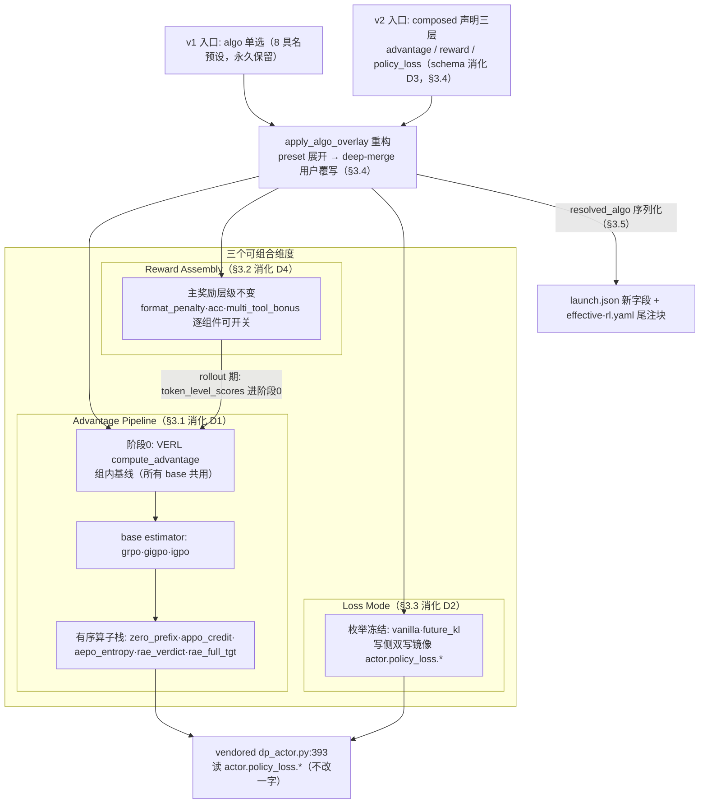
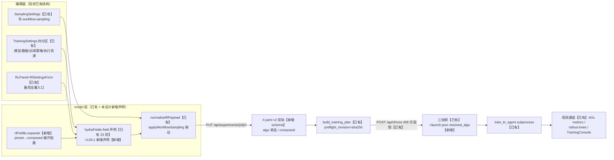
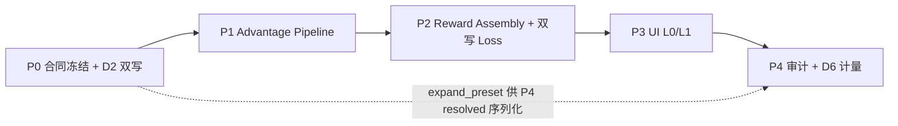

# RL 层设计文档 v1（组合式 RL 与 0 代码实验框架）

日期：2026-10-13
状态：设计稿（尚未实施）。本文档覆盖 RL 层（`rl/` 包 + 训练热路径三件套 + vendored verl / agent-lightning 集成 + 训练控制面）。理论素材取自 [GPT_analysis_for_RL_design.md](./GPT_analysis_for_RL_design.md)（1097 行多轮对话，**原文保留不动**——本文档 §1 是其结构化重写，不替代原文）；上游数据合同以 [MAS_design.md](./MAS_design.md) v2 为准（其 §11 承诺 MAS→RL 的接口，本文档只消费、不重复定义）。
配套阅读：[MAS_design.md](./MAS_design.md) · [Harness_design.md](./Harness_design.md) · [TECHNICAL_FRAMEWORK.md](./TECHNICAL_FRAMEWORK.md)

---

## 0. 定位：RL 层是什么、不是什么

本节冻结 RL 层的架构位置、对外合同与产品边界。后续所有设计（§3 组合式架构、§4 UI 参数化）都在这些边界内展开，越界项进 §8 ADR。

### 0.1 三层架构中的位置

引 MAS_design §0.2，仓库分三层，RL 层落在第三层的 "RL Adapter" 一侧：

| 层次 | 核心问题 | 典型组件 | RL 层是否接管 |
|---|---|---|---|
| MAS Definition（定义层） | 用户如何定义一个多智能体系统 | AgentNodeSpec、RouterSpec、MASSpec、Prompt、Schema | 否（只读 workflow.yaml） |
| MAS Execution（执行层） | 系统如何实际运行 | AgentRegistry、Runtime、Router、Protocol、Memory | 否（只经 Trajectory 合同消费结果） |
| MAS Observability & Learning（观测与学习层） | 如何记录、评估、改进执行过程 | Trajectory、Archive、BranchSite、Harness、**RL Adapter** | **是** |

本仓 "RL 层" 的实际管辖范围（与 MAS 层的归属以 MAS_design §15 速查表为准）：

- `rl/` 包——Reward / TrainSignal / Spec 声明 / VERL+AGL hooks（**Reward 与 TrainSignal 的唯一正典入口**，MAS_design §11）；
- 训练热路径三件套 `mas/{tir_agent,lit_tir_agent,train_tir_agent}.py`（文件属 `mas/`，训练语义归本文档管辖，零移动红线见 MAS_design §0.1）；
- vendored verl（editable 安装，`ref_Rep/APPO-main/APPO/verl_arpo_entropy/`，含 FIPO/future_kl loss）与 agent-lightning（黑盒，不改其源码）；
- 控制面训练链路（`science_infra/control/training.py` + `/api/rl/*` 端点）与 webui RL 组件（§4）。

### 0.2 与 MAS 层的三个合同承诺（合同冻结）

以下三条来自 MAS_design §11（合同 1、2）与其边界段落 + §12 守卫四（合同 3），本文档全体章节必须遵守，**禁止**任何设计绕开：

| # | 合同 | 内容 | RL 侧义务 |
|---|---|---|---|
| 1 | Trajectory 合同 | `task / events / messages（OpenAI 四角色）/ final_answer / branch_points / archive ref / meta`，经 `episode_to_trajectory()` 产出；`format_ok / n_search / n_python` 同步进 meta | reward 与训练信号只从这些字段取数 |
| 2 | SamplePolicy.sites | `BranchSite` 列表（anchor + when + gate + fork + reward），设计期与运行期同一 schema，`resolved_sites()` 显式优先 | RL 层消费 sites 驱动分支采样，不另造分支声明 |
| 3 | `rl/` 唯一入口 + 守卫四 | shim（`mas/algos/`、`workflow/{rewards,train_signal}.py`）已删（Phase 3 完成，提交 `03c8724`），Reward/TrainSignal 唯一入口 = `rl/`；守卫四：**RL 算法只经 Trajectory 合同消费轨迹**，不碰 runtime 私有状态（MAS_design §12） | 新算子/新信号一律落在 `rl/`，禁止回挖 `workflow/` |

### 0.3 Mode A / Mode B 边界声明

引 MAS_design §8.2：**画布 ≠ 训练结构**。两种执行模式不共享计算图：

- **Mode A（Workflow Execution）**：Collect、单题调试、批量评估、user_space——画布 PEV 图原样执行，无采样树；
- **Mode B（Trainable Policy Rollout）**：单 hub TirAgent + BranchSite 两波采样 + RL 训练。

**声明：RL 层只服务 Mode B。** 训练收益不能直接归因到画布上具体 Agent（MAS_design §8.2 后果 2）；UI 与文档不得暗示"训练优化了你画的工作流"。若未来需要训练多 Agent 工作流，走 PolicyBinding 远期方向（MAS_design ADR-12），本文档不为它设计。

两条运行路径的差异速查（引 MAS_design §8.1 表）：训练路径入口 `POST /api/rl/runs` → `train_tir_agent.py`，执行体是 LitTirAgent → `run_episode`（单 hub TirAgent）+ BranchSite，**不走** AgentMessage 协议（plain chat messages + Archive resume），有采样树；其余路径（Collect / 单题调试 / user_space）全部走 centralized_runtime + AgentMessage 协议，无采样树。共享的只有数据合同与持久层（`Trajectory` / `Archive` / Tool 接口 / Harness / Reward 接口）——共享合同清单引自 MAS_design §8.2，本文档 §0.2 的三合同是其在 RL 侧的投影。

### 0.4 设计目标、读者画像与三个设计原则

目标一句话：**研究员用 WebUI 零代码完成"选择 → 组合 → 参数化 → 启动 → 观测"的 RL 实验闭环**。读者画像是不写代码但读得懂算法论文的研究员——其需求是对照实验矩阵式的研究（§1.7），而非单点调参。两个典型用例（§4 的验收场景）：① **基线复现者**——选预设 GRPO，改 lr 与 group_n，跑 A 基线并留存快照；② **消融研究者**——展开 APPO 预设为组合，关掉 future_kl 留分支 credit（或反之），以 B/D 实验位验证 §2.3 关键事实 2 的"名实不符"在生产环境的实际影响。

本文档全程引用以下三条编号设计原则（§3/§4 反复引用）：

| 原则 | 内容 | 反例（禁止） |
|---|---|---|
| **P1 配置即合同** | 凡进入训练热路径的量，必须在声明层有 schema、在快照中有落点（`effective-rl.yaml`） | 隐式环境变量、口头约定参数 |
| **P2 组合优先于预设** | 预设（8 个具名 `tir_algo`）重定义为"组合的具名快照"，展开可查、可改；新形态 = base estimator + 算子序列 + reward 组件 + loss mode | 新增第 9 个单选 preset |
| **P3 可审计先于可扩展** | 每次实验可事后归因（preflight_revision 乐观锁、三快照、resolved pipeline 序列化）重于支持更多模型后端 | 未对账的配置透传 |

三条原则的相互关系：P1 是地基（无 schema 则组合不可校验）、P2 是产品形态、P3 是研究伦理——**没有 P3，论文里的消融实验不可信**（§1.7 的 A-G 矩阵在生产环境无法复现）。三条均不成立的设计提案不得进入 §3/§4 实施章节；实施中的取舍顺序为 P3 > P1 > P2（可审计冲突时宁可少开放组合面）。

### 0.5 开放度三层定义（一句话版）

"零代码"是分层承诺，全文统一用此口径（§4.1 展开为完整边界声明）：

| 层级 | 开放内容 | 零代码？ | 本文落点 |
|---|---|---|---|
| **L0 参数化开放** | 既有原语的全部数值/枚举参数（含当前"yaml 可表达但 UI 不可见"的 `tir.*`、`use_kl_loss`、`loss_mode`） | 是——表单点选 | §4.2 |
| **L1 原语组合开放** | base estimator × advantage 算子序列 × reward 组件 × loss mode 的自由组合 | 是——组合面板点选 | §4.3、§3.1-§3.3 |
| **L2 新算子 = 改代码** | 超出 L0/L1 原语集合的新算子（如 §1.6 三个研究方向所需新原语） | **否**——触发开发流程，见 §3.7 触发条件声明 | §3.7 |

三层之间的边界即测试边界（§7 提前声明主形状）：L0 的每项参数在 `effective-rl.yaml` 快照中断言存在与落点；L1 的每个组合在 §3.6 等价性表中与预设对照；L2 的每个新算子独立成节（可独立 GPU 回归）。研究员不需要理解这三层也能用 UI——三层是**实现与审计的分层**，不是功能菜单。

术语校准（全文统一）：**预设 preset** = 现存 8 个具名 `tir_algo`；**组合 composed** = base estimator + 算子序列 + reward 组件 + loss mode 的新形态；rl.yaml v2 = 老形态（单选 algo）与新形态（composed 声明）双轨共存（§3.4）。

三层定义与素材三层次（§1.2）的关系声明：L0 参数化=素材 Level 1 的参数空间（合法且安全的调参）；L1 组合=素材 Level 2 的算子重组（Advantage 算子与 reward 组件的叠加）；素材 Level 3（重定义优化目标）**不在 L0/L1 中开放**——L2 的"触发改代码"正是为此设置的闸门。这样对应关系的直接推论：研究员在 UI 上能做的一切都落在"理论安全的参数化与算子组合"内，任何 L3 级想法都必须走 §3.7 的显式立项流程并回答素材第十节的五个理论问题。**这是产品边界与研究纪律的统一**：UI 表达力止步于可审计的重组，新颖性贡献止步于经过理论审视的新算子。

---

## 1. RL 整体视角框架

素材原文是四轮以上的研究对话，本节把它重写为结构化框架：先建立五层分解（§1.1）与创新分级（§1.2），再用它定位八个预设与四个 GRPO 局限（§1.3/§1.4），随后盘点 reward 设计空间（§1.5）、标注三个候选研究方向（§1.6），最后给出实验纪律（§1.7）。每小节的理论内容都落点为"对本 infra 的设计指导"。

### 1.1 五层分解：Rollout → Reward → Advantage → Loss → Optimizer

Agent RL 的训练目标可分解为五个相互依赖的层。素材原文最初给出四层（Rollout → Reward+Advantage → Loss → Optimizer），本节把 Reward 与 Advantage 拆成独立层——因为本仓 8 个预设的创新恰好全部落在拆出来的 Advantage 层（§2.3），拆分让后续矩阵可精确制表。**决定学习内容的是前三层，决定更新形态的是后两层**；论文把模块命名为 "loss" 不代表创新在优化器——**很多所谓新 Loss，实质是重构 Advantage 再送入标准 PPO/GRPO 目标**（素材原文修正轮结语）。这句话与本仓事实完全印证：8 个预设全部是 advantage / 采样层创新，token-level loss 全在 vendored verl（`dp_actor.py:393` 分派 `core_algos.py` 的 `compute_policy_loss` / `compute_policy_loss_future_kl`）。

每层的"本仓对应物"列即本仓的地板声明：任何新设计必须回答"落在哪一层、改动哪个锚点"，无法回答的设计不进入 §3 之后的实施章节。

| 层 | 决定什么 | 本仓对应物（代码锚点） | 创新落点示例 |
|---|---|---|---|
| 1. Rollout | 观察到哪些轨迹、决策点、对比结构 | `SamplePolicy.sites`（contracts）、`ActiveSetSession` 两波展开（`active_set.py`）、daemon 波次调度（`rl/hooks/daemon.py:209` 波次1 / `:444` 波次2） | ARPO 熵门控 fork、APPO 分支位置 |
| 2. Reward | 什么结果算好 | `compute_outcome_reward`（`rl/rewards/outcome.py:145`）——层级 outcome | 过程/成本/恢复辅助信号（§1.5） |
| 3. Advantage（Credit Assignment） | 结果如何转化为决策级学习信号 \(\hat A_t\) | `apply_tir_advantages`（`rl/hooks/advantage.py:47`），8 分支分派 | GiGPO/APPO/AEPO/IGPO/RAE 全在这层 |
| 4. Loss | 学习信号如何约束更新（surrogate/裁剪/KL） | vendored verl `dp_actor.py:393` → `core_algos.py:458`（vanilla clip）/ `:688`（future_kl） | FIPO 目标、决策对比目标（§1.6） |
| 5. Optimizer | 参数如何实际更新 | vendored verl FSDP workers + Adam（`fsdp_workers.py:609`） | 纯配置（lr/调度），无算法创新空间 |

不是单向流水线：Rollout 由当前策略产生、更新又影响下一轮 Rollout；**Rollout 决定某一层 Loss 是否可构造**——只有完整轨迹时只能做标准 GRPO；有同状态分支才可构造局部动作比较；有失败+恢复的完整轨迹才可估计恢复增益（素材修正轮判断二的例子）。这个依赖方向是 §1.6 与 §3.1 pipeline 依赖检查的设计依据。

**读论文五问法**（素材修正轮第 5 节，与五层一一对应，作为本仓研究员读任何新算法论文的拆解模板）——每读一篇 Agent RL 算法论文，按序回答：

| 问 | 对应层 | 问题 |
|---|---|---|
| 1 | Rollout | 采样了什么数据？是否有分支、重试、反事实轨迹？ |
| 2 | Reward | 如何定义任务成功、失败与过程质量？ |
| 3 | Advantage | 如何将结果变成**每个决策**的学习信号？ |
| 4 | Loss | 使用什么 surrogate、裁剪或约束？ |
| 5 | Optimizer | 训练预算、更新次数和稳定性如何控制？ |

第 3 问是本仓的靶心——素材原文对"很多新 Loss 实质是重构 Advantage"的提醒，等价于：新论文的光环字段（自称 loss 创新）未必是真的落点，五问拆解后才填进 §1.3 定位矩阵。

**串起五层的最小案例**（素材修正轮第 4 节，保留为读法示范）：某决策状态下两个可选工具——a₁ 调搜索（成功率 80%）、a₂ 调数据库（40%，但某些情况提供关键证据）。同一次 rollout 数据上存在五种互相独立的设计选择：

| 设计层 | 可选决策 | 对应本仓机制 |
|---|---|---|
| Reward | 只对任务成功给 1 / 失败给 0 | `compute_outcome_reward`（现状即此） |
| Advantage | 比较两动作在同状态下的结果，估计相对共同基准的优势 | GiGPO step 组（`(data_id, anchor_obs)`）；§1.6 ① 的显式 \(\mu\) |
| Loss | 局部优势进 PPO surrogate + clip 限制更新 | vendored vanilla clip（现状即此） |
| 稳定性 | KL 正则限制偏离参考策略 | `use_kl_loss`（L0 参数） |
| Rollout | 增加 a₂ 采样、或只在高不确定状态比较两动作 | BranchSite gate（entropy/verifier 门） |

素材结论："只把 KL 系数从 0.01 调到 0.02"是调稳定性权衡（L0）；"新的局部优势估计"是 Advantage 创新（L2）；"新分支采样机制让训练集中在能区分两动作价值的状态上"是 Rollout 创新——**三种贡献需要不同的消融实验证明**（§1.7）。对本 infra 的意义：这正是 P1/P2 的产品依据——每层开关独立落 in rl.yaml，消融才有清晰的配置对照面。

案例表的三个理论约束记录在案（素材修正轮第 4 节的三个"是否"）：调 KL 系数不改变学习内容只改变稳定性权衡——四种稳定性机制（clipping / KL / 乘法式优势缩放 / 加权）不是同一个东西，素材明确"PPO clipping 与 KL regularization 不是同一机制：前者限制 surrogate 内比率的更新，后者约束策略分布偏离参考分布的程度，两者可同时使用也可按设计取舍"。这解释了本仓为何把 KL 三态（`use_kl_in_reward / use_kl_loss / future_kl`）做成独立开关而非单一β参数（§2.3 关键事实 3）。

**对本 infra 的设计指导**：五层中本仓创新集中在 1/3 两层，且三者（Rollout 结构、Advantage 算子、Reward 组件）应当**可独立配置**——这正是 §3 组合式架构的立论起点；第 4 层保持 vendored verl 为唯一实现（ADR 见 §8），第 5 层纯参数（L0，§4.2）。

### 1.2 Loss 创新三层次

素材原文（修正轮第 3 节）把"修改 Loss"分为三个研究强度层次。层次判定标准：**是否改变了进入优化器的优势信号、是否重定义了优化目标本身**。

| 层次 | 定义 | 判定标准 | 素材评价 | 与本仓 8 预设的对应 |
|---|---|---|---|---|
| **L1 加正则项** | \(\mathcal{L} = \mathcal{L}_{\rm GRPO} + \lambda C(\theta)\)（熵正则、行为约束、成本惩罚） | 不改变 \(\hat A_t\) 构造，只增标量项 | 弱——通常是工程改进 | 无自研项；近似物 = flow_grpo 强制 `use_kl_loss=True, kl_loss_coef=0.001`（`overlay.py:137-152`（KL 强制两键位实测 `:144-147`），复用 VERL 既有 KL 项） |
| **L2 改 Advantage Estimation** | \(\mathcal{L}_{\rm PPO}(\rho_t, \hat A^{\rm new}_t)\)，surrogate 不变 | 保留 clipped PPO 骨架，重构 \(\hat A_t\) | 主流——素材与文献一致认为这是值得研究的层 | gigpo / aepo / igpo / rae / appo_credit 全在此层；GiGPO 论文、APPO 的 procedure-level advantage 同层（素材第九节） |
| **L3 重定义优化目标** | 新的目标、约束或梯度估计原理 | 超出新正则与新权重的目标重定义 | 高潜力高门槛——理论要求高 | 唯一候选 = APPO 预设 `loss_mode=future_kl`（FIPO loss，vendored 已有实现但 D2 断链未生效）；§1.6 三方向均属 L3 |

L1 与 L2 的流水量级校准（素材第九节的判语）：L1"实现容易，没有明确理论动机时通常像工程性改进"；L2"保留基本优化框架，改变策略更新接收的学习信号——值得研究"；L3"理论要求更高，但解决现有方法无法充分处理的问题时算法贡献也可能更强"。素材同时警告：三层次**不是论文质量的绝对排名**——严谨推导的正则项可能很有价值，看似全新的目标函数也可能只是已有方法的重参数化。因此层次的正确用法是**贡献归因**（回答创新在哪一层），不是**价值评判**。

**对本 infra 的设计指导**：8 个预设中没有一个是 L1 强度就能成立的——这印证"本仓的研究带宽应继续投向 L2/L3"；L2 的可组合性是刚需（§3.1），L3 的连通开关是 latent 缺口（§3.3 的 D2 修复）。补充一个素材原文 2.3 节的审稿人视角校准：若新方法只是 \(\hat A^{\rm new}_i = \hat A_i \cdot w_i\)（\(w\) 是轨迹长度/熵/工具次数的函数），审稿人会追问——为什么这个权重对应合理的策略梯度而不是任意启发式？是否存在等价的 reward rescaling？是否引入新梯度偏差？与 token-level advantage / clipping / KL 的关系？在相同 rollout 和 reward 下为什么优于是标准 GRPO？——**这组追问即 §3.6 等价性验收与 §1.7 对照矩阵的存在理由**：infra 层面预先保证每个新算子可被追问、可被消融。

层次分级对本仓 UI 的直接映射（注意两个编号体系的区分：创新三层次记作 Level 1/2/3，开放度三层记作 L0/L1/L2）：开放度 L0（§4.2 参数面）覆盖三层次的全部可调量；开放度 L1（§4.3 组合面板）只组合 Level 2 级算子与 reward 组件——**Level 3 目标重定义绝不进组合面板**（误开组合会导致研究员无意中构造出无理论论证的新目标函数，违反 P3）；Level 3 走 §3.7 未来算子菜单的显式立项。

### 1.3 算法定位矩阵

整合素材原文第九节对比表，扩展为本仓 8 预设版本。**阅读法：先看创新所在层，再看机制**——同为"细粒度信用分配"，落在采样层与优势层是完全不同的贡献。

| 算法 | 创新所在层 | 关键机制一句话 | 本仓实现锚点 | 研究空间警示 |
|---|---|---|---|---|
| GRPO（基线） | Advantage | 同 prompt 组内相对优势 \(\hat A_i = (R_i - \mu_R) / (\sigma_R + \epsilon)\) | vendored `core_algos.py:113`；分组靠 `uid = data_id_list`（agl `trainer.py:298`） | 基线 |
| GiGPO | Advantage | 全局 \(A^E\)（组内 z-score）+ 局部 \(A^S\)（同 `(data_id, anchor_obs)` step 组），合计 \(a_e + w \cdot a_s\) | `rl/hooks/gigpo_core.py:36`、分派 `advantage.py:108` | **已占"重复状态局部优势"研究空间**；孤立 anchor 退化为 GRPO |
| ARPO | Rollout 采样 | 熵门控 fork：接受概率 \(\max(0, \min(1, {\rm draw} - w \cdot \Delta H))\) | `rl/hooks/branch_policy.py:35`；advantage 不变（`advantage.py:74` 直接 return） | 已占"工具交互后自适应探索 + 步骤归因"空间 |
| APPO | Rollout + Advantage（+L3 loss） | 程序级分支 + 分支行 outcome 折扣回写父行；论文带 FIPO future_kl loss | `advantage.py:118`（credit）；预设 `overlay.py:127-131`；FIPO = vendored `core_algos.py:688`（**D2 未连通**） | 已占"分支价值 → 未来影响信号"空间 |
| Flow-GRPO | Rollout 规范化 + Loss 正则（L1 借用） | 原论文是 flow-matching 的 SDE 随机化 + KL 约束；本仓形态 = outcome 广播到每 turn + 强制 `use_kl_loss` | `overlay.py:137-152`（KL 强制两键位实测 `:144-147`）；advantage 直通（`advantage.py:71`） | 原论文非 Agent 专用，本仓只借其 KL-约束思想 |
| AEPO | Advantage | 熵重塑：\(\hat A \leftarrow \hat A \cdot (1 + a \cdot z(\Delta H))\)，低熵=确定的位置放大优势 | `advantage.py:193` | 熵-信用耦合空间 |
| IGPO | Advantage | turn 级信息增益组内 z-score（非末 turn 用 IG，末 turn 用 outcome） | `advantage.py:215` | 信息增益信号空间 |
| RAE | Advantage + Rollout 裁决 | validate / invalidate / abstain 三态裁决；R0 分支前缀清零，R1-lite verdict 缩放，R1-full \(\log \pi_{\rm tgt}\) 重归一 | `rl/hooks/rae_advantage.py:33`（R0）/ `:85`（R1-lite）/ `:161`（R1-full）；裁决 `:229`、daemon 填充 `daemon.py:738-761` | 恢复感知雏形（§1.6 方向 ② 前身） |

命名陷阱声明（素材第三节提醒）：ARPO / APPO 存在同缩异义论文（ARPO = Agentic Reinforced Policy Optimization，ICLR 2026；APPO = Agentic Procedural Policy Optimization，2026），本仓实现锚定上述两篇；阅读文献时不得把同名算法的结论直接搬运。另按 §1.2 分层标注：GiGPO / AEPO / IGPO / RAE / appo_credit 是纯 L2；ARPO 是采样层（`advantage.py:74` 证明其 advantage 不动）；APPO 横跨 L2 + L3（FIPO 未连通时只有 L2 生效）；flow_grpo 的正则是 L1 借用。

素材原文的警示（第九节）：GiGPO 的局部优势、APPO 的程序级优势与 ARPO 的步骤归因**已经占据了"细粒度信用分配"的大部分研究空间**，单纯把它们叠加不保证新颖。其中 GiGPO 尤其关键（素材第八节）：它已深入研究"不增加额外 rollout 的多步信用分配"——episode 级保留全局任务目标 + step 级按 `(data_id, anchor_obs)` 分组比较，其成立前提是状态匹配可靠（两个文本相似的 anchor 不保证同环境状态/剩余预算/可用工具）。要超越它需要一个比"找到相同状态再比较奖励"更有区分度的问题——§1.6 方向 ①（显式 baseline 分布 \(\mu\)）正是这种超越的候选。

**对本 infra 的设计指导**：infra 的价值主张不是"发明第 9 个预设"，而是**把已占空间的算法变成同一实验框架下可组合、可对照的基线**（§3、§1.7）；真正的新颖性留给 §1.6 的 L3 方向。

### 1.4 GRPO 的四个结构性局限

素材原文 2.2 节（问题 A-D，编号保留）。每个局限标注"本仓现状是否已缓解/哪个预设缓解了它"——这张对照正是 §2.3 的结论"8 预设差异全在 advantage 与采样层"的镜像论证，也直接给出组合动机：**各预设缓解不同局限，单选一个预设 = 一次实验只能缓解一种局限**。

| 局限 | 内容 | 本仓缓解现状 |
|---|---|---|
| **A 最终奖励不区分决策质量** | 两条同 reward 轨迹，中间决策可能完全不同（正确工具+错参数 vs 错误工具+偶然成功）；GRPO 不自动识别 | 部分缓解——RAE 裁决按 `(data_id, action_key)` 表决失败形态（`rae_advantage.py:229`），APPO 分支 outcome 回写父行提供局部对比（`advantage.py:118`）；纯 GRPO 路径完全未缓解 |
| **B 同轨 token 共享优势** | 整条回答所有有效 token 共享同一 \(\hat A_i\)——早期错误、正确调用、后期修复拿到同一信号 | **GiGPO 缓解**（step 组分解到 anchor），IGPO 缓解（turn 级 IG），RAE R0 前缀清零部分缓解（`rae_advantage.py:33`）；flow_grpo 反其道行之（全广播） |
| **C 组内相对 ≠ 绝对学习价值** | \([0,0,0,1]\)（一题一成）与 \([0.7,0.8,0.9,1.0]\)（整体接近成功）标准化后信号取决于相对排名与组内方差；全零组优势退化为 0 | **未缓解**——所有预设都以组内相对为基线；绝对学习价值需要外部基准（素材结论：这是开放问题）；本仓见 §1.6 方向 ③ |
| **D clip 限比率不限信用分配** | 裁剪约束 \(\rho_t\) 的更新幅度，不判断 reward 可信度、失败可恢复性、分支信息量 | 部分缓解——RAE verdict 强负（invalidate → \(\log \epsilon_f\)）与 dead-end backprop（`rae_advantage.py:161` 区段、`daemon.py:787-813`）是对"错误信用"的显式补偿；FIPO 的 \(A_t \cdot (1 + b \cdot f_t)\) 是信用感知更新形态但 D2 未连通 |

缓解矩阵的对角线解读（组合动机的形式化表述）：8 预设 × 4 局限的缓解关系是**稀疏的**——没有任何一个预设同时缓解 A/B/C/D。假如研究员关心 A+D（失败裁决），只能选 RAE 并放弃 GiGPO 的 B 缓解；关心 B+C 则只能选 GiGPO 并接受 A/D 裸奔。**单选世界的最优解永远只覆盖局限空间的一个切片**；P2 组合世界的价值 = 覆盖并集。C 在当前预设下无解——这是留给 §1.6 ③、也是唯一必须 L2 扩展的局限。

素材原文强调：B 和 D 尤其重要——**GRPO 的更新可以是稳定的，但它可能稳定地学习错误的东西**。

局限 C 的两个具体化子问题（素材结论轮"零组退化"例）：若某题 4 条轨迹 reward 全为 0，组内标准化后优势全部退化为 0，这批轨迹零学习信号——**分支采样预算花在了绝对学不到东西的题上**；同时 \([0,0,0,1]\) 的组里唯一成功轨迹拿满正优势，但研究员无法区分"这题真难"还是"这题全靠运气"（分难度收益分布因此进 §1.7 报告指标）。素材对 B 的补刀同样值得记录：重要性比率 \(\rho_t\) 是 token 级的，但**这不意味着信用分配也是 token 级的**——token 级的"怎么乘"掩盖着轨级的"乘什么"。

**对本 infra 的设计指导**：局限 A-D 是不同预设各自的靶点，组合式架构（§3.1）让研究员在一次 run 中同时挂载多个缓解算子，并在 §1.7 矩阵上逐项归因。矩阵化读法："换一个预设"应理解为"换一组局限缓解组合"，而不是"换一个算法"——这正是 P2（组合优先于预设）的产品语义。

### 1.5 Reward 设计空间与三坑

素材原文 6.1 给出四类 reward，各一行公式；6.2 给出三坑。

| 类型 | 公式（一行） | 信号性质 | 本仓现状 |
|---|---|---|---|
| A. Outcome | \(R_{\rm outcome} = \mathbb{1}[\text{task success}]\) | 稀疏但可验证 | **主信号**——层级化实现：格式坏 → \(-1\)；格式对但答错 → \(0\)；答对 → Acc \((+0.1\) 双工具 bonus\()\)（`outcome.py:145-166`；三层判定的完整签名含 `format_ok / n_search / n_python`，由 Trajectory 合同字段喂入——MAS_design §11 合同 1 的 reward 侧兑现）。QA 任务用 token-F1（连续分）、GSM8K 用 numeric 0/1（`accuracy` 内分流） |
| B. Process | \(R = R_{\rm outcome} + \lambda R_{\rm process}\) | 密集但可能与目标不一致 | 无（`compute_mas_outcome_reward` 的 `result` 参数为未来 shaping 预留未用，`outcome.py:169` 区段） |
| C. Cost-Aware | \(R = R_{\rm success} - \lambda C(\tau)\) | 区分高效/低效成功 | 无独立项（约简为 format 罚分的层级 outcome） |
| D. Counterfactual / Recovery | \(R_{\rm recovery} \approx V(s_{\rm after}) - V(s_{\rm before})\) | 直接研究恢复价值，但需可信状态比较 | 未实现（RAE 裁决是它的优势侧前身，见 §1.6 ②） |

**三坑**（设计 §3.2 Reward Assembly 的护栏需求来源）：

1. **重复计分**：工具有效性既进 process reward 又进 outcome bonus，同一信号双倍进梯度——本仓现状已提供警示样本：`multi_tool_bonus=0.1` 同时起"工具多样性奖励"与"正确答案加成"两义，若未来加 process 组件覆盖工具调用有效性就会双计（组件互斥规则由 §3.2 定义）;
2. **Reward hacking**：惩罚调用次数 → 模型减少必要搜索；奖励恢复成功率 → 模型故意制造可恢复失败——MAS_design §9.2 的环境一致性元数据（cache_status/backend/恢复模式）是事后识别 hacking 的取证面;
3. **相关 ≠ 因果**：成功轨迹中出现某动作 ≠ 该动作导致成功——只有控制前缀/环境/预算的分支对照才提供因果证据（依赖 §1.7 矩阵与 MAS_design §9.2 环境一致性元数据）。

**Reward ≠ Advantage 辨析**（素材结论轮，全文术语纪律的依据）：Reward 决定**学什么**——这个行为产生了什么结果；Advantage 决定**怎么把结果转化为策略更新**——这个动作比基准好多少（\(\hat A^\pi(s,a)=\hat Q^\pi(s,a)-\hat V^\pi(s)\)）。三个素材例子锁定两者不可互相替代：

1. **同轨不同状态**：困难状态（成功率 10%）的成功轨迹与简单状态（99%）的失败轨迹，Reward 分明是 1 与 0，学习价值却可能相反——前者提供难得的正信号，后者暴露值得修正的退化;
2. **同分不同因**（素材 5.1 最小例）：同状态三动作 a₁（直接成功）、a₂（失败）、a₃（先失败后恢复成功）——Reward 只见 \(1/0/1\)，a₃ 携带的"初始缺陷 + 恢复价值"信息只有 Advantage 层能表达——素材并提醒：若恢复轨迹更长，按 token 平均的目标甚至让长恢复轨的每 token 平均权重更小;
3. **全零组退化**（见 §1.4 C）：Reward 相同 ≠ 学习信号存在。

素材的场景判断（本仓全部落在场景 B"Reward 简单可靠但反馈稀疏"——QA F1 / GSM8K numeric 皆可自动验证）：**当任务成功与否可自动验证时，Reward 可以保持简单，研究带宽应投给 Advantage Estimation**。这既是本仓现状的理论背书，也是 §3.1 把组合自由度集中做在 Advantage 管线、而 Reward 只做组件化（§3.2）的原因。场景 C（Reward 有噪声/不可验证）两侧都关键，但不在本轮范围（触发条件见 §3.7）。

**本仓立场**（与素材原文建议一致）：**主奖励保持简单、可验证**（层级 outcome 已足够做主信号）；过程/成本/恢复作为**辅助信号**进入，且辅助信号必须**组件化、可开关、可配权**——而不是把所有可算指标线性相加（素材 6.2 主张"以可验证的最终任务成功为主奖励，其余为有明确用途的辅助信号"）。format 罚分 \(-1\) 与 `multi_tool_bonus=0.1` 当前硬编码（D4），组件化方案见 **§3.2**。

### 1.6 三个候选研究方向（研究提案，非已证明结论）

素材原文第七节的三个方向，标注为**研究提案**。本节对每个方向只做两件事：说清核心问题；点名落地本仓需要哪些新原语（L2 扩展点，一句话见 **§3.7**，不在此展开设计）。

| 方向 | 核心问题与公式 | 与现有预设的差距 | 落地本仓需要的新原语 |
|---|---|---|---|
| ① **反事实决策优势**（最优先） | 同状态多动作的对照：\(\hat A^{\rm cf}(s,a) = \hat Q^{\rm branch}(s,a) - \sum_{a'} \mu(a'\mid s)\, \hat Q^{\rm branch}(s,a')\)，其中 \(\mu\) 必须是**有明确统计含义的比较分布**（如当前策略在候选动作上的归一化分布），baseline 不得是任意历史轨迹 | 所有现存优势算子以组内_reward_相对为基准；无任何一个使用"同前缀下替身动作分布"作 baseline。GiGPO 的 `(data_id, anchor_obs)` 分组是最接近的数据结构，但比较仍是组内 z-score | ① **base challenge 分布 \(\mu\)**（按 action_key 聚合分支结果并给出可声明的基准分布）；② 分支状态对齐/采样偏差校正辅助原语 |
| ② **恢复感知更新** | 区分可恢复/不可恢复失败与恢复增益：\(\hat G_{\rm rec} = \hat V(s'') - \hat V(s')\)，且 \(\hat A_{\rm initial} \neq \hat A_{\rm recovery}\)——初始决策即使导致失败，在合理风险下不应一律负罚；恢复动作应获独立正信用 | RAE 已有 verdict 三态与 dead-end backprop，但 verdict 是**裁决标签**不是**增益估计**：它没有 \(\hat V\) 基准，也没有把初始/恢复信用拆成两条信号 | ① **verdict/regime 标注流**（verdict_list 已存在，`daemon.py:738-761`——需要标注"初始失败/恢复动作"两段而非只标组）；② 可比较状态的 \(\hat V\) 估计源 |
| ③ **学习信号质量加权** | 优势可信度进更新：\(\hat A^{\rm weighted}_t = w_t \hat A_t,\ w_t = f(\widehat{\operatorname{Var}}[\hat A_t])\)。素材警告：简单 \(1/\widehat{\operatorname{Var}}\) 不自动合理（高方差可能代表真困难/估计方差本身有偏/不加模型的权重只是启发式/加权可能改变优化目标） | 无任何预设考虑估计方差；GRPO 的 \(\sigma\)-归一化只做缩放不做置信 | ① **rollout 组内方差列进 `non_tensor_batch`**（daemon 已有列注入机制 `daemon.py:688`，缺 `adv_batch_var` 类列）；② 校准模型（说明 \(f\) 的统计含义） |

素材第十节把三方向合并为一个示例研究命题 **Recovery-Aware Counterfactual Policy Optimization**（\(A^{\rm new}_t = A^{\rm global}_t + \lambda_{\rm cf} A^{\rm cf}_t + \lambda_{\rm rec} A^{\rm rec}_t\) 进标准 clipped objective），并自带三点自我警告（两辅助项可能重复计算同一结果差异；估计不可靠时只添噪声与超参；相加不保证更低方差或更小偏差）与五个必要理论问题——第十节明言"这是候选研究方向，不能在系统检索/推导/验证之前认定新颖"。本表保持该审慎标注；三个方向的共同前置依赖是 §1.7 的 B/D 实验位（同轨迹不同 Loss 的归因通道）先于任何新算子实现可用。

**对本 infra 的设计指导**：三个方向共同验证 §1.5 的立场——reward 不动（outcome 主信号），创新全在 Advantage 信号构造（L2/L3）。它们对"同前缀分支对照"的共同需求恰好是本仓签名式资产（BranchSite + 两波采样 + resume 边界元数据），因此 §3.7 的"未来算子菜单"把上述新原语列入候选；在此之前**不做任何投机实现**（P3：可审计先于可扩展）。

### 1.7 同轨迹对照实验矩阵：证明创新来自 Loss 而非更多 Rollout

素材原文第十一节的实验纪律（A-G 表完整保留），是"新 Loss 有独立贡献"的证明责任清单：**最有说服力的结果是——在完全相同的轨迹和 reward 下，新 Loss 仍获得更高最终成功率或以更少交互达到同等成功率**。素材对这一点的强调原文为"如果你的方法同时增加分支数量、修改 reward、引入新的 advantage 和更复杂的 loss，即使成功率提升，也无法说明是哪一部分带来了收益"——这正是本仓把"组合"做成产品而非科研用法时**必须内建的归因护栏**。

| 实验 | Rollout / 采样 | 优势与 Loss | 回答的问题 |
|---|---|---|---|
| A | 标准轨迹采样 | GRPO | 基线 |
| B | 与 A 完全相同 | 新 Loss | 是否存在独立的优化贡献？ |
| C | APPO 或 ARPO 采样 | GRPO | 分支采样本身的收益 |
| D | 与 C 完全相同 | 新 Loss | 新 Loss 能否利用更有价值的分支？ |
| E | 与 D 相同 | 去除反事实项 | 反事实设计是否必要？ |
| F | 与 D 相同 | 去除恢复项 | 恢复机制是否必要？ |
| G | 不同 rollout 预算 | 新 Loss 与 GRPO | 收益是否只是来自更多采样？ |

控制变量：模型初始化、训练 token 数、环境交互次数、有效梯度更新次数、reward 计算成本（素材原文第十一节）。

**素材第十节的论文选题骨架**（作为 A-G 矩阵服务的示例研究命题，标注"研究骨架，非投稿建议"）：\(A^{\rm new}_t = A^{\rm global}_t + \lambda_{\rm cf} A^{\rm cf}_t + \lambda_{\rm rec} A^{\rm rec}_t\) 进入标准 clipped objective。素材自我警告必须保留：局部反事实项与恢复项可能重复计算同一结果差异、估计不可靠时只加噪声与超参、相加不保证更低方差——真正的贡献必须来自可验证的优势估计原理而非优势项堆叠。E/F 消融（去反事实项/去恢复项）就是为这个命题定制的对照位。素材另给出五个必须回答的理论问题，作为 §3.7 未来算子的立项门槛：策略梯度正确性（是否合法 baseline）、状态条件化（动作是否共享决策状态）、方差与样本效率、恢复的信用分配、优化稳定性（与 clipping/KL 结合后的梯度尺度）。

**素材第四节对 APPO 的三个未决问题**（证明"即使是基线算法也有研究空间"，与 E/D 实验位对应）：

1. **未来 likelihood gain 是否决策价值的可靠代理**——\(\Omega_i\) 衡量新旧策略的相对概率变化，不衡量对成功率的因果影响（风格/长度/分布漂移都会抬高比率）→ 对应本仓 FIPO 未连通（D2）期间，APPO 分支 credit（`advantage.py:118`）是唯一生效的 L2 部分;
2. **乘法式优势缩放改变梯度统计性质**——基优势为负时符号可能翻转，且权重依赖策略概率比率、随训练漂移 → §3.6 等价性验收需锁定各算子的符号语义;
3. **分支信息被压缩成单一 future-aware scalar**——成功/失败分支的具体反事实结构丢失 → §1.6 方向 ① 的直接动机。

**本仓零成本支撑声明**：A-G 全部实验在组合式架构（§3）落地后均为 **L1 组合面板的点选操作**——模式相同 rollout、不同 composed 配置；每个实验的 `effective-rl.yaml` 三快照（`training.py:795` 落盘）天然满足"完全相同的轨迹与 reward"的对照需求，G 的预算轴只是 `group_n / initial_rollouts` 参数（L0）。E/F 的"去除单项"在 pipeline 里就是算子开关（§3.1），不再需要改代码分支。面板设计见 §4.3。

素材要求的报告指标七项，映射到本仓监控通道：

| 报告指标 | 本仓通道 | 缺口 |
|---|---|---|
| 1. 最终任务成功率 | AGL metrics（`AGL_METRICS_JSONL`，`test_freq` 周期评估）→ webui monitor RewardChart | — |
| 2. 每次成功的平均环境交互数 | Trajectory `n_search / n_python` / num_turns（`episode_to_trajectory` 同步进 meta） | — |
| 3. Token 成本 | rollout 长度与 `max_response_length` 核对（Archive / rollout 树统计） | 分桶统计待自动化 |
| 4. 相同 rollout 预算下的学习曲线 | AGL LightningStore `/v1/agl/metrics` → monitor 曲线 | — |
| 5. 优势估计方差与梯度范数 | **当前无通道** | §4.4 列为待补观测 |
| 6. 初始失败率 / 恢复成功率 / 恢复成本 | RolloutTree verdict + `GET /api/rl/runs/{runId}/rollout-trees`（`rollout_trees.py`） | 恢复段标注依赖 §1.6 ② 原语 |
| 7. 分难度收益分布 | 数据侧难度分桶（GSM8K 等）+ Archive | 难度桶未自动化 |

**对本 infra 的设计指导**：§1.7 是 §4.4 观测面板的需求来源（指标 5 通道缺失、6 需要 verdict 呈现、7 需要分桶），也是 §3.6 等价性验收的验收者——对照矩阵跑得动，组合式架构才算成立。

素材第十二节的优先级判断（本仓采纳为研究带宽分配）：**第一优先级 = Advantage 估计与 Loss**（有算法深度的贡献所在）；第二优先级 = 反事实 Rollout 与局部决策比较（不是单纯增加分支，而是保证分支提供可比较的决策结果并被新 Loss 有效利用）；第三优先级 = Reward 的辅助设计（保持可验证主目标，不堆叠奖励项）。本仓 §3 组合式架构的三个维度恰好按这个优先级排布：Advantage Pipeline（§3.1）最大自由度 → Loss Mode 连通（§3.3）其次 → Reward Assembly（§3.2）只做组件化不做新奖励。

---

## 2. 现状盘点与差距分析

§1 给出理论框架后，本节盘点本仓现状：§2.1 结构与职责、§2.2 全链数据流、§2.3 八预设真相、§2.4 差距 D1-D6、§2.5 已有地基。结论先行：**组合式架构的地基（两层设计、注入机制、配置链、审计链）已经存在，缺的是把"单选分派"重构为"可组合管线"并暴露到 UI**。

### 2.1 rl/ 层结构与职责

`rl/` 的核心理念是"**Spec（纯声明）+ 纯函数 reward + hooks 注入**"三层分离：

| 层 | 文件 | 依赖强度 | 职责 |
|---|---|---|---|
| 纯 Spec 声明层 | `rl/loss.py`（52 行）、`rl/train_signal.py`（30 行） | pydantic + numpy，**零 torch / 零 VERL / 零 AGL** | `LossSpec / AdvantageSpec / CreditAssignmentSpec / TrainSignal`——可序列化、可校验的训练配置合同 |
| 纯函数 reward 层 | `rl/rewards/outcome.py`（234 行） | numpy | 层级 outcome 评分、答案抽取链、F1 / numeric_match、折扣回报、组内 z-score |
| hooks 注入层 | `rl/hooks/*` | 延迟 import；`advantage.py` / `rae_advantage.py` module-level torch+DataProto；`daemon.py` / `trainer.py` module-level AGL | 优势重算、daemon 生命周期扩展、trainer monkeypatch —— 经子类化 + monkeypatch 注入而非 fork |

核心文件清单（精选 8 个，其余为支持件）：

| 文件 | 行数 | 职责 |
|---|---|---|
| `rl/loss.py` | 52 | `LossSpec`（clip/entropy/KL/future_kl 参数）、`AdvantageSpec`、`CreditAssignmentSpec`（节点级信用，新框架 P2 预留） |
| `rl/train_signal.py` | 30 | `TrainSignal` 信封（batch + advantage + loss + meta）；`batch_to_train_signal` 全部 3 处转换点共用 |
| `rl/rewards/outcome.py` | 234 | 唯一 reward 实现：`compute_outcome_reward`（TIR 主栈）+ `compute_mas_outcome_reward`（legacy 栈） |
| `rl/hooks/overlay.py` | 213 | 配置叠加总枢纽：`DEFAULT_TIR`（26 键）、`apply_algo_overlay` / `apply_train_signal` / `apply_sample_policy` / `ensure_trainer_horizon` |
| `rl/hooks/advantage.py` | 306 | `apply_tir_advantages` 8 分支互斥分派（§2.3）+ APPO credit / AEPO / IGPO / GiGPO / zero_prefix 算子 |
| `rl/hooks/rae_advantage.py` | 371 | R0 前缀清零、R1-lite verdict 缩放、R1-full \(\pi_{\rm tgt}\) 重归一、动作组裁决、k-hop 累积回报 |
| `rl/hooks/daemon.py` | 877 | `TirAgentModeDaemon`：两波采样调度、triplet→DataProto 扩展列注入、树记录、训练指标发射 |
| `rl/hooks/gigpo_core.py` | 101 | 两级优势数值核心 \(a_e + w \cdot a_s\)（隔离 anchor 退化为 GRPO） |

（支持件：`trainer.py:54` monkeypatch + `bound_daemon_cls`；`branch_policy.py:106` fork 概率与预算分配；`arpo_rollout.py:185` 熵估计与 resume 序列化；`rollout_tree.py:211` 树记录器；`training_batch.py:32` 批前校验。）

补两个"看起来属于 rl/ 但按合同归属 MAS 层"的去向声明（防归类争议）：分支采样的**声明面**（`BranchSite / SamplePolicy` schema、`SamplingCore.plan` 决策、`active_set.py` 两波展开）在 `mas/workflow/`，`rl/hooks/daemon.py` 只做**消费与调度**（enqueue/resume/补齐）——边界即 MAS_design §11 合同 2 的"设计期 sites 同一 schema"；rollout 树的**合同**（`RolloutTreeNode` 等）也在 `contracts.py`，`rl/hooks/rollout_tree.py` 只是记录器。`rl/` 包的字面含义是"Rewards + Loss + 钩子"，不是"RL 的一切"。

**两层设计是组合式架构的现有地基**：声明层（`TrainSignal` 信封，零 torch）负责"训练什么"的可序列化表达——转换点共 3 处（`mas/train_tir_agent.py:365-381`、`science_infra/control/services.py:820`、`science_infra/ui/cli.py:85`），全部走 `batch_to_train_signal` 单一构造器，意味着"配置→信号"没有旁路；张量层（hooks 里的 DataProto 算子）负责"怎么改 advantages"。`warm-up` 时序也已冻结：`TrainSignal` 在 `train_tir_agent.py` 构造一次、经 `apply_train_signal` 展开进 Hydra dict、rl.yaml 载入后再"重套防覆盖"（`train_tir_agent.py:379` 区段：yaml 合并后再跑一次 `apply_train_signal`，保证 signal 不被 yaml 冲掉）——这个重套顺序是 §3.4 schema 设计必须保留的不变量。§3 的设计正是把张量层的"单选分派"重构为"声明层可声明、张量层按序执行"的管线——地基不需要推倒，只需要接出组合面。

依赖边界（三层强度）供新算子选址参考：`rl/loss.py` + `train_signal.py` + `rewards/**` 只许 pydantic + numpy（禁 torch/AGL）；`rl/hooks/{overlay,branch_policy,arpo_rollout,gigpo_core,training_batch,rollout_tree}.py` 是 numpy/stdlib + 延迟 import；`rl/hooks/{advantage,rae_advantage}.py` module-level `import torch` + `from verl import DataProto`（`advantage.py:9-11`）——**张量算子住这一层**；`daemon.py`/`trainer.py` 是 AGL 桥接层（`daemon.py:20-25` 反向依赖 `workflow.*`，双向边界）。§3.1 的 pipeline 执行器落在张量算子层，§3.2 reward 组件落在纯函数层——层级即可测性：纯函数层可无 GPU 单测（§7）。

**公开 API 与消费点**（`rl/__init__.py:7-16` 导出 `AdvantageSpec / LossSpec / TrainSignal / VALID_ALGOS / apply_algo_overlay / apply_train_signal / batch_to_train_signal` 七名；生产消费点 8 处，跨四个子系统的方向全部是"消费 rl/"，无一反向）：

| 消费子系统 | 消费点 | 消费内容 |
|---|---|---|
| 训练 CLI 门面 | `mas/train_tir_agent.py:24,228,352` | overlay 全家 + VALID_ALGOS |
| Rollout 热路径 | `mas/tir_agent.py:21,28`、`mas/workflow/collector.py:18`（default_reward_fn） | 熵估计 5 函数 + reward 5 函数 + has_answer_format（`workflow/runtime.py:27`） |
| 分支采样 | `mas/workflow/gates.py:9`、`sampling/adapters/configured.py:7` | fork 门控 3 函数 + allocate_forks |
| 控制层 / UI | `science_infra/control/training.py:23`（BRANCHING_ALGOS 预检）、`services.py:1236`（apply_sample_policy 同步）、`rollout_runs.py:734`（accuracy） | 预检 + 同步 + 离线评估 |
| legacy | `legacy/structagent/mas_agent.py:21` | compute_mas_outcome_reward |

补充第 9 消费面（P3 后新增拓扑）：`science_infra/control/services.py:820` 与 `science_infra/ui/cli.py:85` 两点经 `from workflow import Collector, batch_to_train_signal` 转写——该导入经 `mas/workflow/__init__.py:60-70` 的 `__getattr__` **懒转发**到 `rl.train_signal`（构造器仍唯一，机制等价；但消费拓扑从"直引 rl"多了一跳"workflow 再导出面"，删除该再导出面必须永远晚于 control/cli 改直引——登记入外部 API 清单）。

这张消费图是 §3 重构的**兼容性边界**：`apply_tir_advantages` 改为 pipeline 执行器（§3.5）时，8 处消费点中只有训练 CLI 门面直接受益，其余 7 处的 import 面（函数名与签名）必须零变化——即"内部管线化、外部合同不动"（P1 的重构应用）。

### 2.2 训练数据流全链

从研究员点"启动"到 optimizer step 的完整链路。环境变量注入（`TIR_EXPERIMENT_ID / TIR_RUN_ID / TIR_ROLLOUT_TREE_DIR / TIR_EXECUTION_TREE_VERSION=3 / CUDA_VISIBLE_DEVICES / PYTHONPATH`）在 `_launch_training` 完成；② 波次1 在 `_async_set_up` 把 `train_rollout_n` 收缩为 `initial_rollouts` 并预注入 expand 字段；⑥ ref log_prob 仅在 `use_kl_in_reward / use_kl_loss` 开启时计算（agl `trainer.py:323-326`）。图中编号①-⑨对应 agl `_train_step` 的九个环节。

```mermaid
flowchart TB
  RLYAML["实验 rl.yaml（WebUI 表单或手写）"] --> PLAN
  PLAN["build_training_plan<br/>training.py:320<br/>preflight_revision = sha256 :614"] -->|"POST /api/rl/runs app.py:471（幂等键 + revision 乐观锁，不一致 409）"| LAUNCH
  LAUNCH["_launch_training :795<br/>三快照 effective-rl.yaml / effective-workflow.yaml / launch.json（argv + git_commit）<br/>subprocess python train_tir_agent.py"] --> MAIN
  MAIN["train_tir_agent.py main :319<br/>algo 属 VALID_ALGOS 校验 :24"] --> BASECFG
  BASECFG["RL_TRAINING_CONFIG :44-111<br/>profile 基底（fast / a800 / a800_2gpu）"] --> MERGE
  MERGE["_deep_merge :278<br/>--rl-yaml 非 launch 键全量透传（OmegaConf struct=False 未知键照收）"] --> SIG
  SIG["batch_to_train_signal<br/>TrainSignal{AdvantageSpec, LossSpec}<br/>构造点 train_tir_agent.py:365-381"]
  SIG --> OVERLAY
  OVERLAY["apply_train_signal overlay.py:161<br/>signal 丢进 actor.* 与 algorithm.tir.*（loss_mode 写 :186 / loss_applied_to_actor :190）<br/>yaml 合并后重套一次防 signal 被覆盖（train_tir_agent.py:379 区段）<br/>apply_algo_overlay :106 按 algo 注 DEFAULT_TIR 叠加<br/>apply_sample_policy :45（group_n 到 rollout.n，sites 到 tir.sites）"]
  MERGE -.->|"apply_sample_policy（sampling 双向联动）"| OVERLAY
  OVERLAY --> GUARD["budget 守卫 train_tir_agent.py:430-444<br/>arpo / apppo 预算不足解释退出<br/>ensure_trainer_horizon overlay.py:198"]
  GUARD --> AGLVERL["agl.VERL.run<br/>interface.py:148（Hydra compose）<br/>daemon_cls / trainer_cls 注入点 train_tir_agent.py:232-241"]
  AGLVERL --> RUNPPO["run_ppo<br/>entrypoint.py:53 → TaskRunner（verl 第一个接触点）<br/>create_rl_sampler from verl.trainer.main_ppo :14"]
  RUNPPO --> FIT["AgentLightningTrainer.fit :439<br/>epoch 循环 :509 → _train_step :240"]
  FIT --> WAVE1["① daemon._async_set_up<br/>rl/hooks/daemon.py:209<br/>波次1：每题 initial_rollouts 条 + expand 字段预注入"]
  WAVE1 --> ROLLOUT["Rollout 生成<br/>LitTirAgent._rollout_with_bound_llm :137 → TirAgent 4 节点 graph :715<br/>episode_to_trajectory → default_reward_fn（collector.py:27）<br/>emit_reward + emit_annotation（34 键 tir meta）"]
  ROLLOUT --> VALID["daemon._validate_data_v1 :96<br/>span→triplet 适配 → extract_tir_meta_from_spans :57<br/>树记录 + 增量 enqueue 补分支 :323"]
  VALID --> WAVE2["③ _wait_for_training_rollouts :420 + _enqueue_from_runner_expansions :444<br/>波次2：ActiveSetSession plans 落发 / legacy 熵门控 fork → 补齐到 group_n"]
  WAVE2 --> BATCH["④ get_train_data_batch daemon.py:688<br/>triplet→DataProto + non_tensor 列注入<br/>rollout_role / site_id / verdict / resume_boundary / anchor_obs …<br/>require_training_samples 校验 + 训练指标发射"]
  BATCH --> LOGPROB["⑤ compute_log_prob agentlightning/verl/trainer.py:313<br/>old_log_prob + entropys（vendored fsdp_workers.py:681）"]
  LOGPROB --> ADV["⑦ compute_advantage trainer.py:359<br/>被 TirAgentLightningTrainer（rl/hooks/trainer.py:18）monkeypatch<br/>→ apply_tir_advantages rl/hooks/advantage.py:47（8 分支互斥）"]
  ADV --> MINIBATCH["⑧ is_drop_mask + mini_batch 切分 :372"]
  MINIBATCH --> UPDATE["⑨ update_actor :408<br/>vendored dp_actor.py:393：读 actor.policy_loss.loss_mode 分派<br/>compute_policy_loss :458 或 compute_policy_loss_future_kl :688（FIPO）"]
  UPDATE --> OPT["Optimizer step：Adam / FSDP（vendored fsdp_workers.py:609）"]
```



链路的架构含义：**RL 算法与 verl 主循环通过两个 hook 点解耦**（`trainer_cls` + `daemon_cls`，注册于 `train_tir_agent.py:232-241`——grpo 用 AGL 默认 trainer，非 grpo 才注入 `TirAgentLightningTrainer`）；token-level loss 与 optimizer 完全在 vendored verl 内（§1.1 论点的代码事实）。monkeypatch 的形状（`rl/hooks/trainer.py:18-41`）：`_train_step` 内临时把 `agentlightning.verl.trainer.compute_advantage` 替换为 `apply_tir_advantages` 包装，`try/finally` 恢复——替换只存在于单个 train step 作用域内，不污染其他 VERL 任务。

**DataProto 扩展列清单**（daemon `get_train_data_batch` 注入的 non_tensor 列，`daemon.py:688` 区段；新 advantage 算子的可用原料，§3.1 pipeline 依赖检查的"输入面"）：

| 列 | 含义 | 主要消费者 |
|---|---|---|
| `rollout_role` | root / child / probe 分支行角色 | APPO credit 回写（`advantage.py:118`）、zero_prefix |
| `data_id_list` | GRPO 分组键（uid） | vendored `core_algos.py:113` 组内 z-score |
| `anchor_obs` | obs hash（tool+observation，SHA1 前 16 位） | GiGPO step 组 |
| `verdict_list` | validate / invalidate / abstain 裁决 | RAE R1-lite / R1-full |
| `resume_boundary` | 分支恢复点 | R0 前缀清零（`rae_advantage.py:33`） |
| `ig_logprob_delta` | turn 级信息增益代理 | IGPO（`advantage.py:215`） |
| `action_key_list` | 动作组键 | RAE 裁决（`rae_advantage.py:229`） |

这张清单同时是 §3.7 未来算子的"原料边界"：§1.6 三方向各自点名的新列（如 adv_batch_var、regime 标注）都要走同一个注入机制，不另开旁路——保证 advantage 算子永远只从 DataProto 读取输入（守卫四的张量层对应物）。

**一个训练 step 的九环节对照**（agl `_train_step` 全景，`agentlightning/verl/trainer.py:240-430`——mermaid 图中编号①-⑨的出处，后续 §3.5 pipeline 执行器将插在 ⑦ 与 ⑧ 之间）：

| 环节 | 位置 | 说明 |
|---|---|---|
| ① wake up vLLM | trainer.py:253 | 权重同步 |
| ② 数据下发 | trainer.py:254-256 → `daemon._async_set_up`（`rl/hooks/daemon.py:209`） | 波次1 |
| ③ 等 rollout | trainer.py:257 | 波次2 分支/补齐（daemon.py:420-444） |
| ④ rollout→batch | trainer.py:258 `get_train_data_batch` | triplet → DataProto（AGL `daemon.py:807`，TIR 扩展 `rl/hooks/daemon.py:688+`） |
| ⑤ old_log_prob + entropy | trainer.py:313-321 `compute_log_prob` | vendored `fsdp_workers.py:681`；产出逐 token `entropys`（训练期精确熵） |
| ⑥ ref log_prob | trainer.py:323-326 | 仅 `use_kl_in_reward` / `use_kl_loss` 时 |
| ⑦ advantage | trainer.py:359-366 `compute_advantage` | 被 `TirAgentLightningTrainer` monkeypatch（§2.3 分派点） |
| ⑧ drop+shuffle | trainer.py:372-383 | is_drop_mask + mini_batch_size 切分 |
| ⑨ actor 更新 | trainer.py:408-418 `update_actor` | vendored `fsdp_workers.py:609` → `dp_actor.py`（loss 形态在此分派） |

### 2.3 八预设的真相

逐预设盘点"到底改了什么"。表格读法：**Loss 列只有两种形态**，其余差异全在 Advantage 与采样。

| 预设 | Advantage 改动 | 采样改动 | Loss 形态 | 参数暴露度 |
|---|---|---|---|---|
| grpo | 无（VERL 组内 z-score 基线，可选 zero_prefix，`advantage.py:81`） | group_n 独立采样 | vanilla clip | clip / lr 全在 L0 面 |
| arpo | **无**（`advantage.py:74` 直接 return） | 熵门控 fork（`branch_policy.py:35`） | vanilla clip | gate 全在 tir dict（D3/D5） |
| appo | 分支行 outcome 折扣回写父行（`advantage.py:118`；child/probe 行 \(\hat A=0\)） | BranchSite sites 分支 | 预设 future_kl（`overlay.py:127`）——**未生效（D2）** | reward_scale_discount 等 |
| aepo | \(\hat A\,(1 + a\, z(\Delta H))\)（`advantage.py:193`） | 熵门控 + 分支预算 | vanilla clip | aepo_beta / entropy_adv_coef 不可见 |
| igpo | turn 级 IG z-score（`advantage.py:215`） | 无分支增量 | vanilla clip | info_gain_type 不可见 |
| gigpo | \(a_e + w\,a_s\) 双级优势（`advantage.py:108`） | 依赖 anchor obs_hash（tool+observation 的 SHA1 前 16 位）自然分组（`arpo_rollout.py:15-17`） | vanilla clip | step_advantage_w / gigpo_mode 不可见 |
| rae | R0 清零 + R1-lite/R1-full（`rae_advantage.py:33/85/161`） | 裁决门控 + dead-end backprop | vanilla clip | rae_p_plus 等 4 键不可见 |
| flow_grpo | 无（outcome 广播到每 turn） | 无分支 | vanilla clip + 强制 `use_kl_loss=True, kl_loss_coef=0.001`（`overlay.py:137-152`（KL 强制两键位实测 `:144-147`），显式 False 存活） | 仅 KL 系数 |

token mask 的三种做法（所有 Advantage 改动最终都要落到"哪些 token 拿什么信号"上，这是 §3.1 算子的正交轴之一）：

| 做法 | 机制 | 使用者 |
|---|---|---|
| 逐行 scalar 广播 | 行级优势乘 `response_mask` 复制到每个 response token（`gigpo_core.py:92-101`） | GiGPO / IGPO / flow_grpo / GRPO 基线 |
| prefix 清零 | 分支行在 `resume_boundary` 前置 0（分支前缀不参与训练，分支后缀拿父对照信号） | RAE R0（`rae_advantage.py:33`）、arpo/grpo 可选（`advantage.py:182`） |
| verdict 缩放/偏置 | validate→不变+0.5 bias、invalidate→\(\log \epsilon_f\) 强负、abstain→scale 0.25；R1-full 直接用 \(\log \pi_{\rm tgt} - \log \pi_{\rm old}\) | RAE R1-lite/R1-full（`rae_advantage.py:85/161`） |

三个关键事实（后续设计反复引用）：

1. **8 预设中 token-level loss 形态只有 2 种**：vanilla clip（全部，vendored `dp_actor.py:393` → `compute_policy_loss`）与 future_kl（FIPO，vendored 已有实现但配置树断链，D2）——**印证 §1.1 论点，也是 §3 组合式架构的立论基础**：组合的自由度天然存在于 Advantage 与采样层。FIPO 的实际公式（vendored `core_algos.py:688-858`）：\(FutureKL_t = \sum_{k \ge t} \gamma^{k-t} M_k \Delta \log p_k\) → \(f_t = {\rm clip}(e^{FutureKL}, 1-\varepsilon, 1+\varepsilon)\) → \(A_t = A_{\rm base}(t) \cdot (1 + b \cdot f_t)\)——即"未来影响调制基优势"，属素材第四节所述 APPO 论文 procedure-level advantage \(\hat A_i = \hat A_i^{\rm base}(1 + b\hat A_i^{\rm fut})\) 的 token 级展开。
2. **future_kl 是唯一 L3 候选且从未生效**：`apply_train_signal` 写 `algorithm.tir.loss_mode`（`overlay.py:186`），vendored 读 `actor.policy_loss.loss_mode`（`dp_actor.py:393`）——`LossSpec.loss_mode` 的注释自认 `Preset only … until future_kl is wired`（`rl/loss.py:16-17`），契约测试 `mas/tests/test_advantage_numerics.py:462-475` 锁定"未接入"现状。overlay 侧还有一个自恰的降级标记 `tir["loss_applied_to_actor"] = (loss_mode != "future_kl")`（`overlay.py:190`）——写侧自己承认 future_kl 不会到 actor。这意味着 APPO 预设**名实不符**：UI 选 APPO 时研究员以为在训 FIPO，实际跑的是 vanilla clip + 分支 credit 回写。
3. **KL 处理的精确现状**（无自研 KL loss 代码，全靠配置映射交给 VERL）：`use_kl_in_reward` 仅缺省置 False（显式配置存活）；`use_kl_loss` 有 flow_grpo 强制 True/0.001 与显式 False 存活两个例外（`overlay.py:144-147` 与重套保护 `overlay.py:171-176`）；`future_kl` 是 preset 占位。三者在 UI 全部不可见（D5）——KL 三态是 L0 参数面必须补全的最后一批"半隐蔽"开关（§4.2）。
4. **preset 之间无公因子**：GiGPO 的局部优势与 RAE 的裁决逻辑分属两文件、两入口，同批共享需要既能选 base 又能叠算子的管线（§3.1）。互斥分派的代码形状是 8 个 `if algo == ...: return ...`（`advantage.py:71-112`）——每分支返回后彻底退出，无任何显式组合点。

### 2.4 差距 D1-D6

| 差距 | 现象 | 证据（file:line） | 影响 | 设计落点 |
|---|---|---|---|---|
| **D1 单选 preset 不可组合** | `apply_tir_advantages` 按 `tir_algo` 8 分支互斥 if-return | `advantage.py:71-112`（flow_grpo/arpo/appo/grpo/rae/aepo/igpo/gigpo 逐个 return） | 一次实验只能缓解一种 GRPO 局限（§1.4）；GiGPO 局部优势 + RAE 裁决 + zero_prefix 无法同批 | §3.1 |
| **D2 loss_mode 配置树断点** | 写侧与读侧 config 树不通，future_kl 永不生效 | 写侧 `overlay.py:186` → `algorithm.tir.loss_mode`；读侧 vendored `dp_actor.py:393` → `actor.policy_loss.loss_mode`；`rl/loss.py:16-17` 注释 + 契约测试 `test_advantage_numerics.py:462-475` | FIPO 损失函数在库中休眠；除非 hydra 有隐藏挂钩（实施 P0 需验证——见 §3.3），APPO 名义 loss 与实际 loss 不符 | §3.3 |
| **D3 advantage 参数野 dict** | 全部超参走 `algorithm.tir` 平面 dict，无 schema 无文档 | `DEFAULT_TIR` 26 键（`overlay.py:15-44`：aepo_beta / rae_p_plus / rae_k_min / gigpo_mode / entropy_threshold / info_gain_type …），缺省兜底静默 | typo 静默不生效；"有哪些可调参数"只能读源码；违反 P1 配置即合同 | §3.4 |
| **D4 reward 组件硬编码** | 两个 shaping 常量内嵌在 reward 函数体 | `multi_tool_bonus=0.1` 与 format 罚分 \(-1\) 均在 `compute_outcome_reward` 内（`outcome.py:145-166`） | reward 消融（§1.7 E/F 类对照）需改代码；三坑（§1.5）无护栏可开 | §3.2 |
| **D5 UI 组合面缺失** | "yaml 可表达但 UI 不可见"：L0 不完备、L1 不存在 | UI 仅 23 个通用 hydra 字段（`webui/src/features/rl/model/hydraFields.ts:57-79`，23 项 field() 声明）+ 算法单选下拉；`DEFAULT_TIR` 26 键 / `use_kl_loss` / `use_kl_in_reward` / `loss_mode` 均不可见 | "零代码实验闭环"（§0.4）当前只覆盖部分参数化，不覆盖组合 | §4.2 / §4.3 |
| **D6 有效样本计量未落指标** | 计数算了但没落盘、没进 UI | `branch_local_count / incremental_branch_count` 已进 daemon metrics（`daemon.py:738` 区域发射）；组级 requested / valid / failed / expanded / **duplicate** 落盘与 UI 缺失 | 补齐组大小可能掩盖采样失败（MAS_design §9.3 承诺未兑现）；G 预算轴实验（§1.7）无法对账 | §4.4 |

差距的结构性判读：**D1 是根因，D2-D6 是它在各面的投影**——因为分派是单选的：(a) 参数只能挤在 `algorithm.tir` 平 dict 里共享命名空间（D3）；(b) UI 没有组合语义可暴露，所以只做了通用字段（D5）；(c) 组合不存在的世界里 branch 计量也没有结构可挂（D6）；(d) reward 与 loss 是仅有的两个横切面，恰好也是硬编码（D4）与断链（D2）所在。因此 §3 的设计顺序是：先立组合式架构（§3.1），再让 D2-D6 各自回归其设计节，而不是六项并列修补。

差距与三原则的对照读法（验证修复优先级的另一条轴）：

| 原则 | 被违反的差距 | 修复后可宣称的验收语义 |
|---|---|---|
| P1 配置即合同 | D3（野 dict）、D4（硬编码常量） | "rl.yaml 里每个键都有 schema 与默认值文档" |
| P2 组合优先于预设 | D1（互斥分派）、D2（loss mode 无连通面） | "任一预设可展开为等价组合，组合可改可存" |
| P3 可审计先于可扩展 | D5（UI 不可见）、D6（计量未落） | "每个 run 的 effective-rl.yaml + 指标可回答 §1.7 全部对照问题" |

### 2.5 流程亮点盘点

只列差距会误判地基质量。以下已有机制**将被 §3/§4 直接复用**，新设计不另造轮子（P3）：

| 已有机制 | 证据 | 复用去向 |
|---|---|---|
| preflight_revision 乐观锁 | `build_training_plan` 产 `sha256(rl+workflow+model+gpu)`（`training.py:614`），`POST /api/rl/runs`（`app.py:471`）校验不一致 409 preflight_stale（`training.py:715`） | §4.4 审计链——组合签名在其上扩展，不另造 config_hash |
| 三快照落地 | `effective-rl.yaml / effective-workflow.yaml / launch.json`（argv + git_commit + preflight_revision，`training.py:795` 落盘） | §4.4 + §1.7——对照实验"完全相同轨迹与 reward"的证据件 |
| `_deep_merge` kwargs 透传 | `train_tir_agent.py:278-289` 跳过 launch 键全量合并；AGL 侧 `OmegaConf.merge(struct=False)` 未知键照收（`interface.py:136-146`） | 现成的参数逃逸通道——L0 参数面（§4.2）与 v2 schema（§3.4）的传输层 |
| `ensure_trainer_horizon` | `overlay.py:198`：把 epochs 抬到至少覆盖 total_training_steps（VERL 只把 steps 当早停） | 保持——经验性踩坑产物，v2 schema 继续内建 |
| arpo/appo budget 守卫 | `train_tir_agent.py:430-444`：sampling_budget ≤ 1 时解释退出（避免静默无分支 run） | 保持——组合面板（§4.3）的预检逻辑样本 |
| sampling ↔ rl 双向联动 | `normalizeRlPayload.ts:16-46`：`workflow.sampling.mode → algo/tir_algo` 映射 + `group_n → rollout.n` 同步（`applyWorkflowSampling`） | §4.3 组合面板的挂载点——必须挂在 TrainingSettings/SamplingSettings 所在联动链上 |
| hydraFields 声明式 UI 机制 | `hydraFields.ts` 路径驱动：`HydraField{path, group, read, update}`，`readPath/updatePath` 通用点路径读写；新增字段 = 一行 `field()` 声明，无组件代码 | §4.2 / §4.3 的 UI 扩展杠杆——L0 补全与 L1 面板均经此机制声明 |
| RolloutTree 记录与 API | `RolloutTreeRecorder`（`rollout_tree.py:26-79`，事件 JSONL 落 `TIR_ROLLOUT_TREE_DIR`）→ `GET /api/rl/runs/{runId}/rollout-trees`（`rollout_trees.py:85` list+manifest / `:130` 树详情+diagnose / `:216` 节点详情） | §4.4 观测面板——verdict 呈现（§1.7 指标 6）与事后归因的只读证据层 |
| daemon 训练指标发射 | `get_train_data_batch` 每 batch 发 `training/tir_algo`、`training/branch_local_count`、`training/incremental_branch_count` 等 6 项进 AGL metrics（`daemon.py:688` 区段）+ stdout 标记帧 `{"__rollout_tree_event__": ...}`（SSE → WebUI） | §4.4——D6 计量的现成发射通道，只缺组级聚合与落盘 |
| 两波采样 + 增量 enqueue | 波次1 `initial_rollouts`（`daemon.py:209 _async_set_up`）；父一完成立即增量 enqueue 分支（`daemon.py:323 _enqueue_expansion_for_parent`）；波次2 `ActiveSetSession` plans 落发 / legacy 熵门控 fork 补齐到 group_n（`daemon.py:444`） | §3.1 pipeline 各算子所见输入面的产生机制——组合不改变波次结构，只改变消费方式 |
| hook 时序（`bound_daemon_cls` → `_async_set_up` → `_validate_data_v1` → `_wait_for_training_rollouts` → `get_train_data_batch`） | `trainer.py:44-54` 在 Ray 序列化前把 tir_algo/tir_config/TREE_ENV_KEYS 闭包进动态子类 `_BoundTirDaemon`；daemon 覆盖 6 个生命周期方法、不 fork AGL（`daemon.py:68`） | §3.5 pipeline 执行器的宿主骨架——组合逻辑将落在 `get_train_data_batch` 与 monkeypatch 两点之间，宿主机制不动 |

复用纪律（与 MAS_design §0.1 渐进原则一致）：上表每一行都有明确的设计节去向；§3/§4 出现任何与上表功能重叠的"新机制"即为设计违例——除非 ADR（§8）记录了不复用的理由。

## 3. RL 层组合式架构（核心设计）

### 3.0 本章导语

§2 的结论是本章的起点：组合式架构的地基（TrainSignal 声明层、daemon 扩展列注入、`_deep_merge` 配置逃逸通道、preflight_revision + 三快照审计链）**已经存在**，缺的是把 `apply_tir_advantages` 的"单选 if-return 分派"（D1，`advantage.py:71-112`）重构为"声明层可声明、张量层按序执行"的管线，并暴露成零代码组合面。理论依据已在 §1.4 冻结："8 预设 × 4 局限"的缓解关系是稀疏的——各预设缓解不同局限，单选一个预设 = 一次实验只能缓解一种 GRPO 局限；组合世界的价值 = 覆盖并集（P2 的形式化表述）。本章把组合自由度收敛为**三个维度**（对应五层分解 §1.1 的第 2/3/4 层；第 1 层 Sampling 按归属声明留在 MAS 层 `workflow.sampling`，RL 层只消费；第 5 层纯参数，L0 §4.2），并依次消化 D1-D4（D1→§3.1、D4→§3.2、D2→§3.3、D3→§3.4）；D5/D6 的消化落 §4，§3 为其提供声明面与结构位（v2 schema 是 §4 组合面板的数据合同，resolved_algo 是 §4.4 审计的序列化载体）。



三条设计原则在本章的落点：**P1 配置即合同**——§3.4 的 v2 schema 让 26 键野 dict（D3）落入可校验结构，§3.5 把展开结果冻结进快照；**P2 组合优先于预设**——§3.1-§3.3 定义组合原语，8 个预设重定义为"组合的具名快照"（展开表见 §3.1.6、正式版快照表见 §3.4）；**P3 可审计先于可扩展**——§3.5 的 resolved pipeline 序列化让 §1.7 的 A-G 对照矩阵成为可机器校验的实验纪律，§3.6 保证全部改动默认 off 字节级兼容。实施取舍顺序 P3 > P1 > P2（§0.4）：当开放组合面与可归因性冲突时，宁可收窄组合面（§3.1.4 的非法组合清单即此原则的产物）。

### 3.1 Advantage Pipeline（维度一）

8 分支互斥 if-return（D1，`advantage.py:71-112`）重构为**两层结构**：base estimator（组级优势由谁定义）× advantage operators（有序后处理栈）。设计合同：**base 决定 \(\hat A_t\) 的组级来源，operators 只做有序后处理**；任何 pipeline 都以 VERL 组内基线为阶段 0 起点（现状 `apply_tir_advantages` 首行先跑 `compute_advantage`，`advantage.py:47-68`——不变量，gigpo/igpo base 的整组替换建立在这个公共起点之后）。

#### 3.1.1 base estimator 层

base 枚举冻结为 **`grpo | gigpo | igpo`** 三值，语义表：

| base | 语义（一句公式） | 替换/保留 | 实现锚点 | 输入列需求 |
|---|---|---|---|---|
| `grpo` | 阶段 0 结果原样保留：组内 z-score \(\hat A_i = (R_i - \mu_R)/(\sigma_R + \epsilon)\) | 保留 | vendored `core_algos.py:113`；分组键 `uid = data_id_list`（agl `trainer.py:298`） | 阶段 0 自带（`data_id_list`） |
| `gigpo` | 替换为双级优势 \(a_e + w \cdot a_s\)：episode 级组内 z-score + 同 `(data_id, anchor_obs)` step 组折扣回报 z-score | 整组替换（行级→token 广播） | `advantage.py:108` 分派 → `gigpo_core.py:36`；孤立 anchor 退化 GRPO（`gigpo_core.py:36-87`） | `anchor_obs`、`turn_index_list`、`rollout_id_list`、`token_level_scores` |
| `igpo` | 替换为 turn 级回报：非末 turn 组内 z-score 的信息增益 IG、末 turn outcome z-score，γ 折扣累积 | 整组替换（行级→token 广播） | `advantage.py:215` `_apply_igpo` | `ig_logprob_delta`、`turn_index_list`、`rollout_id_list`、`token_level_scores` |

三条**设计声明**（合同冻结，§3.4 快照表的语义基础）：

1. **flow_grpo 不是 base**。它是"grpo base + actor 参数覆写（`use_kl_loss=True, kl_loss_coef=0.001` 强制，显式 False 存活）+ 无算子"的具名快照——其"outcome 广播到每 turn"由 AGL daemon 原生完成（`advantage.py:71-73` 注释自认），不是本仓算子。按 §1.2 分层，其 KL 借用是素材 Level 1 强度。
2. **arpo 不是 base**。`advantage.py:74` 直接 `return batch` 证明其 advantage 零改动——arpo 是"grpo base + 熵门控采样 preset"的快照，全部参数落在采样段（§3.4）。
3. **appo / aepo / rae 不是 base**。三者都是"grpo base + 算子栈"的快照（分别挂 `appo_credit` / `aepo_entropy` / `zero_prefix + rae_verdict|rae_full_tgt`）。**APPO 论文的 procedure-level advantage 属于 L3 的 future_kl 侧，与本层无关**（§2.3 关键事实 2）。

#### 3.1.2 advantage operators 层（有序后处理，可叠加）

| 算子 | 一句语义（公式） | non_tensor 输入 | 张量输入 | 参数（缺省） | 锚点 |
|---|---|---|---|---|---|
| `zero_prefix` | 分支行在 `resume_boundary` 前置 \(\hat A = 0\)（分支前缀不训练，后缀拿父对照信号） | `rollout_role`、`resume_boundary` | `advantages`、`returns` | `zero_prefix_adv_for_children = True` | RAE R0 `rae_advantage.py:33`；grpo 侧可选 `advantage.py:182` |
| `appo_credit` | 分支行 \(\hat A = 0\)；父行 \(\hat A \leftarrow \hat A + \text{discount} \cdot \overline{R_{\rm branch}} \cdot \text{mask}\)（内置位置清零，无需前置 zero_prefix） | `rollout_role`、`resume_parent_id`（缺列时按 `data_id` 全组回写，见 §3.1.5） | `token_level_scores`、`response_mask`、`advantages` | `discount = reward_scale_discount = 0.9` | `advantage.py:118-177` |
| `aepo_entropy` | \(\hat A \leftarrow \hat A \cdot (1 + a \cdot z(H)) \cdot \text{mask}\)，scale 截断 \([0.1, 3.0]\)（低熵=确定处放大优势） | — | `entropys`（缺则 \(-\)`old_log_probs` 代用）、`response_mask` | `entropy_adv_coef = 0.1`。注意 `aepo_beta=1.0` 是 daemon 分支预算侧参数（`daemon.py:587`），**不进本算子** | `advantage.py:193` `_apply_entropy_aware` |
| `rae_verdict` | 行级缩放+加偏：validate → \(\hat A + 0.5\)；invalidate → \(\hat A + \log \epsilon_f\)（强负）；abstain → \(0.25\,\hat A\) | `verdict_list` | `advantages`、`response_mask` | `epsilon_f = 1e-3`（裁决参数 `rae_p_plus=0.8 / rae_k_min=2` 在 **daemon 裁决填充**侧，见 §3.1.5） | R1-lite `rae_advantage.py:85` |
| `rae_full_tgt` | \(\hat A \leftarrow \hat A + \log \pi_{\rm tgt} - \log \pi_{\rm old}\)：按 `(uid, action_key)` 分组、剔除 invalidate 质量后 renorm 目标分布 | `verdict_list`、`action_key_list`、`uid|data_id` | `old_log_probs`（缺则均匀代理）、`advantages`、`response_mask` | `epsilon_f = 1e-3` | `rae_advantage.py:161`（renorm `:127`、裁决分组 `:229` 的消费端） |

算子注册表合同：每算子是纯 DataProto→DataProto 张量函数（住 `rl/hooks/{advantage,rae_advantage}.py` 张量层，§2.1 依赖边界），**只读 non_tensor_batch 列、不写列**；缺所需列时 no-op + 发一条 `training/pipeline_noop` 计数（§4.4 观测面），不崩溃——运行期缺列是 daemon 注入面缺口（P0 项见 §3.6），组合合法性校验在配置层前置（§3.1.4）。

#### 3.1.3 pipeline 执行器与配置→执行映射

`apply_tir_advantages` 重写为 pipeline 执行器，**签名与 monkeypatch 宿主零变化**（§2.1 消费图：`rl/hooks/trainer.py:18-41` 包装点不变，纯内部重构）：

```python
def apply_tir_advantages(batch, *, adv_estimator, gamma, lam, num_repeat,
                         norm_adv_by_std_in_grpo, config) -> DataProto:
    spec = resolve_pipeline_spec(config)          # v1/v2 → AdvantagePipelineSpec（§3.4/§3.5）
    batch = compute_advantage(batch, ...)        # 阶段0 不变：VERL 组内基线
    batch = BASES[spec.base](batch, spec.base_params)
    for op in spec.operators:                     # 有序后处理栈
        batch = OPERATORS[op.id](batch, op.params)
    return batch
```

十行伪代码给全执行器形状：**先 base 后按序执行 operators**；`resolve_pipeline_spec` 从 config 读 v2（`algorithm.advantage`）或 v1（`tir_algo` 单选→查 §3.4 快照表展开），两轨在训练前已展开（§3.5 序列化进 launch.json）——热路径内零展开逻辑、纯查表执行。配置→执行映射示例：`base=gigpo + operators=[zero_prefix, aepo_entropy]`（"GiGPO 熵重塑"）：

```
gigpo(base=a_e+w·a_s, anchor_obs 分组)  →  zero_prefix(分支前缀清零)  →  aepo_entropy(熵重塑)
```

这是一次合法的新实验——旧世界它需要"改第 9 个 preset 分支"，组合世界它是 v2 yaml 十行。等价性验收（§7）：此映射必须对全部 8 preset 回放为旧 if-return 路径的**逐字节一致**输出（同一 seed 同一 batch），见 §3.6 表与 P1 Phase 契约测试（`test_advantage_numerics.py` 风格扩展，§7）。

#### 3.1.4 组合互斥/依赖规则（合法组合面冻结）

组合自由度受两重约束：**数据列约束**（§3.1.5）与**语义约束**（本节）。语义规则以"两算子是否改动同一批 token 的同一信号语义"为准：

| # | 规则 | 类型 | 理由 | 校验落点 |
|---|---|---|---|---|
| R1 | `rae_verdict` 与 `rae_full_tgt` **互斥** | 禁止同栈 | 两者都是消费 `verdict_list` 的行级改写：lite 是标量缩放+加偏，full 是 log 目标分布偏移——同栈会双重计入裁决信号（violates §1.5 坑 1"重复计分"在优势层的对应物） | §5 配置校验：`operators` 唯一性 + 互斥表 |
| R2 | `appo_credit` 依赖 `rollout_role` 列 | 依赖声明 | 无列时无法区分父/分支行——**但现状代码静默回退为父子表失败检测后按 data_id 全组回写**（`advantage.py:129-170` 兜底路径） | §5 静态依赖检查 + P0 修复注入（§3.1.5） |
| R3 | `zero_prefix` / `rae_verdict` / `rae_full_tgt` / `appo_credit` 依赖 `rollout_role` | 依赖声明 | 同上——除 appo_credit 外，其余三个缺列时 no-op（算子内已有兜底） | 同 R2 |
| R4 | `zero_prefix` 与 `appo_credit` 同栈 **合法但冗余** | 允许+告警 | appo_credit 第一步已把分支行清零（`advantage.py:150` adv[i]=0）——zero_prefix 先行是空操作；ordering:（zero_prefix→appo_credit）合法序、逆序则 appo_credit 已直通的父行信号被前缀清零误伤 | §5 校验发 `redundant_operator` 警告 |
| R5 | `rae_full_tgt` 与 `appo_credit` **禁止同栈** | 禁止同栈 | 分支语义冲突：appo_credit 语义是"分支行不训练（\(\hat A=0\)）、结果折扣折回父行"（branch row leaves the actor——`advantage.py:118` docstring），rae_full_tgt 恰恰给分支行写 token 级 \(\log \pi_{\rm tgt}\) 信号（含失效组也拿 renorm 目标）——分支行既"离场"又"在场"，trainee 语义自相矛盾 | §5 互斥表（v2 校验拒绝；CLI 同） |
| R6 | base=`igpo`/`gigpo` 与 `appo_credit` | 允许（新实验） | 分支 credit 是行级加法、双级优势是整组替换，可叠加——属 P2 开放面，需 UI 提示（§4.3） | 无阻断，观测面（§4.4）记录组合名 |

校验落点声明：静态合法性在 §5 的 `resolve_pipeline_spec` 出口一次性判定（fail-fast，训练进程起不来而非跑到一半），运行期 no-op 计数（§3.1.2）只兜底 daemon 注入面缺口。**规则表进入合同**：新算子准入必须向 R1-R6 冲突矩阵登记行/列（§3.7），否则不合并。

#### 3.1.5 数据依赖合同（组合自由度 = 可用非张量列）

组合自由度的物理上界是 daemon 注入的 non_tensor 列集合（§2.2 清单）。生产者→消费者合同表：

| 列 | 生产者（注入点） | 消费者（base/算子） |
|---|---|---|
| `data_id_list` | AGL `daemon.py:1143`（triplet→DataProto 时） | base=grpo（经 `uid`）、gigpo、igpo、appo_credit、rae_full_tgt 分组 |
| `rollout_id_list` | AGL `daemon.py:1144` | gigpo、igpo（rollout 分组）、appo_credit（父行 id 匹配） |
| `turn_index_list` | AGL `daemon.py:1146` | gigpo、igpo（turn 序） |
| `token_level_scores` | AGL daemon（reward 写入） | base=grpo 阶段0 经 `returns`、gigpo、igpo、appo_credit（branch outcome 取数） |
| `rollout_role` | TIR `daemon.py:819`（grpo 分支提前 return：**仅非 grpo 才注入**，`daemon.py:698`） | zero_prefix、appo_credit、rae_* 系列（经 R3） |
| `resume_boundary` | TIR `daemon.py:822` | zero_prefix（R3） |
| `verdict_list` | TIR `daemon.py:821`（填充逻辑 `:779-813`，裁决器 `rae_advantage.py:229` 在此消费） | rae_verdict、rae_full_tgt |
| `action_key_list` | TIR `daemon.py:823` | rae_full_tgt（`(uid, action_key)` 分组）、daemon 裁决分组 |
| `anchor_obs` | TIR `daemon.py:740`（obs_hashes 按 turn 对位） | base=gigpo（step 组键） |
| `ig_logprob_delta` | TIR `daemon.py:741`（按 turn 对位） | base=igpo |
| `resume_parent_id` | AGL daemon **未注入 non_tensor_batch**（lit_tir_agent `:321` 带进 span meta、daemon 侧仅用于 verdict 回写） | appo_credit 需要它做精确父子表（缺口：现状靠 `(data_id, parent_id)` 兜底分组 `advantage.py:129-170`） |

两个缺口声明（写进 §6 P0 清单）：**P0-a** `resume_parent_id` 补注入 non_tensor_batch（一行改动，daemon 列注入点），appo_credit 从"全组兜底回写"升级为精确父子回写——这是 R2 的根治；**P0-b** 检查 `rollout_role` 注入范围：`daemon.py:698` grpo 提前 return，导致 grpo+zero_prefix 组合（合法，见 §3.4 快照表 grpo 行——现状已支持 `zero_prefix_adv_for_children`）时 zero_prefix 拿不到列而 no-op——**v1 preset 时代此缺口被 "grpo 不分支" 掩盖**，组合时代暴露，P0-a/P0-b 都是小改、必须先于 pipeline 重构（P1）落地。

#### 3.1.6 preset→组合展开表（等价性证明表的基础）

8 个 VALID_ALGOS 逐一展开为「base + operators + 采样形态 + loss 形态」（与 §2.3 真相表、§3.4 快照表互为镜像；"参数零"指无算法算子参数）：

| preset | base | operators（执行序） | 采样 preset 侧 | loss 形态 | 未来 loss 侧 |
|---|---|---|---|---|---|
| `grpo` | grpo | `[zero_prefix(opt., on by default)]` | group_n 独立采样 | vanilla | — |
| `arpo` | grpo | `[]`（advantage 零改动，`advantage.py:74`） | 熵门控 fork（`branch_policy.py:35`） | vanilla | — |
| `appo` | grpo | `[appo_credit]` | BranchSite sites 分支 | **future_kl 名义**（`overlay.py:129`；D2 修复前实际 vanilla，§3.3） | future_kl（FIPO，连通后） |
| `aepo` | grpo | `[aepo_entropy]` | 熵门控 + 分支预算 | vanilla | — |
| `igpo` | igpo | `[]`（整组替换即其全部语义） | 无分支增量 | vanilla | — |
| `gigpo` | gigpo | `[]`（同上） | 依赖 anchor 自然分组（无门控） | vanilla | — |
| `rae` | grpo | `[zero_prefix, rae_verdict]`（`rae_full_tgt=False` 缺省，`overlay.py:135`）或 `[zero_prefix, rae_full_tgt]`（`rae_full_tgt=True`） | 裁决门控 + dead-end backprop | vanilla | — |
| `flow_grpo` | grpo | `[]`（outcome 广播由 AGL daemon 完成，非本仓算子） | 无分支 | vanilla + **KL 正则强制覆写**（`use_kl_loss=True, kl_loss_coef=0.001`，显式 False 存活，`overlay.py:144-147`） | — |

展开表的三条直接推论（设计合同）：**（a）** 所有非 grpo 预设都以 grpo 阶段0 为起点——base 枚举 3 值而非 8 值是代码事实的自然收敛，组合空间是 \(3 \times 2^{5}\) 算子栈再扣除 R1/R5 非法栈，**无需发明任何新代码路径**；**（b）** 采样与门控参数（`BRANCHING_ALGOS` 的 `initial_rollouts` 收缩等）不进 operators——按归属声明留在 sampling preset 段（§3.4）；**（c）** "新形态"在旧世界 = 第 9 个 if 分支（明令禁止，P2 反例），在新世界 = 展开表加一行。等价性验收（§7）：本表每一行的 pipeline 执行结果与旧 if-return 路径逐字节一致；此后旧路径删除（§6 P1 Phase）。

### 3.2 Reward Assembly（维度二）

消化 D4 的立场先声明（§1.5 已论证）：**可验证 outcome 主奖励保持层级不变，组件化只做"每个层级可开关、可配权"**——研究带宽不投给复杂 reward（素材场景判断：任务可验证时 Reward 保持简单），组件化目的是让 §1.7 的 E/F 类 reward 消融（"去除反事实项/恢复项"）可点选。

#### 3.2.1 主奖励不变合同 + 组件清单

现状层级（`outcome.py:145-166`，含三层判定）：格式坏 → \(-1\)；格式对但答错 → \(0\)；答对 → \(\text{Acc} (+0.1\) 双工具 bonus\()\)；QA 用 token-F1、GSM8K 用 numeric 0/1。**层级语义冻结**，每个层级改写为组件：

| 组件 id | 语义（现状对应物） | 信号源 | 签名信号约束（§1.5 三坑护栏） |
|---|---|---|---|
| `format_penalty` | 格式坏 → 罚 \(-1\)（可调数值，可关＝罚 0） | `format_ok`（Trajectory 合同字段） | 只消费 format 信号 |
| `accuracy_reward` | F1 / numeric（**不可关**——主奖励） | `final_answer` vs gold/aliases | 只消费任务对错信号 |
| `multi_tool_bonus` | 双工具同时使用 → \(+0.1\)（可调，可关） | `n_search & n_python`（Trajectory 合同字段） | 只消费工具多样性信号 |
| `cost_penalty`（预留位） | \(-\lambda_c \cdot \text{n\_calls}\)：每工具调用成本 | n_search + n_python 计数 | 只消费调用量信号；**与 multi_tool_bonus 同源于工具调用计数**——同启时必须 UI 强提示"信号对冲"（见 §3.2.3） |
| `length_penalty`（预留位） | 按响应长度的稀疏惩罚 | rollout 长度 | 只消费长度信号 |
| `recovery_bonus`（预留位） | 恢复成功 \(\to\) bonus（素材 6.1 D 类 \(R_{\rm recovery} \approx V(s'') - V(s')\) 的 reward 侧前身） | verdict/regime 标注流（**依赖 §3.7 原语**） | 只消费恢复事件信号；实现前显式 disabled |

预留位只声明签名（id + weight + enabled + 单一信号源声明），不实现——防 §1.5 坑 1"重复计分"的机制是**结构性**的：每个组件必须只消费**一种**信号（上表第 4 列），`RewardSpec` 的 Schema 校验（§5）拒绝任何消费两种 Trajectory 字段的组件草案。防坑 2"reward hacking"的护栏不在 Spec 里（无法静态判定），在观测面：MAS_design §9.2 环境一致性元数据（cache_status/backend/恢复模式）+ §4.4 计量面板是事后取证面，`cost_penalty` 与 `multi_tool_bonus` 的方向相反预告见 §3.2.3。

#### 3.2.2 RewardSpec 结构与字节级兼容

```python
class RewardComponent(BaseModel):
    id: str                       # format_penalty | multi_tool_bonus | …
    weight: float = 1.0           # 幂等缩放系数
    enabled: bool = True
    model_config = {"extra": "forbid"}

class RewardSpec(BaseModel):
    outcome: Literal["hierarchical"] = "hierarchical"   # 层级不变（合同）
    components: List[RewardComponent] = default_components()  # 默认 = 现状三组件（format_penalty/accuracy_reward/multi_tool_bonus 全开、weight 现状值）
    model_config = {"extra": "forbid"}
```

`compute_outcome_reward` 增加可选参数 `reward_spec: RewardSpec | None = None`——**None 时走现状字面量路径（字节级兼容）**；提供时按 components 逐个开关/配权。消费链声明：reward 发生在 rollout 期（collector `default_reward_fn`，`collector.py:27-43` → `emit_reward` 进 `token_level_scores`），早于 pipeline 阶段0——因此 RewardSpec 不进 `AdvantagePipelineSpec`，独立经 `algorithm.reward` 下发（§3.4）；`default_reward_fn` 与 `LitTirAgent(multi_tool_bonus=…)` 的既有参数链（`lit_tir_agent.py:52` 构造参数）收编进 Spec 传递（现状两条链：DEFAULT_TIR 的 `multi_tool_bonus` 键其实**未通到 reward 函数**——`collector.py:36-43` 调用 `compute_outcome_reward` 不传该参，属死配置；平息此混乱是 P2 Phase 的子任务）。

#### 3.2.3 与 RL 层采样/优势层的耦合提示（UI 文案要点）

`multi_tool_bonus` 是全链唯一"过程性"加成，且与 advantage 算子存在诱导风险叠加：a) 它奖励**工具多样性**而不管答案对错——弱任务上可能奖励"凑工具"行为（§1.5 坑 2 的现实样本：惩罚调用次数会抑制必要搜索，奖励多样性会诱发冗余调用的镜像风险）；b) `cost_penalty` 若启用则与之**方向相反**（一个按调用加、一个按调用减），同启等于信号对冲。因此组件 weight 的 UI 提示文案（§4.2/§4.3）三要点：**①** 默认值即文献常用值，weight 调 0 = 关；**②** 互为反号的组件（cost vs bonus）同启时 UI 弹确认；**③** 组件改动强制进 resolved_algo（§3.5）——reward 消融实验的可归因性依赖快照对账，"我上次那个 run 的 bonus 是多少"必须可查而非靠回忆。

### 3.3 Loss Mode 与 D2 断点连通（维度三）

#### 3.3.1 D2 复述与连通的配置树对照

D2（§2.4）：写侧 `apply_train_signal` 把 `loss_mode` 写进 `algorithm.tir`（`overlay.py:186`），读侧 vendored `dp_actor.py:393` 读 `actor.policy_loss.*`——**两层 config 树不通**，future_kl 永不生效。读侧证据补强：vendored 读点要求的参数名与本仓写侧的参数名**不一致且缺省不同**——

| 参数 | 本仓写侧（`algorithm.tir.*`，`overlay.py:183-189` 经 `LossSpec`） | vendored 读侧（`actor.policy_loss.*`，`dp_actor.py:392` 读 `fipo_cfg`） | 缺省差异 |
|---|---|---|---|
| 开关 | `loss_mode`（default `vanilla`） | `loss_mode`（default `vanilla`） | 同名同缺省（幸运） |
| 权重 | `future_kl_weight = 1.0`（`rl/loss.py:18`） | `future_kl_weight = 1.0`（`:407`） | 同 |
| 衰减 | `decay_rate = 64.0`（`rl/loss.py:19`） | `decay_rate = 128.0`（`:404` 缺省） | **不一致：64 vs 128** |
| 裁剪 | `future_kl_clip_ratio = 0.2` | `future_kl_clip_ratio = 0.2`（`:405`） | 同 |
| （读侧独有） | — | `chunk_size=128`、`future_kl_clip_high_only=False`、`safety_thresh=4.0`（`:403-409`） | 写侧未镜像 |

连通必须同时解决"树不通"与"缺省漂移"两个问题——只镜像 `loss_mode` 不镜像参数，等于把断点换成了隐形参数坑（P1 违例）。

#### 3.3.2 连通方案对比（两案择一，选 A）

| 方案 | 做法 | 验证成本 | 与红线关系 | 判定 |
|---|---|---|---|---|
| **A 写侧双写** | `apply_train_signal` 在写 `algorithm.tir.loss_mode/future_kl_*` 的同时，镜像写入 `actor_rollout_ref.actor.policy_loss.{loss_mode, future_kl_weight, decay_rate, future_kl_clip_ratio}`（+ 可选 `chunk_size/safety_thresh` 透传） | 低——overlay 纯 dict 加四行；契约测试改一条断言 | **不动 vendored verl 一个字符**——符合"不 fork verl"红线（§8 ADR 一）；锅在 rl/ 侧，符合 §0.2 合同 3"新信号一律落在 rl/" | **选定** |
| B 读侧桥 | 改 vendored `dp_actor.py` 读 `algorithm.tir` 备选位置 | 中——需先核 hydra compose 是否会把 `algorithm.*` 传到 actor worker 的 config 视图（uncertain），且改 vendored | 破坏 vendored 不可动原则；每次上游同步需重 apply patch | 除名 |

方案 A 的写入点在 `apply_train_signal`（overlay 尾部、`ensure_trainer_horizon` 前）而**不是** `apply_algo_overlay`——理由：`apply_train_signal` 是 v1/v2 双轨汇合后的最末写侧（yaml 合并后还会重套防覆盖，`train_tir_agent.py:379` 区段），把镜像放此处可被重套逻辑天然保护，不会出现"yaml 覆写了镜像"的窗口。`loss_applied_to_actor` 降级标记（`overlay.py:190`）在 D2 修复后语义翻转为恒 True，随 P0 Phase 一并删除（`rl/loss.py:16-17` 的过时注释同删）。

#### 3.3.3 LossModeSpec 枚举冻结

`loss_mode` 枚举冻结为 **`vanilla | future_kl`** 两值（本仓 vendored 实际支持的两种，§2.3 关键事实 1）。设计合同：**新增 loss mode = L2 = 改 vendored verl = 触发 §8 ADR 流程**——Loss Mode 的自由度天然封顶于读侧分派点已实现的两形态（`dp_actor.py:393-420`），任何第三形态（KL 蒸馏目标、决策对比目标——§1.6 论文方向里 RAE 的 token 层实现）本质上要新 vendored 读写点，不在"零代码组合面"内（§0.5 L2 边界）。future_kl 三参进 `actor.policy_loss` 镜像的映射表：

| `LossSpec` 字段（`rl/loss.py:15-20`） | 镜像目标（`actor_rollout_ref.actor.policy_loss.*`） | 双写缺省（统一后） |
|---|---|---|
| `loss_mode` | `policy_loss.loss_mode` | `vanilla` |
| `future_kl_weight` | `policy_loss.future_kl_weight` | `1.0` |
| `decay_rate` | `policy_loss.decay_rate` | `LossSpec` 缺省升 128.0 对齐读侧（写侧缺省即用户未改时的实际生效值） |
| `future_kl_clip_ratio` | `policy_loss.future_kl_clip_ratio` | `0.2` |
| （透传位）`extra.future_kl_chunk_size` 等 | `policy_loss.chunk_size / safety_thresh / future_kl_clip_high_only` | 读侧缺省（128/4.0/False 档） |

**缺省漂移的裁决**：`decay_rate` 以读侧 128.0 为准统一——理由：它是 FIPO 论文超参的 vendored 实现缺省，读侧在 L0 补全（§4.2）暴露时不能出现"UI 写 64、实际跑 128"的名实不符（当前 `LossSpec` 64.0 从未生效过，属死缺省，改名换档不影响任何已跑实验的可复现性）。UI 表现预告：loss_mode 是**单选**（vanilla/future_kl 两态，非组合维度），参数行（三参 + 可选透传）依附单选灰显（§4.2 L0 参数面）；选 future_kl 而 base/pipeline 未含分支结构时 UI 提示"FIPO 无分支数据时退化为 vanilla+远期 KL 项"，不强制（§4.3）。

### 3.4 rl.yaml v2 schema 与双轨兼容

#### 3.4.1 v2 形态（composed 声明）

v2 在 v1 之上叠加三个声明段（一个完整示例，rae 展开形）：

```yaml
# rl.yaml v2 —— composed 形态（与 v1 双轨共存，见 §3.4.2 兼容规则）
profile: a800_2gpu
algo: rae                       # v1 形态保留：具名快照（= 下面的展开结果）
algorithm:
  adv_estimator: grpo           # 不变（阶段0 恒 grpo）
  tir_algo: rae                 # 兼容期保留：展开后回写，等于 algo（§3.4.2）
  advantage:                    # ★v2 新段一：Advantage Pipeline（§3.1）
    base: grpo
    base_params: {}
    operators:
      - id: zero_prefix
      - id: rae_verdict
        params: {epsilon_f: 0.001}
  reward:                       # ★v2 新段二：Reward Assembly（§3.2）
    outcome: hierarchical
    components:
      - {id: format_penalty, weight: 1.0, enabled: true}
      - {id: multi_tool_bonus, weight: 0.1, enabled: true}
  tir:                          # 兼容期收编：其余非 pipeline 参数仍走平 dict（D3 的渐进收敛，§6 P2）
    rae_p_plus: 0.8
    rae_k_min: 2
actor_rollout_ref:
  actor:
    policy_loss:                # ★v2 新段三：Loss Mode（§3.3 双写镜像落点）
      loss_mode: vanilla
      future_kl_weight: 1.0
      decay_rate: 128.0
      future_kl_clip_ratio: 0.2
```

三段的合同约束（P1 落点）：`algorithm.advantage` 序列化为 `AdvantagePipelineSpec`（base ∈ {grpo,gigpo,igpo} + operators 过 §3.1.4 规则校验）；`algorithm.reward` 序列化为 `RewardSpec`（components 过 §3.2.1 签名约束）；`actor.policy_loss` 序列化为 `LossModeSpec` 镜像（枚举两值）。`algorithm.tir` 平 dict **不立即废除**（D3 全量收敛是 P2 Phase 的独立任务）——pipeline/reward/loss 相关键从 dict 迁入三段后，余下采样类参数（`initial_rollouts` 等）归属 §3.4.4 sampling preset 段。

#### 3.4.2 双轨兼容规则（v1 永久保留）

| 规则 | 内容 |
|---|---|
| 双轨判定 | `algorithm.advantage` 段**出现** → v2 模式，`algo/tir_algo` 被忽略（但展开器仍回写保持一致）；**未出现** → v1 模式，`algo` 单选展开为 §3.4.4 快照表 |
| v1 永久保留 | v1 不是过渡品：CLI 用户、`run.sh` 流程、`applyWorkflowSampling` 前端联动（`normalizeRlPayload.ts:16-46` 的 mode→algo 映射表）长期依赖 algo 单选语义；v1 → v2 的展开永远单向无损（展开结果的 resolved 形态就是 v2） |
| 展开函数落点 | `apply_algo_overlay` 重构为 "**先展开 preset → 再 deep-merge 用户覆写**" 两步：现状它已把 `DEFAULT_TIR` 展开（`overlay.py:121` `tir.update(user_tir)`）——重构即把这个既有模式推广为"快照展开 + 覆写"，**不是新机制**（P3 复用纪律，§2.5） |
| 用户覆写优先级 | v2 段内用户键 > 快照默认；快照默认 > 平 dict 兜底。禁止"v2 与 v1 同键不同值"静默并存——校验若发现 `tir.*` 内有 pipeline 相关键（loss_mode/reward_scale_discount/zero_prefix_adv_for_children 等）且 v2 段也声明了对应组件，**拒绝启动**（§5）合并策略照 `apply_train_signal` 现状（signal 覆盖优先、重套防 yaml 冲掉，`train_tir_agent.py:379` 区段不变量保留） |
| 与 sampling 既有联动 | `apply_sample_policy` / `applyWorkflowSampling`（workflow.sampling → algo/tir_algo/rollout.n）**保持不变**（§2.5 亮点表已声明复用）——sampling 联动继续写 v1 键，展开器视其为"preset 切换信号"，展开后才做 v2 覆写合并 |

#### 3.4.3 与 workflow.sampling 的职责切分（归属再声明）

组合三维度不含 Sampling（§1.1 五层第 1 层）——按 MAS_design §11 合同 2 与 §2.5 声明：**采样门控声明（mode/sites/gate/fork）永远属于 `workflow.sampling`**（MAS 层），RL 层只消费（两波调度、列注入）。因此 v2 的"组合面板"（§4.3）四分区 = Advantage 管线 + Reward 组件 + Loss 模式（rl.yaml v2 三段）+ 采样（workflow.sampling 既有 UI），第四区只读引用 SamplingSettings，不复制声明。

#### 3.4.4 preset = 具名快照表（正式版，计划决策 3）

8 个具名快照的**完整**展开定义（§3.1.6 的参数补全版；每个快照含采样/门控参数——BRANCHING_ALGOS 的 `initial_rollouts` 收缩等由 sampling preset 段承载）：

| preset | advantage 段 | reward 段（组件差异） | policy_loss 段 | sampling preset 段（写回 `tir`） ||---|---|---|---|---|
| `grpo` | `base: grpo`, `operators: [zero_prefix(params 默认开)]` | 全默认（bonus 0.1） | vanilla | group_n 独立；`zero_prefix_adv_for_children: true` |
| `arpo` | `base: grpo`, `operators: []` | 全默认 | vanilla | 熵门控 fork：`branch_probability/entropy_weight/entropy_threshold/use_official_arpo_gate`；BRANCHING ✉ `initial_rollouts` 收缩 + `ready_batch` |
| `appo` | `base: grpo`, `operators: [appo_credit(params{discount:0.9})]` | 全默认 | **future_kl**（三参 `LossSpec` 缺省） | sites 分支（BRANCHING ✉ 同上） |
| `aepo` | `base: grpo`, `operators: [aepo_entropy(params{entropy_adv_coef:0.1})]` | 全默认 | vanilla | 熵门控 + `aepo_beta` 分支预算（门侧，`daemon.py:587`） |
| `igpo` | `base: igpo`, `operators: []` | 全默认 | vanilla | 无分支增量 |
| `gigpo` | `base: gigpo`, `operators: []` | 全默认 | vanilla | anchor 自然分组（无门控）；`step_advantage_w/gigpo_mode` |
| `rae` | `base: grpo`, `operators: [zero_prefix, rae_verdict(params{epsilon_f:1e-3})]`（`rae_full_tgt=true` 时末位换 `rae_full_tgt`） | 全默认 | vanilla | 裁决门控 + `rae_p_plus/rae_k_min`（daemon 裁决侧）+ dead-end backprop 键 |
| `flow_grpo` | `base: grpo`, `operators: []` | 全默认 | vanilla + **KL 覆写**：`actor.use_kl_loss=true, kl_loss_coef=0.001`（显式 False 存活，`overlay.py:144-147`） | 无分支 |

快照表的地位声明：本表是 **preset 展开的唯一权威定义**（`apply_algo_overlay` 重构后查此表），也是 §7 等价性验收的对照真值——任何"展开结果与快照不符"的改动都是破坏性变更，须过 §8 ADR。表内 Fast-forward 检查：流程 gate 的 `use_official_arpo_gate`、AEPO 的 `aepo_beta` 等**门控/预算参数不进 advantage 段**（§3.1.6 推论 b 的执行细节），避免"advantage 算子"与"采样门"参数混栖一个命名空间（D3 的历史教训）。

### 3.5 组合的审计签名（P3 落点）

P3 原则的形式化（§0.4）：**组合自由度越大，可归因性要求越高**。单选时代"跑的什么算法"= algo 字符串；组合时代一个 run 的语义 = base × 算子栈（含序与参数）× reward 组件 × loss 形态 × 采样形态——字符串不再承载语义，序列化承载。

#### 3.5.1 resolved pipeline 机制

v1/v2 配置在**训练启动前**展开为规范化组合（`resolve_pipeline_spec(config)` 出口产物，§3.1.3）：base/operators/reward/loss/sampling 全展开 + 参数冻结，序列化两处：

| 落点 | 形态 | 消费者 |
|---|---|---|
| `launch.json` 新字段 `resolved_algo`（建议名） | JSON 结构（与 AdvantagePipelineSpec/RewardSpec/LossModeSpec 同构，schema_version 随 launch.json 既有字段递增） | §4.4 审计面板只读展示；§7 对照校验的机器输入 |
| `effective-rl.yaml` 尾部注释块 `# resolved_algo: …`（单行 JSON） | yaml 注释（不参与 merge，纯取证） | 人工 diff 两个 run 的"实际组合" |

序列化的不变量：**展开发生在 preflight 之后、subprocess 之前**（`build_training_plan` `training.py:322-638` → `_launch_training` `:795` 区段，写三快照的同一函数内新增一次序列化调用）——保证 resolved_algo 与 effective-rl.yaml 同源同时刻，不存在"配置变了、签名没跟上"的窗口。

#### 3.5.2 与 preflight_revision 的分工（补足可归因缺口）

现状审计链：`preflight_revision = sha256(rl+workflow+model+gpu)`（`training.py:614`）+ 三快照（argv/git_commit，`:795` 落盘）。**已知缺口**：revision 覆盖哈希了配置文本与代码版本，但不含"展开逻辑版本"——同一个 v1 rl.yaml 在不同代码版本下会展开为不同 resolved 组合（快照表本身会演进），而 revision 可能相同（rl 文本未变）。resolved_algo 补的正是这个缺口：

| 层 | 回答"两个 run 是否可对照"的哪一问 |
|---|---|
| preflight_revision | 配置输入是否逐字节相同（rl+workflow 文本、模型、GPU 拓扑） |
| git_commit（launch.json） | 训练代码是否同版本 |
| **resolved_algo（新）** | **展开后的实际组合是否相同**（base/算子序/参数/reward/loss/sampling 语义级相同） |

三层合取才等于"完全相同的轨迹与 reward"（§1.7 控制变量）的机器可校验版本。**注意 resolved_algo 不是第三个 hash**——它是有语义的结构化序列化，可 diff、可读；P3 复用纪律：不另造 config_hash 机制（§2.5），扩展 launch.json 一个字段即止。

#### 3.5.3 实验矩阵 A-G 的机器校验支撑（§1.7 对账）

对照矩阵的纪律要求"同 rollout 不同 loss/不同组件"可验证，resolved_algo 使其对账自动化：A vs B（同 rollout 配置、loss_mode 不同）= 两个 launch.json 的 resolved_algo **diff 恰为 loss 段**；C vs D 同理 diff 恰为 advantage 段；E/F（去除反事实项/恢复项）= diff 恰为算子栈中某 op 的 enabled/params——**任何超出预期维度的 diff 自动告警**（对账脚本随 §6 P3 Phase 交付，进 §7 契约测试）。G 的预算轴只动 sampling 段（`initial_rollouts/group_n`，L0 参数）。结论：§1.7 说"A-G 全部实验在组合架构落地后均为 L1 面板点选"（§1.7 零成本支撑声明），本节补足了后半句——**点选之后，对照有效性由 resolved_algo 对账保证**（组合世界的 P3 兑现）。

### 3.6 实现落点清单

每个组件：改动文件 / 是否改 vendored verl（红线）/ 是否动训练热路径行为（默认全 off，字节级兼容）/ 破坏性风险与回滚。

| # | 改动 | 改动文件 | 改 vendored verl? | 动热路径行为?（默认 off 时） | 破坏性风险与回滚 |
|---|---|---|---|---|---|
| 1 | `resume_parent_id` 补注入 non_tensor_batch（P0-a，§3.1.5） | `rl/hooks/daemon.py`（列注入区 `:813-823` 加一行） | 否 | 否（grpo 提前 return 路径不注入；appo 的兜底路径在列注入后走精确匹配，产出差异极小但**非零**——appo preset 用户需在 release note 里看到） | 低；回滚 = 删一行 |
| 2 | `rollout_role` 注入范围修正（P0-b）：grpo+zero_prefix 组合时禁用 grpo 提前 return（`daemon.py:698`） | `rl/hooks/daemon.py` | 否 | off（仅当 pipeline 含 zero_prefix 且 base=grpo 时才走注入分支） | 低；条件回退到提前 return |
| 3 | `apply_train_signal` 双写镜像（§3.3 方案 A） | `rl/hooks/overlay.py`（尾部四行）+ `rl/loss.py`（`LossSpec.decay_rate` 缺省 64→128 + 注释更新）+ 删 `loss_applied_to_actor`（`:190`） | **否（红线）**——A 方案的全部意义 | **是：future_kl 从此生效**——这是 D2 修复的本题，**不是** off 项；但边界：仅 `loss_mode=future_kl` 时行为变化，vanilla run 字节级不变 | 中：APPO 预设用户会发现实际 loss 从 vanilla 变 future_kl（名实相符化）——需要 release note 显著声明 + 契约测试锁定新行为（§7）；回滚 = revert 镜像四行 |
| 4 | `apply_tir_advantages` 重构为 pipeline 执行器（§3.1.3） | `rl/hooks/advantage.py`（主体重写）、`rl/hooks/rae_advantage.py`（算子签名规范化，不改算法内核） | 否 | off（v1 algo 无 v2 段 → 查快照表展开 = 旧语义；展开表逐 preset 回放等价性验收通过前**不合并**，§7） | 中：等价性回归（8 preset × numerics 契约测试）是准入门槛；回滚 = revert 单文件 |
| 5 | pipeline 算子注册表 + `resolve_pipeline_spec`（v1/v2 双轨归一） | `rl/loss.py`（`AdvantagePipelineSpec` 新类）+ `rl/hooks/advantage.py` | 否 | off | 低 |
| 6 | `RewardSpec` + `compute_outcome_reward` 可选参数（§3.2.2） | `rl/rewards/outcome.py`、`rl/loss.py`（RewardSpec 定义）、`mas/workflow/collector.py`（透传）；**`mas/lit_tir_agent.py` 零改动**——参数链收编改经 overlay→collector 通道（与 §6 红线"三件套零改动"冲突已裁决，见 rl_refactor_plan §4 RL4；其 `multi_tool_bonus` 死参数原地保留） | 否 | off（`reward_spec=None` 走现状字面量路径，字节级） | 低；回滚 = 参数置 None |
| 7 | `apply_algo_overlay` 重构为"快照展开→覆写"两步（§3.4.1） | `rl/hooks/overlay.py` | 否 | off（v1 语义不变——现有 `tir.update(user_tir)` 已是同型逻辑） | 低 |
| 8 | resolved_algo 序列化（§3.5） | `science_infra/control/training.py`（`_launch_training` 落盘区一行调用） | 否 | 否（纯审计面） | 低 |
| 9 | 校验器（§3.1.4 R1-R6 互斥/依赖 + §3.4.1 拒绝规则） | `science_infra/control/training.py`（preflight 内联校验）+ `rl/hooks/overlay.py`（展开出口） | 否 | 否（拒绝坏配置=起不来，不算路径变化） | 低 |
| 10 | UI（L0 补全 + L1 组合面板 + 审计展示） | `webui/src/features/rl/model/hydraFields.ts`（声明式加行）+ TrainingSettings/RLPanel | 否 | 否 | 低（前端独立回滚） |

清单的三个横切声明：**(a)** 改 vendored verl 全部"否"——本清单与"不 fork verl"红线（ADR 一）一致性成立，唯一接近红线的 #3 用双写绕开；**(b)** 默认 off 项的字节级兼容由 §7 契约测试锁定（`test_advantage_numerics.py:462-475` 现有"未接入"断言随 #3 翻转，属计划内变更）；**(c)** 依赖序：#1/#2（P0-a/b 列注入）→ #3（D2）→ #4/#5（pipeline）→ #6/#7（reward/schema）→ #8/#9（审计/校验）→ #10（UI）——对应 §6 Phase 表 P0→P3 的切分，回滚可按行独立执行。

### 3.7 未来算子菜单（L2 扩展点声明）

边界一句话：**新增 base estimator、advantage operator、reward 组件、loss mode = L2 = 改代码，不属于零代码开放面**（§0.5 层级定义）；触发流程统一 = §6 对应 Phase 立项 + §8 ADR 记录（含 P3 审计影响评估）。触发此流程的实际语义：L2 候选必须回答 §1.2 的读论文五问 + 素材第十节五个理论问题，过审后才进 operator 注册表。

#### 3.7.1 三个研究向算子的预留位（连 §1.6，一行一个）

| 预留位 | 对应研究方向（§1.6） | 需要的新数据列（daemon 注入面） | 校验落点 |
|---|---|---|---|
| `counterfactual_adv` | ① 反事实决策优势 \(\hat A^{\rm cf}(s,a) = \hat Q^{\rm branch}(s,a) - \sum_{a'} \mu(a'\mid s) \hat Q^{\rm branch}(s,a')\) | **challenge 分布 \(\mu\) 列**：按 `action_key` 聚合分支结果、给出可声明的基准分布（复用 `action_key_list` 分组键 + 新 `mu_ref_list` 列） | §3.1.4 冲突矩阵登记 + \(\mu\) 的统计含义审查（§1.6 方向 ① 的五问） |
| `recovery_aware_update` | ② 恢复感知更新 \(\hat G_{\rm rec} = \hat V(s'') - \hat V(s')\)、\(\hat A_{\rm initial} \neq \hat A_{\rm recovery}\) | **verdict/regime 标注流增强**：现有 `verdict_list`（`daemon.py:821`）只标组、不标"初始失败/恢复动作"两段——需 new `regime_list`（initial_fail / recovery_action / stable 三态）+ \(\hat V\) 估计源列 | 恢复段标注依赖裁决器扩展（`rae_advantage.py:229` 侧），\(\hat V\) 的估计源必须先过 §8 ADR（估计器选择 = 理论决策，非工程决策） |
| `signal_quality_weight` | ③ 学习信号质量加权 \(\hat A^{\rm weighted}_t = w_t \hat A_t,\ w_t = f(\widehat{\operatorname{Var}}[\hat A_t])\) | **组内方差列 `adv_batch_var`**：daemon 已有注入机制（`daemon.py:688` 区段）+ 缺方差列（`daemon.py:840-845` 计数指标即现成雏形——组级统计下沉到列形状） | \(f\) 必须声明统计含义（校准模型），素材警告"简单 1/Var 不自动合理"（§1.6 ③）进 ADR 审查清单 |

三个预留位与论文方向（RAE：Recovery-Aware Exploration with Counterfactual Policy Elimination，ICML2027 材料）的对齐说明：`counterfactual_adv` 与 `recovery_aware_update` 直接对应 RAE 的核心模块（模块三"Counterfactual Evaluation 与三类裁决"与模块五"证据加权目标重建"）——**本仓的 RAE 预设现状是其 R0/R1-lite/R1-full 雏形**（§2.3），预留位即从 preset 到论文完整方法的升级路径。三个预留位都只声明"数据列需要什么、校验在哪"，不设计实现（素材第十节的五个理论问题未答前，任何投机实现违反 P3）。

#### 3.7.2 新算子准入规则（合同冻结）

任何新 operator/base/reward 组件/loss mode 进入注册表，必须同时交付三件（缺一不合并）：

1. **non_tensor_batch 数据依赖声明**（§3.1.5 合同表加行）——生产者注入点、消费者、缺列 no-op 行为；
2. **单元级数值测试**（§7）：合成 batch 上的期望值断言（`test_advantage_numerics.py` 风格），+ 若改 loss mode 则 vendored 侧对照；
3. **与现有全组合的冲突矩阵更新**（§3.1.4 R1-R6 表加行/列）——声明新算子与每个既有算子/base 的互斥/依赖/允许关系。

准入规则的 P3 动机：组合空间是乘性的——新算子把合法组合数翻倍，未登记冲突关系等于把不可归因性也翻倍。规则同样适用于 §3.7.1 三个预留位的正式立项（届时还需加理论审查：§1.2 五问法 + 素材第十节五问，见 §8 ADR 模板）。


## 4. 0 代码 UI 参数化实验设计

本章把 §0.4 的目标落地为 WebUI 设计：研究员不写代码完成"选择 → 组合 → 参数化 → 启动 → 观测"五步闭环。"选择"（预设入口与采样策略）现状已可用；本章覆盖后四步的 UI 面——参数化（§4.2 L0 全参数面）、组合（§4.3 L1 组合面板）、启动与观测（§4.4 审计与指标）。设计总纲只有一条：**一切 UI 扩展复用既有声明式机制**——hydraFields 路径驱动 field 声明与 useRlDraft 草稿 persist（§2.5）、normalizeRlPayload 保存归一、preflight_revision 乐观锁与训练三快照（`training.py:795` 区段）——新功能优先落在 model 层声明，TrainingSettings 与 RLPanel 两个视图自动一致，不另造第三套组件体系（P3 的 UI 应用，也是"基于既有地基扩展"的硬要求）。



图中实线链路全部为现状已有（保存链 `saveExperiment.ts:9-31` 的 saveOrder、preflight/启动链 §2.2、三快照写盘 `training.py:795-823`、观测通道 §2.5），本设计新增的只有三处 model/呈现层环节：hydraFields 扩展声明（§4.2/§4.3）、rlPrefills 的 preset 展开函数（§4.3）、launch.json 的 `resolved_algo` 字段与 preflight 摘要行（§4.4）。热路径零改动——训练语义的增改全部在 §3。

### 4.1 开放度边界完整版

§0.5 给出 L0/L1/L2 的一句话版，本节是其完整边界声明——层级编号、语义与落点同 §0.5 一字不差（L0 参数化 / L1 原语组合 / L2 新算子），任何 UI 设计（本章）与实施验收（§7）以本表为准：

| 层级 | 能做什么 | 不能做什么 | 越界后果与处置 |
|---|---|---|---|
| **L0 参数化开放** | 改**值**不改结构：既有 + 新增原语的全部数值/枚举参数经表单点选（lr、clip、entropy_coeff、KL 三态、DEFAULT_TIR 全部键、reward 组件权重——§4.2 清单） | 增删组合的算子成员、改 base estimator 选择——那是 L1 的结构组装 | 写出的仍是合法 rl.yaml（`_deep_merge` 透传，§2.5），无系统风险；误调极端值可能训崩——由控件范围提示 + preflight 警告兜底（§4.4），不硬阻断 |
| **L1 原语组合开放** | 改**结构组装**不造新原语：在预定义菜单内点选 base（grpo/gigpo/igpo）× 有序算子（zero_prefix/appo_credit/aepo_entropy/rae_verdict/rae_full_tgt）× reward 组件 × loss mode（§3.1-§3.3） | 新 base、新算子、新 reward 组件、新 loss mode；以及 §1.2 的 Level 3 目标重定义（`A_t·w` 类新公式）——面板不提供任何自由公式输入 | 非法组合被互斥/依赖规则即时禁选（§4.3 tooltip 解释原因）；composed 落盘前必过 §3.4 schema 校验，UI 与校验双保险 |
| **L2 新算子 = 改代码** | 走研究提案流程：提 issue → 回答素材第十节五个理论问题 → §3.7 准入规则排期 → 独立 GPU 回归 | 任何 UI 操作；任何跳过验收的"临时接一下" | 翻墙即绕过 P3（论文消融不可信）；§3.7 准入闸门 + `rl/` 依赖边界（§2.1 三层强度）是代码侧硬约束 |

三条边界的展开说明：

- **L0 的"值 vs 结构"判据**：同一结构下换数字是 L0——如把 `step_advantage_w` 从 1.0 调到 0.5 是调 GiGPO 局部优势的权重（值变化），但把 rae_verdict 从算子列表里摘掉是结构变化（L1）。研究员不需要记住这条判据——UI 分区（表单输入框 vs 组合开关）本身就是判据的物化。
- **L1 的菜单即边界**：组合面板的一切可选项来自 §3.1 算子注册表的静态枚举，注册表之外不可输入。这保证 L1 产物永远是"已知原语的重组"——理论安全性继承自每个原语的既有数值/契约测试（§7），不产生新的未测语义。
- **L2 的研究者通道**：UI 上凡是菜单不可表达的需求（新算子、§3.6 等价表未覆盖的 base×operator 对）统一引导到"提 L2 议案"入口——按 §3.7 的触发条件与准入规则走开发流程，而非在 UI 上私改 yaml 逃生。手改 yaml 技术上永远可行（`_deep_merge` 不拦未知键），但 UI 不为它提供捷径，且 preflight 对 composed 非法形态会失败——歪路可走但没有台阶。

与 §1.2 编号体系的防混淆声明（引主文档 §1.2 末段定论）：创新三层次记作 Level 1/2/3，开放度三层记作 L0/L1/L2——L0 覆盖三层次的全部可调量；L1 只组合 Level 2 级算子与 reward 组件；**Level 3 绝不进组合面板**（误开组合会让研究员无意构造无理论论证的新目标函数，违反 P3）。Level 3 的 UI 呈现只有一个位置：§4.3 面板上对 `loss_mode=future_kl` 的"阶段标注"（它是当前唯一 L3 候选，且 D2 未连通——§2.4）。

边界即测试边界（§7 主形状的提前引用）：L0 每项参数在 `effective-rl.yaml` 快照中断言存在与落点；L1 每个组合与 §3.6 等价表对照；L2 每个新算子独立成节可独立 GPU 回归。三层是**实现与审计的分层**，不是功能菜单——研究员的 UI 视野里只有"表单"和"组合面板"两个东西。

### 4.2 L0 全参数面清单

本节补全 D5 的"UI 不可见"半边。§2.4 已确认：现状 UI 仅暴露 23 个通用 hydra 字段（`hydraFields.ts:57-79`，23 项 field() 声明）+ 算法单选下拉，`DEFAULT_TIR` 26 键、KL 三态、loss_mode 均不可见。本节把研究实验**全部可调参数**列为 UI 面清单——逐行对照 `rl/hooks/overlay.py:16-44 DEFAULT_TIR`（定义起于 :15，26 键）与 `hydraFields.ts` 实读核对；每行标注：参数路径（= yaml 路径 = hydraFields path 声明，一字不差）、中文含义、默认值、落点（verl config 树 / `algorithm.tir` dict / RewardSpec）、UI 控件类型（number/text/select/toggle 及范围提示）、现状三态（**已暴露** / **yaml 可表达但 UI 不可见（D5）** / **新增**）、风险提示语。

**表 1：优化参数组**（HydraGroup `'Optimization'` 现有 7 项 + 新增 7 项）

| 参数路径 | 中文含义 | 默认值 | 落点 | 控件 | 现状 | 风险提示语 |
|---|---|---|---|---|---|---|
| actor_rollout_ref.actor.optim.lr | 学习率 | 1e-6 | verl actor.optim（不进 Spec） | number（>0） | 已暴露 | RL 常用 1e-6～5e-6，10 倍以上易发散 |
| actor_rollout_ref.actor.ppo_mini_batch_size | PPO Mini-batch 样本数 | 32（profile 相关） | verl actor | number（≥1 整数） | 已暴露 | 与 train_batch_size 存在整除语义 |
| actor_rollout_ref.actor.ppo_micro_batch_size_per_gpu | Actor 单卡 Micro-batch | 4 | verl actor | number（≥1 整数） | 已暴露 | 过大导致单卡显存溢出 |
| actor_rollout_ref.actor.clip_ratio_low | PPO Clip 下限 | 0.2 | verl actor / LossSpec.clip_ratio_low | number | 已暴露 | — |
| actor_rollout_ref.actor.clip_ratio_high | PPO Clip 上限 | 0.3 | verl actor / LossSpec.clip_ratio_high | number | 已暴露 | — |
| actor_rollout_ref.actor.entropy_coeff | 熵正则系数 | 0 | verl actor / LossSpec.entropy_coeff | number | 已暴露 | 过大损害收敛速度 |
| actor_rollout_ref.actor.kl_loss_coef | KL Loss 系数 | 0.0 | verl actor / LossSpec.kl_loss_coef | number | 已暴露 | >0 时须开 use_kl_loss 才生效（联动 1） |
| actor_rollout_ref.actor.use_kl_loss | KL 进损失开关 | false | verl actor（flow_grpo 预设强制 True/0.001、显式 False 存活——§2.3 事实 3） | toggle | UI 不可见（D5）→ 新增 | 开启会触发 ref log_prob 计算（联动 2） |
| algorithm.use_kl_in_reward | KL 进 reward 开关 | false | verl algorithm（仅缺省置 False，显式配置存活） | toggle | UI 不可见（D5）→ 新增 | 开启后每 step 额外 ref forward（显存上升） |
| algorithm.tir.loss_mode | Loss 形态 | vanilla（appo 预设 future_kl） | 写侧 algorithm.tir（`overlay.py:186`）/ 读侧 actor.policy_loss（D2 断链）/ LossSpec.loss_mode | select: vanilla\|future_kl | UI 不可见（D5）→ 新增 | future_kl 需 D2 双写连通后生效（联动 3） |
| algorithm.tir.future_kl_weight | FIPO 优势调制幅度 b | 1.0 | algorithm.tir / LossSpec.future_kl_weight | number | UI 不可见 → 新增 | 仅 loss_mode=future_kl 显示 |
| algorithm.tir.decay_rate | FIPO 未来折扣尺度 | 64.0 | algorithm.tir / LossSpec.decay_rate | number | UI 不可见 → 新增 | 仅 loss_mode=future_kl 显示 |
| algorithm.tir.future_kl_clip_ratio | FIPO 调制截断 ε | 0.2 | algorithm.tir / LossSpec.future_kl_clip_ratio | number | UI 不可见 → 新增 | 仅 loss_mode=future_kl 显示 |
| algorithm.tir.reward_scale_discount | 分支结局折扣（credit 回写强度） | 0.9（appo 预设注入；AdvantageSpec 同默认） | algorithm.tir / AdvantageSpec.reward_scale_discount | number | UI 不可见 → 新增 | 值越大父轨迹优势越被分支结局影响（联动 4） |

注：future_kl 三参随 LossSpec 每次写盘都进 tir（`overlay.py:186-190`），UI 全不可见即 D5"半隐蔽"开关的最后一批——本表全部补全。

**表 2：Advantage 参数组**（新增 group `'Advantage'`）——DEFAULT_TIR 中优势侧参数的全集补齐（D3+D5 的 UI 兑现）。

| 参数路径 | 中文含义 | 默认值 | 落点 | 控件 | 现状 | 风险提示语 |
|---|---|---|---|---|---|---|
| algorithm.adv_estimator | 基础优势估计器 | grpo | verl algorithm（`overlay.py:112` 恒置 grpo）/ AdvantageSpec.name；composed 形态下由 pipeline.base 承载（§3.4） | select: grpo\|gigpo\|igpo | UI 不可见（D5）→ 新增 | gigpo/igpo 需要 anchor_obs / IG 列（§3.1 依赖） |
| algorithm.tir.gamma | 折扣因子（igpo turn 回报 / gigpo step 折扣） | 1.0 | algorithm.tir / AdvantageSpec.gamma | number（0～1） | UI 不可见 → 新增 | <1 时 credit 衰减加大 |
| algorithm.tir.step_advantage_w | GiGPO 局部优势权重 w | 1.0 | algorithm.tir / AdvantageSpec.extra | number | UI 不可见 → 新增 | 0=退化为 GRPO；孤立 anchor 场景本身就退化（§2.3） |
| algorithm.tir.gigpo_mode | GiGPO step 组归一方式 | mean_std | algorithm.tir / AdvantageSpec.extra | select: mean_std | UI 不可见 → 新增 | 当前仅一种实现 |
| algorithm.tir.aepo_beta | AEPO 熵门控行为增益（波次预算分配） | 1.0 | algorithm.tir（daemon 波次2 读，`daemon.py:587`） | number | UI 不可见 → 新增 | 见附注一的双键辨析 |
| algorithm.tir.entropy_adv_coef | 熵优势系数（AEPO 优势重塑幅度） | 0.1 | algorithm.tir（advantage 分派读）/ AdvantageSpec.extra | number | UI 不可见 → 新增 | 见附注一的双键辨析 |
| algorithm.tir.entropy_threshold | 熵门控阈值 τ | 0.15 | algorithm.tir（daemon 预注入门参 `daemon.py:283-286`） | number | UI 不可见 → 新增 | — |
| algorithm.tir.info_gain_type | IGPO 信息增益类型 | log_prob_diff | algorithm.tir | select: log_prob_diff | UI 不可见 → 新增 | 当前仅一种实现 |
| algorithm.tir.zero_prefix_adv_for_children | 分支前缀优势清零开关 | true | algorithm.tir | toggle | UI 不可见 → 新增 | 分支前缀 token 不参与训练 |
| algorithm.tir.rae_p_plus | RAE validate 偏置强度 p+ | 0.8 | algorithm.tir（advantage 分派读） | number | UI 不可见 → 新增 | — |
| algorithm.tir.rae_k_min | RAE 裁决最少表决数 k_min | 2 | algorithm.tir | number（≥1 整数） | UI 不可见 → 新增 | 过大导致 abstain 比例上升 |
| algorithm.tir.rae_full_tgt | RAE R1-full（π_tgt 重归一）开关 | false | algorithm.tir（`advantage.py:92-96` 分叉） | toggle | UI 不可见 → 新增 | 与 rae_verdict 算子互斥（联动 5） |
| algorithm.tir.rae_epsilon_f | RAE invalidate 强负 log(ε_f) | 1e-3 | algorithm.tir | number（>0） | UI 不可见 → 新增 | 过小造成极端负梯度 |

**附注一（双键辨析与命名遗留）**：`aepo_beta` 与 `entropy_adv_coef` 双键并存是历史遗留——`DEFAULT_TIR:27-28` 同时定义，但两个运行时消费点语义不同：daemon 波次2 把 `aepo_beta` 用作熵门控/预算分配行为参数（`daemon.py:587`），advantage 分派把 `entropy_adv_coef` 用作优势重塑幅度（`advantage.py:106-107`，缺省 0.1）。本表把两行并列展示并按**真实消费点**归类风险提示；§5 合同冻结时裁决归一——建议 `entropy_adv_coef` 承载优势重塑进 AdvantageSpec.extra，`aepo_beta` 归采样门控行为、由 SamplingSettings 的 AEPO 模式高级区承载（与 branch_penalty_slope 同区）；过渡期两键都可写、`_deep_merge` 全兼容。

**附注二（核对发现：缺省值偏差）**：核对 `daemon.py:583-587` 发现波次2 熵门控对 `entropy_weight` 的缺省读值是 0.2（`tir_config.get("entropy_weight", 0.2)`），而 `DEFAULT_TIR.entropy_weight` 为 0.5。overlay 正常注入时 tir dict 总是完整（`apply_algo_overlay:118-135` 以 DEFAULT_TIR 垫底再 update 用户覆盖），实际 run 无偏差；但两处字面缺省不一致，若有旁路构造 tir dict 的调用（当前无）即分叉。列入 §5 合同"键缺失兜底语义统一"项。另补第三处差异：daemon 预注入侧 `tir_entropy_weight` 读缺省为 0.5（`daemon.py:284/318`，`_async_set_up` 预注入 expand 字段时），与上述 0.2 读点字面不一致——同属"键缺失兜底语义统一"治理面。

**DEFAULT_TIR 26 键逐键去向核验**（对照 `overlay.py:16-44` 实读——"逐项核对后列全"的完整台账）：

- 表 2 已收录（12 键）：gamma、step_advantage_w、gigpo_mode、entropy_adv_coef、aepo_beta、entropy_threshold、info_gain_type、zero_prefix_adv_for_children、rae_p_plus、rae_k_min、rae_full_tgt、rae_epsilon_f；
- 表 1 / 表 3 已收录（1 键）：multi_tool_bonus（表 3）；
- **不进 RL 表单——采样计划 6 键**（`workflow.sampling` 的镜像，SamplingSettings 已编辑，apply_sample_policy 从 sampling 同步——重复暴露 = 双主源打架）：initial_rollouts、beam_size、max_branch_depth、expand_in_runner、sites、use_official_arpo_gate；
- 采样门控行为 4 键（归 SamplingSettings 的 gate 高级区、按模式条件显隐，不新建入口）：branch_probability、entropy_weight、entropy_tokens、branch_penalty_slope；
- rae_verdict 算子 submenu 2 键（L1 算子参数面，§4.3）：rae_dead_end_backprop、rae_dead_end_depth；
- 不开放 1 键（系统内部调度位，维持 DEFAULT_TIR 值）：ready_batch。

计数核验：12 + 1 + 6 + 4 + 2 + 1 = 26 ✓ 与 DEFAULT_TIR 键数逐一对应，无缺项无重复。`algorithm.adv_estimator` 不在 26 键内（algorithm 顶层键，`overlay.py:112` 恒置 grpo 基线），已单独列于表 2 首行。

**表 3：Reward 组件参数组**（新增 group `'Reward'`）——D4 硬编码常量的 UI 化入口。组件化方案本体在 §3.2（可开关、可配权、防双计），本表只暴露**值**。

| 参数路径 | 中文含义 | 默认值 | 落点 | 控件 | 现状 | 风险提示语 |
|---|---|---|---|---|---|---|
| algorithm.tir.multi_tool_bonus | 双工具奖励加成 | 0.1 | algorithm.tir（DEFAULT_TIR 同名键）→ RewardSpec.weight | number | UI 不可见（D5）→ 新增 | 与未来 process 组件叠加时双计（§1.5 坑 1） |
| algorithm.tir.format_penalty | 格式坏罚分 | -1 | RewardSpec（§3.2 组件化后；现状硬编码 `outcome.py:145-166`） | number（≤0） | 新增（现状硬编码不可配，D4） | — |
| algorithm.tir.cost_penalty.enabled | 成本惩罚组件开关 | off（预留） | RewardSpec.components | toggle（disabled） | 新增（§3.2 预留位） | 后端未实现前 disabled，tooltip 注明"§3.2 组件实现后开放" |

**落点 Spec 映射段**（本节三表 → §5 合同的 UI 前哨）：

- **LossSpec**（`rl/loss.py:10-21` 现有字段承载）：clip_ratio_low/high、entropy_coeff、kl_loss_coef、loss_mode、future_kl 三参共 7 键与 `LossSpec` 字段一一同名（§3.4 冻结归属）；lr 为纯 verl 配置不进 Spec；
- **AdvantageSpec**（`rl/loss.py:28-35`）：name（= adv_estimator）、gamma、reward_scale_discount 顶层承载；step_advantage_w / gigpo_mode / entropy_adv_coef / aepo_beta / info_gain_type / zero_prefix_adv_for_children / rae_p_plus / rae_k_min / rae_full_tgt / rae_epsilon_f / entropy_threshold 共 11 键经 `AdvantageSpec.extra` 进 DEFAULT_TIR 同路径——**落点键名与 DEFAULT_TIR 一字不差**，overlay 兜底与 `_deep_merge` 透传零迁移；
- **RewardSpec**（§3.2 新 Spec）：multi_tool_bonus / format_penalty / cost_penalty 三行即其字段。

hydraFields 的 path 必须（也自然）与 yaml 路径一致——`readPath/updatePath`（`hydraFields.ts:21-43`）按 path 直接读写 yaml 同位置，路径驱动机制的天然约束，无需映射层。这顺带满足 P1：表单可写 ⟺ 快照可断言（§4.4 审计的落点保证）。

**控件联动规则清单**（实现挂点：现有 field() 声明 + RlField 渲染层扩展，不写新组件体系）：

1. `kl_loss_coef > 0` 且 `use_kl_loss = false` → RlField hint 行内提示"KL Loss 系数已设置但 use_kl_loss 未开启，该系数不会生效"——RlField 已有 label title 与 description hint 通道（`RlField.tsx:17-19`），只扩文案；
2. `use_kl_loss = true` 或 `use_kl_in_reward = true` → 提示"已开启 ref 策略 KL：每 step 额外 ref log_prob forward（`trainer.py:323-326`），显存与耗时上升"；
3. `loss_mode = future_kl` → 展开三参 + 固定黄条"阶段标注：需 D2 双写连通后生效（§3.3）"；
4. `reward_scale_discount` 仅在 composed 形态 appo_credit 算子开（或 v1 形态时 algo=appo）时展开；
5. `rae_full_tgt = true` → rae_verdict 相关参数（rae_p_plus）收起 + 提示"互斥：二者均为 RAE 判决后处理，只能选其一"；
6. 数值校验挂 useRlDraft persist 既有循环（`useRlDraft.ts:49-62` 的正则族），新增字段只扩一条 pattern（`_w$|_beta$|_coef$|_min$` 数值有效性），不新写校验器；
7. 条件显隐的实现载体：HydraField 增加可选 `visible?: (rl: RlConfig) => boolean` 声明（§4.3 改动清单第 2 项），渲染层按声明过滤——与 field() 一样是声明式扩展，无组件体系变化。

### 4.3 L1 组合面板设计

L0 改值、L1 改结构：本节设计 composed 形态（§3.1）的 UI 面。先立机制论证，再给面板结构。

**两视图同源论证（双视图不一致风险的正面消解）**：训练策略的编辑面现状有二——主编辑面 TrainingSettings（画布侧栏 03 分区，`TrainingSettings.tsx:131-138` 内嵌 SamplingSettings 与折叠的优化参数组）与备用全量入口 RLPanel + RlSettingsForm。字段渲染**同源**：两者都遍历同一个静态 `HYDRA_FIELDS` 声明、共用 RlField 渲染器——新增字段 = 一行 field() 声明，两视图自动同步出现（§2.5 杠杆）。草稿层事实需写清：TrainingSettings 的 draft 经 `useTrainingConfig()` Provider 共享（`TrainingSettings.tsx:48`），RLPanel 则**自建** `useRlDraft` 实例（`RLPanel.tsx:33`）——两实例靠既有机制消解冲突：incoming JSON 变化时未编辑侧自动采纳（`useRlDraft.ts:32-41`），同时双写由 saveExperiment 的同资源单 dirty 守卫拦截（`saveExperiment.ts:13`："同一份配置存在多个编辑来源，请先确认要保留的版本"）。设计推论：**组合面板的一切新增都必须落在 model 层共享物（HYDRA_FIELDS / composed 类型 / 展开函数 / 归一规则）+ 一个最小渲染容器**；容器 `<ComposedPanel>` 内部完全复用 RlField 渲染 §4.2 已声明字段与算子行内参数，TrainingSettings 03 区与 RlSettingsForm 各挂一行实例。新结构若只做局部组件不进共享 model 层 = 必然双视图漂移——此为设计违例（§2.5 复用纪律的 UI 条款）。

**入口与落点**：主编辑面 = TrainingSettings"03 训练策略"分区内、SamplingSettings（写 workflow.sampling，不动）之后，新增"算法组合"子区；独立 RLPanel 同步获得（同一 model 层驱动两视图）。SamplingSettings 与算法组合的协同关系见下文联动消解规则。

**面板三层信息架构**（低保真文字线框；第一层预设卡片承接向后兼容——研究员最常用路径不变）：

```
┌ 03 训练策略 ──────────────────────────────────────────────┐
│ [SamplingSettings：采样模式 + group_n + Branch Sites 编辑  │
│   —— 现状已有，不动，写 workflow.sampling]                 │
│ ── 算法组合（本设计新增子区）──────────────────────────── │
│ 第一层 · 预设卡片（默认态，8 张）                          │
│   ┌─────┐┌─────┐┌─────┐   名称（GRPO/ARPO/APPO/AEPO/IGPO/ │
│   │GRPO ││ARPO ││APPO │ … GiGPO/RAE/flow_grpo）+           │
│   └─────┘└─────┘└─────┘   一句话定位（文案取 §1.3 定位矩阵）│
│   激活态高亮。行为 = 写 algo/tir_algo 字段（v1 形态）       │
│   落 rl.yaml —— 预设路径完全不变形                          │
│ 第二层 · [展开为组合]（预设选中后可用）                    │
│   行为：algo → composed（按 §3.6 等价表行展开），           │
│   algo/tir_algo 清空、composed 进 model 层并持久化。        │
│   单向活门：回预设卡片会覆盖未另存的组合修改（有确认弹窗）  │
│ 第三层 · 组合编辑器（composed 形态显示）                    │
│   3a Advantage 管线：                                      │
│     base 单选（grpo | gigpo | igpo）                       │
│     operators 有序列表：zero_prefix / appo_credit /        │
│       aepo_entropy / rae_verdict / rae_full_tgt            │
│       行操作：上移 / 下移 / 开关；行内参数 = §4.2 表 2      │
│       对应字段按算子分组展开（rae_dead_end_* 在 rae 系      │
│       算子行 submenu 内）                                  │
│   3b Reward 组件：outcome 主信号（恒开不可关，§3.2 声明）   │
│     + multi_tool_bonus 数值 / format_penalty 数值 /         │
│       cost_penalty 预留位（disabled）                       │
│   3c Loss mode：单选 vanilla | future_kl + 联动三参         │
│      （§4.2 联动 3 的"阶段标注"同样在此显示）              │
└──────────────────────────────────────────────────────────┘
```

**互斥 / 依赖规则的即时校验**：规则本体以 §3.1 算子注册表的依赖/互斥声明为**单一事实源**，前端 import 注册表生成禁选逻辑，不重复手写规则；校验表现为"非法组合禁选 + tooltip 一句话解释为什么"。三个示例（对齐 §3.1 定义）：

- rae_verdict × rae_full_tgt 互斥："二者均为 RAE 判决后处理，只能选其一"（依据 `advantage.py:92-99` 的 if/else 分叉现状）；
- appo_credit 依赖 `rollout_role` 列：采样模式为非分支型（grpo_n）时禁选，提示"需要分支采样（rollout_role 列）——请先在采样模式中选择分支型"；
- base=igpo × rae 系算子：禁选，提示"该 base×operator 组合未在 §3.6 等价性表覆盖（verdict 列依赖 RAE 裁决填充链）——如需此组合请提 L2 议案（§3.7）"。

**操作文案设计原则**：每个 operator 在 UI 上必须有三件套——一句人话描述 + 它改什么 advantage + 一个风险提示。文案全部来自 §3.1 注册表的 description/risk 字段（单一事实源、两视图一致），UI 不散落硬编码。四例：

| operator | 一句人话 | 改什么 advantage | 风险提示 |
|---|---|---|---|
| appo_credit | 分支轨迹的结局折扣回写父轨迹 | 分支行 Â=0、父行加 discount×分支均值（`advantage.py:118`） | 提升组内信号密度，但父轨迹优势被外部结局影响（素材问题 3 的压缩警告，§1.6） |
| zero_prefix | 分支前缀不参与训练 | resume_boundary 之前 token 优势置 0（`rae_advantage.py:33`） | 与 appo_credit 同开时前缀信号丢弃更彻底 |
| aepo_entropy | 低熵位置的优势差分放大 | Â←·(1+β·z(ΔH))（`advantage.py:193`） | 基优势为负时符号可能翻转（素材问题 2，§1.6） |
| rae_verdict | 裁决结果缩放优势 | validate +偏置 / invalidate 强负 / abstain 缩 0.25（`rae_advantage.py:85`） | invalidate 强负梯度可能过烈（rae_epsilon_f 控制） |

预设卡片的一句话定位同理取自 §1.3 定位矩阵"关键机制一句话"列（不另写文案），例如 GRPO="同 prompt 组内相对优势"、GiGPO="全局组内 + 局部 step 组双级优势"、APPO="程序级分支 + 分支行结局折扣回写父行"。

**webui model 层改动清单**（配合 §3.4 schema，按文件列）：

1. `webui/src/shared/api/types.ts`：RlConfig 增加可选 `composed?: ComposedSpec`，类型对齐 §3.4 schema——`{ base: 'grpo'|'gigpo'|'igpo'; operators: Array<{ name: string; params?: Config }>; reward: { components: Config }; loss: { mode: 'vanilla'|'future_kl'; params?: Config } }`；`algo` 保留（v1 双轨），两者互斥由归一规则强制；
2. `hydraFields.ts`：HydraGroup 联合类型加 `'Advantage' | 'Reward'`（§4.2 表 2/3 的组落点）；HydraField 增加可选 `visible?: (rl: RlConfig) => boolean`（条件显隐，§4.2 联动 7）与可选 `hint?: string | ((rl: RlConfig) => string)`（风险提示语）——field() 工厂与 readPath/updatePath 零改动；
3. `normalizeRlPayload.ts`：归一规则增三条——(a) composed 与 algo/tir_algo 互斥：composed 存在则删 algo 侧（反之删 composed），防双轨同写；(b) composed 存在时 applyWorkflowSampling 降级（见下）；(c) 其余归一（点键清理、devices.ids 去重排序、n_gpus 同步、rollout_per_gpu→rollout.n）一律不变；
4. `rlPrefills.ts`：新增 `expandPreset(rl: RlConfig, preset: string): RlConfig`——preset 名 → §3.6 等价表对应 composed 形态（等价表经共享常量或 API 提供，前端不重复实现展开逻辑）；`applyTrainSignal` 回填（`rlPrefills.ts:49-60`）同步遵守互斥——signal.advantage.name 为预设名时走 algo 路径，signal 带 composed 时走 composed；
5. **SaveOrder 不变**（`saveExperiment.ts:8-9`：workflow=0 → rl=1 → 模型绑定=3 → 其余=2）：workflow 先落盘、rl 后归一——applyWorkflowSampling 拿到的 sampling 永远是最新已保存版；composed 形态下该顺序仍是正确前提（联动降级只改写不删数值同步），零改动。

**applyWorkflowSampling 联动保留与消解规则（现状联动 × 新增组合的冲突消解——写实的规则）**：现状 `applyWorkflowSampling`（`normalizeRlPayload.ts:16-46`）在每次 rl 保存时把 `workflow.sampling.mode` 映射为 algo/tir_algo **覆盖**写入（`SAMPLING_ALGORITHMS` 五档映射表 + `group_n → rollout_per_gpu/rollout.n` 数值同步）。composed 形态下若保留 algo 覆盖，研究员在组合编辑器里的结构调整会在下一次保存时被**静默清掉**——这是现状联动与 L1 的正冲突。消解规则三条：

- **规则一（降级而非禁用）**：显式 composed 存在时，applyWorkflowSampling 降级为只同步 group_n → rollout_per_gpu/rollout.n（数值联动保留——group_n 决定 GRPO 分组是采样事实，与算法结构选择无关），**不再覆盖 algo/tir_algo/composed**；
- **规则二（优先级声明）**：算法结构选择权 composed（显式组合）> sampling.mode 映射（v1 兼容路径）。理由：a) "展开为组合"动作本身即用户声明"我要改结构"的显式意图，比上一次保存的 sampling.mode 更新；b) sampling.mode 只有 5 档、本是多对一近似映射（`branchSites.ts:178-184`：8 预设中 3 个无对应档），用它覆盖 composed 等于用粗粒度表达碾掉细粒度表达；
- **规则三（反向不自动同步）**：ComposedPanel 不回写 sampling.mode（部分组合无法用五档语言表达，强行回写必失真）；组合与 sampling 依赖性不一致时（如开了 appo_credit 而 mode=grpo_n），面板黄条提示"采样模式仍为 grpo_n——当前组合假设分支采样，请手动对齐"，不自动改、不阻断保存（依赖类禁选只在面板内即时校验）。

### 4.4 观测审计与实验闭环（"启动 → 观测"）

**启动前**：preflight 确认对话框（现有训练计划弹窗 `alert-dialog.tsx:12-75`）的训练摘要 dl 区增一行"resolved 组合摘要"——人类可读一行式，由 build_training_plan 产出的 resolved 字段渲染：`base=gigpo + [aepo_entropy], reward=[outcome, multi_tool_bonus×0.1], loss=vanilla, n=8`；v1 形态（algo 单选）同样显示其 §3.6 等价展开（等价表保证任意预设可用组合语言呈现）。**revision 机制不动**：preflight_revision = sha256(rl+workflow+model+gpu)（`training.py:610` 区段）对 composed 子树整体哈希，409 乐观锁语义自然延伸到双轨——不另造 config_hash（P3；§2.5"组合签名在其上扩展"宣告的直接兑现）。

**启动后审计链**（复用既有审计物，新增仅 resolved 序列化一处）：

- `effective-rl.yaml` 三快照（`training.py:795-823` 写盘）**已是**完整审计物——composed 形态下 UI 所改即所落盘，所见即所跑（P1）；
- `launch.json` 增加 `resolved_algo` 字段：§3.5 定义的 resolved 审计签名——展开后 base/operators（含顺序与各自 params）/reward 组件/loss mode 的完整结构、缺省值填充后序列化（"解析后的最终形态"，杜绝"同 preset 不同参数"的版本歧义）。现状 launch.json 已含 argv/git_commit/preflight_revision（`training.py:819-835`），加字段是 schema_version=1 的超集扩展，旧 run 不受影响；
- TrainingConsole / TrainingHistory 增 resolved 摘要显示：现状已展示 `meta.algo`（`TrainingConsole.tsx:106`、`TrainingHistory.tsx:23,34`），扩展为摘要字符串，`resolved_algo` 缺失时回退 algo（旧 run 兼容）。

**分层审计表**（什么问题 → 查什么；证据件全部已有，零新增查询通道）：

| 问题 | 查什么 | 回答什么 |
|---|---|---|
| 复现实验（run 到底跑了什么） | effective-rl.yaml + launch.json.argv + git_commit | 配置逐字节可回放（P1 语义） |
| 组合版本歧义（两个 run 是否同一组合） | launch.json.resolved_algo 逐字段比对 | §3.5 审计签名——algo 同名但算子/参数不同在此显形 |
| 环境差异（同组合不同结果） | launch.json 的 git_commit / model resource / cuda_visible_devices | §2.5 三快照既有职责 |
| 指标异动归因（成功率突降） | AGL metrics 序列 + rollout-trees verdict（`GET /api/rl/runs/{runId}/rollout-trees` 树详情+diagnose，`rollout_trees.py:130`） | §1.7 指标 6 的 verdict 取证面 |

**观测面挂钩 §1.7 实验矩阵七项报告指标**——现状判定与缺口归属逐一标注：

| §1.7 报告指标 | 通道现状 | 本设计判定 |
|---|---|---|
| 1 最终任务成功率 | AGL metrics（`AGL_METRICS_JSONL`，test_freq 周期评估）→ monitor RewardChart（d3） | 现状已有 |
| 4 相同 rollout 预算下学习曲线 | AGL LightningStore `/v1/agl/metrics` → monitor | 现状已有 |
| 2 每次成功的平均环境交互数 | Trajectory meta 的 n_search/n_python（合同 1 同步进 meta） | 数据已有；UI 补聚合列（TrainingConsole 观测表） |
| 3 Token 成本 | rollout 长度 × max_response_length 核对（Archive/树统计） | §1.7 已判"分桶统计待自动化"，与 D6 相关、非本章 UI 直接覆盖 |
| 6 初始失败率 / 恢复成功率 / 恢复成本 | rollout-trees verdict + 树/节点详情 API（§2.5 已有） | 取证面已备；恢复段标注依赖 §1.6 ② 原语（L2） |
| 5 优势估计方差 / 梯度范数 | 无通道 | **Harness 层职责，本文档不设计**——仅声明接口期待：daemon 发射 metrics 的现成通道（`daemon.py:843-847`）可承载，列名提案进 §3.7 素材方向 ③ 原料清单 |
| 7 分难度收益分布 | 数据侧难度分桶 + Archive | 依赖数据侧建设，超出本章 L0/L1 范围 |

**D6 落地细节**（§1.7 指标 5'，本节唯一新增计量承诺）：daemon 每 batch 已发射 `training/tir_algo`、`training/branch_local_count`、`training/incremental_branch_count` 等 6 项进 AGL metrics（`daemon.py:843-847`）；本设计在同一发射点扩组级五计数列——`training/group_requested / group_valid / group_failed / group_expanded / group_duplicate`（MAS §9.3 承诺的 requested/valid/failed/expanded/duplicate），TrainingConsole 观测表对应加 5 列。改动点单一（`get_train_data_batch` 的 metrics dict），组级聚合逻辑属训练语义、落点由 §3.6 定义——UI 只消费列。

**验收场景 walkthrough**（§0.4 两个典型用例的完整 UI 路径——本章完工的验收定义）：

**① 基线复现者**（"选预设 GRPO，改 lr 与 group_n，跑 A 基线并留存"）——全走现状结构 + L0 补全：TrainingSettings 03 区预设卡片选 GRPO（写 algo=grpo，v1 形态）→ 折叠"训练与优化参数"改 lr（已暴露）→ SamplingSettings 改 group_n=8 → L0 新增能力示例：开 KL 正则，use_kl_loss toggle 开、kl_loss_coef=0.001（若误设系数未开开关，联动 1 提示消解）→ 点启动 → preflight 弹窗显示 resolved 摘要 `base=grpo + [], reward=[outcome…], loss=vanilla, n=8` → 确认 → 三快照落盘 → RewardChart 观测。全程零组合面板操作——最常用路径完全不变形（向后兼容的验收）。

**② 消融研究者**（§0.4 用例二，B/D 实验位："展开 APPO 预设为组合，验证 §2.3 关键事实 2 的名实不符在生产环境的实际影响"）：预设卡片 APPO → 点"展开为组合" → composed 形态展开可见 `base=grpo + [appo_credit], loss=future_kl`（§3.6 等价表行），algo 字段清空；其中 loss=future_kl 标注"阶段标注：需 D2 双写连通后生效"——**名实不符从隐性断链变为 UI 显性状态**：修 D2 是 §3.3 的事，让研究员看见 D2 是本章的事（最小成本补偿）。研究者在组合编辑器把 loss_mode 改回 vanilla，即得 B 实验位（同 trajectory 换 loss 的归因对照）；显式保留 future_kl 跑 D 位（当前实际仍走 vanilla——resolved_algo 如实记录这一事实）；两次 run 的 effective-rl.yaml + resolved_algo 构成 B/D 位完整证据件。E/F 消融（§1.7）即面板上的算子开关：去掉 appo_credit 一键完成，无需改代码分支。回退路径：面板"返回预设卡片"→ 确认弹窗（覆盖未另存的组合修改）→ 回 v1 形态。

**闭环收束**：A-G 实验位（§1.7）的观测依赖至此全部有挂载点——B/D 靠 resolved 签名 + 指标 1/4；C 靠指标 6/2；E/F 靠 composed 算子开关 + effective-rl.yaml 差分；G 靠 group_n 等 L0 参数 + 指标 5'（D6）。本章全部新增合计：hydraFields ~40 行声明（三组新 field + visible/hint 扩展）、ComposedPanel 一个渲染容器、rlPrefills 一个展开函数、normalizeRlPayload 三条归一规则、launch.json 一字段、preflight 弹窗一行、TrainingConsole/History 一列与组级五计数——**改动面收敛在 model 层与信息呈现层，训练热路径零改动**（训练语义增改全部在 §3；本章与其的接口即 §3.4 schema + §3.5 resolved 签名 + §3.6 等价表，三处均进 §5 合同冻结项）。

## 5. 数据合同与校验

本节是 §3 组合式架构的合同版：§5.1 定义"一个组合能否被合法声明"（Spec 扩展的字段级合同），§5.2 定义"非法声明在哪一层被拦下"（组合校验规则表），§5.3 定义"每个算子在运行期真正消费哪些输入列"（数据依赖矩阵）。三者的消费者全部在 rl/ 一侧（overlay 层 `apply_train_signal` / 展开函数 `expand_preset` / pipeline 执行器），vendored verl 与 AGL 不参与校验——黑盒边界保持（§0.1）。P1（配置即合同）在本节落地为字面要求：下表中的每个字段、每条规则、每个勾都必须有对应测试（§7）。

### 5.1 Spec 扩展（合同演进）

合同本体是 `rl/loss.py` 的三个 pydantic Spec：`LossSpec`（:9-23）、`AdvantageSpec`（:26-36）、`CreditAssignmentSpec`（:39-52），全部 `extra: "forbid"`。v2 演进的指导规则照抄 MAS_design §10 的合同演进纪律——**只加不改**：

| Spec | v1 现状 | v2 扩展 | 扩展默认值 |
|---|---|---|---|
| `AdvantageSpec` | `name / use_critic / gamma / reward_scale_discount / extra`；8 preset 以 `name` 表达 | 增 `base` + `operators` 两字段（见下表） | 缺省等价 v1 grpo 语义；`name` 字段保留，v1 preset 表达不受影响 |
| `RewardSpec`（新增） | 不存在——reward 常量硬编码在 `compute_outcome_reward`（D4，`outcome.py:147-168`） | `components` 列表字段，首期注册 `format_penalty / multi_tool_bonus`，预留 `cost_penalty` 位 | 缺省组件 = 现状层级 outcome 数值 |
| `LossSpec` | `loss_mode: "vanilla"`，注释自认 "Preset only … until future_kl is wired"（`loss.py:16-17`） | 字段零增零改；`loss_mode` 升级为**落点双写承载**（§3.3 D2 修复），`future_kl_weight / decay_rate / future_kl_clip_ratio` 三参随行同写 | 缺省 `"vanilla"`；D2 修复前 UI 提示与现状文案一致（"尚未接到 actor"） |

v2 新增字段的字段级定义（合同的最小单元，P0 冻结的就是这张表）：

| 字段 | 类型 | 默认值 | 合法值 / 约束 | 语义 |
|---|---|---|---|---|
| `AdvantageSpec.base` | `Literal["grpo","gigpo","igpo"]` | `"grpo"` | 三枚举（V1） | 替换 VERL 组内 z-score 的基础优势估计器（§3.1） |
| `AdvantageSpec.operators` | `List[str]` | `[]` | §3.1 算子注册表五值；无重复（V2）；`rae_verdict` XOR `rae_full_tgt`（V3） | 有序后处理链，自左向右施加 |
| `RewardSpec.components` | `List[str]` | `["format_penalty","multi_tool_bonus"]` | 组件注册表；`cost_penalty` 仅占位实施推迟（§3.2） | reward 组件开关清单 |

**合同演进三原则**（验收红线，与 §6 P0/P1 的回归门逐条挂钩）：

1. **`extra: "forbid"` 保持**——组合合法性由显式字段 + 校验器表达，不退回动态键自由 dict（D3 的教训：`DEFAULT_TIR` 26 键平 dict 的 typo 静默不生效正是 forbid 缺席的后果）；
2. **旧字段一个不删**——v1 preset 继续 `AdvantageSpec(name="appo")` 即可完整表达（`name` 语义冻结进 P4 的 resolved 审计签名）；`CreditAssignmentSpec` 原样保留（新框架 P2 预留位，本轮不扩展不删除）；
3. **扩展只加字段、默认值 = v1 语义字节级等价**——`operators=[]` 时 pipeline 执行器输出与旧 dispatch 路径逐元素一致，`RewardSpec` 缺省组件下 reward 逐值等价。这条是 §7 第一类契约测试的机器化验收，也是 §6 P1 回归门的判据。

v1 / v2 表达对照（同一实验的两种写法；yaml 形状由 §3.4 双轨 schema 定义，此处仅示合同面）：

```yaml
# v1（algo 单选，继续合法）
algo: appo

# v2（composed 声明，等价展开）
advantage: { base: grpo, operators: [appo_credit], reward_scale_discount: 0.9 }
reward:    { components: [format_penalty, multi_tool_bonus] }
loss:      { loss_mode: future_kl, future_kl_weight: 1.0 }
```

### 5.2 组合校验规则表

校验分三层，按拦截成本从低到高：**保存时**（`PUT /api/experiments/{id}/rl`，experiments.py:379 save_section——pydantic 构造即拦）、**preflight 时**（`build_training_plan`，training.py:322；revision = sha256(rl+workflow+model+gpu)，training.py:614）、**训练启动时**（`train_tir_agent.py` main 的 VALID_ALGOS 校验 :24 + budget 守卫 :430-444 + pipeline 执行器首步复查）。规则的消费者=overlay 层与展开函数，校验器实现住 rl/（pydantic validator）与 science_infra（preflight 预检）两处：

| # | 规则 | 语义 | 校验层级 |
|---|---|---|---|
| V1 | `base` 枚举 | 落在 `Literal["grpo","gigpo","igpo"]`，枚举外值非法 | 保存（pydantic）→ preflight → 启动，三层全查（越早拦截成本越低，启动层为最后防线） |
| V2 | `operators` 无重复 | 同一算子声明两次非法（重复叠加语义未定义） | 保存 + preflight（pydantic validator + 展开后复查） |
| V3 | `rae_verdict` XOR `rae_full_tgt` | R1-lite 与 R1-full 互斥——两者改写同批 advantages 的方式冲突（`rae_advantage.py:85` / `:161` 两入口） | 保存 + 启动（执行器首步复查，与 pydantic 双保险） |
| V4 | `appo_credit` 依赖 `rollout_role` | child/probe 行由 daemon 端 **BRANCHING 采样**才产生（`daemon.py:688` 区段列注入）；组合 `appo_credit` 而采样无分支（grpo_n 纯独立采样）时算子无输入 → **preflight 静态提示**（黄标）："组合 appo_credit 需同时声明分支采样 preset（BRANCHING_ALGOS 系）或显式 sites"，不硬拦截 | preflight 提示 → 运行期按 §5.3 降级（双层兜底） |
| V5 | `future_kl` 三参非负 | `future_kl_weight / decay_rate / future_kl_clip_ratio ≥ 0`（`loss.py:18-20`） | 保存（pydantic `ge=0`） |
| V6 | `loss_mode=future_kl` 连通检查 | P0 双写落地**前**：提示"尚未接到 actor"（对齐现状 APPO 文案，§2.3 关键事实 2）；**后**：preflight 摘要显示"future_kl 已连通至 `actor.policy_loss`"，不再是有名无实的选项 | 保存（前端即时）+ preflight 摘要 |

### 5.3 数据依赖矩阵：operator × non_tensor_batch 列

§3 声明的组合自由度在此收敛为可校验的合同：每个算子**只从 DataProto `non_tensor_batch` 已声明列取输入**（守卫四的张量层对应物，列清单见 §2.2）。这张矩阵同时是 §3 组合自由度声明的合同版——勾数越多的算子，组合的上下文要求越高：

| operator ↓ / 列 → | `rollout_role` | `data_id_list` | `anchor_obs` | `verdict_list` | `resume_boundary` | `ig_logprob_delta` | `entropys`（张量，训练期） |
|---|---|---|---|---|---|---|---|
| `zero_prefix`（前缀清零） | ✅（区分 child 行） | | | | ✅（清零边界） | | |
| `appo_credit`（分支 credit 回写） | ✅（child/probe 判定） | ✅（`(data_id, parent_id)` 分组） | | | | | |
| `aepo_entropy`（熵重塑） | | ✅（组归一分母） | | | | | ✅ |
| `rae_verdict`（R1-lite 缩放/偏置） | | | | ✅ | | | |
| `rae_full_tgt`（R1-full renorm π_tgt） | | | | ✅ | | | |
| base：`gigpo`（A^E + A^S 双级） | | ✅（uid 分组） | ✅（step 组键） | | | | |
| base：`igpo`（turn 级 IG） | | ✅（uid 分组） | | | | ✅ | |
| base：`grpo` | | ✅（vendored `core_algos.py:113` 组内 z-score） | | | | | |

依赖来源说明（每行勾的证据链）：

- **`rollout_role / resume_boundary / verdict_list` 等列的产生**：`get_train_data_batch` 一次性注入（`daemon.py:688` 区段），verdict 的填充逻辑在 `daemon.py:738-761`（`adjudicate_action_group` 按 `(data_id, action_key)` 表决）——即 RAE 两算子的"动作组"分组发生在 daemon 侧，advantage 算子只消费现成 `verdict_list`，不重算分组；
- **`anchor_obs`**：`obs_hash(tool_name, observation)` SHA1 前 16 位（`arpo_rollout.py:15-17`），gigpo step 组键（`gigpo_core.py:36`）；
- **`ig_logprob_delta`**：LitTirAgent rollout 期 `ig_deltas_from_messages` 经 emit_annotation 上报，`_apply_igpo` 消费（`advantage.py:215`）；
- **`entropys`**：训练期 vendored `fsdp_workers.py:681` 的逐 token 张量（严格说是 `batch.batch` 张量而非 non_tensor 列，列出仅为依赖完备——`aepo_entropy` 优先用训练期精确熵，rollout 期近似熵为回退）；
- **`data_id_list` / `rollout_role`**：appo credit 的 `(data_id, parent_id)` 分组与 child/probe 判零（`advantage.py:118` 区段）。

**降级语义声明**（有勾依赖的列缺失时，合同版）：

- **算子可关**：operator 层缺列 → 降级 **no-op + 告警**（warning log + AGL metrics `operator_degraded` 事件），禁止崩溃——一个可选算子的输入缺席不应毁掉整个 run；这是 V4 提示的运行期兑现。`appo_credit` 缺 `rollout_role` 时回退零作用（父行 advantage 保持 base 输出），`rae_verdict / rae_full_tgt` 缺 `verdict_list` 同理。
- **base 必活**：base 估计器的 uid 分组列（`data_id_list`）是训练合同的一部分，缺失属批构造错误 → fail-fast 清晰报错而非静默降级；gigpo 缺 `anchor_obs` 则 A^S=0 退化为 GRPO（现有退化路径，非新增）。
- **矩阵即准入表**：新算子准入必须先在此表登记依赖列（§3.7 三件套的第一件）——未登记依赖而偷读未声明列的组合，等价类不通过评审。

本矩阵与 §3.6 等价性表的分工声明：§3.6 回答"展开后的组合是否与旧 preset 语义一致"（等价验收面），本矩阵回答"组合中的每个算子凭什么能跑"（输入合同面）——两者共同构成 §3 组合自由度声明的完整数据面；矩阵的每次修订（新增行/列）属 L2 变更，走 ADR-4 三件套流程，preset 等价表随之重跑。

pydantic 校验错误 → HTTP 错误码约定一句（对齐 §4 UI 的"前端防（表单即时）+ 后端验（pydantic）"双层）：保存路径校验失败 → **400 `rl_contract_validation`**，错误体 = 字段路径 + 规则号 V1-V6 + 区别于启动路径的 409 `preflight_stale`（`training.py:715`，409 = 配置合法但已过期被乐观锁拦截）——400/409 按阶段区分，前端分别引导（§4 交互细节）。错误体形状（P0 与 §4 共用的合同示例）：

```json
{
  "error": "rl_contract_validation",
  "rule": "V3",
  "field": "advantage.operators",
  "detail": "rae_verdict 与 rae_full_tgt 互斥（rae_advantage.py:85/:161 两入口冲突）",
  "hint": "二选一：R1-lite（verdict 缩放）或 R1-full（π_tgt 重归一）"
}
```

启动时第三层（执行器首步复查）的失败不走 HTTP——直接进入 `require_training_samples` 同级的批前校验路径：explain 退出（对齐 arpo/appp budget 守卫的报错形态，`train_tir_agent.py:430-444`），stderr 打印规则号与修复建议，不静默继续训练。

---

## 6. 实施阶段

五阶段的排序逻辑：**P0 冻结合同并连 D2**（后续一切的地基——文档即合同，先冻结再动代码），**P1/P2 语义重构**（advantage 管线 → reward 组件 + 双写 loss），**P3 暴露到 UI**（语义先于面板，保证"点得出来的组合一定跑得通"），**P4 审计闭环**（resolved 签名 + D6 计量，兑现 P3 可归因）。P 编号与 §3/§4 预告一致：P0 合同冻结+D2、P1 pipeline、P2 reward+双写、P3 UI、P4 审计+D6。照 MAS_design §13 的 Phase 表样式（列=内容/回归门/备注）：

| Phase | 内容 | 回归门 | 备注 |
|---|---|---|---|
| **P0 合同冻结 + D2 验证/修复** | ① §5.1 三张字段落文档冻结（Spec 扩展的字段/类型/默认值清单——文档即合同，先冻结再动代码）；② **D2 断点验证实验**：写 `tir.loss_mode=future_kl` 的 rl.yaml 实跑短步数（极小 total_training_steps + `ensure_trainer_horizon` 生效路径）→ 确认 `dp_actor.py:393` 未按 future_kl 分派（当前认知：写侧只写 `algorithm.tir.*`（overlay.py:186），读侧树不取，§2.4 D2）；③ **实施写侧双写**：`apply_train_signal` 增补 `actor.policy_loss.{loss_mode, future_kl_weight, decay_rate, future_kl_clip_ratio}`，重跑确认 `dp_actor` 走 `compute_policy_loss_future_kl`（vendored `core_algos.py:688`）；④ **预设展开函数** `expand_preset(algo) -> ComposedConfig`：v1 8 preset（grpo/arpo/appo/aepo/igpo/gigpo/rae/flow_grpo）全展开并人工核对语义 | 全量测试绿（含既有 `TestFutureKlStatusQuo`：锁定"未接入"现状的用例按双写后语义**反转改写**——预期更新，属预期差异类）+ `expand_preset` 8 preset 展开等价表单测（§7 第三类） | 预估规模：`rl/loss.py` +30 行 / `rl/hooks/overlay.py` +25 行 / 新 `rl/expand.py` 或并入 loss.py +60 行 / 测试 +120 行；代码改动最小、验证最重的一期 |
| **P1 Advantage Pipeline 重构** | `apply_tir_advantages` 内部改 **pipeline 执行器**（base + 有序 operators）；算子注册表建立（每条 = 执行函数 + §5.3 依赖声明 + no-op 降级路径）；外部签名与 8 处消费点 import 面**零变化**（内部管线化、外部合同不动）；`tir_algo` 单选入口改为"展开后走管线"的兼容壳 | **字节级等价回归**：除 flow_grpo 的 KL 强制（overlay 配置叠加，不属张量算子域）外，全部 8 preset 默认参数下 pipeline 产物与旧 dispatch 路径**逐元素一致**（基线 = 既有 `test_advantage_numerics.py` / `test_appo_arpo_credit.py` / `test_flow_grpo.py` 的 fixture 构造器，扩展到全 preset）；preset 等价测试全绿 + **GPU 3-step 冒烟**（征询后执行） | 预估规模：`rl/hooks/advantage.py` ±150 行（重构+注册表）/ 新增 pipeline 执行器 1 文件 ~200 行 / 测试 +200 行；**风险最高期**，靠等价门兜底；训练热路径三件套零移动 |
| **P2 Reward Assembly + 双写 Loss** | `compute_outcome_reward` 组件化：`RewardSpec.components` → 组件函数按序施加（`format_penalty / multi_tool_bonus`），默认组件下**数值与现状逐值等价**（`cost_penalty` 只留 schema 位，实施推迟）；`apply_train_signal` 的 `signal.loss.*` 双写随行（若 P0 已完成双写则此期收敛为清理+文档化）；§5.2 V1-V6 全部校验规则三层挂点落地 | reward 组件单测（沿用 `test_outcome_hotpot.py` 锚点用例扩展）+ **`test_rl_config_contract.py` 扩展**（Spec 构造 / V1-V6 断言 / 双写落点断言）+ P1 等价回归不回退 | 预估规模：`rl/rewards/outcome.py` ±80 行 / `rl/hooks/overlay.py` +40 行 / 新 `rl/rewards/assembly.py` ~60 行 / 测试 +100 行 |
| **P3 UI L0/L1** | ① hydraFields 两 group 扩展（L0 参数面全清单 §4.2 + composed types §4.1）；② **L1 组合面板**：preset 卡片 → "展开为组合" → 组合编辑器（§4.3，hydraFields 路径驱动声明即得，无组件代码）；③ preflight 摘要展示（V4/V6 提示的 UI 呈现）；④ 联动打架消解：显式 composed 时 sampling 不覆盖 algo（§4.3 规则） | `rlConfig.test.ts` 扩展（composed 归一 / sampling-覆盖规则 / 联动消解；现有 6 用例为基线不回退）+ webui build 通过 + **手动验收脚本**：预设卡片 → 展开 → 改参数 → 保存 → preflight 显示 resolved 摘要（§0.4 验收场景①基线复现者、②消融研究者各走一遍） | 预估规模：`hydraFields.ts` +30 行 / `normalizeRlPayload.ts` ±30 行 / composed types +1 文件 / 组合面板组件 +2-3 文件 ~400 行 / vitest +150 行 |
| **P4 审计与指标落地** | resolved pipeline 序列化进 `launch.json`（**`resolved_algo` 字段**：展开后 base/operators/reward components/loss mode + 参数值）；TrainingHistory 列呈现；**D6 组级有效样本计量**落盘：requested/valid/failed/expanded/duplicate（对接 MAS_design §9.3 五元组），复用 daemon metrics 发射通道（`daemon.py:688` 区段）扩展组级聚合 | 快照回读测试（`launch.json` 含 resolved_algo 且既有字段不丢）+ **消费者兼容**：TrainingHistory 对**旧 run**（无 resolved_algo 字段）缺省渲染不报错——向后兼容读 + 组级计量对账用例（requested = 卷面值，valid 落盘值，断言二者比对关系正确） | 预估规模：`science_infra/control/training.py` +30 行 / daemon 组级聚合 +40 行 / webui TrainingHistory +40 行 / 测试 +80 行 |

回滚策略（照 MAS_design §13 样式）：**每 Phase 一个 commit、逐路径 `git add`**（不捎带仓库既有未提交变更——当前工作区 `rl/hooks/overlay.py`、`rl/rewards/outcome.py` 两处未提交修改须先行处理完毕再开工），任一阶段回归不过即 revert 单个 commit，不产生跨阶段耦合。

P0→P4 全程**明确禁止改动**（红线清单）：

- **vendored verl**（`ref_Rep/APPO-main/APPO/verl_arpo_entropy/`）——D2 双写全部在 rl/ 写侧完成，vendored 的 `dp_actor.py:393` 分派点与 `core_algos.py` 双 loss 函数零触碰（ADR-1）；
- **训练热路径三件套** `mas/{tir_agent, lit_tir_agent, train_tir_agent}.py`——P0-P2 全程零移动、零改动（`train_tir_agent.py` 至多新增 composed 声明的解析冒烟行，属 P1 兼容壳内最小增量）；**AGL agent-lightning 黑盒保持**（守卫四 + ADR-1）；
- **波次结构与注入机制不重排**——两波采样、`_BoundTirDaemon` Ray 序列化前闭包、monkeypatch try/finally 作用域（§2.5 复用纪律）：组合只改变"消费方式"，不改变"产生机制"。

每阶段预估规模汇总（总量诚实化）：
| Phase | 新增文件 | 主要改动文件 | 量级（净增行数） |
|---|---|---|---|
| P0 | expand 函数落点 +1（或并入 loss.py） | `rl/loss.py`、`rl/hooks/overlay.py` + 测试 | ~235 |
| P1 | pipeline 执行器 +1 | `rl/hooks/advantage.py`（重构）+ 测试 | ~350 |
| P2 | `rl/rewards/assembly.py` +1 | `rl/rewards/outcome.py`、`rl/hooks/overlay.py` + 测试 | ~280 |
| P3 | composed types +1、组合面板组件 +2-3 | `hydraFields.ts`、`normalizeRlPayload.ts`、TrainingSettings + vitest | ~610 |
| P4 | — | `science_infra/control/training.py`、daemon 聚合、TrainingHistory + 测试 | ~190 |
| **合计** | **+4-5 文件** | **5 个主改动文件** | **~1665**（测试 ~650 占 1/3） |

整个基建的量级结论：**新增约 4-5 文件、净增 1600-2000 行、主要改动面 5 个文件**；无目录级重组、无 vendored 改动、无 schema 破坏性迁移。

Phase 依赖（mermaid，节点 ID 无空格）：



补充两条横切说明：

- **GPU 冒烟的早停陷阱**：P0/P1 的 GPU 冒烟一律先核对 `ensure_trainer_horizon`（`overlay.py:198`）已把 epochs 抬到覆盖 steps——VERL 把 total_training_steps 当早停条件，若 epochs 覆盖不足会在中途 rc=0 退出，冒烟被误读为"绿"（与 TECHNICAL_FRAMEWORK §7 已知差距现文一致）；
- **P0 开工前置**：先跑全量测试存基线（对齐 MAS_design Phase 0 例）；同时处理工作区现存 3 个未提交行为变更（`rl/hooks/overlay.py` 的 `use_kl_in_reward` 尊重显式配置、`rl/rewards/outcome.py` 的 `strip_thinking` 截断兜底 + numeric_match 多候选增强、`agent-lightning/agentlightning/verl/daemon.py` 的空 triplet 过滤——第三处是 **vendored AGL 黑盒内的改动，直接触碰"AGL 不改源码"红线（ADR 一）**，需用户裁决归属：独立收编 commit（经批准后落基线）、stash 或回退）——混进 P0 会被"全量测试绿"门误收。（裁决已按方案 RL0 执行：前两处带单测收编、第三处经用户批准单独收编并记录红线例外，见 rl_refactor_plan RL0。）

各 Phase 风险登记（按风险从高到低；缓解 = 回归门 + 红线清单）：

| 风险 | 相位 | 内容 | 缓解 |
|---|---|---|---|
| R1 | P1 | pipeline 重构改变张量语义但测试 fixture 覆盖不到真实 batch 分布（空批/全零组/孤立 anchor 等边界） | 等价测试 fixture 补边界构造（全零组复用 §2.3 zero-prefix 用例、孤立 anchor 复用 gigpo 退化用例）+ GPU 3-step 冒烟核对 `training/tir_algo` 指标发射 |
| R2 | P0 | D2 双写后 vendored 读侧出现未预期行为（如 fipo_cfg 结构不匹配导致 KeyError） | 双写前先跑 D2 验证实验（Phase 表②）建立"未连通"的实验基线；双写后 diff launch.json + stderr 确认走 future_kl 分支 |
| R3 | P2 | reward 组件化改变 QA F1 / GSM8K 分数路径的浮点行为 | `test_outcome_hotpot.py` 全锚点复跑 + 逐值比对（非近似） |
| R4 | P3 | 表单大规模扩展遭 UI 联动回归（sampling 双向联动被新字段干扰） | `rlConfig.test.ts` 旧 6 例为冻结基线只增不删 + 手动验收脚本含 sampling 面板交叉验证步骤 |
| R5 | P4 | resolved_algo 序列化格式钉死后与未来 §3.7 新算子演化冲突 | 签名含算子注册表版本号（不冻结枚举值，只冻结序列化形状 – ADR-6） |

---

## 7. 测试体系

照 MAS_design §14 五类架构测试样式，本设计的测试类型表。总纪律：**等价优先**——重构期一切新测试以"与旧路径一致"为第一目标（字节级），然后才是组合面新行为的结构化断言（分层原则照抄 MAS_design §14 末段）：

| 测试类型 | 核心目标 | 示例 |
|---|---|---|
| **Preset 等价契约测试** | 8 preset 经 `expand_preset` 展开后 pipeline 执行 vs 旧 dispatch 路径，advantages 张量**逐元素一致**（含特例标注：flow_grpo 的强制 `use_kl_loss=True, kl_loss_coef=0.001` 与显式 False 存活属 overlay 配置叠加，不在张量比较域——即"flow_grpo 预设注明的域外差异"） | 新 `test_preset_equivalence.py`：`test_preset_equivalence_{grpo,arpo,appo,aepo,igpo,gigpo,rae,flow_grpo}`（8 用例一组，fixture 复用 `test_advantage_numerics.py` 构造器） |
| **Operator 数值单测** | 每 operator 一最小 batch fixture 验证算子数学（appo credit 折扣回写、aepo 熵重塑系数、rae 三态缩放偏置），以及互斥矩阵非法组合 raise 断言（V3 XOR / V2 重复 / V1 枚举外） | 扩展 `test_appo_arpo_credit.py` + 新 `test_operator_composition.py`（非法组合断言组） |
| **展开函数测试** | `expand_preset` 对 8 algo 的产物 schema 有序——yaml dump **稳定排序**（键序 & 算子序列确定）：同配置必得同展开串，这是 §3.5/§4.4 审计签名 reproducible 的前提 | 新 `test_expand_preset.py`：8 preset 断言展开产物与冻结清单精确匹配（含默认参数值） |
| **前端模型测试** | composed 归一路径、**联动打架消解**（显式 composed 时 sampling 不覆盖 algo，§4.3）、sampling-覆盖规则保持旧行为不破 | `rlConfig.test.ts` 扩展（现有 6 用例——GPU/rollout 归一、workflow sampling 有效性、Hydra 字段更新——为基线只增不删） |
| **快照回读 / 降级测试** | ① operator 依赖列缺失 → no-op + 告警路径（§5.3 降级语义，含 `operator_degraded` 事件发射）；② 旧 `launch.json` 无 `resolved_algo` 的兼容读（TrainingHistory 缺省渲染不报错） | 新 `test_resolved_audit.py`（回读 + 兼容）+ 降级路径并入 operator 单测组 |

测试设施依赖事实（对齐现状不另造）：

- pytest 配置 **`pythonpath=[".","mas"]`**（`pyproject.toml:53` `[tool.pytest.ini_options]`）——测试以顶层 `rl.*` / `workflow.*` 导入；`mas/tests/__init__.py` 存在（包可导入）；
- 后端测试放 **`mas/tests/`**——与现有 rl 相关测试同位（rl/ 相关消费测试 14+：`test_advantage_numerics.py / test_appo_arpo_credit.py / test_flow_grpo.py / test_rl_config_contract.py / test_outcome_hotpot.py / test_stage2_rl.py / test_functional_rl.py / test_daemon_expand.py / test_gates_and_rae.py / test_phase_abcd_rae_activeset.py / test_branch_policy_activeset.py / test_sampling_core.py / test_training_agent_tracing.py / test_rollout_tree_results.py`）；stage 系聚合测试（`test_stage2_rl.py` 等）覆盖既有轨道，新增用例优先并入上述专测而非另开 stage 文件；
- 前端 **vitest**：`webui/src/features/rl/model/rlConfig.test.ts`（现状 6 用例：GPU/rollout 别名归一、workflow sampling 作为有效算法与 group 大小、推荐值从属 sampling、rollout 别名同步、单字段更新不覆盖兄弟配置、APPO sampling 保持自身算法）——P3 扩展以这 6 例为基线只增不删；
- GPU 冒烟走既有 `run.sh` 训练入口约定（**征询后执行**）；`check_workflow_deps.py:12` FORBIDDEN = `{agentlightning, verl, ray, lit_tir_agent}` 禁入 `workflow/`（不禁 rl/）——新测试放 `mas/tests/` 天然合规，CI 守卫不得违反此边界。

测试 × Phase 落地映射（哪类测试是哪个 Phase 的回归门主件；§6 Phase 表的"回归门"列引用此映射）：

| 测试类 | P0 | P1 | P2 | P3 | P4 |
|---|---|---|---|---|---|
| Preset 等价契约 | — | **主件**（全 preset） | 复跑不回退 | — | — |
| Operator 数值单测 | — | 随注册表 | 互斥矩阵断言（V 规则） | — | — |
| 展开函数测试 | **主件** | 复跑 | — | — | 签名序列化断言 |
| 前端模型测试 | — | — | — | **主件** | — |
| 快照回读 / 降级 | — | 降级路径 | — | — | **主件**（回读+兼容） |

一个具体用例的形状（Preset 等价契约测试的范式，其余仿此）：

```python
# mas/tests/test_preset_equivalence.py（新增，P1 回归门主件）
import numpy as np
from rl.loss import expand_preset, default_tir              # P0 产物（零 torch 层）
from rl.hooks.advantage import (
    legacy_apply_tir_advantages,                            # P1 起冻结为对照实现（只读旧 dispatch）
    run_pipeline,                                           # 新 pipeline 执行器
)
from mas.tests.test_advantage_numerics import make_mixed_batch  # 复用既有 fixture 构造器

def test_preset_equivalence_grpo():
    """expand(grpo) 经 pipeline 执行 ≡ 旧 dispatch 路径，逐元素一致。"""
    batch_old, batch_new = make_mixed_batch("grpo"), make_mixed_batch("grpo")
    expected = legacy_apply_tir_advantages(batch_old, algo="grpo", tir=default_tir("grpo"))
    composed = expand_preset("grpo")     # → base="grpo"，默认 zero_prefix 开启时如实展开
    actual = run_pipeline(batch_new, composed)
    np.testing.assert_array_equal(       # byte-level：逐元素（allow_nan=False）
        expected.batch["advantages"], actual.batch["advantages"])
    np.testing.assert_array_equal(
        expected.batch["response_mask"], actual.batch["response_mask"])

# 其余 7 preset 同构：test_preset_equivalence_{arpo,appo,aepo,igpo,gigpo,rae,flow_grpo}
# flow_grpo 追加断言：overlay 强制 use_kl_loss=True/kl_loss_coef=0.001 与显式 False 存活
# （overlay.py:143-151），其 KL 属配置叠加域，不进张量比较——域外差异声明在案。
```

---

## 8. 设计决策记录（ADR）

编号接着本文档自身的 ADR 习惯从 1 开始（本节序号与 MAS_design §16 的 ADR 体系**互独立**，引用彼方决策时显式写"MAS_design ADR-x"）。每条四元组 = 标题 / 决策 / 理由 / 触发重开条件；格式精炼 5-8 行。速查索引：

| # | 决策一句话 | 主要影响面 |
|---|---|---|
| ADR-1 | 不 fork vendored verl，D2 双写在写侧完成 | vendored / AGL 边界（§0.1） |
| ADR-2 | 组合式（base+operators）而非参数爆炸 | §3.1 架构形态 |
| ADR-3 | `algorithm.tir` 平 dict 渐进收敛，Spec 双轨过渡 | §3.4 schema / §6 P1-P2 |
| ADR-4 | L2 新原语走开发流程，准入三件套 | §3.7 / §5.3 矩阵 |
| ADR-5 | 双轨 schema 永久保留 v1 algo 单选 | §3.4 / §4.3 |
| ADR-6 | `resolved_algo` 与 `preflight_revision` 分层不合并 | §4.4 / P4 审计 |

### ADR-1 不 fork vendored verl——token 级目标全留 verl

**决策**：token-level loss 与 optimizer 全留 vendored verl（editable 安装 `ref_Rep/APPO-main/APPO/verl_arpo_entropy/`），rl/ 只经 monkeypatch（`rl/hooks/trainer.py:18-41`，try/finally 单 step 作用域）+ 配置注入（`actor.policy_loss.*` / `algorithm.tir.*`）施加影响；D2 双写也在**写侧**（`apply_train_signal`）完成，vendored 的 `dp_actor.py:393` 分派点与 `core_algos.py` 双 loss 函数零修改；agent-lightning 完全不动（黑盒边界）。
**理由**：fork 即背上 verl 上游演进的永久维护成本与升级合并负担；当前 `future_kl` 分派点在 vendored 侧**已存在**（`dp_actor.py:393` 读 `actor.policy_loss.loss_mode`），连通只差配置桥——无任何理由动刀；黑盒边界一破，`check_workflow_deps.py:12` FORBIDDEN 集合的守卫语义随之失效。
**代价**：表达力受限——一切 token 级创新被约束为"vendored 已实现的两种 loss 形态 + 配置参数"（§1.2 层次表 L3 候选只剩 future_kl 一个）；丢失的形态（如正交的新 surrogate）在触发重开前不可实验。
**触发重开**：出现无法用 `loss_mode` 参数表达的 token 级目标（如需 tokenizer 级新对齐项、非逐 token 分解的目标函数）——届时先讨论 verl 插件位或最小 patch 集，fork 仍是最后手段。

### ADR-2 组合式而非参数爆炸——base+operators 结构化

**决策**：新形态以 `base + operators + reward components + loss mode` 结构化表达（§3.1-§3.3），**不**把 8 preset 的全部超参拼进一个继续膨胀的大平 dict（反面路线 = `DEFAULT_TIR` 从 26 键继续向 60 键增长，每个新 preset 贡献 3-5 个专属键）。
**理由**：D1 的教训——单选互斥分派（`advantage.py:71-112`）使 `aepo_beta` 与 `rae_p_plus` 永远不会同批生效，平 dict 却为两者常驻命名空间；§1.4 缓解矩阵证明各 preset 缓解 GRPO 不同局限（A-D 对角线稀疏），组合的世界恰好是"一次实验覆盖并集"；参数随组元走才可校验（§5.2）、可审计（§5.3 依赖登记）、可在 UI 分组呈现（§4.2/§4.3）。
**代价**：表达力换复杂度——研究员需理解 base/operators 两级概念（v1"一个下拉框"的心智模型升级），UI 文案与 onboarding 成本随之增加；部分参数（如 `multi_tool_bonus`）从"常量"变为"组件参数"，读旧代码者需重学索引。
**触发重开**：组合面板使用数据表明研究员 90%+ 场景只用单 preset 参数微调——结构开销可疑时，可回缩为 preset 内 tab。

### ADR-3 treated dict 渐进收敛——Spec 与平 dict 双轨过渡

**决策**：`algorithm.tir` 平 dict **不一次性删除**——P1-P2 期间 Spec 与 dict 双轨共存，展开函数 `expand_preset` 负责 Spec → dict 桥（Spec 是声明正典、dict 是运行载体）；收敛完成条件 = **UI L0 表全部参数有 Spec 承载**（§4.2 清单全覆盖）。
**理由**：`DEFAULT_TIR`（`overlay.py:15-44`）被 4 个子系统消费——overlay 注入、daemon `_BoundTirDaemon` Ray 序列化前闭包（`trainer.py:44-54`）、前端预制链（`rlPrefills.ts`）、yaml `_deep_merge` 透传；一次性迁移破坏面横跨四侧且热路径载体更换必须择期。双轨期的 D3 风险（dict 键 typo 静默）靠"Spec 承载的键即文档 + pydantic forbid 新面"缓解，旧 wave 旧跑。
**代价**：双轨期同一参数有两个权威来源的窗口（Spec 值 vs dict 兜底值不一致时以展开函数合并结果为准），实现须确保 Spec 覆盖 dict 而非反之——这条优先级规则写进 `expand_preset` docstring 并由展开函数测试锁定。
**触发重开**：P3 落地后仍有 L0 参数无法入 Spec（发现 schema 表达力缺口）——扩展 Spec 而非回退平 dict。

### ADR-4 L2 算子走开发流程——新原语准入三件套

**决策**：新 operator / 新 base / 新 reward 组件 / 新 loss mode 均属**代码变更**（L2，§3.7），不进组合面板；准入 = 三件套：① §5.3 数据依赖矩阵登记（声明消费的 non_tensor 列）+ ② 数值单测（§7 Operator 数值单测组新增组元）+ ③ 冲突矩阵更新（V1-V6 规则表增补互斥/依赖条目）。
**理由**：P3 可审计的红线——UI 上点得出的组合必须全部有理论审视背书；§1.2 末段已声明 Level 3 目标重定义**绝不**进组合面板（防研究员无意构造无理论论证的新目标函数，违反研究纪律）；三件套把"可组合"变成有门槛的工程承诺而非面板上无中生有的开关。
**代价**：研究员的快速原型路径变长——"两周一个新算子"变成"提案 → 评审 → 三件套 → 合入"；配合通道是以预研分支 + 本地 yaml 表达（不进 UI）承载过渡实验。
**触发执行**：研究员提交新算子提案且评审通过（§3.7 流程）——即触发开发流程而非配置动作；触发重开：评审通过率证明三件套过重（如大量提案栽在同一件套条目上）时精简流程。

### ADR-5 双轨 schema 永久保留 v1——algo 单选不废弃

**决策**：`algo` 单选**永久保留**——v2 双轨 schema（§3.4）里 composed 是新增可选项而非替代，预设 = 组合的具名快照的展开关系长期有效。
**理由**：预设是最好的 onboarding 路径（一张卡片对齐一篇论文，§4.3 卡片序即入门序）；研究员实验习惯从"选基线"起步；UI 简单性优先——8 张卡片覆盖大多数场景，composed 只服务消融研究者（§0.4 画像②）；且 v1 存量实验文件（`experiments/*/rl_*.yaml`）永久可跑、零迁移成本。存量前提脚注（2026-10-14 核实）：用户已删除 `experiments/arpo_e2e / demo / alpha`，v1 存量面实际收窄为 `experiments/agentflow_4algo` 的 5 个 rl yaml（rl.yaml + rl_{grpo,arpo,appo,flow_grpo}.yaml，全 v1 形态）——"永久可跑"义务按此 5 文件计；且 `scripts/arpo_train_verify.py:143`、`scripts/branch_rollout_ui_test.py:309` 仍默认 `--experiment arpo_e2e`，GPU 门流程执行前需恢复该 bundle 或显式传 `--experiment`。
**代价**：展开函数对每个 preset 的"具名快照保真"成为永久维护义务——preset 语义与展开产物不得漂移（由展开函数测试锁定），preset 参数更新（如未来调 APPO 默认 discount）需同步改冻结清单。
**触发重开**：预设卡片使用率近零且维护双轨展开逻辑的成本在审计中被指出——才评估收编为纯展开别名。

### ADR-6 审计签名与 revision 分层——resolved_algo 与 preflight_revision 不合并

**决策**：`preflight_revision` 管"配置状态"（sha256 of rl+workflow+model+gpu，`training.py:614`，409 乐观锁对象）；`resolved_algo`（launch.json 新字段，P4）管"语义展开"（Spec 展开后的 base/operators/reward/loss mode + 参数值的序列化）——二者保持独立字段，**不合并**为单一签名。
**理由**：revision 回答"启动后配置是否被改过"（防竞态），resolved 回答"这个 run 的算法语义到底是什么"（防未来 `expand_preset` 升级改变历史 run 的复述——reproducible 的锚是**快照时点**的展开结果，而非"当前代码对同一 yaml 的再展开"）；合并后任何展开函数迭代都会使历史 revision 失配，409 乐观锁机制被静默销毁。
**代价**：审计链两个键并存（前端与 CLI 消费者需各读一次），观测 UI 需同时展示两列——轻微呈现成本，可接受。
**触发重开**：出现"同一 resolved 语义、不同 revision"的审计纠纷——需精确判例时再议分层粒度与第三签名的必要性。

与 MAS_design ADR 的交叉对照（避免两文档决策撞车的核对表；引用彼方时写"MAS_design ADR-x"）：

| 本节 | MAS_design 对应 | 关系 |
|---|---|---|
| ADR-1（不 fork verl） | MAS_design ADR 群中 "rl/ 唯一入口"（其 §11 合同 3） | 同向加强——本条把"不 fork"从 Reward/TrainSignal 扩展到 token-level loss 与 AGL 边界 |
| ADR-3（dict 渐进收敛） | MAS_design ADR-13（"v1 表述作废清单"） | 刻意相反——MAS_design 作废 v1 文档**表述**，本仓保留 v1 配置**形态**（preset 向后兼容是 §0.4 产品承诺，展开关系见 §3.4） |
| ADR-4（L2 流程） | MAS_design §10 contracts.py 职责约束（防"公共杂物文件"） | 同构——两者都是"扩张走显式准入"守则，前者管算子、后者管合同字段 |
| ADR-5（双轨保留） | MAS_design ADR-12（PolicyBinding 推迟） | 相邻——PolicyBinding 触发多 Agent 训练需求时，组合面板的 base 枚举扩展一并重评 |


