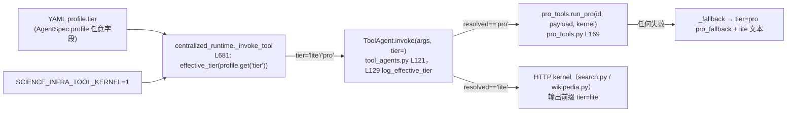
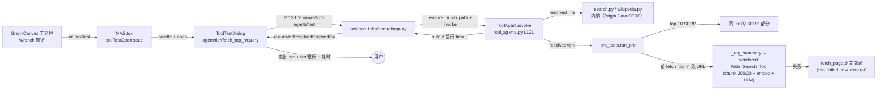

# ToolAgent lite/pro 划分与 UI 测试功能 · 设计文档

> 状态：设计稿（对应计划 `tool-agent_lite_pro_划分与_ui_测试_03a3568c` 的 Todo 1 交付物）。
> 本文只做设计，不含代码实现；行号引用均来自当前仓库实际代码（2026-10 快照）。
> 实施顺序：Todo 2（pro 重构）→ Todo 3（控制面 API）→ Todo 4（UI）→ Todo 5（测试与验证）。

---

## 目录

1. [背景与目标](#1-背景与目标)
2. [现状架构与 tier 传递链路](#2-现状架构与-tier-传递链路)
3. [现有 lite/pro 语义与现有测试契约](#3-现有-litepro-语义与现有测试契约)
4. [EPC-AW 参考实现逐个分析](#4-epc-aw-参考实现逐个分析)
5. [新 tier 契约（本次变更核心）](#5-新-tier-契约本次变更核心)
6. [UI 测试功能设计](#6-ui-测试功能设计)
7. [风险与边界](#7-风险与边界)
8. [变更清单（对应计划 Todo 2-5）](#8-变更清单对应计划-todo-2-5)
9. [附录：阅读代码时发现的与计划描述不符/需补充的事实](#9-附录阅读代码时发现的与计划描述不符需补充的事实)

---

## 1. 背景与目标

仓库的 MAS 工具层有五个 palette 工具 agent（`mas/tools/tool_agents.py:207` 的 `PALETTE_TOOL_IDS`：`wikipedia_search`、`google_search`、`web_fetch`、`python_coder`、`think`；另有别名 `web_search → web_fetch`、`execute_python → python_coder`，见 L216-219）。

**只有 `google_search` 与 `wikipedia_search` 存在有意义的 lite/pro 区分**——因为只有它们是"搜索"工具，存在"只拿 SERP 列表"还是"深入抓取页面内容"的取舍维度：

- `web_fetch`/`web_search`：语义是"打开恰好一个 URL"，pro 分支已是"原文 + query 相关句高亮"（`mas/tools/pro_tools.py:149` `_web_pro`），**本次不动**；
- `python_coder` / `think`：与检索无关，pro 只是给 lite 输出加 `tier=pro` 前缀透传（`mas/tools/pro_tools.py:178-188`），**本次不动**。

目标：

1. 重新定义 `google_search`/`wikipedia_search` 的 **pro = lite SERP 结果之上，对 top-N 条目 URL 做 web RAG**（抓取→chunk→embedding 排序→LLM 总结），复用 vendored `legacy/structagent` 的 `Web_Search_Tool`；
2. 新增控制面测试端点 `POST /api/mas/tool-agents/test`，让 UI 可以单独、即时地试跑某个 tool-agent 并观察 tier 解析结果；
3. UI（webui）新增「测试 Tool Agent」对话框（ToolTestDialog），从画布工具栏进入；
4. 同步更新契约测试：废弃「pro 也不打开页面」的旧断言，改为「pro 对 top-N URL 做 RAG、lite 仍零抓取」。

不做的事：不改 lite 内核（`mas/tools/search.py`、`mas/tools/wikipedia.py`）；不做端到端联调（另有测试代理）；不改计划文件。

---

## 2. 现状架构与 tier 传递链路

### 2.1 tier 解析链路（现状）



逐环节事实：

1. **YAML `profile.tier`**：`AgentSpec.profile` 是自由 dict（`mas/workflow/spec.py:76`）。当前模板 `mas/specs/templates/centralized.yaml` 的 tool agent（L27-39）**没有写 `tier` 字段**，`tool_yaml` 侧也未 grep 到 `tier:` 赋值——即现状所有 tool agent 配置层都是缺省 lite（`mas/tests/test_tool_tiers.py:43` `test_missing_template_tier_stays_lite` 锁定了这一点）。计划里说"YAML profile.tier"是指用户可在 YAML 的 `agents[].profile` 中写 `tier: pro`，经由 spec.py 的任意 profile dict 透传，没有专门的 schema 字段。

2. **`centralized_runtime._invoke_tool`**（`mas/workflow/centralized_runtime.py`）：
   - L265 `run_centralized_episode`，L279 `from tools.tool_agents import effective_tier, get_tool_agent, validate_tool_args`；
   - L678 `def _invoke_tool(aid, targs, prev_msg)`；L679-681 从 `compiled.agents.get(aid)` 取 node，`profile = getattr(node, "profile", ...) or {}`，`tier = effective_tier(profile.get("tier"))`；
   - L737 调 `ta.invoke(targs, tier=tier)`，L743 起 tool_result payload 带 `"tier": tier`。

3. **`effective_tier` / `log_effective_tier`**（`mas/tools/tool_agents.py:48` 与 L59）：`SCIENCE_INFRA_TOOL_KERNEL=1/true/yes` 强制返回 lite（L50）；仅当请求 "pro" 且开关未强制时返回 "pro"。`log_effective_tier` 每个 (tool, requested, resolved) 组合只 warning 一次（L73-83，`_logged_tier_mismatches` 去重），带结构化字段 `override_reason`。

4. **`ToolAgent.invoke`**（`mas/tools/tool_agents.py:121-144`）：L129 `resolved = log_effective_tier(self.id, tier)`；L131-134 resolved == pro 时 `from .pro_tools import run_pro; return run_pro(self.id, payload, self._kernel)`。**注意**：run_pro 失败的语义在 pro_tools 内部已经兜底（返回 `tier=pro pro_fallback\n<lite 文本>` 字符串），invoke 本身不 catch。

5. **user-space 工具**：`workflow/user_gateway/tools.py:38` 的 `UserToolAgent.invoke` 直接 `del prefer_llm, tier`——**tier 对用户自建工具无效**，本次 UI 的 tier 单选只应展示给 palette 内置的 google/wikipedia。

6. **pro 后端工厂与 vendored 导入**：`_epc_aw_llm_backend`（`mas/tools/tool_agents.py:158-205`）按工具 id 懒构造 vendored EPC-AW 工具闭包，但**当前 `invoke` 走 pro 时并未使用这些闭包**（pro_tools 是纯 HTTP kernel 强化，L9-10 注释明确说明不 import HIVE 工具类，因为它们缺 API key 时会 `sys.exit`）。vendored 导入靠 `_import_epc_aw_tool`（L27-46）的 dual sys.path 模式：先按 `legacy.structagent.*` 常规导入，ImportError 时把 repo root（`mas/` 的父目录）插入 `sys.path` 再重试一次，覆盖 `PYTHONPATH=mas` 单根进程。

### 2.2 lite 内核现状（不改动）

- **`google_search`**（`mas/tools/search.py:484`）：query → 最多 top-10 条 `(title, URL)`（`format_title_url` L473），顺序：`MAS_SEARCH_CACHE` 缓存（L495）→ Bright Data SERP API（L498，`_brightdata_enabled` L167，配置 L36-41）→ 本地 Bing/DDG 抓取（`search_organic` L435）→ Wikipedia 兜底（L505-508）。绝不打开结果页面。
- **`wikipedia_search`**（`mas/tools/wikipedia.py:46`）：MediaWiki API `list=search`（L70-78），返回 top-`_TOP_K`（L14，env `TIR_WIKI_TOP_K` 默认 10）条 title+URL；缓存三分支同 search.py。
- **`fetch_page`**（search.py L572）/ **`fetch_by_type`**（L601）：打开单个 URL 的正则化内核（web_fetch 用）。

---

## 3. 现有 lite/pro 语义与现有测试契约

### 3.1 现有 pro 语义（将被本次变更替换的部分）

`mas/tools/pro_tools.py` 顶级 docstring（L1-10）声明了当前契约："pro 只扩大召回（srlimit=10 / 10 results）但**从不打开页面**"。具体：

- `_wikipedia_pro`（L62）：自己再发一遍 MediaWiki 搜索（不经过 lite kernel），失败走 `_fallback`（L57，输出 `tier=pro pro_fallback\n<lite>`）；
- `_google_pro`（L114）：Bright Data SERP → `search_organic` 本地，返回 top-10 title+URL；
- `select_titles`（L31）：词项交集给 title 打分（`_terms` L27），目前只在测试里被断言，主流程未用于抓取；
- `_web_pro`（L149）：打开一个 URL + query 相关句高亮（`query_matches:` 段），**保持不变**。

### 3.2 现有测试契约（`mas/tests/test_tool_tiers.py`）

与搜索类 pro 直接相关的两条断言（**本次契约变更点**）：

- L80 `test_pro_wikipedia_title_url_only_never_opens_pages`：mock `requests.get`，断言 pro wiki 在 `api.php` 之外打开任何 URL 都算违规（L86 `raise AssertionError(f"pro wikipedia opened {url}")`）；
- L118 `test_pro_google_title_url_only_never_opens_pages`：patch `tools.search._request` 返回 DDG lite HTML，断言输出有 `tier=pro`、无 `pro_fallback`、无 `abstract:`。

这两条与"pro 不打开页面"的产品契约绑定。**契约变更声明**：

> 旧契约「search 工具在 lite 和 pro 两个 tier 下都不打开页面」废除其 pro 半边：
> **新契约下 pro 明确会打开 top-N 条目的页面做 web RAG**；lite 仍严格保持 title+URL、零页面抓取。
> 上述两条测试将改写为：mock `_rag_summary`，断言 pro 恰好对前 `fetch_top_n` 个 URL 调用 RAG、lite 路径 fetch 计数为 0（详见 §8 Todo 5）。

测试文件当前的其它相关事实：L16 `os.environ.setdefault("SCIENCE_INFRA_TOOL_KERNEL", "1")`（**默认强制 lite**，只有显式 temp 清除才测 pro 解析）；`test_pro_google_fallback_keeps_serp`（L129）与 `test_google_empty_query_and_offline_pro`（L206）测 `_fallback` 行为——这些保留，但要验证它们在 `_google_pro` 改造后不误抓页面导致 mock 越界失败。

---

## 4. EPC-AW 参考实现逐个分析

参考代码位于 `ref_Rep/EPC-AW/MAS/epc_aw/tools/`（EPC-AW 原仓库），vendored 版本位于 `legacy/structagent/epc_aw/tools/`（pro 将实际复用的那份，见 §4.4）。

### 4.1 `google_search/tool.py`：top-N 摘要抓取

- `_summarize_results`（L186）是 Bright Data 与本地后端共用的总结管线：
  - L196-200 过滤黑名单域名（hugging/openai/grok/gaia/bamboogle）；
  - **L203 `GOOGLE_SEARCH_MAX_ABSTRACT_PAGES` env 默认 3**——对 organic 结果的**前 3 个** URL，调用 `self.web_rag_tool.execute(url=url, query=query)` 抓摘要（L207），失败时该条目 `abstract` 记为 `[abstract_fetch_failed] <err>`（L208-209）；
  - 之后把带 abstract 的 JSON（截断 24000 字符，L214-215）交给 LLM 总结（prompt L219-272），要求引用格式 `[index](url)`，再在末尾追加完整 Citations 段（L286-296）。
- **重要细节：仅本地后端抓摘要**（L202 `if raw_result.get("backend") != "brightdata_serp"`），Bright Data 结果自带 snippet，不抓页面。
- 对新契约的启示：fetch_top_n 默认 3 正是对齐这里；RAG 失败逐条降级（记 `[fetch_failed]`），不让单条失败炸掉整个结果。

### 4.2 `wikipedia_search/tool.py`：LLM 相关性筛选 + RAG

- 管线（`execute_single` L300）：
  1. `search_wikipedia`（L169）：`wikipedia.search` 取 top 页面（`max_pages=10`），每页取 `page.content` 截断到 `max_length=100` 字符做 abstract（L193-199）；
  2. **LLM 相关性筛选**：`select_relevant_queries`（L41）把 10 个 title 编号列表 + 原查询喂给 LLM（prompt L43-101，few-shot 给出 `Matched Query IDs` 输出格式），正则提取 `matched_query_ids`（L118-123），异常时返回空列表（L125-127）→ 相关页 + other_pages 两组（L327-333）；
  3. 对**筛选后的相关页**逐个调用 `Web_Search_Tool.execute(query, url)`，填充 `page["retrieved_information"]`（L351-354，异常置 None）；
  4. 返回 dict：`relevant_pages (to the query)` / `other_pages (may be irrelevant to the query)`。
- **复刻 `select_relevant_queries` 风格但注意条件**：vendored 版同样在无 `OPENAI_API_KEY` 时 `sys.exit`（L305-308）——这正是 pro 实现中"只实例化工具、只在真正有 key 时调用"并在外层 catch 一切异常回退的原因（见 §5.4 与 §7.1）。

### 4.3 `wikipedia_search/web_rag.py`：旧版独立 RAG 简版（仅参考）

这是早期抽取式 RAG：固定 chunk 200/20（L）、embedding **text-embedding-3-large**（L108）、抓取不截断（`max_window_size=1000000`）、纯 LLM 总结（无 PDF/browser 流）。作为"chunk+embedding 排序+LLM 总结"这个最小闭环的样板即可，正式实现不采用。

### 4.4 `Web_Search_Tool` 完整 RAG 流水线（pro 的核心复用单元）

`ref_Rep/EPC-AW/MAS/epc_aw/tools/web_search/tool.py` 与 vendored `legacy/structagent/epc_aw/tools/web_search/tool.py` 同源；pro 实际复用 **vendored 版**（`tool_agents._import_epc_aw_tool("epc_aw.tools.web_search.tool", "Web_Search_Tool")`）。vendored 版相对 ref_Rep 版的差异：多进程代理支持（L26-28 `proxy_util.ensure_process_proxy_env / get_requests_proxies`，requests 与 playwright 请求都带上代理，L208-228）、playwright browser flow 带代理 launch（L551-562）。

vendored 版关键参数与流水线：

| 环节 | 位置（vendored tool.py） | 参数/行为 |
| --- | --- | --- |
| chunk | L146 `chunk_size = 200`、L147 `chunk_overlap = 20`（`_chunk_website_content` L586：按词滑窗） | 词级 chunk，200 词窗口、20 词重叠 |
| 抓取 | `_get_website_content` L174 | **先截断到 `max_len=1000` 字符再进 RAG**（L177-182 min(1000)）——这个 hard cap 是文档要点，见下 |
| 抓取降级链 | L174-280 | HEAD 探测 content-type → PDF 流（`_pdf_flow` L497，PyPDF2 取前 6 页找 Abstract）→ requests HTML → 403/captcha/cloudflare 时若 playwright 可用走 `_browser_flow` L541；HTML 内的 meta description / 嵌入 JSON abstract（`__PRELOADED_STATE__`、`__NEXT_DATA__`、JSON-LD）/ 站点专用选择器（ScienceDirect、ACM、Springer、IEEE、arXiv）/ 段落 TF-cosine 抽取式摘要，逐级兜底 |
| embedding | L150-152 | `EMBEDDING_MODEL_NAME` env 默认 **text-embedding-3-small**；`EMBEDDING_MODEL_API_KEY`（回退 `OPENAI_API_KEY`）；`EMBEDDING_MODEL_URL` 可选 base_url；`_embed_strings` L607-621 用 `openai.OpenAI(api_key=..., base_url=...)` |
| 排序 | `_rank_chunks` L632 | 余弦相似度（`_cosine_similarity` L627，numpy），取 top_k=10（L148） |
| 总结 | `_construct_final_output` L652 | SUMMARIZE_PROMPT_TEMPLATE（L71-105）：只依据引用 chunk、单段自然语言回答 |
| 入口 | `execute(query, url)` L664 | 全链路 try/except，最后 `Error processing request: <e>` |

**重要修正事实**：vendored `Web_Search_Tool` 的 `_get_website_content`（L174）有内置 `max_len=1000` 的 hard cap（L177-182：`max_len = min(max_len, 1000)`）。也就是说 `execute` 的 chunk+embedding 实际是对**已截到 ≤1000 字符的页面提取文本**做的，并非整页 100 万字符。对新实现的影响：`_rag_summary` 无需自行截断页面；默认 1000 字符窗口对"摘要级信息"已足够，且快、稳、省 embedding 配额。若未来要完整大页 RAG，需调大 `max_len` 或绕过该 helper——本次不做。

另外注意：实例化该工具会连带 `create_llm_engine`（`legacy/structagent/epc_aw/engine/factory.py:4` → `engine/openai.py` 的 `ChatOpenAI`），其 base_url 默认链（openai.py L109-115）最终回退 **`https://www.dmxapi.cn/v1/`**、api_key 回退 `"dummy"`（L116-121），并使用 `trust_env=False` 的 httpx client（L155-161）。`Web_Search_Tool.__init__` 传入的 `model_string` 决定总结 LLM（embedding/LLM 端点兼容性见 §7.1）。

---

## 5. 新 tier 契约（本次变更核心）

### 5.1 语义定义

| 工具 | lite（不变） | pro（新） |
| --- | --- | --- |
| `google_search` | top-10 (title, URL)，Bright Data SERP 优先，绝不打开页面 | 同 lite 的 top-10 列表 **+ `retrieved_information:` 分节**：对前 `fetch_top_n` 条 URL 逐条 `_rag_summary`（web RAG 摘要） |
| `wikipedia_search` | top-10 (title, URL)，绝不打开页面 | 同上 |
| `web_fetch` / `web_search` | url → 页面正文提取（不变） | 原文 + query 相关句高亮（不变，`_web_pro` L149 保持原样） |
| `python_coder` / `think` | kernel / 直通（不变） | `tier=pro` 前缀透传（不变，pro_tools.py L178-188） |

`google_search`/`wikipedia_search` 是仅有的两个 `has_tiers=true` 工具；palette 其余条目 UI 固定 lite 且禁选 pro。

### 5.2 `fetch_top_n` 配置链

- **args schema**：`TOOL_AGENT_ARGS_SCHEMAS`（`mas/tools/tool_agents.py:221`，其中 `wikipedia_search`/`google_search` 定义在 L223-224）两条均增加可选 `fetch_top_n`：`{"type": "integer", "minimum": 1, "maximum": 10}`，不进 required（lite 调用不带它也合法；`validate_tool_args` L352 走 `workflow.protocol.validate_json_schema` 现有通道即可，无需新校验器）。
- **取值优先级**（pro_tools 内部）：`args.fetch_top_n` → env `MAS_PRO_FETCH_N` → 默认 3，即 `int(payload.get("fetch_top_n") or os.getenv("MAS_PRO_FETCH_N", "3"))`，并 clamp 到 [1, 10] 防御越界。
- **profile 注入**：`centralized_runtime._invoke_tool` 在 tier==pro、调 `ta.invoke(targs, tier=tier)`（L737）之前加 `targs.setdefault("fetch_top_n", profile.get("pro_fetch_n") or 3)`——工作流 YAML 可在 agent 的 `profile.pro_fetch_n` 配置每次 rollout 的默认抓取条数，args 显式值优先于 setdefault。
- **默认 3 的出处**：对齐 EPC-AW `GOOGLE_SEARCH_MAX_ABSTRACT_PAGES=3`（§4.1），也是成本/延迟的稳妥起点。

### 5.3 pro 输出格式

保持现有 `tier=pro` 首行约定（测试 `text.startswith("tier=pro")` 惯例、`centralized_runtime` L681/L743 把 tier 写进 tool_result payload 的行为均不变），在前 10 条 SERP 列表之后追加 RAG 分节，命名对齐 ref_Rep 的 `retrieved_information`：

```text
tier=pro
google_search results for: <query>
1. <title>
   URL: <url>
2. ...

retrieved_information:
[1] URL: <url>
    rag: <_rag_summary 的输出，多行保持缩进>
[3] URL: <url>
    rag: [rag_failed] <原因>（单条失败不中断整体）
...
```

约定：

- `[i]` 序号对应 SERP 列表条目序号，只罗列真实尝试过 RAG 的前 `fetch_top_n` 条；
- 单条 `_rag_summary` 失败 → 该条写 `[rag_failed] <原因>` 并继续下一条（对齐 EPC-AW google 的 `abstract_fetch_failed` 逐条降级，§4.1）；
- SERP 本身失败 → 现有 `_fallback`（pro_tools.py L57）行为不变：`tier=pro pro_fallback` + lite 文本——搜索都拿不到就没有可 RAG 的 URL，短路是正确语义。

### 5.4 `_rag_summary` 设计（Todo 2 核心函数）

新函数在 `mas/tools/pro_tools.py`，签名 `_rag_summary(query: str, url: str) -> str`：

1. **懒加载 + 单例缓存** vendored `Web_Search_Tool`：模块级 `_RAG_TOOL = None`；首次调用经 `_import_epc_aw_tool("epc_aw.tools.web_search.tool", "Web_Search_Tool")`（直接复用 `tool_agents.py:27` 的 dual-syspath 导入器，pro_tools 内 `from .tool_agents import _import_epc_aw_tool`）构造 `Web_Search_Tool(model_string=_model_name())`。`_model_name` 在 tool_agents.py L147-155（读 `MODEL_Name`/`OPENAI_MODEL`/`SCIENCE_INFRA_MODEL`，默认 "Qwen3-4B"），一并 import 复用。**单例的理由**：`__init__` 每次都构造 ChatOpenAI 与 embedding client（并打初始化日志），rollout 高频调用必须复用；且单例状态放在 pro_tools 侧而不放 tool_agents（`test_legacy_isolation` 会 reload tool_agents 并做属性快照恢复，pro_tools 不在其 reload 范围，风险最小，见 §7.3）。
2. **异常回退**：任何一步（导入 ImportError、实例化、execute 异常——vendored execute 已自带 try/except，把异常吞成 `Error processing request: ...` 串）失败时，回退 `from .search import fetch_page`（search.py L572）抓原文前 ~800 字符摘录，标 `[rag_failed, raw_excerpt]`。**契约：`_rag_summary` 永不 raise**，最坏返回带标记的降级文本；顶层 `run_pro` 的既有 try/except（L186-189）是最后防线。
3. **不做 LLM 相关性筛选**（与 EPC-AW wikipedia 的有意差异，§4.2）：本次直接对 SERP top-N 逐条 RAG，不引入 `select_relevant_queries`——那会引入第二个 LLM 依赖点（无 `OPENAI_API_KEY` 时 vendored wikipedia tool 直接 `sys.exit`，见其 tool.py L305-308），且"挑哪几条深入"应由 planner 拿到列表后自行决定（后续可 `web_fetch` 单页）。若将来要加，作为独立开关实现。

---

## 6. UI 测试功能设计

### 6.1 端点契约：`POST /api/mas/tool-agents/test`

加在 `science_infra/control/app.py`（沿用现有风格：模块顶部 pydantic Body 模型 + `create_app` 内处理函数；参照 palette 端点 L282-284、sample-data 端点 L424-436 的写法）。实现要点：先 `services._ensure_tir_on_path()`（services.py L46-49，把 tir_agent root 即 `mas/` 加入 sys.path），再从 `tools.tool_agents` 拿 `TOOL_AGENTS` 调用。

**请求**（body，pydantic 模型）：

| 字段 | 必填 | 说明 |
| --- | --- | --- |
| `agent_id` | 是 | palette `tool_agents[].id`；未知值 → HTTP 400 |
| `tier` | 否，默认 `"lite"` | `"lite" \| "pro"` |
| `args` | 是 | dict，按对应 agent 的 args_schema 校验（复用 `validate_tool_args`，tool_agents.py L352）→ 不合法 HTTP 400 |
| `fetch_top_n` | 否 | int 1-10；存在时并入 `args.fetch_top_n`（合并后取值优先级同 §5.2），越界 clamp |

**响应**（HTTP 200）：

| 字段 | 说明 |
| --- | --- |
| `requested_tier` | 请求的 tier 原样回显（缺省补 "lite"） |
| `resolved_tier` | 从 invoke 返回串首行 `tier=<x>` 解析（前缀约定见 tool_agents.py L133-144）。**`pro_fallback` 也解析为 pro**——回退是 pro 内部降级，tier 仍是 pro，回退信息在 output 文本里可见；解析不到前缀（异常路径）→ `resolved_tier: null`、`ok: false` |
| `output` | invoke 完整输出串；异常时为错误消息 |
| `elapsed_ms` | invoke 前后计时的毫秒整数 |
| `ok` | invoke 未抛异常且输出非空 |

错误语义：invoke 抛异常 → `ok=false`、HTTP 仍 **200**（试跑端点，"试跑失败"是合法结果）；只有请求级错误（未知 agent / args 不合法）才 400。

**同步执行**：一次请求 = 一次真实搜索（pro 含 top-N 抓页 + RAG），可能 10-60s。不做后台任务化（不进 PROPS），FastAPI sync handler 自带线程池；前端有 loading 态即可（§6.4）。后续嫌慢再改后台+SSE（记为后续项，不在本次范围）。

### 6.2 palette 扩展：`mas_palette`（services.py L663；tool_agents 组装 L698-719）

每个 `tool_agents[]` 条目（现 L708-714 为 `id/backend/llm_required/description`）新增：

- 仅 `google_search`、`wikipedia_search`：`"has_tiers": True, "tiers": ["lite", "pro"], "default_fetch_n": int(os.getenv("MAS_PRO_FETCH_N", "3"))`（与 pro_tools 同源默认）；
- 其余（`web_fetch`、`python_coder`、`think`）：`"has_tiers": False`（`tiers`/`default_fetch_n` 可省略）；
- **兜底分支同步**：L716-719 的 except 硬编码分支也按同样白名单输出这三字段（静态判断 google/wikipedia），避免 services 导入降级时 UI 拿不到结构。

### 6.3 前端类型与 API

- `webui/src/shared/api/types.ts`：`Palette` 接口的 `tool_agents` 条目类型（L274-279）追加 `has_tiers?: boolean; tiers?: string[]; default_fetch_n?: number;`。
- `webui/src/features/mas/api.ts`：`masApi` 新增 `toolAgentTest(body: ToolAgentTestRequest)` → `request<ToolAgentTestResponse>('/api/mas/tool-agents/test', { method: 'POST', body: JSON.stringify(body) })`；两个 interface 定义并 export。

### 6.4 `ToolTestDialog.tsx`（新组件）

新建 `webui/src/features/mas/components/ToolTestDialog.tsx`，整体仿 `EvalDialog.tsx`（L1-100）的 radix AlertDialog 范式（`AlertDialog.Root/Portal/Overlay/Content/Title/Description/Cancel` + `dialog-actions`、`InlineNotice` 错误提示、`Button loading=pending`）：

| 部件 | 设计 |
| --- | --- |
| agent 下拉 | 数据源为已加载的 `palette.tool_agents`（MAS.tsx L159 已把 `draft.palette` 传给 MasGraphEditor；同一 palette prop 传给对话框，不在对话框内重复请求） |
| tier 单选 | lite / pro；仅 `has_tiers=true` 的 agent 可选，否则固定 lite 且单选组禁用置灰 |
| `fetch_top_n` 数字输入 | **仅 tier=pro 时渲染**；min=1 / max=10，初值 `default_fetch_n ?? 3`；发送时作为请求顶层字段（非 args 内） |
| query/args 输入 | 按所选 agent 的最小 schema 渲染：google/wikipedia → 单 `query` 文本框；web_fetch/web_search → `url` 文本框；python_coder → `code` 多行框；think → `text` 多行框。required 不满足时运行按钮禁用 |
| 运行按钮 | pending 态 loading，调 `masApi.toolAgentTest` |
| 输出区 | `<pre>` 全文 `output`；顶行两个徽标：**resolved_tier**（lite 灰 / pro 紫）与 **耗时 elapsed_ms**；`requested_tier !== resolved_tier` 时追加一行 InlineNotice（不猜原因，只展示不一致，用户可自查 `SCIENCE_INFRA_TOOL_KERNEL`） |

### 6.5 GraphCanvas / MasGraphEditor / MAS.tsx 接线

- `GraphCanvas.tsx`：`Props`（L20-36，现含 `onDebug/debugOpen/onFlowDoc/flowDocOpen`）加 `onToolTest: () => void;`；主工具栏（L99-115 渲染的 `mas-canvas-primary-toolbar` 组）第三组里、FlaskConical（L107-108）旁新增 `Wrench` 图标按钮（`lucide-react`，L6 import 追加 `Wrench`），label「测试 Tool Agent」，回调对齐 `onDebug` 的接线方式。
- `MasGraphEditor.tsx`：`Props`（L32-58）加 `onToolTest: () => void;`，在 `<GraphCanvas ...>`（L399-401）透传。纯透传、无本地状态（现有 `onDebug/onFlowDoc` 同通道）。
- `MAS.tsx`：新 state `const [toolTestOpen, setToolTestOpen] = useState(false)`；回调对齐 L87-91 的 openDebug/toggleFlowDoc 模式；在 L160-172 的 `<MasGraphEditor ...>` 上补 `onToolTest={...}`；在 L173 WorkflowDebug 同级渲染 `<ToolTestDialog open={toolTestOpen && workflowVisible} onOpenChange={setToolTestOpen} palette={draft.palette} />`。

### 6.6 数据流图



---

## 7. 风险与边界

### 7.1 embedding / LLM 端点兼容性（最大运行时风险）

- vendored `Web_Search_Tool._embed_strings`（L607-621）用 `openai.OpenAI(api_key=self.embeddings_model_api_key, base_url=self.embeddings_model_url)` 直连；`EMBEDDING_MODEL_URL` 默认 **None**（即 api.openai.com），本部署环境没有官方 OpenAI key——**必须设置** `EMBEDDING_MODEL_URL`（dmxapi 的 OpenAI 兼容端点）与 `EMBEDDING_MODEL_API_KEY`；embedding 模型名默认 `text-embedding-3-small`（L150，走 `EMBEDDING_MODEL_NAME`）。dmxapi 对该 embedding 模型的实际可用性需部署时验证——这是计划里点名的风险。
- **兜底链完整**：`_embed_strings` 失败 raise（L609-621 `Error embedding strings`）→ `execute` 最外层 catch（L690-693）→ 我们的 `_rag_summary` 再 catch → `fetch_page` 原文摘录（§5.4）。embedding 不可用的最坏结果是"pro 退化为原文摘录版"，不会让 rollout 崩溃。
- 总结 LLM：`Web_Search_Tool(model_string=_model_name())` 默认拿 `MODEL_Name`（回退 "Qwen3-4B"），该模型必须在 ChatOpenAI 的 base_url 上可用（engine/openai.py L109-115，默认 `https://www.dmxapi.cn/v1/`）。ChatOpenAI 带重试装饰（`@retry(wait=wait_exponential(min=1,max=5), stop=stop_after_attempt(5))`，L168 起），单条 RAG 最坏耗时受此放大——`fetch_top_n` clamp 在 1-10 的一个原因就是控制这条成本曲线。
- UI 同步端点要承受上述重试叠加：`fetch_top_n=3` 最坏可能分钟级。前端 loading 文案要设定预期；后续嫌慢可改后台任务+SSE（后续项）。

### 7.2 `SCIENCE_INFRA_TOOL_KERNEL=1` 强制 lite

- `effective_tier`（tool_agents.py L48-53）语义**保持不变**：开关开着时一切 pro 请求解析为 lite，且**不应发生任何页面抓取/LLM 调用**（新 pro 路径必须在 resolved=lite 时完全不可达）。RL 训练的 kernel-only 模式依赖这一点（test_tool_tiers.py L16 默认 setdefault "1"）。
- `log_effective_tier`（L59-83）的降级结构化日志 每个 (tool, mismatch) 只发一次，改造不影响。
- UI 端点必须把 `requested != resolved` 如实返回（§6.1），对话框直接可见"请求 pro、实际 lite"。
- 已有测试 `test_lite_invoke_prefixes_every_agent`（L166）在 kernel=1 下断言 google 的 `invoke(args, tier="pro")` 输出 `tier=lite`——tier 解算发生在 invoke 头部（L129）、未达 run_pro，与本次改动正交，应继续成立。

### 7.3 legacy syspath 隔离（test_legacy_isolation.py 语义不能破坏）

`mas/tests/test_legacy_isolation.py` 锁定三条语义：

1. **双栈同进程导入顺序无关**（L50-67）：产品栈（workflow/tools）先导、vendored bootstrap 先导，模块身份互不污染；
2. **模块身份**（L100-110）：`sys.modules["MAS"].__path__` 唯一指向 `legacy/structagent`；
3. **缺失可选依赖**（`TestMissingOptionalDependency` L112-200）：把 legacy 相关 path/module 摘光后产品栈必须照常工作；pro 后端闭包调用时抛显式 ImportError（L152-166 断言 `_import_epc_aw_tool` 的 ImportError 语义，而非崩溃）。

对新设计的**硬约束**：

- `_rag_summary` 的 vendored 加载**必须**沿用 `_import_epc_aw_tool`（ImportError → 回退 fetch_page），**绝不能**在 `pro_tools.py` 模块顶层 import `legacy.*`——顶层 import 会让"legacy 移除"场景在 import 期炸掉，破坏 L112 起整个测试类的语义。pro_tools 的相关 import 保持函数内 late-import（现状 `_wikipedia_pro` L69、`_google_pro` L119、`_web_pro` L154 已是此风格）。
- `TestMissingOptionalDependency` 末尾对 `tools.tool_agents` 做属性快照 + reload + 恢复（L186-197），该测试对 tool_agents 的模块级状态敏感——RAG 单例缓存放 pro_tools（该测试不 reload pro_tools），见 §5.4。

### 7.4 契约回归面（改测试时的护栏）

- 改写两条旧断言测试（L80、L118）时，其余测试必须保持绿：
  - `test_pro_google_fallback_keeps_serp`（L129，mock `_request` 全失败）：新实现下 SERP 失败先短路、无 URL 可 RAG，fallback 输出不变；
  - `test_google_empty_query_and_offline_pro`（L206）：空 query / offline 短路发生在 RAG 之前，行为不变；
  - `test_web_pro_highlights_query_matches`（L235）：`_web_pro` 不动；
  - `test_pro_python_does_not_call_hive_backend`（L137）：python_coder 分支不动；
  - 新 RAG 只发生在 `resolved==pro` 且 SERP 成功之后——上述 mock 均不会触及。
- 新端点冒烟测试（Todo 5）：并入 `test_stage10_control_ui.py` 风格文件；mock kernel/`_rag_summary`（不发真实网络），断言 `requested_tier/resolved_tier/output/elapsed_ms/ok` 字段契约与 kernel=1 强制 lite 的解析。真实网络端到端留给后续测试代理。

---

## 8. 变更清单（对应计划 Todo 2-5）

### Todo 2 — pro_tools 重构（核心）

| 文件 | 改动点 |
| --- | --- |
| `mas/tools/pro_tools.py` | ① 新增 `_rag_summary(query, url)`（§5.4：懒加载单例 vendored `Web_Search_Tool`、复用 `_import_epc_aw_tool`、永不 raise、失败回退 `fetch_page` 摘录）；② 新增 `_fetch_top_n(payload)` helper（args → env `MAS_PRO_FETCH_N` → 3，clamp 1-10）；③ `_google_pro`（L114）：保留 SERP 部分，成功后按 `fetch_top_n` 追加 `retrieved_information:` 分节（§5.3 格式）；④ `_wikipedia_pro`（L62）：同 ③；⑤ **修改顶部 docstring 契约描述**（L1-10 现为 "Pro ... NEVER opens a page"，要更新为新契约）；⑥ `run_pro`（L169）签名不变 |
| `mas/tools/tool_agents.py` | `TOOL_AGENT_ARGS_SCHEMAS`（L221）的 `wikipedia_search`/`google_search`（L223-224）加可选 `fetch_top_n`（integer 1-10）；`_DESCRIPTIONS`（L280 起）中两个搜索工具的描述措辞更新（pro 会打开 top-N 页面做摘要） |

### Todo 3 — tier 注入 + 控制面 API

| 文件 | 改动点 |
| --- | --- |
| `mas/workflow/centralized_runtime.py` | `_invoke_tool`（L678；invoke 点 L737）：tier==pro 时 `targs.setdefault("fetch_top_n", profile.get("pro_fetch_n") or 3)`（user_space backend 分支 L683-709 不涉及） |
| `science_infra/control/app.py` | 新增 pydantic 请求模型（agent_id/tier/args/fetch_top_n 可选）与 `POST /api/mas/tool-agents/test` 处理函数（§6.1 契约：validate → invoke → resolved_tier 首行解析 → elapsed_ms → 响应） |
| `science_infra/control/services.py` | `mas_palette`（L663）tool_agents 组装（L698-719）：条目加 `has_tiers`/`tiers`/`default_fetch_n`（白名单 google/wikipedia；except 兜底分支同步加字段）；如端点逻辑放 services 则加对应函数（`_ensure_tir_on_path` L46 已具备，无需新 path 逻辑） |

### Todo 4 — UI

| 文件 | 改动点 |
| --- | --- |
| `webui/src/shared/api/types.ts` | `Palette.tool_agents` 条目（L274-279）加 `has_tiers?/tiers?/default_fetch_n?` 可选字段 |
| `webui/src/features/mas/api.ts` | 新增 `ToolAgentTestRequest/ToolAgentTestResponse` interface + `masApi.toolAgentTest(body)`（POST `/api/mas/tool-agents/test`） |
| `webui/src/features/mas/components/ToolTestDialog.tsx` | **新建**（§6.4 全部交互；仿 EvalDialog 范式） |
| `webui/src/features/mas/components/GraphCanvas.tsx` | `Props`（L20-36）加 `onToolTest`；lucide import（L6）加 `Wrench`；主工具栏（L99-115）第三组加按钮 |
| `webui/src/features/mas/components/MasGraphEditor.tsx` | `Props`（L32-58）加 `onToolTest`；`<GraphCanvas>`（L399-401）透传 |
| `webui/src/pages/MAS.tsx` | state `toolTestOpen`；回调（对齐 L87-91 模式）；`<MasGraphEditor>`（L160-172）传 `onToolTest`；WorkflowDebug 同级（L173 附近）渲染 `<ToolTestDialog>` |

### Todo 5 — 测试与验证

| 文件 | 改动点 |
| --- | --- |
| `mas/tests/test_tool_tiers.py` | **改写** L80 `test_pro_wikipedia_title_url_only_never_opens_pages` 与 L118 `test_pro_google_title_url_only_never_opens_pages`：名称与断言改为新契约——patch `pro_tools._rag_summary`，断言 pro 对**恰好前 fetch_top_n 个 URL** 调用 RAG、lite 路径 fetch 计数为 0、SERP 部分仍 title+URL；覆盖默认 fetch_top_n=3 与 `fetch_top_n=1` 边界各一条 |
| `mas/tests/`（test_stage10_control_ui.py 风格或新文件） | 新端点冒烟：mock kernel/`_rag_summary`，断言 `{requested_tier, resolved_tier, output, elapsed_ms, ok}` 契约；`SCIENCE_INFRA_TOOL_KERNEL=1` 下请求 pro → resolved=lite |
| `webui` | `cd webui && npm run build` 通过（types/api/dialog/editor/canvas/mas 六处改动无 TS 错误） |
| （后续）真实联调 | lite/pro × {google, wikipedia} × fetch_top_n=1/3 手动验证 resolved tier 徽标与 RAG 输出——**本代理不做**，留给测试代理 |

---

## 9. 附录：阅读代码时发现的与计划描述不符或需补充的事实

1. **`web_search` 与 `web_fetch` 的关系**：计划称两者一个 "page content extraction" 一个 "combined"——实际 `web_search` 只是 `web_fetch` 的别名（`tool_agents.py` L216-219 `_LEGACY_TOOL_ALIASES`），且注册循环（L302-328）把 `web_search` 也注册成独立条目（L308），二者指向同一 kernel（`fetch_by_type`）。UI 的 agent 下拉会出现两条，行为相同。
2. **「YAML profile.tier」当前无人使用**：仓库所有 YAML 模板（`mas/specs/templates/*.yaml`，含 centralized.yaml L27-39 的 tool 节点）都没有 tier 字段；`AgentSpec.profile`（spec.py L76）是自由 dict，tier 是"可写但当前没人写"的透传字段。`test_missing_template_tier_stays_lite`（test_tool_tiers.py L43）锁定的就是缺省 lite 现状。
3. **ref_Rep google 的 top-3 摘要有后端前提**：仅当后端**不是** Bright Data 时才抓页（ref google tool L202 `if raw_result.get("backend") != "brightdata_serp"`），Bright Data 结果自带 snippet 不抓。我们的新 pro 不分后端一律抓（Bright Data SERP 也没有正文可用），这是有意偏离，已在 §5 声明。
4. **vendored `Web_Search_Tool` 有 `max_len=1000` hard cap**（L174-182）：chunk+embedding 作用于截断后的 ≤1000 字符文本，并非"整页 RAG"（详见 §4.4 修正事实）。ref_Rep 的 `wikipedia_search/web_rag.py` 是另一版无截断但用 `text-embedding-3-large`（L108 附近）的旧简版——两版参数不要混记。
5. **vendored 与 ref_Rep 的 web_search/tool.py 不完全相同**：vendored 版多了进程代理支持（`proxy_util.ensure_process_proxy_env/get_requests_proxies`，vendored L26-28、L208-228、L551-562），其余同构。pro 必须复用 vendored 版（`legacy.structagent.` 前缀由 `_import_epc_aw_tool` 保证），别误 import ref_Rep 的。
6. **`pro_fallback` 不是独立 tier**：invoke 返回的回退串首行是 `tier=pro pro_fallback`（pro_tools.py L57-58），解析 `resolved_tier` 时按首行 `tier=` 之后的 token（`pro`）解析、丢弃 ` pro_fallback` 标记；lite 回退同理（lite 路径返回 `tier=lite`，kernel 关开关的降级在 `effective_tier` 就已发生）。
7. **`_epc_aw_llm_backend`（L158-205）当前在 pro 链路未被使用**：`run_pro` 是纯 HTTP 强化（pro_tools L9-10 注释明确不 import HIVE 工具类），`invoke` 也从不消费 `self._llm_invoke`（L121-144 的 pro 分支直接走 run_pro）。计划中"pro 后端工厂"的表述容易误导——这些闭包只是注册在 ToolAgent 上的元数据；本次改造也不启用它们，RAG 单元直接走 `_import_epc_aw_tool`。
8. **UI 接线行号核对**：GraphCanvas 工具栏按钮组在 `mas-canvas-primary-toolbar` Panel（GraphCanvas.tsx L99-115），第三组已有 FlaskConical（L107-108）/BookOpen（L112-114）两按钮，Wrench 加在该组；MasGraphEditor 透传点 L399-401；`mas_palette` 的 tool_agents 组装在 services.py L698-719（计划写 "约 L698"——一致）。
9. **`effective_tier` 的大小写与取值细节**：只认小写化后的 `"pro"`（L52），kernel 开关只接受 `1/true/yes`（L50，不含 `"on"`；而 Bright Data 的开关判定（search.py L167）含 `"on"`——两处不同源）。端点实现 tier 归一化时照抄 `effective_tier` 的语义，别把 `"on"` 混进 kernel 开关。
10. **`wikipedia_search` 的 `_epc_aw_llm_backend` 闭包存在但同样未被 pro 消费**（L168-173）；`select_titles`（pro_tools L31）目前只是工具函数，仅测试（test_tool_tiers.py L95）在用——新设计不依赖它，留作未来 LLM 相关性筛选的挂点。
